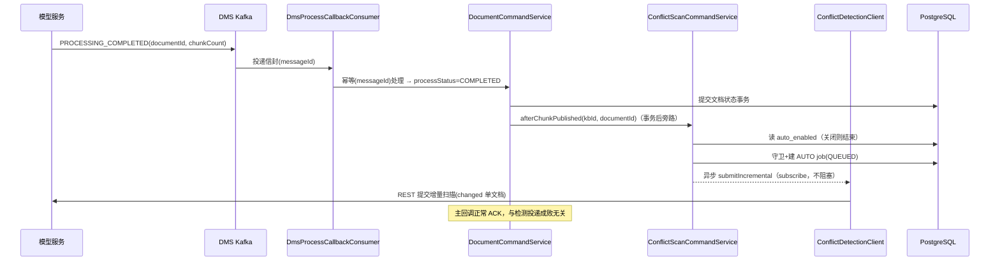
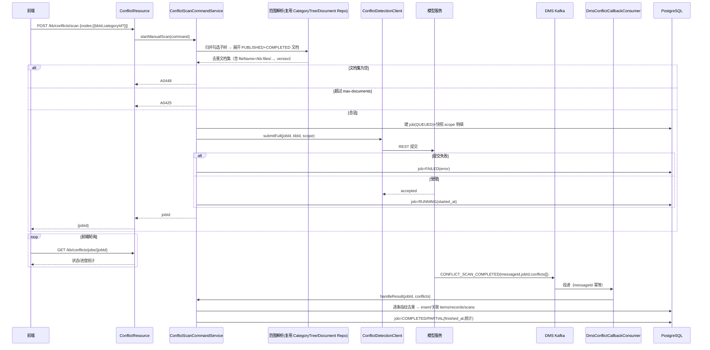

# 冲突检测模块设计

## 功能设计说明书

海思知识库架构设计 - 知识库冲突检测模块（手动 / 自动扫描、冲突管理、Badcase 提报）

### 修订记录

| 日期         | 修订版本 | 修改描述 | 作者 |
|------------|---------|---------|------|
| 2026-10-15 | 0.1 | 初稿 | AI 协作 |
| 2026-10-15 | 0.2 | 明确分期边界：立即检测 / 自动检测均保留模型对接链路（本期桩实现占位）；Badcase 工单系统后续另行设计，本期保留提报入口与本地落库 + 对接端口 | AI 协作 |

### Keywords 关键词

> 冲突检测、事实冲突、语义冲突、版本冲突、跨模态冲突、近重复冲突、冲突批次、增量扫描、LLM 判定、PROCESSING_COMPLETED 回调、Badcase 工单、指纹去重

### Abstract 摘要

> 在知识库内检测并管理文档间内容冲突（事实 / 语义 / 版本 / 跨模态 / 近重复五类），支持手动选定知识库或文件夹范围的全量扫描、文档切片就绪后的自动增量扫描，以及冲突查看、Badcase 工单提报。
>
> **关键边界**：平台后端（本仓库）**不具备冲突判定算法**，五类冲突的识别是 LLM 推理任务，由模型服务（HaiSI RAG Server）新增能力承担。平台负责：扫描范围解析、任务编排与限流、判定结果落库、冲突生命周期与工单管理、前端查询接口。平台与模型之间沿用现有混合通道——**大 payload 扫描命令走 REST（rest-client），判定结果走 DMS Kafka 回调**（与现有切片处理 `PROCESSING_COMPLETED` 回调同一套幂等 / 路由机制）。
>
> **分期落地边界（务必先读）**：以下两个外部能力**当前都不存在**，但对接链路本期**必须保留、不得删减**，平台侧先以桩 / 本地实现占位并联开发，能力就绪后只换实现、不改业务代码：
> 1. **模型冲突判定接口**（立即检测的全量提交 + 自动检测的增量提交，走 §6 契约）：本期 `ConflictDetectionClient` 端口、REST 提交（`ModelConflictApi`）、Kafka 三类回调消费、job 状态机**全部照建**；模型未就绪期间由可切换的桩实现接收提交（job 落 RUNNING/可 mock 回调），联调时切到真实 rest-client。
> 2. **Badcase 工单系统**：**本期没有独立工单功能，后续会另行设计**。但【提交 Badcase 工单】入口、`conflict_badcase_tickets` 本地落库、`BadcaseTicketClient` 对接端口**本期保留**；先由 `LocalBadcaseTicketClient` 本地存"描述 + 提交人 + 状态"并回工单号，未来工单系统设计完成后新增远程实现替换即可。

---

## 1 背景与需求映射

### 1.1 需求来源

`docs/知识库冲突检测模块需求文档.md`：冲突检测列表页、开始冲突监测弹窗（范围树）、冲突详情弹窗、提交 Badcase 工单弹窗、自动检测开关与交互规则。

### 1.2 需求 → 后端能力映射

| 需求点 | 后端能力 |
|--------|---------|
| 自动冲突检测开关（全局，开启耗 token） | `conflict_settings` 单行全局开关；开启后在切片就绪回调后异步投递增量检测 |
| 立即检测（选知识库 / 文件夹，全量扫描切片） | 解析勾选节点 → 展开为已发布且切片就绪的文档集 → 建批次任务 → 提交模型异步判定 |
| 冲突列表（主题 / 类型 / 起止时间 / 是否 badcase / 提交人 + 多维筛选） | `conflict_records` 分页查询（keyword / type / badcaseSubmitted） |
| 冲突详情（批次、起止、片段卡片、位置、原文、基准版本、处理记录） | `conflict_record_items`（证据快照）+ `conflict_resolutions` 聚合查询 |
| 提交 Badcase 工单（问题描述必填） | `conflict_badcase_tickets` 落库 + 端口预留外部 Badcase 系统对接 |
| 五类冲突 | `ConflictType` 枚举，模型回传，平台落库（未知值兜底，见 §3.3） |

### 1.3 三个必须先讲清的现状约束

| # | 现状（代码事实） | 对设计的影响 |
|---|------------------|--------------|
| 1 | `llm` 模块通过 rest-client 调模型服务，现有 `ModelServiceClient` 仅有对话 / 临时文件 / KG；`commons-dict` 的 `DocumentChunkClient` 仅能按文件名取切片。**全仓无任何冲突判定能力** | 冲突判定是**模型服务需新增的能力**（当前不存在，排期见 §13）。但立即检测 / 自动检测两条对接链路**本期照建、不删减**：端口 + REST 契约 + Kafka 回调消费 + job 状态机全部落地，模型未就绪时以**可切换桩实现**占位（见 §6.0），平台只做编排与管理 |
| 2 | 文档可检索 = `status=PUBLISHED` 且 `processStatus=COMPLETED`（`DocumentPO` 双重正交状态）；切片由模型在 `DOCUMENT_PUBLISHED` 后生成，完成后经 DMS Kafka 回调 `PROCESSING_COMPLETED`（`DmsProcessCallbackConsumer`） | ① 只有 **PUBLISHED + COMPLETED** 的文档有切片、可参与检测；② 自动检测的正确触发点是 **COMPLETED 回调成功之后**，而非上传 / 审批时刻 |
| 3 | 全仓搜索无 Badcase 模块 / 表 / 接口 | **本期没有 Badcase 工单功能，后续会另行设计**。但【提交 Badcase 工单】入口本期保留：先在本地 `conflict_badcase_tickets` 落库，经 `BadcaseTicketClient` 端口隔离（`LocalBadcaseTicketClient` 占位）；未来工单系统设计完成后新增远程实现替换，业务代码不变（见 §3.7） |

---

## 2 方案概述与不做什么

### 2.1 职责划分

```mermaid
flowchart LR
    FE["前端<br/>(列表页 / 三个弹窗)"]

    subgraph KB["knowledge 模块（本仓库）"]
        Res["ConflictResource<br/>(Facade)"]
        ScanCmd["ConflictScanCommandService"]
        RecCmd["ConflictRecordCommandService"]
        Q["Conflict(Query)Service<br/>(CQRS 查询侧)"]
        Expire["ConflictExpiryJob"]
        Consumer["DmsProcessCallbackConsumer<br/>(冲突分支)"]
    end

    subgraph Shared["commons-dict（共享端口/DTO）"]
        Port["ConflictDetectionClient"]
    end

    subgraph LLM["llm 模块"]
        Impl["ConflictDetectionClientImpl"]
        Api["ModelConflictApi (rest-client)"]
    end

    subgraph Model["HaiSI RAG Server（需新增能力）"]
        Judge["冲突判定引擎<br/>(5 类, LLM)"]
    end

    subgraph DB[("PostgreSQL")]
        Jobs[("conflict_scan_jobs")]
        Recs[("conflict_records")]
        Items[("conflict_record_items")]
        ResT[("conflict_resolutions")]
        Tk[("conflict_badcase_tickets")]
        Set[("conflict_settings")]
    end

    subgraph Kafka["DMS Kafka"]
        CB[("回调 topic")]
    end

    FE -->|"REST"| Res
    Res --> ScanCmd
    Res --> RecCmd
    Res --> Q
    ScanCmd --> Port
    Port -.impl.-> Impl --> Api -->|"REST 提交扫描命令(大 payload)"| Judge
    Judge -->|"CONFLICT_SCAN_* 结果回调"| CB --> Consumer
    Consumer --> ScanCmd
    ScanCmd --> Jobs
    ScanCmd --> Recs
    ScanCmd --> Items
    RecCmd --> Recs
    RecCmd --> ResT
    RecCmd --> Tk
    Q --> DB
    Expire --> Recs
    ScanCmd --> Set
```

### 2.2 本期明确不做（YAGNI）

- **平台不自研任何冲突判定 / 相似度算法**（无 LLM、无向量计算，均归模型服务）。
- 不做冲突的在线实时阻断（不在文档发布链路上阻塞等待判定结果；判定全部异步）。
- 不做冲突的人工合并 / 文档内容在线修订（处理动作仅"标记已解决 / 已忽略 + 备注"，改文档走既有文档编辑链路）。
- 不做 RESOLVED / IGNORED 的"重新打开"（需求未要求；复发由指纹策略新建记录，见 §3.4）。
- 不做复杂工单流转（指派 / 流转 / 闭环），**独立 Badcase 工单系统本期不存在、后续另行设计**；但【提交 Badcase 工单】入口与本地落库本期保留（§3.7）。
- 不在本期等待模型判定能力上线：立即检测 / 自动检测的**模型对接链路（提交 + 回调 + 状态机）照常建设**，模型未就绪期用桩实现占位（§6.0），而非砍掉对接或改成纯手工数据。
- 不新增范围树接口：开始监测弹窗的知识库 / 文件夹树**复用现有 `NavTreeQueryService`**（懒加载 + 关键字搜索，见后端架构设计导航树），后端零新增。

---

## 3 核心设计决策

### 3.1 只有"已发布且切片就绪"的文档参与检测

扫描范围展开时，对勾选的 KB / 文件夹做子树归并，取其下 `status='PUBLISHED' AND process_status='COMPLETED'` 的文档。

- DRAFT / REVIEWING 文档尚无已发布切片，不纳入（需求语义即"知识片段"）。
- ARCHIVED / DEPRECATED 不纳入活跃扫描（归档切片已从活跃索引移除）。
- 范围归一化后为空（没有任何可检测文档）→ `A0448`，不创建任务。

### 3.2 手动全量 vs 自动增量

| 维度 | 手动扫描（立即检测） | 自动扫描（开关开启） |
|------|---------------------|----------------------|
| 触发 | 用户在弹窗勾选 KB / 文件夹 | 文档发布且模型回调 `PROCESSING_COMPLETED` 后 |
| 模式 | `FULL`：scope = 勾选子树下全部可检测文档 | `INCREMENTAL`：changed = 本次就绪的单文档，模型以其为"新片段"在同 collection 内比对（候选近邻召回由模型侧向量检索完成，平台不做算法） |
| 范围上限 | 受 `kb.conflict.scan.max-documents`（默认 2000）限制，超限 `A0425` | 单文档，天然小 |
| 任务记录 | 建 job，`trigger_type=MANUAL` | 建 job，`trigger_type=AUTO`（同样可在批次维度追溯） |
| 失败影响 | 仅本任务失败 | **绝不影响文档发布主链路**：事务提交后异步投递，投递失败仅记 job=FAILED + 告警日志 |

> 自动检测开关默认**关闭**（成本考量，弹窗也明示"消耗大量 token"）。开关状态持久化在 DB（用户页面切换），`application.yml` 仅提供出厂默认值。

### 3.3 五类冲突的枚举与模型返回兜底

`ConflictType`：`FACT`（事实）/ `SEMANTIC`（语义）/ `VERSION`（版本）/ `CROSS_MODAL`（跨模态）/ `NEAR_DUPLICATE`（近重复）。

- 平台以枚举落库、筛选、展示标签色；前端按类型出标签（事实=红，其余配色前端定）。
- 模型须遵守契约回传五值之一；平台对未知值做 **fail-safe 兜底**：落库 `type=SEMANTIC` 且在 `raw_type` 保留原始字符串，不因此丢弃整条冲突（不能因模型枚举漂移让整批结果报废）。
- `CROSS_MODAL`（图文 / 图表跨模态）成立的前提是模型具备多模态判定；平台不判断能否支持，只透传类型与证据，能力由模型侧决定（§12 风险）。

### 3.4 重复扫描的指纹去重（防列表膨胀）

每次扫描都可能再次发现同一冲突，不加控制会让列表随扫描次数线性膨胀。引入**冲突指纹 `fingerprint`**：

```
fingerprint = sha256( type || '|' || 排序后的参与文档ID集合 || '|' || 归一化主题 )
```

- 参与文档 ID 集合：证据 `evidence` 中去重后的 `document_id` 排序拼接。
- 归一化主题：trim + 小写 + 压缩空白；模型也可直接回传 `fingerprint_hint`，平台优先用自算值（平台掌握权威 documentId）。
- 落库前按 `(kb_id, fingerprint)` 查活跃记录：

| 命中记录状态 | 处理 |
|--------------|------|
| `PENDING` | **不新建**；关联到当前 job（`conflict_record_scans` 多对多，记录"被哪些批次再次命中"），刷新 `last_seen_job_id` / `last_seen_at` |
| `RESOLVED` / `IGNORED` | 视为**复发**，新建一条 PENDING（原处理记录保留，详情可见复发历史） |
| `EXPIRED` / 无命中 | 新建 PENDING |

> 关联表 `conflict_record_scans(record_id, job_id, seen_at)` 解决 record 与 job 的多对多（一条冲突可被多个批次命中；一个批次产生多条冲突）。列表展示的"检测开始 / 结束时间"取**首次发现该冲突的 job**时间（冗余在 record 上，见 §7.2）。

### 3.5 冲突证据采用快照，不实时关联文档

冲突片段卡片要求展示"文档名称 + 版本 + 发布状态 + 位置 + 原文 + 更新时间"。这些内容若实时 join 文档，会在文档被覆盖修订 / 删除 / 归档后失真（系统存在版本覆盖、outbox 旧周期 CANCELLED 机制）。

故模型回调落库时，将每条证据**快照**写入 `conflict_record_items`（文档名 / 版本 / 当时发布状态 / 定位 / 原文摘录 / 片段更新时间 / 是否基准），同时保留 `document_id` 供前端跳转当前文档。

- 文档事后变更 / 删除 **不级联影响**冲突记录（冲突是某一时刻的事实判定，证据须固化）。
- "基准版本标记"直接取模型回传 `is_baseline`（模型判定哪份文档是基准）；平台不自行推断。

### 3.6 定位信息能给到什么粒度

模型 chunk 元数据（`DocChunk.DocChunkMetadata`）现有：`chunk_index` / `page_numbers` / `titles`（章节路径）/ `chunk_type`，**没有"行号"**。

- 平台落库：章节路径（titles 拼接，如"第 9 章 UART 接口 > 9.5 电气特性"）、页码、chunk_index。
- 需求示例中的"行 4"依赖模型在证据中回传 `line_hint`（可选）；模型不提供则前端不展示行段，**平台不臆造行号**。已在模型契约中标注该字段可选（§6.3）。

### 3.7 Badcase 工单：提报入口保留 + 本地落库 + 端口隔离

> **分期说明**：Badcase 工单系统（独立的工单管理 / 流转 / 闭环）**本期不做、后续另行设计**。但冲突详情里的【提交 Badcase 工单】动作、字段校验、提交人 / 时间 / 状态回写**本期保留并可用**——数据先落在本地 `conflict_badcase_tickets`，对外经端口隔离；等工单系统设计落地后，新增远程实现把本地单据同步 / 推送到正式系统即可，前端与 `ConflictRecordCommandService` 均无感。

- 一条冲突**最多一张工单**：提交后 `conflict_records.badcase_status=SUBMITTED`、`badcase_ticket_id`、`badcase_submitted_by`、`badcase_submitted_at` 落值；重复提交 → `A0447`（列表"是否提交"一次性翻为"是"）。
- `conflict_badcase_tickets` 存 `description`（必填，1~1000 字）、提交人、状态 `SUBMITTED`、来源冲突快照（record_id / topic / type）。
- 定义端口 `BadcaseTicketClient`（`knowledge.domain.service`）：本期提供 `LocalBadcaseTicketClient`（仅本地落库、直接返回工单号）；未来外部【Badcase 管理】就绪，新增 `RemoteBadcaseTicketClient`（rest-client）替换，`ConflictRecordCommandService` 不变。

---

## 4 自动检测的触发链路

### 4.1 挂载点

现有回调链路：模型 → DMS Kafka → `DmsProcessCallbackConsumer` → `DocumentCommandService` 处理 `PROCESSING_COMPLETED`（文档 `processStatus=COMPLETED`、回写 chunkCount / processedAt）。

在该处理**成功完成、事务提交之后**，挂一个非阻塞的自动检测钩子：

1. 读 `conflict_settings.auto_enabled`（单行全局，缓存，见 §9）。关闭 → 直接返回。
2. 守卫：该 KB 是否已有该文档的 QUEUED/RUNNING 自动任务（防抖，避免同文档短时间重复入队）；超过每 KB 自动任务并发上限 `kb.conflict.auto.max-concurrency-per-kb`（默认 2）→ 跳过并记日志（本次不排队，下次该文档更新仍会触发）。
3. 建 `conflict_scan_jobs`（trigger=AUTO，mode=INCREMENTAL，范围=单文档），事务提交。
4. 事务后异步（Mutiny `.subscribe()`）调 `ConflictDetectionClient.submitIncremental(...)`；提交失败 → job=FAILED + `error`，**不回滚文档发布**、不向主链路抛错。

> 用 Mutiny 异步 + 独立事务，保证"冲突检测"是发布后的旁路动作，不增加发布回调 RT、不改变发布成败语义。

### 4.2 自动检测时序



---

## 5 手动检测时序与任务状态机

### 5.1 任务状态机（conflict_scan_jobs.status）

```
QUEUED ──提交模型成功──> RUNNING ──┬─ 全部证据落库成功 ─> COMPLETED
                                   ├─ 部分文档失败      ─> PARTIAL
                                   ├─ 提交/判定失败     ─> FAILED
                                   └─ 用户中止(可选)    ─> ABORTED
```

- QUEUED：范围已解析落库，等待 / 正在提交模型。
- RUNNING：模型已受理开始扫描（`started_at`）。
- COMPLETED / PARTIAL / FAILED：终态，写 `finished_at`、统计（文档数 / 切片数 / 新增冲突数 / 命中既有数 / 失败数）、`error`。
- 同一范围同时只允许一个 QUEUED/RUNNING 的 **MANUAL** 任务（指纹为范围归一化集合 hash），重复点击 → `A0449`（防 token 浪费；AUTO 不在此限，走 §4.1 独立守卫）。

### 5.2 手动检测时序



### 5.3 结果回调

- 走 **DMS Kafka 回调 topic**，新增事件类型 `CONFLICT_SCAN_COMPLETED` / `CONFLICT_SCAN_PARTIAL` / `CONFLICT_SCAN_FAILED`，由 `DmsProcessCallbackConsumer` 统一消费并按 `eventType` 分流到冲突分支（Kafka 入站通道只允许一个下游消费者，独立 consumer 类会导致启动失败；冲突分支失败吞异常、永远 ACK，不改文档路由逻辑）。
- 幂等：复用 `kb_callback_processed`（messageId 去重主键），同一结果重复投递只处理一次。
- 落库为**一个事务**：job 终态 + 全部 record / item / scan 关联同生共死；部分证据解析失败不影响其余（逐条 try，失败计入 `failed_items`，job 落 PARTIAL）。
- 回调找不到 job（jobId 不存在）：记 warn + ack 丢弃（不无限重试毒消息）；model 返回的结构非法：job=FAILED + `error`，ack（避免重放毒消息打爆）。

---

## 6 模型服务契约（外部依赖，需模型团队实现）

> 平台提交走向为 **REST**（scope 可能含上千文档，不宜塞 Kafka 消息体）；结果走向为 **Kafka 回调**（复用现有通道与幂等）。以下为**建议契约**，最终以与模型团队联调确认为准（§12）。

### 6.0 模型未就绪期的桩实现（立即检测 / 自动检测都保留对接）

模型冲突判定接口当前不存在，但**立即检测（FULL）与自动检测（INCREMENTAL）两条提交链路本期都要保留并可端到端走通**，做法是端口先行、实现可切换：

- 端口 `ConflictDetectionClient`（`submitFull` / `submitIncremental`）与回调 DTO 照契约定义，业务代码（`ConflictScanCommandService`、自动钩子）只依赖端口，**不因模型缺失而裁剪任何一条链路**。
- 通过配置 `kb.conflict.model.client-mode` 选择实现：
  - `remote`（目标态）：`llm` 模块 `ConflictDetectionClientImpl` → `ModelConflictApi` rest-client 真实提交。
  - `stub`（**本期默认**，模型未就绪）：`StubConflictDetectionClient` 接收提交后只做受理应答（job 置 RUNNING、回写 `started_at`），不真正判定；结果侧提供两种联调手段——①按固定 mock 结果（配置 / 资源文件）投递 Kafka 回调，验证指纹去重 / 落库 / 状态机；②提供内部手工触发回调的联调入口（仅 dev/test profile 注册）。
- 切换到真实模型时仅改配置 + 落 `remote` 实现，**扫描编排、job 状态机、自动触发钩子、回调消费、落库逻辑零改动**。
- 桩模式下同样遵守 token / 并发守卫与失败语义（不发真实请求、不耗 token），前端轮询、列表、详情、Badcase 提报可全链路并联开发。

### 6.1 REST：提交全量扫描

`POST {model.base-path}/conflict/scan/submit`（由 `ModelConflictApi` rest-client 声明）

```json
{
  "job_id": "CHK-20260930-0001",
  "kb_id": "<知识库ID，即模型 collection_name>",
  "trigger_type": "MANUAL",
  "mode": "FULL",
  "conflict_types": ["FACT", "SEMANTIC", "VERSION", "CROSS_MODAL", "NEAR_DUPLICATE"],
  "scope": [
    {
      "document_id": "uuid",
      "file_name": "/kb-files/谛听用户手册 v2.1.pdf",
      "current_version": "v2.1"
    }
  ]
}
```

- `file_name` 与现有 `DocumentChunkQueryService` 同一拼法：`kb.documents.chunk-file-path-prefix`（默认 `/kb-files/`）+ 文档相对 `filePath`（去首位 `/`）。
- `conflict_types` 空 / 省略 = 全类型。
- 受理返回 202 + `{ "accepted": true }`；模型不可用 / 非 2xx → 由 rest-client 抛 `ModelServiceException`（C0001），平台置 job=FAILED。

### 6.2 REST：提交增量扫描（自动检测）

同端点，`mode=INCREMENTAL`，`scope` 仅含 changed 单文档（或用 `changed` 字段单列，模型以该文档新增切片在同 collection 内检索比对）：

```json
{
  "job_id": "CHK-...", "kb_id": "...", "trigger_type": "AUTO", "mode": "INCREMENTAL",
  "changed": { "document_id": "uuid", "file_name": "/kb-files/x.pdf", "current_version": "v2.1" }
}
```

### 6.3 Kafka 回调：判定结果

信封沿用现有 DMS 回调外层，`eventType` 新增三值；payload：

```json
{
  "job_id": "CHK-20260930-0001",
  "kb_id": "...",
  "status": "COMPLETED",
  "error": null,
  "stats": { "scanned_documents": 2, "scanned_chunks": 134 },
  "conflicts": [
    {
      "topic": "UART 波特率上限参数不一致",
      "type": "FACT",
      "severity": "HIGH",
      "summary": "用户手册称最高 921600bps，数据手册称最高 3Mbps，二者矛盾。",
      "baseline_document_id": "uuid-1",
      "evidence": [
        {
          "document_id": "uuid-1",
          "chunk_index": 213,
          "page_numbers": [88],
          "titles": ["第 9 章 UART 接口", "9.5 电气特性"],
          "line_hint": 4,
          "excerpt": "支持波特率 9600 ~ 921600 bps",
          "is_baseline": true,
          "chunk_updated_at": "2026-09-20T15:10:00"
        },
        {
          "document_id": "uuid-2",
          "chunk_index": 74,
          "page_numbers": [31],
          "titles": ["4.2 串行接口参数"],
          "line_hint": 7,
          "excerpt": "UART 最高支持 3Mbps",
          "is_baseline": false,
          "chunk_updated_at": "2026-08-15T10:00:00"
        }
      ]
    }
  ]
}
```

字段约定：

| 字段 | 必填 | 说明 |
|------|------|------|
| `topic` | 是 | 冲突主题（列表主列） |
| `type` | 是 | 五选一；未知平台兜底 SEMANTIC + raw_type |
| `severity` | 否 | HIGH/MEDIUM/LOW，展示与排序用，缺省 MEDIUM |
| `summary` | 否 | 判定理由（详情展示） |
| `evidence[]` | 是，≥2 | 冲突至少两个位置；单条证据无法构成"冲突"，<2 整条丢弃并计入 failed_items |
| `evidence.document_id` | 是 | 平台据此取文档名 / 版本快照、算指纹 |
| `titles` / `page_numbers` / `chunk_index` | 否 | 定位三元组，尽量给 |
| `line_hint` | 否 | 行号，模型无能力则省略（平台不臆造，§3.6） |
| `excerpt` | 是 | 冲突原文片段 |
| `is_baseline` | 否 | 是否基准版本；多条中至多一条 true |
| `chunk_updated_at` | 否 | 缺失时平台用文档 `updated_at` 兜底快照 |

> 跨文档证据必须能映射到平台 `document_id`。模型侧文件名 → document_id 的映射若拿不到，退而用 `file_name`，平台按 `(kb_id, file_path)` 反查 document_id；反查不到的证据整条跳过并计数。`document_id` 直传为首选。

---

## 7 数据模型

> 遵循 `quarkus规范.md`：PO 在 `infrastructure.po`（贫血 JPA Entity，不继承 `PanacheEntity`）；仓储接口在 `domain.repository` 返回 `Uni`，实现注入 `PanacheRepositoryBase`；领域对象纯 POJO，无 `jakarta.persistence`；MapStruct 转换；ID 用值对象包装。迁移脚本 `docs/sql/migration_019_conflict_detection.sql`，并同步 `docs/sql/init.sql`。

### 7.1 conflict_scan_jobs（检测批次 / 任务）

| 列 | 类型 | 说明 |
|----|------|------|
| `id` | varchar PK | 任务 ID（值对象 `ConflictScanJobId`） |
| `batch_no` | varchar | 批次号，展示用 `CHK-yyyyMMdd-NN`（日内序号，唯一） |
| `kb_id` | varchar | 知识库（增量单 KB；手动也可跨 KB，见下注） |
| `trigger_type` | varchar | `MANUAL` / `AUTO` |
| `mode` | varchar | `FULL` / `INCREMENTAL` |
| `scope_nodes` | json | 勾选节点快照 `[{kbId,categoryId?}]`（手动）；增量为单文档定位 |
| `scope_fingerprint` | varchar NULL | 范围归一化文档集 hash（MANUAL 并发守卫用） |
| `status` | varchar | QUEUED/RUNNING/COMPLETED/PARTIAL/FAILED/ABORTED |
| `total_documents` | int | 范围内文档数 |
| `scanned_chunks` | int | 回调回传切片数（默认 0） |
| `new_conflict_count` | int | 本次新建冲突数 |
| `hit_conflict_count` | int | 命中既有 PENDING 数 |
| `failed_items` | int | 失败证据 / 失败文档数 |
| `error` | varchar NULL | 失败原因 |
| `started_at` | timestamp NULL | 检测开始时间（模型受理） |
| `finished_at` | timestamp NULL | 检测结束时间（终态） |
| `created_by` | varchar | MANUAL=操作人；AUTO=SYSTEM |
| `created_at` / `updated_at` | timestamp | |

> 手动范围树允许跨 KB 勾选时，`kb_id` 置空、`scope_nodes` 记录多 KB；本期判定按 KB（collection）隔离提交——跨 KB 范围在应用层**按 KB 拆成多个模型提交、归并到同一 job**（stats 累加，回调按 jobId 聚合）。一期前端可约束单次提交同 KB（默认选中【谛听】即单 KB），表结构保留跨 KB 能力。

索引：`idx_jobs_status_created(status, created_at)`、`uk_jobs_batch_no(batch_no)`、`idx_jobs_scope_fp(scope_fingerprint)`（部分索引，仅 QUEUED/RUNNING 参与守卫）。

### 7.2 conflict_records（冲突记录 —— 聚合根）

| 列 | 类型 | 说明 |
|----|------|------|
| `id` | varchar PK | `ConflictRecordId` |
| `kb_id` | varchar | 所属知识库 |
| `first_job_id` | varchar | 首次发现批次（列表起止时间取该 job） |
| `last_seen_job_id` | varchar | 最近一次命中批次 |
| `fingerprint` | varchar | 见 §3.4 |
| `topic` | varchar | 冲突主题（keyword 检索列） |
| `type` | varchar | ConflictType 五值 |
| `raw_type` | varchar NULL | 模型原始类型（兜底时留存） |
| `severity` | varchar | HIGH/MEDIUM/LOW（缺省 MEDIUM） |
| `summary` | text NULL | 判定理由 |
| `status` | varchar | 已废弃（原 PENDING/RESOLVED/IGNORED/EXPIRED，需求简化后删除） |
| `location_count` | int | 冲突位置数（证据数，顶部"N 位置"） |
| `scope_label` | varchar | 范围标签（如"跨文档多处"，按证据文档数生成） |
| `detected_started_at` | timestamp | 冗余首次 job 的 started_at（列表列） |
| `detected_finished_at` | timestamp | 冗余首次 job 的 finished_at（列表列） |
| `last_seen_at` | timestamp | 最近命中时间 |
| `expired_at` | timestamp NULL | 过期时间（=创建 + TTL，过期 job 用） |
| `badcase_status` | varchar | NONE/SUBMITTED（默认 NONE） |
| `badcase_ticket_id` | varchar NULL | 关联工单号 |
| `badcase_submitted_by` | varchar NULL | 提交人（列表"提交人"，无=NULL 前端显"无"） |
| `badcase_submitted_at` | timestamp NULL | |
| `created_at` / `updated_at` | timestamp | |

索引：`uk_records_kb_fp_active(kb_id, fingerprint)`（**部分唯一索引**，仅对 `status IN ('PENDING')` 生效，数据库层兜底并发去重）、`idx_records_status_type(status, type)`、`idx_records_topic(topic)`（或 pg_trgm 模糊，见 §7.7）、`idx_records_expire(status, expired_at)`。

### 7.3 conflict_record_items（冲突证据片段快照）

| 列 | 类型 | 说明 |
|----|------|------|
| `id` | varchar PK | |
| `record_id` | varchar | 所属冲突 |
| `document_id` | varchar NULL | 来源文档（供跳转；快照失效时可空） |
| `doc_name_snapshot` | varchar | 文档名快照 |
| `version_snapshot` | varchar NULL | 版本快照（取 current_version / published_version） |
| `publish_status_snapshot` | varchar | 快照时发布状态（已发布等） |
| `chunk_index` | int NULL | |
| `page_numbers` | json NULL | 页码数组 |
| `titles_path` | varchar NULL | 章节路径快照（titles 用 ` > ` 拼接） |
| `line_hint` | int NULL | 行号（模型可选回传） |
| `excerpt` | text | 冲突原文 |
| `is_baseline` | boolean | 是否基准版本（默认 false） |
| `chunk_updated_at` | timestamp NULL | 片段更新时间快照 |
| `sort_no` | int | 证据展示顺序（基准置前） |
| `created_at` | timestamp | |

索引：`idx_items_record(record_id, sort_no)`。

### 7.4 conflict_resolutions（处理记录）

| 列 | 类型 | 说明 |
|----|------|------|
| `id` | varchar PK | |
| `record_id` | varchar | 所属冲突 |
| `action` | varchar | RESOLVED / IGNORED |
| `remark` | varchar(1000) | 处理备注（必填，1~1000，接口层校验） |
| `handled_by` | varchar | 处理人 |
| `handled_by_name` | varchar NULL | 处理人显示名（冗余，避免跨系统 join 用户） |
| `handled_at` | timestamp | |

索引：`idx_resolutions_record(record_id, handled_at)`。

### 7.5 conflict_badcase_tickets（Badcase 工单）

| 列 | 类型 | 说明 |
|----|------|------|
| `id` | varchar PK | 工单号（本地生成，如 `BC-yyyyMMdd-xxxx`） |
| `record_id` | varchar | 来源冲突（唯一，一冲突一工单） |
| `kb_id` | varchar | |
| `topic_snapshot` | varchar | 冲突主题快照 |
| `type_snapshot` | varchar | 冲突类型快照 |
| `description` | varchar(1000) | 问题描述（必填） |
| `status` | varchar | SUBMITTED（本地）；对接外部后可扩展 ACCEPTED/CLOSED |
| `external_ref` | varchar NULL | 外部 Badcase 系统单号（远程实现回填） |
| `submitted_by` | varchar | 提交人 |
| `created_at` | timestamp | |

约束：`uk_tickets_record(record_id)`。

### 7.6 conflict_settings（开关设置）

| 列 | 类型 | 说明 |
|----|------|------|
| `id` | varchar PK | 本期固定常量 `GLOBAL` |
| `kb_id` | varchar NULL | 预留 KB 级开关；本期全局行为 NULL |
| `auto_enabled` | boolean | 自动冲突检测开关（默认 false） |
| `updated_by` | varchar NULL | |
| `updated_at` | timestamp | |

> 表结构预留 `kb_id` 以便将来下钻到 KB 级开关；一期只读写 `GLOBAL` 行（启动时若不存在按 `kb.conflict.auto-detection.enabled-default` 播种）。

### 7.7 conflict_record_scans（冲突-批次多对多）

| 列 | 类型 | 说明 |
|----|------|------|
| `id` | varchar PK | |
| `record_id` / `job_id` | varchar | |
| `seen_at` | timestamp | 命中时间 |

约束：`uk_record_scan(record_id, job_id)`。

> keyword 搜索"搜索冲突..."：对 `topic` 做包含匹配。数据量小可直接 `ILIKE '%kw%'`；若后续 record 量级达十万级，再迁 `pg_trgm` GIN 索引，不在本期预设复杂度。

### 7.8 领域对象与枚举

- 聚合根 `ConflictRecord`（`domain.entity`，纯 POJO）：持有 items / resolution 行为，封装状态流转守卫（`resolve()` / `ignore()` / `expire()`）、badcase 一次性提交守卫（`submitBadcase()`）、复发判定。
- 聚合根 `ConflictScanJob`：封装 QUEUED→RUNNING→终态机、stats 累加、并发守卫判定。
- 实体 `ConflictRecordItem`、`ConflictResolution`；值对象 `ConflictRecordId`、`ConflictScanJobId`、`ConflictFingerprint`。
- 枚举：`ConflictType`、`ConflictStatus`、`ConflictSeverity`、`ScanTriggerType`、`ScanMode`、`ScanJobStatus`、`BadcaseStatus`。
- 领域服务 `ConflictFingerprintService`（指纹计算，纯函数）、`ConflictScopeResolver`（多聚合 / 子树归并，可作 domain.service；若仅查询编排也可放应用层，实现时按纯度定）。

---

## 8 分层与包结构（对齐 quarkus规范.md）

沿用 knowledge 模块现有扁平包组织（不新开业务大子包，类名以 Conflict 前缀隔离）：

| 层 | 包 | 主要类 |
|----|----|--------|
| Facade | `knowledge.facade` | `ConflictResource`（冲突 / 设置 / 扫描 / 处理 / 工单 REST） |
| Command | `knowledge.command` | `ConflictScanCommandService`（发起、回调落库、自动触发）、`ConflictRecordCommandService`（状态流转、工单）；record：`StartConflictScanCommand`、`ResolveConflictCommand`、`IgnoreConflictCommand`、`SubmitConflictBadcaseCommand`、`UpdateAutoDetectionCommand`、`ScanScopeNode` |
| Domain 实体 | `knowledge.domain.entity` | `ConflictRecord`、`ConflictScanJob`、`ConflictRecordItem`、`ConflictResolution`、枚举与 ID 值对象 |
| Domain 事件 | `knowledge.domain.event` | `KnowledgeEvent.EventType` 扩展 `CONFLICT_SCAN_REQUESTED`（仅当平台→模型也走 Kafka 时使用；本期提交走 REST，预留） |
| Domain 仓储 | `knowledge.domain.repository` | `ConflictScanJobRepository`、`ConflictRecordRepository`、`ConflictResolutionRepository`、`ConflictBadcaseTicketRepository`、`ConflictSettingsRepository`（均返回 `Uni`） |
| Domain 服务 / 端口 | `knowledge.domain.service` | `BadcaseTicketClient`（端口）、`ConflictDetectionPort`（可选，若不直接依赖 commons-dict） |
| Infrastructure PO | `knowledge.infrastructure.po` | `ConflictScanJobPO`、`ConflictRecordPO`、`ConflictRecordItemPO`、`ConflictResolutionPO`、`ConflictBadcaseTicketPO`、`ConflictSettingsPO`、`ConflictRecordScanPO` |
| Infrastructure 仓储 | `knowledge.infrastructure.repository` | 各 `*RepositoryImpl` + `*PanacheRepository`（`PanacheRepositoryBase`） |
| Infrastructure Mapper | `knowledge.infrastructure.mapper` | `ConflictScanJobMapper`、`ConflictRecordMapper`、`ConflictRecordItemMapper` 等（MapStruct） |
| Infrastructure 消息 | `knowledge.infrastructure.messaging` | `DmsProcessCallbackConsumer`（唯一 `@Incoming`，按 `eventType` 分流 `PROCESSING_*` / `CONFLICT_SCAN_*`；`kb.messaging.kafka.enabled=true` 时注册） |
| Infrastructure 端口实现 | `knowledge.infrastructure.service` | `LocalBadcaseTicketClient`（本期默认 `@IfBuildProperty`/默认 CDI） |
| Infrastructure Job | `knowledge.infrastructure.job` | `ConflictExpiryJob`（PENDING 超时过期） |
| Query（CQRS） | `knowledge.query` | `ConflictQueryService`（列表 / 详情）、`ConflictScanQueryService`（任务进度）；DTO：`ConflictListItem`、`ConflictDetailDTO`、`ConflictEvidenceDTO`、`ConflictResolutionDTO`、`ConflictJobProgress`、`AutoDetectionStatusDTO` |

共享端口与模型契约 DTO（跨模块解耦，同 `DocumentChunkClient` 模式）：

| 模块 | 类 |
|------|----|
| `commons-dict`（`commons.dict.chat` 或新建 `commons.dict.conflict`） | `ConflictDetectionClient`（端口：`submitFull` / `submitIncremental`）、`ConflictScanSubmitRequest`、`ConflictTypeCode`、`ModelConflictResult` / `ModelConflictEvidence`（回调反序列化 record，`@JsonIgnoreProperties(ignoreUnknown=true)` 防模型字段漂移） |
| `llm`（`infrastructure.service`） | `ModelConflictApi`（`@RegisterRestClient` 接口）、`ConflictDetectionClientImpl`（`client-mode=remote` 时生效，失败统一 C0001，同 `DocumentChunkClientImpl`） |
| 桩实现（模型未就绪期，`knowledge.infrastructure.service` 或 `llm` 测试装配） | `StubConflictDetectionClient`（`client-mode=stub` 时默认，受理提交 + 可选 mock 回调，见 §6.0） |

依赖方向：`knowledge` 与 `llm` 互不依赖，经 `commons-dict` 端口 + DTO 解耦（架构文档 §3.14）。

事务约定（规范）：

- 写库在应用服务方法标事务（官方 skill 优先：以项目当前 Hibernate Reactive 官方 skill 推荐注解为准；历史写法 `@WithTransaction`，冲突时按规范 §3 以 skill 为准）。
- 查询侧 `@WithSession`；领域层零事务 / 零 JPA 注解。
- Command record 加 `@RegisterForReflection`；JSON 一律注入 Quarkus 托管 `ObjectMapper`，**禁止 `new ObjectMapper()`**；模型回调 DTO 同样注册反射。

### 8.1 自动触发对现有代码的改动面（最小侵入）

- `DocumentCommandService`：在 `PROCESSING_COMPLETED` 成功分支末尾注入 `ConflictAutoScanHook`（一个窄接口，默认实现在 conflict 包；放在 `infrastructure` 装配，避免 DocumentCommandService 直接依赖一堆冲突类）。
- 采用 `@Inject protected` / 构造注入一个可选端口，测试与未启用时无副作用；hook 内部读开关、建任务、异步提交，异常吞掉只记日志。
- 不改文档状态机、不改 outbox、不改现有 consumer 的文档路由。

---

## 9 配置

```yaml
kb:
  conflict:
    enabled: true                          # 模块总开关（灰度，false 时端点返回功能未启用）
    auto-detection:
      enabled-default: false               # 全局自动开关出厂值（DB 无 GLOBAL 行时播种）
      max-concurrency-per-kb: 2            # 每 KB 自动任务并发（QUEUED+RUNNING）上限
    scan:
      max-documents: 2000                  # 单次手动扫描文档数上限（token / 时长保护）
      max-running-manual-per-scope: 1      # 同范围手动任务并发
    expiry:
      pending-days: 30                     # PENDING 超过该天数 → EXPIRED（ConflictExpiryJob）
      cron: "0 0 2 * * ?"                  # 每日 02:00 扫描过期
    model:
      client-mode: stub                     # stub=桩实现（模型未就绪，本期默认）；remote=真实 rest-client
      submit-path: /conflict/scan/submit   # rest-client 路径（具体以模型契约为准）
      request-timeout-ms: 10000
      stub:
        mock-callback-enabled: true         # stub 模式下是否按 mock 结果投递回调（联调落库 / 状态机）
    settings:
      cache-ttl-seconds: 30                 # 自动开关读缓存（降低回调热路径查库）
```

- `batch_no` 生成：`CHK-yyyyMMdd-NN`，序号按当日 job 数 +1（并发下用 DB 序列 / `count + 唯一约束重试`，简单可靠优先）。
- 模型 rest-client 复用 `llm` 现有 model service 基础 URL / 日志过滤器 / 超时配置体系。

---

## 10 接口设计（ConflictResource，前缀 `/kb/conflicts`）

统一返回 `ResponseResult` / `PageResult`（响应式 `Uni<...>`）；`@Authenticated`；入参非空 / 长度在 Resource 层 bean validation 完成。权限码见 §11。

### 10.0 需求页面动作 → 接口映射

| 需求页面动作（控件 / 弹窗按钮） | 方法 | 路径 | 详述 |
|----------------------------|------|------|------|
| 顶部开关回显【自动冲突检测】当前状态 | GET | `/kb/conflicts/settings/auto-detection` | 进页面时查 |
| 开关切换（弹【开启自动冲突检测】点"确认开启"或关闭） | PUT | `/kb/conflicts/settings/auto-detection` | **更新是否自动检测**，见 §10.4 |
| 【立即检测】→【开始冲突监测】弹窗选范围 → 点"立即检测" | POST | `/kb/conflicts/scan` | **立即检测**，见 §10.5 |
| 检测中轮询任务状态 | GET | `/kb/conflicts/jobs/{jobId}` | 见 §10.5 |
| 【提交 Badcase 工单】弹窗点"提交工单" | POST | `/kb/conflicts/{id}/badcase` | **提交 Badcase**，见 §10.6 |
| 列表【查看】→【冲突详情】弹窗 | GET | `/kb/conflicts/{id}` | 见 §10.2 |
| 列表搜索框 + 状态 / 类型筛选 | GET | `/kb/conflicts` | 分页列表，见 §10.1 |
| 更多操作：标记已解决 / 已忽略 | POST | `/kb/conflicts/{id}/resolve`、`/ignore` | 见 §10.7 |

### 10.0.1 接口总表

| 方法 | 路径 | 说明 |
|------|------|------|
| GET | `/kb/conflicts/settings/auto-detection` | 查自动开关状态 → `AutoDetectionStatusDTO{enabled}` |
| PUT | `/kb/conflicts/settings/auto-detection` | 开关切换，body `{enabled:boolean}`；前端承担"确认开启"弹窗，后端只落状态 |
| POST | `/kb/conflicts/scan` | 发起手动扫描；body `StartConflictScanCommand{nodes:[{kbId,categoryId?}]}`；返回 `{jobId,batchNo}`（范围空 A0448 / 超限 A0425 / 重复 A0449） |
| GET | `/kb/conflicts/jobs/{jobId}` | 任务进度（状态 / 起止 / 各项统计），供前端轮询；不存在 A0446 |
| GET | `/kb/conflicts/jobs` | 最近批次列表（可选，便于"所属批次"追溯；分页） |
| GET | `/kb/conflicts` | 冲突分页列表，query：`pageNo/pageSize`、`keyword`、`status`、`type`、`kbId?` |
| GET | `/kb/conflicts/{id}` | 冲突详情（基础信息 + 证据卡片 + 处理记录 + badcase 信息）；不存在 A0444 |
| POST | `/kb/conflicts/{id}/resolve` | 标记已解决，body `{remark}`（必填 1~1000）；状态非法 A0445 |
| POST | `/kb/conflicts/{id}/ignore` | 标记已忽略，body `{remark}`；状态非法 A0445 |
| POST | `/kb/conflicts/{id}/badcase` | 提交 Badcase 工单，body `{description}`（必填 1~1000）；已提交 A0447；外部失败 A0450 |

### 10.1 列表项 `ConflictListItem`

| 字段 | 来源（对应需求列） |
|------|--------------------|
| `id` / `topic` | 冲突主题 |
| `type` / `typeLabel` / `severity` | 冲突类型标签 |
| `detectedStartedAt` / `detectedFinishedAt` | 检测开始 / 结束时间（首次 job） |
| `badcaseSubmitted`（boolean）/ `badcaseSubmittedByName` | 是否提交 badcase（是/否）、提交人（无=null 前端显"无"） |
| `status` / `locationCount` | 状态徽标、范围（详情用，列表可省） |

> 需求中列表默认筛选为"已解决"。**后端不内置默认值**（不传 status = 全部），默认选中由前端控制。另：从使用习惯看默认"待处理"更合理（用户进入页面首要处理新冲突），此点已列入待产品确认（§13），后端两种都支持。

### 10.2 详情 `ConflictDetailDTO`

```
{
  id, topic, type, severity, status, scopeLabel, locationCount,
  batchNo, kbId, detectedStartedAt, detectedFinishedAt, lastSeenAt,
  summary,
  evidence: [
    { documentId, docName, version, publishStatus, titlesPath, pageNumbers,
      chunkIndex, lineHint, excerpt, isBaseline, chunkUpdatedAt }
  ],
  resolution: { action, remark, handledByName, handledAt } | null,
  badcase: { ticketId, description, submittedByName, submittedAt } | null
}
```

### 10.3 范围树（零新增接口）

开始监测弹窗的知识库下拉、关键字搜索、目录树懒加载勾选、底部"已选 N 节点"，全部由现有导航树接口承载（`NavTreeQueryService.navTree(parentId, keyword)`，节点含 kbId/categoryId/计数），前端按勾选节点提交 `nodes`，后端 `ConflictScopeResolver` 归并去重（勾选父节点与子节点时取并集，不重复计文档）。

### 10.4 更新是否自动检测（PUT 开关）

| 项 | 内容 |
|----|------|
| 方法 / 路径 | `PUT /kb/conflicts/settings/auto-detection` |
| 权限 | `kb:conflict:scan` |
| 请求体 | `UpdateAutoDetectionCommand`：`enabled`（boolean，必填，`@NotNull`） |
| 成功响应 | `ResponseResult<AutoDetectionStatusDTO{enabled, updatedAt}>` |

```json
// 请求
{ "enabled": true }
// 响应
{ "code": "0", "data": { "enabled": true, "updatedAt": "2026-10-09T14:00:00" } }
```

- 语义：仅落 `conflict_settings`（GLOBAL 行）开关；开启**不追溯**存量文档，只对开启之后"新增 / 更新并完成切片"的文档生效（贴合需求"新增或更新的知识片段自动检测"）。
- "确认开启吗？消耗大量 token"的二次确认弹窗由前端承担，后端不区分开启来源、不做额外确认。
- 幂等：重复写相同状态返回成功，不报错；写审计日志（§11）。
- 配套 `GET /kb/conflicts/settings/auto-detection` 进页面回显开关位置。

### 10.5 立即检测（POST 发起扫描）

| 项 | 内容 |
|----|------|
| 方法 / 路径 | `POST /kb/conflicts/scan` |
| 权限 | `kb:conflict:scan`（并对每个 node 的 KB 校验可管理权限） |
| 请求体 | `StartConflictScanCommand`：`nodes`（非空列表，每项 `{kbId 必填, categoryId 可空}`；可空 categoryId=整库） |
| 成功响应 | `ResponseResult<StartConflictScanResult{jobId, batchNo, totalDocuments}>`（202 语义，body 同 `ResponseResult` 外壳） |

```json
// 请求（勾选【谛听】知识库 + 某文件夹）
{
  "nodes": [
    { "kbId": "kb-diting" },
    { "kbId": "kb-diting", "categoryId": "cat-uart-001" }
  ]
}
// 响应
{ "code": "0", "data": { "jobId": "uuid", "batchNo": "CHK-20261009-03", "totalDocuments": 126 } }
```

处理（`ConflictScanCommandService.startManualScan`，见 §5.2）：

1. 节点归并去重（父子勾选取并集）；逐节点校验 KB 存在、当前用户有权限。
2. 展开为 `PUBLISHED + COMPLETED` 文档集。空集 → `A0448`；数量 > `kb.conflict.scan.max-documents` → `A0425`。
3. 同范围已有 QUEUED/RUNNING 手动任务 → `A0449`。
4. 建 job（QUEUED，快照 scope）→ 提交模型 REST：提交失败 job=FAILED 并返回错误；受理成功置 RUNNING，返回 jobId/batchNo。

**进度轮询**：`GET /kb/conflicts/jobs/{jobId}` → `ConflictJobProgress{jobId,batchNo,status,totalDocuments,scannedChunks,newConflictCount,hitConflictCount,failedItems,error,startedAt,finishedAt}`。前端在"检测中"按固定间隔轮询，直到 status 为终态（COMPLETED/PARTIAL/FAILED）后刷新冲突列表。

### 10.6 提交 Badcase 工单

| 项 | 内容 |
|----|------|
| 方法 / 路径 | `POST /kb/conflicts/{id}/badcase` |
| 权限 | `kb:conflict:badcase` |
| 请求体 | `SubmitConflictBadcaseCommand`：`description`（`@NotBlank`，1~1000 字，占位文案前端给"请描述遇到的问题，例如：冲突判定与实际情况不符..."） |
| 成功响应 | `ResponseResult<ConflictBadcaseResult{ticketId, submittedAt}>` |

```json
// 请求
{ "description": "冲突判定与实际情况不符，3Mbps 为早期工程样片参数，非现售规格。" }
// 响应
{ "code": "0", "data": { "ticketId": "BC-20261009-0037", "submittedAt": "2026-10-09T15:20:00" } }
```

- 冲突不存在 → `A0444`；该冲突已有工单 → `A0447`（幂等拒绝，列表"是否提交 badcase"保持"是"）。
- 本地实现（`LocalBadcaseTicketClient`）同事务写 `conflict_badcase_tickets` 并回写 record 的 `badcase_status/ticket_id/submitted_by/submitted_at`；远程实现外部系统不可用 → `A0450`，不置 SUBMITTED、可重试（§3.7、§12.1）。

### 10.7 标记已解决 / 已忽略

| 项 | 内容 |
|----|------|
| 方法 / 路径 | `POST /kb/conflicts/{id}/resolve`、`POST /kb/conflicts/{id}/ignore` |
| 权限 | `kb:conflict:handle` |
| 请求体 | `ResolveConflictCommand` / `IgnoreConflictCommand`：`remark`（`@NotBlank`，1~1000，对应详情"处理备注"） |
| 成功响应 | `ResponseResult<Boolean>`（true） |

- 仅 PENDING 可流转；RESOLVED / IGNORED / EXPIRED 再操作 → `A0445`（状态机守卫在聚合根，§12.2）。
- 写 `conflict_resolutions`（action/remark/handled_by/handled_at），详情"处理记录"区域读此表。

---

## 11 安全与权限

- 所有端点经现有 JWT Filter（`commons-web`）+ `@Authenticated`。
- 新增权限码（纳入权限字典，具体编码以系统权限字典规范为准）：
  - `kb:conflict:read`：查看冲突列表 / 详情 / 批次进度。
  - `kb:conflict:scan`：发起手动检测、切换自动开关。
  - `kb:conflict:handle`：解决 / 忽略冲突。
  - `kb:conflict:badcase`：提交 Badcase 工单。
- **KB 可见性过滤**：冲突可能跨文档，列表 / 详情 / 扫描必须按用户可访问的知识库集合过滤（复用现有 KB 可见性解析，同聊天 `KnowledgeBaseChatResolver` / KB 选项服务的权限过滤路径）。无任何可见 KB → 列表空；详情中含不可访问 KB 的冲突 → A0301。扫描范围节点逐个做 KB 管理权限校验。
- **回调端点 / 消费者**：Kafka 消费者走平台与 DMS 间既有信任机制，不暴露为公网 HTTP；若 §6 的提交 / 回调后续改为 HTTP，复用现有模型回调签名 / 内网约束，不裸暴露。
- 审计：开关切换、手动扫描、解决 / 忽略、工单提交纳入审计日志（架构设计 §3.7），记录操作人 / 冲突 id / 批次 id。
- 输入约束：`remark` / `description` 长度 1~1000，`keyword` 长度上限与通用搜索一致；范围节点数量上限（防超大勾选体）。

---

## 12 失败处理、一致性与成本控制

### 12.1 失败语义

| 场景 | 处理 |
|------|------|
| 模型提交 REST 失败 / 超时（手动） | job=FAILED + error；前端进度可见失败，允许用户重新发起（同范围守卫已随终态释放） |
| 模型提交失败（自动） | job=FAILED + error 日志告警；**不影响文档发布**；不自动重试（避免发布后突发重试风暴），下次文档更新再触发 |
| 模型回调 PARTIAL | 成功证据正常落库，失败项计数，job=PARTIAL |
| 模型回调结构非法 / evidence<2 / document_id 反查不到 | 该条 / 该证据丢弃并计入 `failed_items`，不拖垮整批；job=PARTIAL |
| 回调重复（messageId 重放） | `kb_callback_processed` 幂等，只处理一次 |
| 回调找不到 job | warn + ack 丢弃 |
| 工单提交外部系统失败（远程实现） | `A0450`，本地不置 SUBMITTED，用户可重试；本地实现不会失败 |
| 落库事务失败 | 整批回调事务回滚，消息不 ack → Kafka 重投（至少一次 + 幂等） |

### 12.2 一致性与并发

- 指纹去重数据库层用 **PENDING 部分唯一索引**兜底并发（同 KB 同指纹同时两条新冲突，只有一条 insert 成功，另一条转"关联既有"）。
- 手动同范围并发守卫：`scope_fingerprint` + 存在 QUEUED/RUNNING 检查；高并发下靠部分唯一索引 / insert 冲突转 A0449。
- 自动任务防抖：同 `(kb_id, changed_document_id)` 存在 QUEUED/RUNNING AUTO 任务则不重复入队。
- 记录与证据为快照，文档删除 / 归档 / 版本覆盖**不级联**改动冲突表（§3.5）。
- 状态机守卫在聚合根内：仅 PENDING 可 resolve/ignore；RESOLVED/IGNORED/EXPIRED 再操作 → A0445。

### 12.3 成本（token）控制

- 自动开关默认关，开启需用户二次确认（前端弹窗明示成本）。
- 手动扫描文档数硬上限（默认 2000）；同范围禁止并发重复扫描。
- 自动为单文档增量比对（模型侧近邻召回，非全库两两比对）。
- 每 KB 自动并发上限；回调侧不限平台入库速度，但提交侧受限流保护模型。
- 后续可在 settings 增加"按 KB 开关 / 仅检测特定类型"以进一步控成本（表结构已预留 kb_id）。

---

## 13 待确认事项（阻塞 / 需产品 & 模型团队对齐）

| # | 事项 | 倾向 |
|---|------|------|
| 1 | **模型服务何时提供冲突判定能力、排期、契约定稿**（REST 提交 + Kafka 三类回调、证据字段、能否给 line_hint / 跨模态） | 阻塞真实判定，但**不阻塞平台开发**：立即 / 自动两条对接链路本期照建，`client-mode=stub` 桩实现 + mock 回调并联开发前端与落库；契约定稿后切 `remote` |
| 2 | 模型增量比对的输入形态（传 changed 单文档即可，还是需平台传候选集） | 倾向只传 changed，候选召回归模型（平台无向量能力） |
| 3 | Badcase 工单系统何时设计、独立系统的接口形态 | **当前确认无该功能、后续另行设计**；本期保留提报入口，用本地工单表 + `LocalBadcaseTicketClient` 占位，远程接口形态待工单系统设计时再定 |
| 4 | 列表默认筛选项：需求写"已解决"，使用习惯上"待处理"更合理 | 后端不内置默认（均支持），请产品确认前端默认 |
| 5 | 冲突是否需要严重级别（severity）展示 / 排序 | 契约保留可选字段，前端一期可不展示 |
| 6 | 单次手动扫描是否允许跨 KB | 表 / 应用层支持按 KB 拆分提交；前端一期可约束单 KB（默认【谛听】） |
| 7 | PENDING 过期天数（默认 30 天） | 可配置，待业务确认 |

---

## 14 关键决策记录

| # | 权衡点 | 决策 | 理由 |
|---|--------|------|------|
| 1 | 冲突判定放平台还是模型 | **模型服务** | 平台无 LLM / 向量能力；判定耗 token，属 RAG Server 职责；平台只编排与管理 |
| 2 | 平台与模型通道 | 提交走 REST、结果走 Kafka 回调 | scope 可达上千文档不宜入 Kafka；结果复用现有 DMS 回调幂等 / 路由机制 |
| 3 | 自动检测触发点 | 切片 COMPLETED 回调之后、旁路异步 | 此前切片不存在；旁路保证不阻塞 / 不影响发布成败 |
| 4 | 哪些文档可检测 | 仅 PUBLISHED + COMPLETED | 只有此态有活跃切片，贴合"知识片段"语义 |
| 5 | 重复扫描结果 | 指纹去重（PENDING 关联、终态复发新建） | 防列表随扫描次数膨胀，同时保留复发 / 处理历史 |
| 6 | 证据实时关联 vs 快照 | **快照** | 文档会被覆盖 / 删除（版本覆盖、outbox CANCELLED），证据须固化 |
| 7 | Badcase 落地 | 本地表 + 端口隔离 | 外部 Badcase 系统当前不存在；端口保证未来替换不改业务代码 |
| 8 | 范围树 | 复用 NavTreeQueryService，零新增接口 | 现有懒加载 + 搜索树已满足弹窗勾选 |
| 9 | 自动开关粒度 | 本期全局（表预留 KB 级） | 需求为全局开关；不过度设计，保留扩展位 |
| 10 | 检测是否阻塞发布 | 不阻塞、全异步 | 成本高、耗时长，不能让质量检测卡住文档上线 |

---

## 15 交付物清单（实现拆分建议）

1. `docs/sql/migration_019_conflict_detection.sql`（7 张表 / 索引 / 部分唯一索引）+ 同步 `init.sql`。
2. `commons-dict`：冲突检测端口 + 契约 DTO（record，注册反射）。
3. `llm`：`ModelConflictApi`（rest-client）+ `ConflictDetectionClientImpl`（remote）；**另提供 `StubConflictDetectionClient`（stub，本期默认）+ `kb.conflict.model.client-mode` 切换**，保证立即 / 自动两条检测链路在模型未就绪时即可联调（见 §6.0）。
4. `knowledge`：PO / Mapper / Repository / 领域模型 / 枚举 / 指纹与范围解析。
5. `knowledge`：`ConflictScanCommandService`（手动发起、回调落库、自动钩子）、`ConflictRecordCommandService`（状态机 + 工单）。
6. `knowledge`：`DmsProcessCallbackConsumer` 冲突分支（三类事件 + 幂等；CONFLICT_SCAN_* 经同一 `@Incoming` 分流）。
7. `knowledge`：`ConflictQueryService` / `ConflictScanQueryService` + DTO。
8. `knowledge`：`ConflictResource`（10 个端点）+ 权限码 / i18n 文案。
9. `knowledge`：`ConflictExpiryJob`。
10. `DocumentCommandService` 挂 `ConflictAutoScanHook`（最小侵入 + 单测验证发布主链路不受影响）。
11. 错误码（`ErrorCodeEnum` 增补，见下）+ `app_zh_CN.properties` 等国际化文案。
12. 单测（领域状态机 / 指纹去重 / 范围归并 / 回调幂等）+ 契约测试（mock 模型客户端）。

### 15.1 建议新增错误码（A 段，顺延知识业务自定义区间）

| 枚举 | code | 含义 |
|------|------|------|
| `CONFLICT_NOT_FOUND` | A0444 | 冲突记录不存在 |
| `CONFLICT_STATUS_NOT_ALLOWED` | A0445 | 当前冲突状态不允许该操作（状态机非法流转） |
| `CONFLICT_JOB_NOT_FOUND` | A0446 | 冲突检测任务不存在 |
| `CONFLICT_BADCASE_DUPLICATE` | A0447 | 该冲突已提交 Badcase 工单，请勿重复提交 |
| `CONFLICT_SCAN_SCOPE_EMPTY` | A0448 | 所选范围内没有可检测的已发布知识片段 |
| `CONFLICT_SCAN_ALREADY_RUNNING` | A0449 | 该范围已有检测任务进行中 |
| `CONFLICT_BADCASE_SUBMIT_FAILED` | A0450 | Badcase 工单提交失败，请稍后重试 |

> 范围文档数超限复用通用 `A0425`（数量超出限制）；外部模型不可用复用 `C0001`；越权复用 `A0301`。
