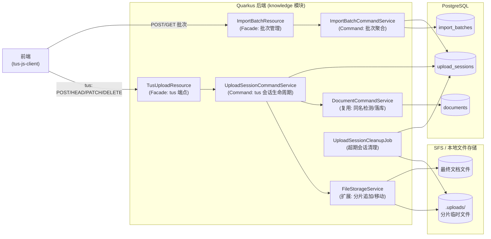
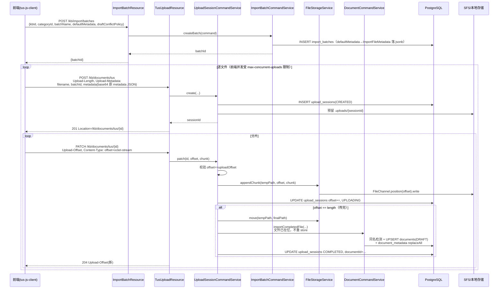
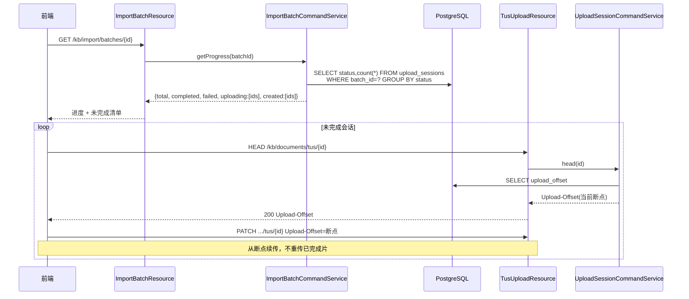

# 初始化批量上传设计

## 功能设计说明书

海思知识库架构设计 - 初始化批量上传（断点续传）设计

### 修订记录

| 日期 | 修订版本 | 修改描述 | 作者 |
|------|---------|---------|------|
| 2026-08-06 | 0.1 | 初稿 | AI 协作 |

### Keywords 关键词

> tus、断点续传、分片上传、初始化灌库、上传会话

### Abstract 摘要

> 知识库初始化阶段需一次性灌入约 5GB、上千个文件的历史文档。现有 `POST /kb/documents/upload` 为单次 multipart、整文件入内存模型，无法承载该规模，亦无续传能力。本文档设计一套基于 **tus.io 标准断点续传协议** 的初始化批量上传能力：对前端暴露标准 tus 端点（可对接 `tus-js-client`），后端在 Quarkus 内自实现 tus 服务端，深度集成现有 documents 落库链路与 SFS 文件存储；上层以"导入批次"聚合上千文件的文件级进度，实现"单文件内续传 + 批次内文件续传"两级断点续传。

---

## 1 背景与问题

### 1.1 需求

知识库建库后的**初始化灌库**：一次性导入约 5GB、上千个文件的历史文档。特征：

- 总量约 5GB，文件数上千（量级 1000~3000）
- 单文件**大部分在几十兆以内**（文档类为主，少量较大 PDF）
- 必须支持**断点续传**：网络中断 / 进程重启后可从断点继续，不重传已完成部分

### 1.2 现有上传链路为何不够

现有 `POST /kb/documents/upload` 链路（`DocumentResource.upload` → `DocumentCommandService.upload`）面向"日常单/批文档上传"设计，在初始化场景存在三个硬伤：

| 硬伤 | 代码事实 | 后果 |
|------|---------|------|
| **整文件入内存** | `DocumentResource` 中 `Files.readAllBytes(upload.uploadedFile())` 把整个文件读成 `byte[]`，`FileInput.content()` 一路传到 `fileStorageService.store(path, content)` 整体 `Files.write` | 单文件几十兆尚可，单请求累计上千文件必 OOM；单文件若达数百兆直接爆堆 |
| **单请求无续传** | 一次 multipart 请求处理全部 files，`processFiles` 串行 chain | 5GB / 上千文件单请求必超时；任一文件失败或网络中断，整批重来 |
| **上限不足** | `kb.upload.max-file-size=100M`、`kb.upload.zip-max-total-size=1G` | 初始化场景单文件/总量均会触顶 |
| **无进度持久化** | 无上传会话表、无分片表 | 无从记录"传到哪了"，断点续传无从谈起 |

> 结论：初始化灌库是独立于日常上传的新场景，需新建一套断点续传基础设施，**不污染**日常 `upload` 链路（日常链路保持简单）。

---

## 2 方案选型

### 2.1 协议层：采用 tus.io 标准

tus.io 是 HTTP 断点续传的事实标准协议（1.0.0），核心语义成熟、前端生态好（官方 `tus-js-client`）。其对前端暴露标准端点，与本项目 Quarkus 后端解耦。

### 2.2 服务端实现路径（关键决策，需如实面对 Java 生态现状）

tus 官方参考实现 **tusd 是 Go 语言**项目；`tus-java-client` 仅为客户端 SDK；**纯 Java 生态没有成熟、被广泛维护的 tus 服务端库，Quarkus 扩展目录亦无 tus 扩展**。据此有三条路径：

| 路径 | 说明 | 对本项目评价 |
|------|------|--------------|
| **A. 自实现 tus 端点（Quarkus 内）** | 在新增 `TusUploadResource` 实现 tus 的 POST/HEAD/PATCH/DELETE/OPTIONS，状态存 DB，分片追加写 SFS | ✅ 推荐。协议核心不复杂（offset 续传语义），与 DDD 四层 / Mutiny / documents 落库 / SFS / `moveToTrash` 两阶段清理深度集成，无新运行时，部署仍是单体 |
| B. tusd(Go) sidecar | 独立部署 tusd 暴露 tus 端点，通过 hook 回调 Java 后端做鉴权与落库 | 引入 Go 运行时；文件需从 tusd 存储二次搬运到 SFS；鉴权走 hook 回调链路，故障面变大；与现有 K8s 单 Pod 单 Quarkus 部署模式不一致 |
| C. 对象存储原生 multipart | 若存储走 OBS 对象存储，用其 multipart upload + 预签名 URL 直传 | ❌ 与当前 SFS（弹性文件服务，POSIX 文件系统 NAS 语义）不一致；模型服务按 `filePath` 读整文件，对象存储语义需额外适配 |

**结论（已确认）：采用路径 A —— Quarkus 内自实现 tus 协议端点**，对前端仍是标准 tus 协议（`tus-js-client` 无缝对接），后端深度集成现有设施。

### 2.3 两级断点续传模型

| 层级 | 管什么 | 机制 |
|------|--------|------|
| **文件内续传** | 单个文件的分片断点 | tus 协议原生：`HEAD` 查 `Upload-Offset`，`PATCH` 带 `Upload-Offset` 续传 |
| **批次内文件续传** | 上千文件中哪些传完 / 失败 / 未传 | 自建"导入批次"聚合各文件 tus 会话状态 |

---

## 3 总体设计

### 3.1 组件总览



### 3.2 关键设计决策

1. **tus create 携带 `batchId`**：批次不预创建文件清单，前端 `POST /kb/import/batches` 拿 `batchId` 后，逐文件 tus `create` 时在 `Upload-Metadata` 带 `batchId`，服务端将会话归入批次。批次进度 = 该 `batchId` 下所有会话状态聚合。**更 tus-native，前端更简单**。
2. **complete 即落库**：单文件最后一片 `PATCH`（`offset == length`）后立即触发 documents 落库（DRAFT）。传完即可见，批次进度自然推进；不搞"批次统一提交"二次落库。
3. **complete 时文件已在磁盘**：分片追加写完成后，临时文件即最终内容，`complete` 只需**移动**临时文件到 `buildStoragePath` 并落 documents，**不重新 store 整文件**（不回读内存）。这是对现有 `createNewFile` 的"文件已在位"变体。
4. **不逐片记录 DB**：几十兆文件顺序 `PATCH`，offset 由"临时文件实际大小"决定（`HEAD` 时 `stat` 文件大小即可）。不建 `upload_chunks` 表，保持简单。不支持 tus `concat`（并行分片）扩展——几十兆文件顺序足够。
5. **草稿态同名冲突策略参数化**：complete 落库时，对 DRAFT 态同名文件按 `draftPolicy`（`OVERRIDE` 覆盖 / `SKIP` 忽略）处理；REVIEWING/PUBLISHED/ARCHIVED 一律 SKIP 不允许覆盖。策略由批次 `draftConflictPolicy` 默认，tus create 的 `Upload-Metadata.draftPolicy` 可逐文件覆盖。
6. **不强制整体 SHA-256**：完整性靠 complete 时 `临时文件大小 == uploadLength` 校验兜底；防篡改非本期诉求，避免前端预算摘要的负担。
7. **元数据落层：仅写 `document_metadata`，不写 KB/类别层**。上传元数据（product/chip_model/sensitivity/official/access_policy）描述的是「这一份文档」，文档级是正确归宿，与单文件上传 `UploadDocumentCommand` → `documentMetadataRepository.replaceAll` 落层完全一致。现有元数据是三层 OR-overlay（`knowledge_base_metadata` / `category_metadata` / `document_metadata` 任一层命中即算，`KnowledgeBaseChatResolver` 三层 OR），**无继承机制**——系统里唯一继承是 ACL 的 `inherit_parent`（架构设计 §3.11），与元数据是两套独立子系统。故批次级 `default_metadata` 仅作逐文件默认值，complete 时合并逐文件覆盖后写各文档的 `document_metadata`；KB/类别级元数据 scope 不同（KB 维度 org/default_sensitivity；`category_metadata` 当前无业务使用），由独立接口 `POST /kb/metadata/set` 维护，灌库不越权代写。

---

## 4 协议设计（tus 端点）

端点前缀：`/kb/documents/tus`。遵循 tus Protocol 1.0.0。

### 4.1 OPTIONS（协议握手）

返回服务端能力声明，供 `tus-js-client` 协商。

| 响应头 | 值 |
|--------|-----|
| `Tus-Resumable` | `1.0.0` |
| `Tus-Version` | `1.0.0` |
| `Tus-Extension` | `creation,termination`（不实现 `checksum`/`concatenation`，简化） |
| `Tus-Max-Size` | `kb.import.tus.max-file-size`（默认 1G） |
| `Access-Control-Allow-Methods` | `POST,HEAD,PATCH,DELETE,OPTIONS` |

### 4.2 POST（创建上传会话）

创建一个 tus 上传资源，对应一个文件。

**请求头**：

| 头 | 必填 | 说明 |
|----|------|------|
| `Tus-Resumable` | 是 | `1.0.0`，缺失/不匹配 → `412` |
| `Upload-Length` | 是 | 文件总字节数 |
| `Upload-Metadata` | 是 | tus 标准 `key value(base64)` 逗号分隔。必填：`filename`、`batchId`；可选 `metadata`（base64 编码的前端 metadata JSON，**形态同普通上传 `UploadDocumentCommand`**：`product`/`chip_model`/`version`/`sensitivity`/`official`/`tag`/`author`/`remark`/`access_policy`，作逐文件覆盖，缺省取批次 `default_metadata`）。省略 `metadata`=继承批次默认。`version` 不入 `document_metadata`，由 `documents.current_version` 承载。`categoryId`/`draftPolicy` 不入 tus（取批次，见 docs/断点续传.md 契约）。`.zip` 特判放行（complete 时异步解压，见 §4.6.1）；其余扩展名须在白名单（与普通上传 `ALLOWED_EXTENSIONS` 一致） |

**处理**（`UploadSessionCommandService.create`）：

1. 鉴权（现有 JWT Filter + `kb:doc:upload` 权限码）
2. 校验 `kbId` 存在且未删除、`batchId` 属于当前用户且未过期、`categoryId` 存在且属于该 KB
3. 校验 `Upload-Length` ≤ `kb.import.tus.max-file-size`；校验批次累计未超 `max-total-size` / `max-files`
4. 文件名清洗复用 `DocumentCommandService.sanitizeFileName`（防路径穿越）
5. `draftPolicy` 取批次 `draftConflictPolicy`（缺省 `OVERRIDE`），存入 `upload_sessions.draft_policy`。**不进 tus `Upload-Metadata`**（前端契约仅 `filename`/`batchId`/`metadata` 三 key，策略批次统一）
6. **解析元数据**：`metadata` blob base64 解码为 `UploadDocumentCommand`（与普通上传同一形态）→ `toImportMetadata()`；`resolvedMetadata = 批次 default_metadata ⊕ 逐文件覆盖`（逐文件优先；`version` 抽出走 `current_version`）。复用 `MetadataCommandService` 的校验链——同步格式校验（key 正则 `^[a-zA-Z][a-zA-Z0-9_]{0,49}$`、value trim 1~200、无控制字符）→ `DictMetaKeyCacheService` key 白名单 → `DictValueValidator` 字典值（fail-closed）；任一非法 → `422` + JSON body（`A0420` + `metadataKeyNotInDict`/`metadataValueNotInDict`，与 §4.6 complete 失败语义一致），不创建会话。解析结果存入 `upload_sessions.metadata`（json），complete 时直接 `replaceAll`
7. 生成 `sessionId`（`IdGenerator`），分配临时路径 `{storage_root}/.uploads/{sessionId}`
8. 持久化 `upload_sessions`（status=`CREATED`，upload_offset=0，draft_policy，metadata，expires_at=now+expire-hours）
9. 返回 `201 Created`，`Location: /kb/documents/tus/{sessionId}`，`Upload-Expires`

### 4.3 HEAD（查询断点）

**响应**：`200`，无 body。

| 响应头 | 说明 |
|--------|------|
| `Upload-Offset` | 已上传字节数 = 临时文件实际大小（`FileStorageService.size`） |
| `Upload-Length` | 文件总大小（session 记录） |
| `Cache-Control` | `no-store` |
| `Upload-Expires` | 会话过期时间 |

> 续传依据：`tus-js-client` 断网恢复后先 `HEAD` 拿 `Upload-Offset`，从该 offset 续 `PATCH`。

### 4.4 PATCH（上传分片）

**请求头**：

| 头 | 必填 | 说明 |
|----|------|------|
| `Tus-Resumable` | 是 | `1.0.0` |
| `Upload-Offset` | 是 | 客户端认为自己从哪开始 |
| `Content-Type` | 是 | `application/offset+octet-stream` |
| `Content-Length` | 是 | 本片字节数 |

**处理**（`UploadSessionCommandService.patch`，全程 `vertx.executeBlocking` 切 worker 线程）：

1. 校验 `Tus-Resumable`、session 存在且未过期
2. 校验 `Upload-Offset == session.uploadOffset`（实际临时文件大小），不等 → `409 Conflict`
3. `FileStorageService.appendChunk(tempPath, offset, chunkBytes)`：`FileChannel.position(offset).write(buf)` 定位追加（支持断点续传的正确语义——从指定 offset 覆盖写，非简单 append）
4. 更新 `uploadOffset += chunkLen`，session status=`UPLOADING`
5. **若 `uploadOffset == uploadLength`（传完）→ 触发 complete 流程**（见 §4.6）
6. 返回 `204`，`Upload-Offset`（新偏移），`Upload-Expires`

### 4.5 DELETE（终止，termination 扩展）

中止一个会话：临时文件移 `moveToTrash`，session status=`ABORTED`。幂等。

### 4.6 complete（传完即落库）

最后一片 `PATCH` 使 `uploadOffset == uploadLength` 时，**在同一响应内**完成落库（不另开端点）：

1. 校验：临时文件大小 == `uploadLength`（防半成品），不等 → `422` + `sizeMismatch`
2. 调 `DocumentCommandService.importCompletedFile(...)`：复用同名检测（`findByKbIdAndTitle`），按命中态 + `draftPolicy` 处理（见下表）。文件已在位不重新 store——OVERRIDE/新建时 `FileStorageService.move(tempPath, finalPath)`
3. session 置相应终态（见下表），记录 `documentId`
4. 返回 `204`（最后一片 PATCH 的响应）

> **元数据落层约束（见 §3.2 决策 7）**：complete 落库时元数据**仅写 `document_metadata`**（取 `upload_sessions.metadata` 已解析的 resolved 值，create 时已校验，complete 直接 `documentMetadataRepository.replaceAll(documentId, meta)`），**不写 `knowledge_base_metadata` / `category_metadata`**。`version` 单独走 `documents.current_version`（与单文件上传一致，不入 `document_metadata`）。校验在 create 时 fail-closed 完成，complete 不重校验（resolved 已落 session，避免重复 IO）。

> **草稿态同名冲突处理（draftPolicy，仅对 DRAFT 态生效；REVIEWING/PUBLISHED/ARCHIVED 一律 SKIP 不允许覆盖）**：

| 命中态 | draftPolicy | 行为 | session 终态 |
|--------|-------------|------|--------------|
| 未命中 | — | 新建 documents(DRAFT)，move 临时文件到 finalPath | `COMPLETED` |
| `DRAFT` | `OVERRIDE` | 复用 documentId，旧文件移 trash，move 临时文件覆盖，更新 documents（process_status→PENDING）+ `document_metadata` 全量替换 | `COMPLETED` |
| `DRAFT` | `SKIP` | 不覆盖，documents 不变，临时文件移 trash | `SKIPPED` |
| `REVIEWING` / `PUBLISHED` / `ARCHIVED` | — | 一律跳过（不允许覆盖），documents 不变，临时文件移 trash | `SKIPPED` |
| `DEPRECATED` | — | 新建（与现有 upload 一致，DEPRECATED 不参与同名匹配） | `COMPLETED` |

> **complete 失败语义**：单文件 complete 即落库是同步后处理（zip 异步见 §4.6.1），落库 DB 冲突等失败返回 `422` + JSON body（务实优先；`tus-js-client` 非 2xx 走 error 回调，可解析 body 拿到原因）。`SKIPPED` 不算失败，批次进度独立计数。

> complete 落库**不发 outbox 消息**——与现有上传一致，模型处理在 `approve` 时才触发（见后端架构设计 §3.9.3.8）。

### 4.6.1 zip complete 异步解压（5GB 大包、上千文件）

单文件 complete 同步落库（一次 persist，§4.6 步骤）。但 zip 会话（`isZip(fileName)`）complete 时需解压成 N 文档（5GB zip × 上千文件，解压 + 逐条目落库分钟级），同步在 PATCH 内会致网关/LB/客户端超时。故 zip complete **异步化**：

1. PATCH 末片检测 `isZip` → `self.markProcessing(sessionId)`（status=PROCESSING，独立 tx 提交）→ **立即返 `204`**（Upload-Offset=length），不等解压。
2. fire-and-forget `runZipExtraction(session)`（`.subscribe()` 非阻塞）：`vertx.executeBlocking` 跑阻塞读循环，逐条目流式读出 → `self.persistZipEntryAndBump`（独立 tx：doc 落库 + `entries_done+1` 原子；单条目失败回滚自身不连累其余）→ 终态 `markSessionTerminal`（SUCCESS→COMPLETED(docId=null)；全跳过→SKIPPED；含失败→FAILED 聚合原因）。zip 临时文件解压后移 trash。
3. 进度可见：前端轮询 `GET /kb/import/batches/{id}`，PROCESSING 会话暴露 `entriesDone`（逐条目累加，`bumpEntriesDone` bulk update 1 轮次）。
4. 崩溃兜底：`UploadSessionCleanupJob` 每 30 分钟扫 `status=PROCESSING and updated_at < now-30min`（无推进）→ 标 FAILED + 临时文件移 trash。后台解压逐条目 bump 更新 updated_at，运行中不会误判。

> **内存安全**：`ZipFileExtractor.extract(InputStream, max, max, EntryConsumer)` 回调式——逐条目读出即交 consumer 落库，条目字节用完即丢弃，不累积成 List（避免 5GB 解压全进堆致 OOM）。单条目仍受 100MB 上限。

> **配置**：`kb.import.tus.max-file-size=10G`（放行 5GB zip）、`kb.import.tus.zip-max-total-size=10G`（批量解压总量，独立于普通上传 `kb.upload.zip-max-total-size=1G`）、`kb.import.tus.zip-max-entries=2000`、`kb.import.tus.stale-processing-minutes=30`。普通上传仍受 1G 约束（List 解压防 OOM）。

> zip 内目录结构 v1 忽略（条目均落批次 categoryId），与普通上传的目录→子类别映射不同。

### 4.7 文档编辑 / 版本覆盖复用 tus（DOC_EDIT / VERSION_OVERRIDE）

批量导入的 tus 会话设施（会话表 / 分片写盘 / 断点仲裁 / 超期清理）扩展服务**单文档换文件**场景，引入"用途（purpose）"分流，不新建平行端点：

| 场景 | purpose 值 | 目标 | complete 落库 |
|------|-----------|------|--------------|
| 初始化批量导入（既有） | `batchImport`（缺省） | `batchId` 必填 | importCompletedFile / zip 解压 |
| **文档编辑换文件** | `docEdit` | `targetDocumentId` 必填 | DRAFT 同类型文件替换 + 可选属性/元数据编辑（`editWithFileFromTemp`） |
| **版本覆盖** | `versionOverride` | `targetDocumentId` 必填 | PUBLISHED 同类型新版本 + 旧版归档（`overrideVersionFromTemp`） |

**业务规则（编辑/覆盖一致）**：单文件（一会话一文件）；**zip 显式拒绝**（系统内无 zip 文档——上传/导入均自动解压）；**文件类型必须和源文件一致**（新扩展名 == 源文档 file_path 末段扩展名，A0701；VERSION_OVERRIDE 为新规则，multipart `overrideVersion` 同步强制）；大小上限复用 `kb.upload.max-file-size`（与 multipart edit/versions 同源）。

**create 校验（fail-closed）**：目标文档存在（A0430）→ 状态符合用途（DOC_EDIT 限 DRAFT / VERSION_OVERRIDE 限 PUBLISHED，A0508）→ 同类型（A0701）→ 扩展名白名单 → 大小上限（A0705）→ 元数据字典链（key 白名单 + 字典值；versionOverride 版本号必填 + 版本查重）。doc 用途 metadata JSON **非法 → 422 A0400**（不静默吞——无批次默认兜底）；缺省 = 仅换文件不改属性。

**complete 分流**：`UploadSessionCommandService.complete` 按 purpose 分发；doc 用途走独立 tx（DB 先、move 后，事务回滚保留临时文件可重试）。**永久性业务拒绝**（上传期间文档被提交审核/已归档/换过类型/版本冲突/已删）→ 临时文件移 trash + 会话 FAILED + `409 COMPLETE_FAILED`（客户端停止静默重试，语义同 zip 预检失败）。落库行为与 multipart 完全等价：processStatus→PENDING、dict 元数据全量替换（空 map 不调 replaceAll）、**作废旧内容周期 PENDING outbox 事件**、override 归档 document_versions(was_published=TRUE)。

**断点发现**：`GET /kb/documents/{documentId}/upload-session` 返回当前用户在该文档上的活跃会话（sessionId/purpose/fileName/uploadOffset/uploadLength/expiresAt；仅本人可见，无则 data=null）——前端刷新/换设备后据此续传。

**修订记录**（2026-08-29）：§4.7 新增（编辑/覆盖复用 tus）；migration_013（batch_id 置可空 + purpose + target_document_id + idx_sessions_target_doc）。

---

## 5 数据模型

遵循 `quarkus规范.md`：PO 在 `*.infrastructure.po`，贫血 JPA Entity（不继承 `PanacheEntity`）；仓储接口在 `*.domain.repository` 返回 `Uni`，实现用 `PanacheRepositoryBase`；领域对象纯 POJO 不带 `jakarta.persistence` 注解。

### 5.1 import_batches（导入批次）

| 列 | 类型 | 说明 |
|----|------|------|
| `id` | varchar PK | 批次 ID |
| `kb_id` | varchar | 所属知识库 |
| `category_id` | varchar NULL | 默认类别（可空=根） |
| `batch_name` | varchar | 批次名称 |
| `total_files` | int | 文件总数（动态聚合，冗余便于查询） |
| `total_size` | bigint | 总字节数（动态聚合） |
| `status` | varchar | `UPLOADING` / `COMPLETED` / `PARTIAL` / `ABORTED` |
| `default_metadata` | json | 批次默认元数据：逐文件 `document_metadata` 的默认值（结构同 `UploadDocumentCommand` 的 dict 受控部分：`product`/`chip_model`/`sensitivity`/`official`/`access_policy`，可含 `tags`/`author`/`remark`）。create 时与 tus `Upload-Metadata` 逐文件覆盖合并，**落库时仅写各文档的 `document_metadata`，不写 KB/类别层**（见 §3.2 决策 7）。`version` 不入此列，由 `Upload-Metadata.version` 承载 |
| `draft_conflict_policy` | varchar | 草稿态同名冲突策略：`OVERRIDE`/`SKIP`（默认 `OVERRIDE`，逐文件可覆盖） |
| `created_by` | varchar | 创建者 |
| `created_at` | timestamp | |
| `updated_at` | timestamp | |

> 进度（success/failed/pending）不落列，由 `upload_sessions` 聚合得出，避免双写不一致。

> `default_metadata` 在批次创建（`POST /kb/import/batches`）即按 §3.2 决策 7 的校验链校验（同步格式 → key 白名单 → 字典值，fail-closed），非法 → `A0420`，不创建批次；逐文件覆盖在 tus create 时复校（见 §4.2 步骤 6）。

### 5.2 upload_sessions（tus 上传会话）

| 列 | 类型 | 说明 |
|----|------|------|
| `id` | varchar PK | tus upload id（即 sessionId） |
| `batch_id` | varchar NULL | 所属批次（索引）。**BATCH_IMPORT 用途必填；DOC_EDIT / VERSION_OVERRIDE 用途恒 NULL**（migration_013 置列可空） |
| `purpose` | varchar NOT NULL DEFAULT 'BATCH_IMPORT' | 会话用途：`BATCH_IMPORT`（批量导入）/ `DOC_EDIT`（文档编辑换文件）/ `VERSION_OVERRIDE`（版本覆盖）。应用层（UploadSessionMapper）恒显式写值 |
| `target_document_id` | varchar NULL | doc 用途的目标文档 ID（编辑/覆盖针对哪个文档）；BATCH_IMPORT 恒 NULL |
| `kb_id` | varchar | 知识库 |
| `category_id` | varchar NULL | 类别 |
| `file_name` | varchar | 原始文件名（已清洗） |
| `file_title` | varchar | 文档标题（文件名去扩展名） |
| `mime_type` | varchar | |
| `upload_length` | bigint | 文件总大小（tus Upload-Length） |
| `upload_offset` | bigint | 已上传字节（断点） |
| `draft_policy` | varchar | 草稿态同名冲突策略：`OVERRIDE`/`SKIP`（create 时取批次默认或 metadata 覆盖；仅 BATCH_IMPORT 消费） |
| `metadata` | json NULL | create 时解析后的 resolved per-file 元数据（批次 `default_metadata` ⊕ tus `Upload-Metadata` 逐文件覆盖，`version` 抽出走 `current_version` 不入此列）。create 时已通过字典校验 fail-closed，complete 时直接 `documentMetadataRepository.replaceAll`，不重校验、不重解析。doc 用途：DOC_EDIT 取 `EditDocumentCommand` 形态（title/author/tags/remark + dict 全量替换语义，null=清空）、VERSION_OVERRIDE 取 `UploadDocumentCommand` 形态；`title` 组件仅 doc 用途消费（编辑 null=不改 / 覆盖 null=文件名推导） |
| `status` | varchar | `CREATED` / `UPLOADING` / `COMPLETED` / `SKIPPED` / `FAILED` / `ABORTED` / `EXPIRED` |
| `document_id` | varchar NULL | 完成后关联 documents.id |
| `error` | varchar NULL | 失败原因 |
| `temp_path` | varchar | 临时文件相对路径 `.uploads/{id}` |
| `expires_at` | timestamp | 会话过期时间 |
| `created_by` | varchar | |
| `created_at` | timestamp | |
| `updated_at` | timestamp | |

**索引**：`idx_sessions_batch`(batch_id, status)、`idx_sessions_expires`(expires_at)（清理 job 用）、`idx_sessions_target_doc`(target_document_id, status)（断点发现端点用，migration_013）。

**唯一约束**：`(kb_id, category_id, file_title, status)` 不加唯一索引——同名按状态分流（DRAFT 覆盖 / PUBLISHED 跳过）由落库逻辑处理，与现有 upload 一致。

### 5.3 领域对象

- `UploadSession`（`domain.entity`，纯 POJO 聚合根）：封装 offset 推进、状态流转、complete 判定（`isComplete()` = offset==length）
- `ImportBatch`（`domain.entity`）：封装批次状态聚合
- `DraftConflictPolicy`（枚举，`domain.entity` 或 `command` 包）：`OVERRIDE`（覆盖草稿态同名文件）/ `SKIP`（忽略草稿态同名文件）；仅对 DRAFT 态生效，其余态同名文件一律 SKIP 不允许覆盖

---

## 6 存储设计（FileStorageService 扩展）

`FileStorageService` 接口新增三个方法，本地 / SFS 实现语义一致（POSIX 文件系统）：

```java
/** 追加分片：从 offset 定位写入（非简单 append，支持断点续传覆盖半成品片） */
Uni<Long> appendChunk(String tempPath, long offset, byte[] chunk);

/** 查询临时文件当前大小（HEAD 查断点用） */
Uni<Long> size(String path);

/** 移动文件（complete 时临时→最终，原子 rename 优先，跨卷降级 copy+delete） */
Uni<Void> move(String fromPath, String toPath);
```

**本地实现**（`LocalFileStorageService`，沿用现有 `vertx.executeBlocking` 切 worker 模式）：

- `appendChunk`：`FileChannel.open(path, WRITE).position(offset).write(ByteBuffer.wrap(chunk))`
- `size`：`Files.size(path)`，不存在返回 0
- `move`：`Files.move(src, dst, ATOMIC_MOVE)`（跨卷异常降级 `copy + delete`）

临时目录：`{kb.storage.local-path}/.uploads/`，与现有 `.trash` 并列。complete 后临时文件 `move` 到最终路径，不残留；中止/过期则 `moveToTrash`（复用现有两阶段清理，由 `TrashCleanupJob` 物理删）。

---

## 7 分层与包结构（对齐 quarkus规范.md）

| 层 | 包 | 类 |
|----|-----|-----|
| Facade | `knowledge.facade` | `TusUploadResource`（tus 端点）、`ImportBatchResource`（批次管理） |
| Command | `knowledge.command` | `UploadSessionCommandService`、`ImportBatchCommandService`；Command record：`CreateImportBatchCommand`、`CreateUploadSessionCommand` |
| Domain | `knowledge.domain.entity` | `UploadSession`、`ImportBatch`（纯 POJO） |
| Repository 接口 | `knowledge.domain.repository` | `UploadSessionRepository`、`ImportBatchRepository`（返回 `Uni`） |
| Infrastructure | `knowledge.infrastructure.repository` | `*RepositoryImpl` + `*PanacheRepository`（注入 `PanacheRepositoryBase`） |
| Infrastructure | `knowledge.infrastructure.po` | `UploadSessionPO`、`ImportBatchPO`（JPA Entity） |
| Infrastructure | `knowledge.infrastructure.mapper` | `UploadSessionMapper`、`ImportBatchMapper`（MapStruct） |
| Infrastructure | `knowledge.infrastructure.job` | `UploadSessionCleanupJob` |
| Query | `knowledge.query` | `ImportBatchQueryService` + `ImportBatchProgress`（DTO） |

- `UploadSessionCommandService` / `ImportBatchCommandService` 的写方法标 `@WithTransaction`（仅应用层，符合规范）
- `DocumentCommandService` 新增 `importCompletedFile(...)`：文件已在磁盘的落库变体，复用 `sanitizeFileName` / `buildStoragePath` / `classify` / `deduceFileType` / 同名检测 / `documentMetadataRepository.replaceAll`。元数据取 `upload_sessions.metadata`（create 时已解析并校验，complete 直接 `replaceAll`，不再调 `buildDocumentMetadata` 重建、不重校验，见 §4.6）
- Command record 加 `@RegisterForReflection`；JSON 用注入的 `ObjectMapper`，禁止 `new ObjectMapper()`

---

## 8 时序图

### 8.1 创建批次 + 逐文件 tus 续传 + complete 落库



### 8.2 断点续传（批次中断后恢复）



---

## 9 配置

对齐现有 `kb.upload.*` 命名空间，新增 `kb.import.*`（YAML）：

```yaml
kb:
  import:
    enabled: true
    tus:
      max-file-size: 1G            # 初始化放宽单文件上限（日常 upload 仍 100M，互不影响）
      expire-hours: 168            # 会话保留 7 天（断点续传窗口）
    batch:
      max-files: 10000            # 单批次文件数上限
      max-total-size: 20G         # 单批次总量上限（防滥用）
      max-concurrent-uploads: 5   # 单批次并发文件数（前端 tus 并发）
```

- `kb.import.enabled`：功能开关，灰度可控
- 临时目录复用 `kb.storage.local-path` + `/.uploads/`
- 清理保留期复用 `TrashCleanupJob` 的 `retentionDays` 配置

---

## 10 关键决策记录（已确认）

| # | 权衡点 | 决策 | 理由 |
|---|--------|------|------|
| 1 | tus 服务端实现路径 | ✅ **A 自实现端点** | Java 无成熟 tus server 库；自实现与 DDD/SFS/documents 深度集成最优，无新运行时 |
| 2 | complete 后是否立即落 documents(DRAFT) | ✅ **立即落库** | 传完即可见，批次进度自然推进；不引入"批次提交"二次落库 |
| 3 | 批次是否预创建文件清单 | **不预创建**（tus create 带 batchId 归集） | 更 tus-native，前端简单；批次仅聚合视图 |
| 4 | 是否整体 SHA-256 校验 | ✅ **不开启** | 需客户端在上传前预算文件整体摘要并提交（等同让用户填），取消。靠 complete 时 `临时文件大小 == uploadLength` 校验保证完整性；防篡改非本期诉求 |
| 4b | 草稿态同名冲突策略 | ✅ **参数化**（`OVERRIDE`/`SKIP`） | 批次级 `draftConflictPolicy` 默认 + create metadata 逐文件覆盖；仅 DRAFT 态生效，REVIEWING/PUBLISHED/ARCHIVED 一律 SKIP 不允许覆盖 |
| 5 | 是否支持 tus `checksum`/`concatenation` 扩展 | **本期不支持** | 几十兆文件顺序 PATCH 足够；并行分片（concat）按需再加 |
| 6 | complete 与最后一片 PATCH 是否同响应 | ✅ **同响应** | 减少 round-trip；落库失败以 `422` + JSON body 反馈（见 §4.6 complete 失败语义） |
| 7 | 批量上传元数据落层 | ✅ **仅 `document_metadata`（批次默认 + 逐文件覆盖）** | 现有三层元数据 OR-overlay 无继承机制（`KnowledgeBaseChatResolver` 三层 OR），唯一继承是 ACL `inherit_parent`，与元数据无关。上传元数据 scope 是「这份文档」，与单文件上传落层一致；KB/类别级元数据 scope 不同且由 `POST /kb/metadata/set` 独立维护；`category_metadata` 当前无业务使用。三层都写=冗余（OR 任一命中即算），只写 KB=污染整个 KB |

---

## 11 安全与校验

- **鉴权**：tus 端点 + 批次端点均走现有 JWT Filter（`commons-web`）+ `kb:doc:upload` 权限码（架构设计 §3.9.2 F-097）；`Upload-Metadata` 的 `batchId` 校验属当前用户
- **路径穿越**：文件名复用 `DocumentCommandService.sanitizeFileName`，临时路径用 `sessionId`（服务端生成，不可控）
- **上限**：单文件 `max-file-size`、批次 `max-files` / `max-total-size`、并发 `max-concurrent-uploads`，防滥用与资源耗尽
- **CORS / 预检**：`commons-web` 拦截器放行 tus 端点 `OPTIONS` 预检，暴露 `Tus-*` / `Upload-*` 响应头
- **审计**：批次创建、complete 落库纳入审计日志（架构设计 §3.7）

---

## 12 并发与一致性

- **同会话 PATCH 顺序**：tus 协议要求 `Upload-Offset` 严格递增，乱序 `PATCH` → `409`。几十兆文件顺序传，无并发分片需求
- **跨会话并发**：不同文件可并发 `PATCH`，受 `max-concurrent-uploads` 限制，避免 event loop / SFS 压力
- **complete 落库事务**：`@WithTransaction` 包裹 `documents` UPSERT + `document_metadata` replaceAll + session 置 COMPLETED；同名检测（`findByKbIdAndTitle`）在事务内，DRAFT 覆盖 / PUBLISHED 跳过逻辑与现有 upload 一致
- **幂等 complete**：重复触发最后一片（offset 已 == length）→ 检测 session 已 COMPLETED → 返回当前 offset，不重复落库（status 守卫）
- **跨实例**：DB 行约束 + session status 状态机守卫兜底；offset 以临时文件实际大小为准（文件系统是事实源）

---

## 13 失败处理与清理

- **落库失败**（如 metadata 字典值非法、DB 冲突）：session status=`FAILED`，记录 error，临时文件保留（用户可修正元数据后重传该文件或调批次级重试）；不影响其他文件
- **超期会话清理**：`UploadSessionCleanupJob`（仿 `TrashCleanupJob`，定时扫 `expires_at < now` 且 status∈{CREATED,UPLOADING}）→ 临时文件 `moveToTrash` → session status=`EXPIRED`
- **批次中止**：`POST /kb/import/batches/{id}/abort` → 批次下所有未完成 session 置 ABORTED，临时文件清理
- **已完成文件**：session COMPLETED 后临时文件已 move 走，无残留；documents 走现有删除两阶段（`moveToTrash` + `TrashCleanupJob`）

---

## 14 用户接口设计

### 14.1 批次管理（`ImportBatchResource`）

| 方法 | 路径 | 说明 |
|------|------|------|
| POST | `/kb/import/batches` | 创建批次（kbId/categoryId/batchName/默认元数据/draftConflictPolicy），返回 batchId |
| GET | `/kb/import/batches/{id}` | 批次进度（total/success/failed/uploading 清单/created 清单） |
| POST | `/kb/import/batches/{id}/abort` | 中止批次，清理未完成会话 |
| GET | `/kb/import/batches` | 当前用户批次列表 |

**POST `/kb/import/batches` 请求体**（`CreateImportBatchCommand`，JSON）：

| 字段 | 类型 | 必填 | 说明 |
|------|------|------|------|
| `kbId` | string | 是 | 知识库 ID |
| `categoryId` | string | 否 | 默认类别 ID（空=根类别）；tus 会话不带 categoryId，均取此值 |
| `batchName` | string | 是 | 批次名称 |
| `defaultMetadata` | object | 否 | 逐文件元数据默认值，**形态同普通上传 `UploadDocumentCommand`**：`product`/`chip_model`/`version`/`sensitivity`/`official`/`tag[]`/`author`/`remark`/`access_policy`；灌库统一元数据即设此值。服务层 `toImportMetadata()` 映射为持久化形态 |
| `draftConflictPolicy` | string | 否 | `OVERRIDE`（默认）/`SKIP`；tus 会话不带，均取此值 |

响应：`{ "code": "0", "data": "<batchId>" }`（`batchId` 供 tus `Upload-Metadata.batchId` 用）。

**GET `/kb/import/batches/{id}` 响应**（`ImportBatchProgress`）：

| 字段 | 类型 | 说明 |
|------|------|------|
| `batchId` / `batchName` / `status` | string | 批次状态：UPLOADING/COMPLETED/PARTIAL/ABORTED |
| `totalFiles` / `totalSize` | int/long | 文件总数/总字节 |
| `successCount` / `failedCount` / `uploadingCount` | int | 聚合计数 |
| `sessions` | array | 会话清单（每条：sessionId/fileName/status/uploadOffset/uploadLength/**entriesDone**（zip PROCESSING 进度）/documentId/error） |

**422 错误体**（complete/落库失败，tus PATCH 响应）：`{ "code": "A0XXX", "message": "<原因>" }`（`tus-js-client` 非 2xx 走 error 回调解析 body）。

### 14.2 tus 端点（`TusUploadResource`）

| 方法 | 路径 | 说明 |
|------|------|------|
| OPTIONS | `/kb/documents/tus` | 协议握手（Tus-Version/Extension/Max-Size） |
| POST | `/kb/documents/tus` | 创建上传会话（Upload-Length/Metadata） |
| HEAD | `/kb/documents/tus/{id}` | 查断点（Upload-Offset） |
| PATCH | `/kb/documents/tus/{id}` | 上传分片（Upload-Offset） |
| DELETE | `/kb/documents/tus/{id}` | 终止会话 |

返回体统一遵循 `ResponseResult`（批次管理类）；tus 协议端点遵循 tus 响应头规范，不复用 `ResponseResult`（tus 客户端按协议头解析）。
