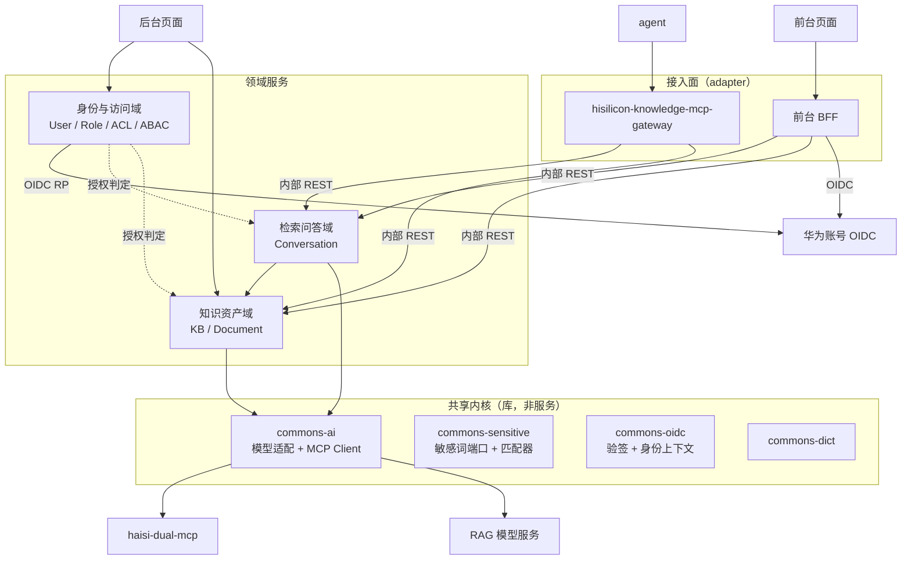

# 服务拆分评估

## 评估说明书

| 项目 | 内容 |
|------|------|
| 文档版本 | V1.7 |
| 密级 | 内部 |
| 拟制日期 | 2026-10-19 |
| 状态 | 拆分已实施并通过真实环境验证，待确认合并 |
| 关联文档 | 《海思知识库架构设计-后端架构设计》《海思知识库架构设计-权限与安全设计》《海思知识库架构设计-部署与运维设计》《生产配置安全-K8s密钥注入》 |

### 修订记录

| 版本 | 日期 | 修订说明 | 作者 |
|------|------|---------|------|
| V1.0 | 2026-10-19 | 初稿。前后台页面分离背景下的后端拆分评估：鉴权的组件/服务划分、MCP 服务边界、按 DDD 重划领域与迁移路径；含现状盘点、方案对比、过渡期硬约束、文档-代码差距清单 | 架构组 |
| V1.1 | 2026-10-19 | 落实两项决策：① **确认允许对旧服务做一处小改**，方案 B 不再作为备选路径；② **确认 `haisi-dual-mcp` 只是模型服务名、模型侧不鉴权** —— 据此新增 §4.6"平台是模型层唯一门禁"及其三条硬要求与出站收紧措施，新增差距 #9–#11（含必须修正的"9789 被列为 agent 路由目标"），附件与对比表相应更新 | 架构组 |
| V1.2 | 2026-10-19 | **拆分已实施**（分支 `feat/split-domain-services`，基线 `litianguo`）：解环（下沉 `commons-ai`）→ 域归位（敏感词入 `llm`、字典入 `knowledge`、`system` 收缩为 IAM）→ 两个部署单元（`hisilicon-knowledge-core-service` 8080 / `hisilicon-knowledge-iam-service` 8085；**V1.4 改前缀、V1.5 改端口与探针，见下两行**）+ 两个预留骨架（`hisilicon-knowledge-mcp-gateway` / `commons-oidc`）。新增 **§10 拆分实施记录**：逐步证据（`@Path` 契约与测试数守恒、服务级独立启动、依赖双向隔离）、路由与配置归属、与本文设计的四处偏差、新发现 P1–P3；§5.5 目标形态的服务数量按实施结果由 3 修正为 2 | 架构组 |
| V1.3 | 2026-10-19 | **真实环境验证完成**（本地 Podman：PG 18.4 / Redis 8.8.1 / Kafka 4.3.1，生产模式 runner jar）：两个服务在真库上启动并建成持久化单元、IAM 登录全链路（RSA 解密 + BCrypt + RS256 签发 + Redis 落令牌 + `last_login` 落库）跑通、跨服务令牌流通过、**P0 验签缺失现场复现**。新增 **§10.8**；修复 `hisilicon-knowledge-iam-service` 缺端口配置（同机必冲突）；新发现 **P4**：`application.yml` 中带点的键被静默忽略，Kafka 通道 10 个属性（含 `group.id`、`dead-letter-queue.topic`、`auto.offset.reset`）实测全部失效，已记为差距 #14，并据此修正 §8.1 红线 2 与 §10.7 偏差 4 的表述 | 架构组 |
| V1.4 | 2026-10-19 | **按部署约束修正对外前缀**：测试/生产经华为云 APIG 按**前缀**转发到 CCE 内的 Service，第一版让两个服务共用 `/hisilicon-knowledge` 是错的（APIG 分不开）。改为 iam 独占 `/hisilicon-knowledge-iam`、core 保留 `/hisilicon-knowledge`、MCP 预留 `/hisilicon-knowledge-mcp`；浏览器可见路径由 nginx/APIG 内部 rewrite 保持不变，前端零改动。§10.3/§10.4 重写，§8.1 增补红线 5，§10.6 增补"前缀互不相同"证据并给 #1 加上口径限定，§10.8 补跨前缀实测 | 架构组 |
| V1.5 | 2026-10-19 | **端口定稿 + 探针分离 + 修掉 P4**：① 两个服务业务端口统一显式 `8080`（CCE 里各自独立容器，同值不冲突），**探针独立到 9000**（`quarkus.management.enabled`）——探针不再出现在业务端口上，且地址与各服务 `root-path` 无关（两个服务都是 `:9000/q/health`）；8 个 Dockerfile 改 `EXPOSE 8080 9000`。② **P4 修复**：Kafka 10 个"带点键"全部改为嵌套 map 写法，并用真实 Kafka 逐键验证——`group.id`/DLQ 主题看 `SRMSG18257`/`SRMSG18258`、`key.deserializer`/`bootstrap.servers` 看 `SRMSG18214`/`SRMSG18213` 是否消失、`auto.offset.reset` 用 A/B 行为对照、assignor 看 broker 的 `cooperative-sticky`；并指出该 bug 极可能就是 2026-10-13"三环境共组静默不消费"的根因（旧服务与各环境挂载文件尚未修）。§10.4/§10.5/§10.8/§10.8.1 重写，§8.1 红线 2、差距 #14、§10.7 同步更新 | 架构组 |
| V1.6 | 2026-10-19 | **服务改名对齐运维命名族**：`kb-core-service` → `hisilicon-knowledge-core-service`、`kb-iam-service` → `hisilicon-knowledge-iam-service`、`kb-mcp-gateway` → `hisilicon-knowledge-mcp-gateway`（模块目录、`settings.gradle.kts`、`quarkus.application.name`、`quarkus.otel.service.name`、Dockerfile 镜像 tag、全部文档与 AGENTS 共 36 个文件）。理由与"刻意不带 `platform`"的口径见 §10.3；改名**行为中性**（Kafka 组名由显式 `group.id` 决定，已在真实 Kafka 复验）。⚠️ **仓库外待运维/前端同步**：CCE 的 Deployment/Service/HPA 名、SWR 镜像目录、APIG/ELB 上游名、LTS 配置、前端 nginx 上游名（前端对接说明已同步改名） | 架构组 |
| V1.7 | 2026-10-19 | **Hibernate SQL 日志默认关闭**：两个服务 yml 的 `hibernate-orm.log.{sql,format-sql,bind-parameters}` 由 `true` 改为 `false`，本地体验由新增的 `%dev` 段保留。起因：CCE 上外挂配置里删掉 `hibernate-orm` 段后 core 仍在打 SQL——外挂配置是叠加语义，删键只是回落到镜像内写死的 `true`，而 outbox relay（`kb.outbox.poll-interval: 10s`）每 10 秒刷一条。§10.5 增补生产配置口径与实测（prod 查询成功但 0 行日志 / dev 打印格式化 SQL） | 架构组 |

### Keywords 关键词

服务拆分、限界上下文、OIDC、MCP、BFF、RBAC/ACL/ABAC

### 缩略语清单

| 缩略语 | 全称 | 说明 |
|--------|------|------|
| RP | Relying Party | OIDC 依赖方（客户端），负责登录流程 |
| RS | Resource Server | OAuth2 资源服务器，负责校验令牌 |
| JWKS | JSON Web Key Set | IdP 公钥集合，用于本地验签 |
| PKCE | Proof Key for Code Exchange | 授权码流程的防拦截扩展 |
| BFF | Backend For Frontend | 面向特定前端的接入层 |
| 限界上下文 | Bounded Context | DDD 中领域边界，一个上下文对应一个模型 |
| 共享内核 | Shared Kernel | 多个上下文共享且不可复制的基础能力 |
| ACL/ABAC | — | 见《权限与安全设计》缩略语表 |

---

## 1 评估范围与约束

### 1.1 背景

前端需将前台页面与后台页面分开，后端需要评估是否拆分、如何拆分。前后台能力清单如下：

| 端 | 能力 | 说明 |
|----|------|------|
| 前台 | 智能问答、热门词查询、全局文档搜索 | 后续提供各 agent 如何集成的信息 |
| 后台 | 智能问答；**无**全局文档搜索 | 另有知识库/文档/审核/敏感词/字典等既有管理能力；后续提供各 agent 如何集成的信息 |
| 后端 | 对接模型侧 MCP 服务 | 既有对接对象为 `haisi-dual-mcp` |
| 鉴权 | MCP、前端、后端均以 OIDC 对接华为账号 | 保留现有本地登录给后台管理人员 |

### 1.2 评估约束

1. **暂时不改变 `hisilicon-knowledge-platform-service`**，以兼容旧前端与旧调用方；该服务后续下线。
2. **本地登录长期保留**：后台账号可先经 OIDC 接入并自动/预置产生账号信息，管理员为该账号设置密码与权限后，该账号**既可走华为 OIDC 也可走本地密码进入后台**。本地登录不是过渡手段，不随旧服务下线。
3. 新能力（前台页面、MCP、agent 集成信息）落在新服务上。

### 1.3 评估结论速览

| 问题 | 结论 | 详见 |
|------|------|------|
| 一、鉴权是通用组件还是独立服务 | **拆成两半**：OIDC 依赖方（RP，登录/换令牌/`client_credentials`）是**一个认证服务**；OIDC 资源服务器（RS，每请求验签）是**通用组件 `commons-oidc`**（本文早期稿称 `commons-security`，实施时定名 `commons-oidc`，见 §10.7）；授权判定只保留**一处实现** | §3 |
| 二、MCP 是否独立服务 | **对外 MCP Server 独立成服务**（`hisilicon-knowledge-mcp-gateway`，薄网关）；**模型侧 MCP Client 不独立**，随 `commons-ai` 下沉为共享库。已确认模型侧**不鉴权**，故平台是模型层唯一门禁，9789/47861/8777 禁止对外暴露 | §4 |
| 三、按 DDD 是否一个领域一个微服务 | 判据正确，但**当前 `system`/`knowledge`/`llm` 三个模块不是三个限界上下文**。真正三个域＝知识资产 / 检索问答 / 身份与访问；**切服务的前置动作是解除 `检索问答 ↔ 知识资产` 双向环** | §5 |
| 四、前后台如何区分 | **不是领域边界，而是接入面边界**：同一批领域能力的两种门面 + 不同鉴权主体 + 不同暴露面 + 不同可写范围（IAM 写侧仅后台可达） | §5.6 |
| 五、最紧急的独立事项 | ① `AuthenticationFilter` **不验签**：只解析 JWT payload 取 `sub`/`exp`，任意伪造令牌可通过全部 17 个 `@Authenticated` 资源；② 模型侧不鉴权而 `/kg/*` 只到"已登录"，任一登录用户可读任意知识库图谱。两者优先级均高于任何拆分 | §2.4、§4.6 |
| 六、拆分实施到哪一步了 | **结构拆分已完成并且已过真实环境验证**：解环 + 域归位 + 两个部署单元（`hisilicon-knowledge-core-service` / `hisilicon-knowledge-iam-service`，业务端口都是 8080、探针都是 9000、`root-path` 分别为 `/hisilicon-knowledge` 与 `/hisilicon-knowledge-iam`）+ 两个预留骨架（`hisilicon-knowledge-mcp-gateway` / `commons-oidc`）。对外 `@Path` 契约 106 条逐字未变、模块测试数 1002→1002、依赖双向隔离；两个服务已在真实 PG/Redis/Kafka 上启动并跑通登录与查库（含 P0 现场复现）、跨前缀双向 404 与探针端口分离已实测、Kafka 带点键问题已修复并逐键验证。**OIDC / 权限 / MCP / 前台 BFF 未实现，旧服务未删**（native 构建由用户侧执行验证） | **§10、§10.8** |

> **实施更新（V1.2）**：上表第 3、4、6 条已按实施结果落地；**第 3 条的目标形态由"三个服务"修正为"两个"**——
> 依据是 `ChatAnswerImageRewriter.onRawChunk()` 在**每个 SSE 分片**上回调并做 DB 查询 + 文件校验 + HMAC 签名，
> 检索问答与知识资产无法拆成两个进程（详见 §10.3）。前台 BFF 仍是后续独立交付物。

### 1.4 本文不覆盖

前端工程结构（两个前端应用如何组织）、CI/CD 与镜像发布流程、华为云 APIG/WAF 的具体策略配置、模型侧服务（`haisi-dual-mcp`、RAG 模型服务）的内部实现。

---

## 2 现状盘点

### 2.1 部署与模块

| 项 | 现状 | 证据 |
|----|------|------|
| 部署形态 | **单进程** Quarkus native 镜像 | `hisilicon-knowledge-platform-service/build.gradle.kts:20-22` 聚合 knowledge/llm/system |
| 全局根路径 | `/hisilicon-knowledge` | `hisilicon-knowledge-platform-service/src/main/resources/application.yml:25` |
| 启动类 | 空壳，无 main/@QuarkusMain | `PlatformService.java:1-4` |
| 数据库 | 单 PostgreSQL，单 schema `knowledge` | `application.yml:50` |
| 缓存 | 单 Redis，承载令牌/权限/字典/敏感词 | `application.yml:76`；`TokenRedisRepository.java:17-20` |
| 消息队列 | Kafka 仅 knowledge 使用 | `application.yml:169`（出站）、`:203`（入站）、`:228`（DLQ） |
| 文件存储 | 单 SFS 挂载 `/data/kb-files`，tus 分片、trash、文档树同根 | `application.yml:247-249` |

**结论**：当前是**模块化单体（modular monolith）**——模块间无编译期互相依赖，靠 `commons` 端口 + CDI 在运行期装配。这个形态对拆分是有利的（切面已存在），但没有进程边界。

### 2.2 接口面与前后台归属

全系统 **21 个 Resource、109 个端点**。17 个业务 Resource 标注 `@Authenticated`；4 个不标注（`PublicKeyResource`、`UserResource` 登录系、`ChatImageAssetResource`、`DocumentAssetResource`——后两个是签名 URL 图片通道，有意不标，见 `ChatImageAssetResource.java:34`、`DocumentAssetResource.java:31-32`）。

**全仓无一处 `@RolesAllowed`**，鉴权只有"登录/未登录"两态，没有任何角色或前后台隔离。

| 模块 | Resource | 根路径 | 端点数 | 前后台归属 | 证据 |
|------|----------|--------|--------|-----------|------|
| knowledge | DocumentResource | `/kb/documents` | 25 | **混装**：前台 4（`/global-search`、`/global-metadata-options`、`/detail`、`/download`）+ 后台 21 | `DocumentResource.java:91-92`、`:233`、`:306`、`:396`、`:670` |
| knowledge | KnowledgeBaseResource | `/kb` | 13 | 后台 | `KnowledgeBaseResource.java:57-58` |
| knowledge | KnowledgeGraphResource | `/kg` | 6 | 前台（检索类） | `KnowledgeGraphResource.java:45-46` |
| knowledge | HotWordResource | `/hotword` | 6 | **混装**：前台 1（`/listEnabled`）+ 后台 5 | `HotWordResource.java:43-44`、`:95` |
| knowledge | ImportBatchResource | `/kb/import/batches` | 4 | 后台 | `ImportBatchResource.java:31-32` |
| knowledge | TusUploadResource | `/kb/documents/tus` | 3 | 后台 | `TusUploadResource.java:59-60`；`:108-109` 为 OPTIONS 预检不计 |
| knowledge | DocumentChunkResource | `/kb/documents/chunks` | 1 | 后台 | `DocumentChunkResource.java:30-31` |
| knowledge | DocumentFileContentResource | `/kb/documents` | 1 | 后台 | `DocumentFileContentResource.java:77-78` |
| knowledge | DocCodeMappingResource | `/kb/doc-code-mapping` | 1 | 前台流程（代码↔文档映射） | `DocCodeMappingResource.java:27-28` |
| knowledge | ChatImageAssetResource | `/kb/chat` | 1 | 前台（签名通道） | `ChatImageAssetResource.java:59`、`:94-95` |
| knowledge | DocumentAssetResource | `/kb/documents` | 1 | 前台（签名通道） | `DocumentAssetResource.java:52`、`:92-93` |
| llm | ChatResource | `/chat` | 11 | **前后台共用**（两端都有智能问答） | `ChatResource.java:60-61` |
| llm | HitRateStatsResource | `/stats/hit-rate` | 5 | 后台（管理侧统计页） | `HitRateStatsResource.java:41-42` |
| system | SensitiveWordResource | `/system/sensitive/words` | 8 | 后台 | `SensitiveWordResource.java:47-48` |
| system | SensitiveTagResource | `/system/sensitive/tags` | 7 | 后台 | `SensitiveTagResource.java:34-35` |
| system | SensitiveQuestionResource | `/system/sensitive/questions` | 1 | 后台 | `SensitiveQuestionResource.java:27-28` |
| system | DictItemResource | `/system/dict/items` | 5 | 后台 | `DictItemResource.java:34-35` |
| system | DictTypeResource | `/system/dict/types` | 5 | 后台 | `DictTypeResource.java:32-33` |
| system | DictCacheResource | `/system/dict/cache` | 1 | 后台 | `DictCacheResource.java:24-25` |
| system | UserResource | `/user` | 3 | 登录入口（前后台共用） | `UserResource.java:25`、`:41-91` |
| system | PublicKeyResource | `/publicKey` | 1 | 登录入口 | `PublicKeyResource.java:17` |
| **合计** | **21 个** | | **109** | 前台 24 / 后台 85 | 见附件 A |

**关键观察**：`DocumentResource` 一个类里同时挂着前台的 `/global-search`（`:233`）与后台上传/审核/删除等端点，类级鉴权完全相同（`:92`）；`HotWordResource` 同理。**这意味着"前台/后台"这条分界线穿在模块内部，并不沿模块边界走。**

### 2.3 跨模块接缝（10 条，全部为进程内 CDI 装配）

| # | 方向 | 接缝（端口） | 载体 | 消费方证据 | 实现方证据 |
|---|------|------------|------|-----------|-----------|
| 1 | llm → knowledge | `KnowledgeBaseChatResolver` | commons-dict `chat` | `SendMessageCommandService.java:4` | `KnowledgeBaseChatResolverImpl.java:29` |
| 2 | llm → knowledge | `KnowledgeBaseNameResolver` | commons-dict `chat` | `SendMessageCommandService.java:5` | `KnowledgeBaseNameResolverImpl.java:22` |
| 3 | llm → knowledge | `ChatImageAssetUrlRewriter` | commons-dict `chat` | `ChatQueryService.java:4` | `ChatImageAssetUrlRewriterImpl.java:66` |
| 4 | llm → knowledge | `ChatDocsSourceResolver` | commons-dict `chat` | `ChatDocsEventTransformer` | `ChatDocsSourceResolverImpl.java:21` |
| 5 | knowledge → llm | `DocCodeMappingClient` | commons-dict `chat` | `DocCodeMappingQueryService.java:66,70` | `DocCodeMappingClientImpl.java:31` |
| 6 | knowledge → llm | `DocumentChunkClient` | commons-dict `chat` | `DocumentChunkQueryService.java:35,38` | `DocumentChunkClientImpl.java:33` |
| 7 | knowledge → llm | `KnowledgeGraphClient` | commons-dict `chat` | `KnowledgeGraphService.java:47,50` | `KnowledgeGraphClientImpl.java:36` |
| 8 | llm → system | `SensitiveWordChecker` | commons-sensitive | `SendMessageCommandService.java:11,102` | `SensitiveWordCacheService.java:65` |
| 9 | system → knowledge | `DictReferenceChecker` | commons-dict `service` | `DictTypeCommandService.java:42`、`DictItemCommandService.java:38` | `KnowledgeDictReferenceCheckerImpl.java:40` |
| 10 | system ↔ knowledge | 共享表 `kb_dict_types`/`kb_dict_items`（system 写、knowledge 读） | commons-dict PO/Repository | `DictOptionQueryService.java:3-6` | `DictTypePanacheRepository` |

**关键观察**：**#1–#4 与 #5–#7 构成 `检索问答 ↔ 知识资产` 的双向同步依赖**。这是拆分时唯一的结构性障碍，见 §5.3。

### 2.4 鉴权现状（含 P0 问题）

**当前实现**：本地账号 + BCrypt 密码哈希（`UserEntity.java:46-48`）+ RSA 传输加密（`UserCommandService.java:43-44`）+ 自签 RS256 JWT（`UserEntity.java:65-88`）+ Redis 刷新令牌轮换（`UserCommandService.java:101-165`、`TokenRedisRepository.java:17-20`）。

**P0 问题**：`AuthenticationFilter` 只做三件事——Bearer 前缀存在、`exp` 未过期、`sub` 存在（`AuthenticationFilter.java:41-76`）；`JwtUtils` 是纯字符串解析（`JwtUtils.java:26-53`）。

| 缺失的校验 | 后果 |
|-----------|------|
| 签名校验 | 任何人可伪造任意 `sub` 的令牌 |
| `iss`/`aud` 校验 | 其他系统签发的令牌可被接受 |
| Redis 会话存在性校验 | 无法强制下线；已登出/已撤销令牌仍可用 |
| 角色/权限校验 | 任何已登录用户可调用全部 109 个端点 |

全仓**无** `mp.jwt.verify.*`、`jwks`、`publickey` 配置。

**文档-代码差距**：《权限与安全设计》第 4.8.3 节（第 1734 行）声称认证过滤器"校验 JWT 签名/exp + Redis 会话存在性（支持强制下线），构建 `SecurityIdentity`"——**代码里这四项一项都没有**。集成测试注释也记录了该缺口（`ZipBatchExtractionIT.java:27-28`："确认 JWT 验签配置（mp.jwt.verify.*）"）。

### 2.5 已规划未落地清单

| 能力 | 文档位置 | 代码现状 |
|------|---------|---------|
| OIDC 多 IdP、`/oauth2/login/{provider}`、`/oidc/callback/{provider}` | 【权】1590-1734 | 只有 `ExternalIdentityPO.java` 一张空表，无实现 |
| RBAC→ACL→ABAC 三层判定引擎 | 【权】4.2/4.3/4.6 | `commons-abac` **只有 3 个 PO + `beans.xml`**，无引擎、无服务、无调用方 |
| 权限码、角色、菜单 | 【权】4.2.3.2 | `roles`/`user_roles`/`role_permissions`/`permissions`/`menus` 表存在（`init.sql:737,774,832,849,960`），**无任何 REST 接口**（`RoleResource` 不存在） |
| 用户管理（增删改、口令、角色分配） | 【后】3.4/3.5 | `UserResource.java:41-91` **只有 login/refresh/logout 三个端点** |
| `/auth/check`、`/auth/batch-check`、`/auth/preview` | 【权】4.6.4 | 无实现 |
| 社区用户 `community` 角色与公开文档双通道放行 | 【权】4.12 | 无实现；`/kb/public` 不存在 |
| 敏感词审计日志查询 | — | `SensitiveQuestionResource` 已有（`/system/sensitive/questions/search`） |
| 审计日志 | 【权】4.7 | `AuditLog`/`AuditLogInterceptor` 存在，但**业务代码零处使用**：`@AuditLog` 全仓仅出现在拦截器绑定（`AuditLogInterceptor.java:31`）与注解自身的 javadoc 示例（`AuditLog.java:20,23`），无任何业务方法标注 |
| MCP Server（对 agent 暴露） | 【部】95、420、580 | **零实现**；且拓扑里的"MCP 服务"实为模型侧 `haisi-dual-mcp` |

### 2.6 现状小结：四条决定性事实

1. **模块边界 ≠ 领域边界，也不等于前后台边界。** 前后台分界线穿在 `DocumentResource`/`HotWordResource` 内部；真正的重依赖与重负载分界线（读/查询 vs 写/摄取）也穿在 `knowledge` 模块内部。
2. **`检索问答 ↔ 知识资产` 是双向同步依赖**（§2.3 #1-#7）。按现有模块直接切服务会切出调用环。
3. **鉴权只有"登录/未登录"两态，且不验签。** 权限体系、OIDC、用户管理接口全部是文档态。这意味着"拆分"与"权限落地"必须同时规划，否则拆出来的每个服务都继承同一个安全洞。
4. **模型侧不鉴权（已确认），平台是模型层唯一门禁。** 因而模型数据的访问控制必须在平台侧一次做对，且模型侧端口不得对外暴露（§4.6）。

---

## 3 结论一：鉴权——OIDC 依赖方服务化，资源服务器组件化

### 3.1 两半的落点相反

OIDC 是同一个协议的两半，两半的落点方向相反，不能合并成一个"鉴权服务"，也不能都塞进组件：

| 半 | 职责 | 落点 | 反着放的代价 |
|----|------|------|------------|
| **OIDC 依赖方（RP）** | `/authorize` 重定向、`state`/PKCE、`/token` 交换、ID Token 校验、建立会话、登出、`client_credentials` | **唯一的一个认证服务** | 有状态（`state` 存 Redis）、持 `client_secret`、回调地址须固定集中。分散则每个服务各持一份 secret 与回调 |
| **资源服务器（RS）** | 每个业务请求验签（JWKS/`iss`/`aud`/`exp`）+ 提取身份 | **通用组件 `commons-oidc`**（早期稿称 `commons-security`） | 无状态、可缓存。放网络后面等于每请求一跳，且 SSE 长连接全部压在该服务上 |

### 3.2 身份模型：一个本地主体 + 两种凭据

本项目的账号来源与登录方式是**两件独立的事**：

```
华为账号 ──OIDC────────┐
                       ├──→ 本地主体 users（1 个）──→ 角色（N）──→ 权限码
管理员设置的本地口令 ──┘            └──→ 外部身份 external_identities（N 条，可多 IdP）
```

- 管理员"设置密码"= 给**同一主体**挂第二份凭据，不是创建第二个账号；"设置权限"= 给同一主体挂角色。
- **两个 provider 长期并存**：华为 OIDC + 本地口令。本地登录**不随旧服务下线**。
- 因此"账号来源（oidc/local）"与"能否本地登录"必须**分字段表达**。

### 3.3 三端与两个 provider

| 端 | 令牌获取方式 | 说明 |
|----|------------|------|
| 前台页面 | 授权码 + PKCE（**两个 OIDC client 之一**） | 对外暴露，走 BFF + httpOnly cookie |
| 后台页面 | 授权码 + PKCE（**另一个 client**） | 内网；**同时**支持本地口令 provider |
| MCP / agent | `client_credentials` | 无浏览器；机器身份，同一认证服务签发**同形态**令牌 |
| 后台管理人员 | 本地口令（第二个 provider） | 面向"已设置口令的后台账号" |

前台与后台是**两个 OIDC client**（两个 `redirect-uri`/`client_id`），注册在**同一个**认证服务上，会话与签发逻辑共用一份实现。

### 3.4 四处必须修的数据模型

以下四处直接卡住 §3.2 的账号流程，需在权限落地时一并修改：

| # | 现状 | 证据 | 问题 | 建议 |
|---|------|------|------|------|
| 1 | `users.password varchar(256) NOT NULL` | `init.sql:980` | OIDC 首登开通账号时无密码可写；写占位哈希则"是否设过密码"无法判定 | 改为可空（无口令 = 本地通道关闭），或新增 `password_set boolean` |
| 2 | `users.source varchar(16)` 单值 `local/oidc` | `init.sql:985,998`；`UserPO.java:38-39` | 无法表达"OIDC 来源 + 管理员已设本地口令"的混合态 | `source` 保留为"账号来源"，**新增本地登录开关字段**，两者不混用 |
| 3 | `external_identities` 缺唯一约束与属性列 | `init.sql:496-503`（仅 id/created_at/external_id/idp_name/source/user_id）；设计文档【权】1659-1672 有 `UNIQUE(idp_name, subject)` + email/display_name/raw_attributes | **并发首登无唯一键兜底 → 同一华为账号可能绑定到两个本地用户**；`external_id varchar(50)` 对长 subject 不保险 | 补 `UNIQUE(idp_name, external_id)`、补属性列、`external_id` 扩容；以 IdP 的 `sub` 为准（**不要用邮箱**，邮箱可变） |
| 4 | `users.status` 一值两义 | `init.sql:997` 注释 `0=删除, 1=正常, 2=禁用`；【权】1644/1650 用 `status=0` 表示"待激活" | "待激活"与"已删除"在代码中不可区分：`UserEntity.isActive()` 只认 `status==1`（`UserEntity.java:36-38`），而 `findByUsername` **不按 status 过滤**（`UserRepositoryImpl.java:27-29`），两者都落入同一个 `UserDisabledException` | 拆分"生命周期状态（正常/停用/删除）"与"授权状态（待激活/已激活）"两个字段 |

> 另：《权限与安全设计》为 `users` 规划了 ABAC 四列 `department`/`region`/`employment_type`/`clearance`（【权】462-492），`init.sql` 中**不存在**——印证权限体系仍为文档态。

### 3.5 本地凭据通道的安全边界

本地口令是一条**长期、可爆破、不受 IdP 治理**的旁路：华为账号离职即失效，而本地口令不会。因此该通道必须有明确边界：

| 约束 | 说明 |
|------|------|
| 仅后台角色可用 | 前台用户、社区用户、agent 一律不设本地口令 |
| 管理员可关闭 | 清空口令即关闭该通道，且清空 ≠ 删号 |
| 口令强度与锁定 | 复杂度校验 + 连续失败锁定（【权】1678 规划 5 次/15min，需落到本地 provider） |
| 全程审计 | 口令设置/重置/清空、角色变更、账号激活/停用全部写审计 |
| 权限变更即时收口 | 授权变更须能主动失效已签发会话 |

最后一条是选择"平台自签令牌"的关键理由之一：透传华为令牌时，平台权限变更的生效时间受 IdP 令牌 TTL 约束。

### 3.6 令牌策略与浏览器持令牌取舍

**平台自签 RS256**（声明含 `sub`/`roles`/`perms`/`kb_scope`/`exp`/`src`），华为令牌只在换取环节使用一次。理由：

1. 可撤销、可强制下线（Redis 会话索引，沿用 `TokenRedisRepository` 现有形态）；
2. 可携带平台自己的角色与权限码，避免每请求查库；
3. `client_credentials` 能拿到**同形态**令牌——否则 agent 链路要另立一套。

**浏览器是否持令牌**：

| 端 | 建议 | 理由 |
|----|------|------|
| 前台 | **BFF + httpOnly cookie** | 对外暴露面（社区用户/机器人/agent 混杂），令牌不进浏览器 JS；这也是前台 BFF 存在的理由之一 |
| 后台 | 可沿用 SPA 持 Bearer | 内网、管理人员、现状一致 |

### 3.7 授权为何必须唯一实现

《权限与安全设计》4.10 第 3 条要求：搜索结果命中文档但 `kb:doc:read` 被 DENY 时，必须**完全过滤而不是打码**（防 title 泄露）。这类"过滤式授权"每多写一份就多一个泄露口。因此：

- 三层判定（RBAC→ACL→ABAC）+ 数据权限过滤 + 公开判定（`PublicVisibilityResolver`，【权】1797-1803）**只保留一处实现**；
- 其他服务通过 `/auth/check`、`/auth/batch-check` 调用，**仅用于列表页与敏感操作**，单资源操作不做远程判定；
- 权限变更以事件推送失效缓存（项目已有敏感词跨实例失效先例：变更成功后向 Redis 频道广播，其他副本只重建、不回源，语义与退化行为见 `SensitiveWordCacheService.java:54-57`，发布点 `:290`）。

**在模型侧不鉴权的前提下（§4.6），这一条从"设计原则"升级为"安全必需"**：模型既不鉴权也不认识用户，无法补做权限过滤，平台是唯一能做的地方——因此更不能有第二份实现，也不能停留在"已登录即可"。当前 `/kg/*` 正是反例（只到 `@Authenticated`，kbId 取自请求体）。

### 3.8 落到组件与服务清单

| # | 交付物 | 形态 | 职责 |
|---|--------|------|------|
| 1 | `commons-oidc`（早期稿称 `commons-security`） | **库**（新通用组件，已建空骨架） | 统一验签（华为 JWKS + 平台公钥）、统一身份上下文（→ `OperatorIdHolder`）、身份映射。替换现有 `AuthenticationFilter` 的解析式实现。**HTTP 层的 401/403 与审计埋点留在 `commons-web`**（实施时把这个组件收窄到了 OIDC 关注点，见 §10.7 偏差 2） |
| 2 | `kb-auth-service` | **服务**（可先以 system 模块 `/auth/*` 形态存在，接口按服务设计） | 多 IdP 登录/回调、令牌交换、会话与撤销、`/auth/check`、`/auth/batch-check`、`/auth/preview`。**唯一签发平台令牌的地方** |
| 3 | 权限判定实现 | 归属 `身份与访问` 域 | 三层判定 + 数据权限过滤 + 公开判定，唯一实现 |

---

## 4 结论二：MCP 服务边界

### 4.1 现状：两个"MCP"被混为一谈

| 名称 | 实际是什么 | 证据 |
|------|-----------|------|
| 部署拓扑里的"MCP 服务 / 9789" | **模型侧**知识图谱查询服务 `haisi-dual-mcp`——**只是一个模型服务名，自身不做任何鉴权**（已由模型侧确认）；平台作为**客户端**调用它 | `application.yml:14-21`；`KgServiceApi.java:19-24`；【部】420 |
| 文档描述的"MCP 服务" | **平台侧**对外 MCP Server，"agent 请求路由至 MCP 服务，对外提供 MCP 能力" | 【部】95；【部】580 描述其职责为"协议解析、工具调用编排及上下文状态管理" |

**平台侧 MCP Server 目前是"文档承诺、代码空白"**：代码中没有任何 MCP 协议实现，现有 `/kg/*` 只是 knowledge 模块对 `haisi-dual-mcp` 的镜像转发（`KnowledgeGraphResource.java:37-46`）。

> **⚠️ 由此暴露一处部署设计缺陷**：`haisi-dual-mcp` 不鉴权，而部署文档把端口 **9789** 同时列为"agent 请求路由目标"（【部】95）与"MCP 服务"的端口（【部】420）。若照此实施，**agent 将直连一个不鉴权的模型服务，绕过平台的全部鉴权与权限判定**。详见 §4.6。

### 4.2 为什么对外 MCP Server 必须独立

它的差异是**接入面差异**，且每一维都与后台管理 API 不同：

| 维度 | MCP Server | 后台管理 API |
|------|-----------|-------------|
| 协议 | JSON-RPC + streamable HTTP/SSE，版本演进快 | REST + JSON |
| 调用主体 | **agent（程序）**，`client_credentials`，无人登录 | 后台管理人员（人） |
| 连接特征 | 长连接、连接数密集 | 短请求 |
| 弹性维度 | 并发连接数/请求速率 | CPU/内存 |
| 采集与路由 | 独立 LTS 采集（【部】119）、独立 APIG 路由（【部】95） | 业务侧采集 |
| 拓扑位置 | 已按独立 Deployment 规划（【部】420、588） | 后端服务 |

附带收益：给 agent 一个**触达不到管理端点**的独立进程，比在业务服务内堆 `@RolesAllowed` 更干净。

**形态建议：薄网关。** 只做协议适配 + 工具注册/schema + 入参校验 + 调用内部 REST；权限判定与数据访问全部留在能力侧。理由：厚网关必须复制权限判定与数据访问，双份实现即双份泄露风险。

### 4.3 为什么模型侧 MCP Client 不独立

`haisi-dual-mcp` 的对接是**出站适配器**（`KgServiceApi.java:19-24` + `KnowledgeGraphClientImpl.java:36`，配置见 `application.yml:14-21`）。它是"领域 → 基础设施"的调用，位置在能力侧是正确的：

- 搬进 MCP 网关只会让知识图谱调用多一跳；
- 会把它同业务数据与权限逻辑搅在一起；
- 它是 §5.4 解环方案的组成部分，**应随 `commons-ai` 下沉为共享库**。

### 4.4 命名与端口必须分离

| 服务 | 定位 | 端口 | 归属 |
|------|------|------|------|
| `hisilicon-knowledge-mcp-gateway`（新） | 平台对外 MCP Server | 待定，**不复用 9789** | 接入面 |
| `haisi-dual-mcp`（既有） | 模型侧知识图谱查询 | 9789 | 模型服务 |

建议在部署文档中同步更名，避免运维混淆。**暴露面也必须分离**：

| 服务 | APIG/ELB 路由 | 集群内可达来源 |
|------|--------------|---------------|
| `hisilicon-knowledge-mcp-gateway`（新） | ✅ 对外（agent 唯一入口） | agent（经 APIG） |
| `haisi-dual-mcp`（9789） | ❌ **禁止对外暴露** | 仅后端服务 |
| RAG 模型服务（47861/8777） | ❌ **禁止对外暴露** | 仅后端服务 |

### 4.5 工具映射与鉴权

工具集（= 前台能力集）：

| 工具 | 对应现有端点 | 备注 |
|------|------------|------|
| `search_documents` | `POST /kb/documents/global-search`（`DocumentResource.java:233`） | 仅 PUBLISHED + COMPLETED |
| `list_hot_words` | `GET /hotword/listEnabled`（`HotWordResource.java:95`） | |
| `ask` | `POST /chat/messages/send`（`ChatResource.java:181`，SSE） | **SSE 长流不得缓冲整条回答** |
| `get_document` / `download_document` | `GET /kb/documents/detail`、`POST /kb/documents/download`（`DocumentResource.java:396-398`、`:670-673`） | 走【权】4.12.3 双通道放行 |

- 后续"agent 集成信息"建议做成 MCP **resources/prompts**，不再加工具。
- 鉴权：入站按 OAuth2 `client_credentials`，**不复用浏览器授权码流程**；令牌需能标识"哪个 agent 代哪个用户"，以便落 `qa_kb_stats.source=AGENT_CALL`（该列已存在，见《后端架构设计》3.15.2 / 第 2524 行，并已预留 `RECEPTION_BOT` 前台机器人）。

### 4.6 模型侧不鉴权 ⇒ 平台是模型层唯一门禁（已确认）

模型侧服务（`haisi-dual-mcp` 及 RAG 模型服务）**自身不鉴权**。这不是一个可忽略的实现细节，它把平台从"业务编排者"变成**模型数据的唯一访问控制点**，派生三条硬要求：

| # | 要求 | 依据与现状 |
|---|------|-----------|
| 1 | **模型侧端口禁止对外暴露**（9789/47861/8777 不得有 APIG/ELB 路由）；agent 只能打 `hisilicon-knowledge-mcp-gateway` | 部署文档【部】95 把 agent 请求路由至 9789、【部】420 把 9789 列为"MCP 服务"端口 → **照此实施即 agent 绕过平台全部门禁**，必须更正 |
| 2 | **平台侧对代理端点必须做到 kb 粒度授权**，不能停留在"已登录" | `KnowledgeGraphResource` 类级只有 `@Authenticated`（`:46`）：`projects()` **无入参返回全量项目列表**（`:69-76`）；`search()`/`node()`/`suggest()` 的 `kbId` 直接取自请求体（`:87`、`:101`、`:129`）；`graphKg()` **连 kbId 都没有**（`:109-118`）；`KnowledgeGraphService` 中注入的 `knowledgeBaseRepository` 仅用于路径前缀规整（`:164`），**不是鉴权** |
| 3 | **权限过滤无法下推给模型**，必须全部在平台侧完成 | 模型不鉴权、不认识用户，因此不存在"把 kbIds 交给模型过滤"的选项；这与 RAG 检索链路的模式不同，需在设计里显式区分 |

**出站方向同样要收紧**：平台当前对 `haisi-dual-mcp` 的调用**不带任何凭据**（`application.yml:14-21` 只有 url 与超时）。部署文档的安全手段是 VPC + 安全组（【部】157/161/451），但同文第 161 行写明"**内网互通**"——即集群内横向可达。结合要求 2，**任一被攻破的 Pod 都能读取全量知识图谱并调用模型**。建议：

- 用 NetworkPolicy（或细化安全组）把模型侧端口限定为"仅后端服务命名空间可达"，取代笼统的"内网互通"；
- 模型侧暴露面收敛后可再评估是否需要 mTLS/网关令牌作为纵深防御。

### 4.7 待确认

- agent 的身份主体如何登记（是否需要在 IAM 域新增"服务账号/agent 注册"实体）。

---

## 5 结论三：DDD 领域划分——先解环，再切服务

### 5.1 判据

DDD 的判据是"**一个限界上下文对应一个模型、一个服务**"。判据本身成立；分歧点在于**当前三个 Gradle 模块是否就是三个限界上下文**。结论是**否**：它们更像技术分层与历史演进的产物。

### 5.2 模块 ≠ 领域（证据）

| 模块 | 证据 | 判断 |
|------|------|------|
| `llm` | `llm/infrastructure/service` 共 26 个文件，其中 **20 个**是 RestClient 接口 / wire DTO / 请求日志 / 截断工具（`ModelServiceApi`、`ModelDocApi`、`KgServiceApi`、`ModelServiceRestClient`、各类 `*Request`、`LogTruncate`）；AGENTS.md 亦定义其为"模型模块，负责调用模型服务，通过 rest-client" | 被设计为**适配器**，却同时持有 `Conversation` 聚合 |
| `system` | 同时包含 IAM（用户/角色/权限/审计）、内容治理（敏感词）、平台配置（字典） | 混装了至少三种职责 |
| `knowledge` | 同时包含知识资产（KB/类别/文档/版本/审核）、摄取（tus/zip/Tika/outbox/Kafka 回调）、检索投影（全局搜索/热门词/切片）、模型能力代理（`KnowledgeGraphResource` 在自己的门面里转发 `KnowledgeGraphClient`） | 混装了四种职责 |

### 5.3 上下文映射与双向环

| 上游 → 下游 | DDD 中的真实性质 | 现状 |
|------------|----------------|------|
| 知识资产 → 检索问答（接缝 #1–#4） | 上游 supplier → 下游 customer，**只读投影** | 合理的依赖方向 |
| 知识资产 → 检索问答（接缝 #5–#7） | **归错域**：实为「领域 → 基础设施」（调用模型能力） | **不合理**：造成双向同步依赖 |
| 问答/知识 → 敏感词、字典（#8–#10） | **共享内核**（库，唯一实现） | 合理，保持为库 |

`#1–#4` 与 `#5–#7` 合起来构成调用环。**DDD 中双向同步依赖意味着这两个上下文并没有真正分开**。

### 5.4 解环方案：模型适配下沉为 `commons-ai`

把 `llm` 中的模型适配部分下沉为共享库：

| 下沉内容 | 现状位置 |
|---------|---------|
| `ModelServiceApi`、`ModelDocApi`、`KgServiceApi`、`ModelServiceRestClient` | `llm/infrastructure/service` |
| `DocCodeMappingClientImpl`、`DocumentChunkClientImpl`、`KnowledgeGraphClientImpl` | 同上 |
| wire DTO（各类 `*Request`/`*Response`、`DocChunk`）与 `ModelServiceException` | 同上 / `llm/exception` |
| 流式工具（`ModelErrorFrameScanner`、`RestClientRequestLogger`、`LogTruncate`） | 同上 |

**已核实该下沉是机械操作**：三个 client impl 只 import commons-dict 的 DTO、commons-i18n、`llm.exception.ModelServiceException` 与各自 RestClient 接口，**不触碰任何 `Conversation`/`ConversationMessage` 领域对象**（详见 §2.3 #5–#7 的实现方证据）。

下沉后：`知识资产 → llm` 变为 `知识资产 → commons-ai`（领域 → 基础设施，方向合法），**调用环消失**；仅保留 `检索问答 → 知识资产` 的单向只读投影。

### 5.5 目标领域划分

| 域 | 核心聚合 | 来源 | 服务 |
|----|---------|------|------|
| **知识资产** | KnowledgeBase / Document / Version / Category / Review | knowledge 的资产半边 + 摄取（摄取是该域的写模型）+ 字典域（自 `system` 迁入） | `hisilicon-knowledge-core-service`（与检索问答合并，见下） |
| **检索问答** | Conversation（+ 命中统计） | llm 的会话半边 + knowledge 的检索投影 + 敏感词域（自 `system` 迁入） | `hisilicon-knowledge-core-service`（与知识资产合并，见下） |
| **身份与访问** | User / Role / Permission / ACL / ABAC / Audit | system（已收缩为纯身份域） | `hisilicon-knowledge-iam-service` |
| 共享内核（**库**） | — | commons-ai（模型适配，含 MCP Client）、commons-sensitive（敏感词端口+匹配器）、commons-dict（字典持久化 + 问答↔知识接缝端口）、commons-oidc（验签，预留）、commons-i18n/errorcode/web | — |
| 接入面（**adapter，非域**） | — | 前台 BFF、`hisilicon-knowledge-mcp-gateway`、OIDC RP | — |

> **实施更新（V1.2）**：本表首行两个域**没有各自成服务**，而是合并为一个 `hisilicon-knowledge-core-service`。
> 原因不是省事，而是硬约束：`ChatAnswerImageRewriter.onRawChunk()` 在**每个 SSE 分片**上回调，
> `ChatImageAssetUrlRewriterImpl.rewrite()` 做 DB 查询 + `kb-files` 存在性检查 + HMAC 签名，
> 失败即 `onFailure().recoverWithItem(原文)`；把它变成跨进程调用＝每分片一次网络往返，
> 且失败语义从"降级返回原文"变成"超时"。**域边界保留在代码里（两模块互不引用），进程边界暂不切**。
> 其余三条接缝（`commons-dict` 的 resolver/checker 端口）是"每消息一次"，未来可远程化。
> 敏感词/字典的实现也已从 `commons-*` 移入各自域包（端口与纯逻辑仍留在 commons），见 §10.7 偏差 3。
> 共享内核的 `commons-security` 实施时定名为 `commons-oidc`。

目标架构：



### 5.6 前后台是接入面边界，不是领域边界

前台与后台**都在消费**"检索问答"与"知识资产"两个域的能力，差异是：

| 差异维度 | 前台 | 后台 |
|---------|------|------|
| 鉴权主体 | 社区用户 / 机器人 / agent | 管理人员 |
| 暴露面 | 对外（经 APIG） | 内网 |
| 令牌形态 | BFF + httpOnly cookie | SPA + Bearer，或本地口令 |
| 可写范围 | **只读**领域能力 | 可写领域能力 + **IAM 写侧（账号开通、口令、角色分配）唯一入口** |
| 访问频率 | 高并发问答/搜索 | 低频管理 + 突发重负载灌库 |

**用领域边界去表达"用户群/暴露面差异"，会把每个域劈成两半**（见 §6.3 对方案 B 的否定）。

### 5.7 敏感词给出的硬约束

这是"问答能力只能有一份"的直接证据：

| 项 | 内容 | 证据 |
|--------|------|------|
| 提问侧 | `match(text)` 命中即拒绝提问，并 `record()` 落 `kb_sensitive_question_logs` | `SendMessageCommandService.java:337`；`SensitiveWordChecker.java:23,41` |
| 回答侧 | `matchBlocking` 对 SSE 流**同步逐片**累积扫描 | `SensitiveAnswerScanner.java:17,30`；`SendMessageCommandService.java:164` |
| 实现 | `SensitiveWordCacheService`（system）——**有状态**：内存 DFA WordTree + Redis 缓存 + 跨实例 pubsub 失效 | `SensitiveWordCacheService.java:65` 实现端口；`:54-57` 失效语义；`:85` 频道；`:290` 发布 |
| 失败语义 | fail-closed：缓存回源失败即拒绝提问 | `SensitiveWordChecker.java:12-13` |

由此两条推论：

1. **按端拆两份问答 = 两份内存 DFA + 两套 pubsub 订阅 + 两个失效窗口**，一致性窗口翻倍，漏一处即合规事故；
2. **回答侧是同步逐片扫描，物理上不能跨进程**——改为远程调用等于每个 SSE 分片一次 RPC，改批量则放弃"边流边拦"。

**结论：问答能力只能有一份，敏感词内建其中；前台与后台复用同一份能力。**

---

## 6 拆分方案对比

### 6.1 候选方案

| 方案 | 内容 |
|------|------|
| **A 不拆** | 单进程，仅用路由组 + 权限码 + APIG 暴露面区分前后台 |
| **B 按端拆** | 拆为前台服务 + 后台服务，共享 core 库 |
| **C 按模块直切** | 把现有 `system`/`knowledge`/`llm` 直接变成三个微服务 |
| **C′ 先解环再按域切** | 先下沉 `commons-ai` 解除双向环，再按 §5.5 三个域切分 |
| **D 接入面分离** | 能力后端暂不动，新增前台 BFF 与 `hisilicon-knowledge-mcp-gateway` 两个接入面 |

### 6.2 多维对比

| 维度 | A 不拆 | B 按端拆 | C 按模块直切 | **C′ 先解环再按域切** | **D 接入面分离** |
|------|--------|---------|-------------|---------------------|-----------------|
| 跨进程调用点 | 0 | 0（同代码两入口），但**两服务同写数据面** | **9 条边，含 4+3 双向 → 调用环** | 环已解除，仅剩单向只读投影 | 新增 8–10 个内部 REST，可枚举 |
| 敏感词 | 一份 ✅ | **两份 ❌**（失效窗口翻倍；回答侧无法跨进程） | 一份 ✅ | 一份 ✅ | 一份 ✅（能力侧唯一） |
| 前后台隔离 | 仅逻辑级（权限码 + 网关路径） | 强（进程/暴露面/扩缩容） | 弱（域 ≠ 端） | 不解决（由接入面解决） | 暴露面/鉴权主体强，负载不隔离 |
| IAM 写侧管控 | 靠权限码 | 两服务都可写 ❌ | 按域 ✔ | 按域 ✔ | 仅后台可达 ✔ |
| 扩缩容/SLO | 前台问答与后台灌库同一 HPA，互相误判 | 独立 ✅ | 按域独立 | 按域独立 ✅ | 前台/MCP 独立 ✅ |
| 前台服务依赖负担 | — | **被迫打包 POI/Tika/解压/PDFBox** | — | 需先切 query/ingest 库 | 网关薄，无此问题 |
| 跨进程故障域 | 无 | 问答链路含于前台服务 | **问答链路要求两个服务同时可用** | 单向依赖，故障域清晰 | 前台依赖能力后端 |
| 与"旧服务可改一处"的兼容 | 冲突（新能力要加进旧服务） | 可满足 | 冲突 | 冲突 | **已确认可做一处小改（§7.6）** |
| 首期成本 | 最低 | 中高（2 份 native 构建 + 2 套重依赖） | 高 | 高（但含解环重构） | **低** |
| **判断** | 仅作过渡兜底 | **反对** | **反对（顺序错）** | **长期目标** | **第一步** |

### 6.3 逐方案结论

**反对方案 B（按端拆）**

- 前台链路的实现横跨 `llm`（问答）+ `knowledge`（KB/文档/图片签名）+ `system`（敏感词），按端拆等于把每个模块劈成两半；
- 两套问答 = 两套敏感词（§5.7），这是不可接受的；
- 前台服务被迫继承 `knowledge` 的重依赖（POI/Tika/junrar/7-Zip/commons-compress，见 `knowledge/build.gradle.kts`），镜像与内存翻倍，而前台实际只需要查询能力；
- "端"的差异本质是**鉴权主体、暴露面、访问频率、可写范围**的差异，用路由组 + APIG + 权限码即可表达，不值得付进程边界的代价。

**反对方案 C（按现有模块直切）**

- `llm ↔ knowledge` 双向同步依赖（§2.3 #1–#7）→ 问答链路要求两个服务同时可用，故障域不独立，且易成调用环；
- 顺序错了：先付微服务的全部代价（构建、部署、可观测、事务边界、跨服务调试），再回头收一个环；
- 领域归属也错了：`llm` 一半是适配器、`system` 混装内容治理、`knowledge` 混装摄取与模型代理。

**推荐：D 起步 → C′ 收口。** 方案 D 不新增任何跨域调用，不要求动能力后端的结构；方案 C′ 是终局，但它的前置动作（§5.4 解环）可以独立于部署形态先做，且是纯重构。

---

## 7 推荐路径

### 7.1 四步路径与退出条件

| 步 | 内容 | 并行性 | 退出条件 |
|----|------|--------|---------|
| **0 安全底座** | `commons-oidc` 落地（**含验签修复**，骨架已建）；权限判定与 `/auth/*` 收敛为唯一实现；OIDC RP 落地（前台/后台两个 client + 本地 provider）；§3.4 四处数据模型改动 + 用户/角色管理 API；**模型侧暴露面收敛 + `/kg/*` 等代理端点做到 kb 粒度授权 + 更正部署文档 9789 的 agent 路由（§4.6）** | 与拆分解耦，可立即启动 | 伪造令牌用例被拒；权限判定矩阵测试全绿；"OIDC 开通 → 管理员设口令与角色 → OIDC 与本地口令两种方式均可登录后台"端到端用例通过；`external_identities` 并发首登不产生重复绑定；**越权用例通过：以 A 库权限的登录用户请求 B 库图谱被拒，且未授权库不出现在 `/kg/projects` 结果中**。**未开始** |
| **1 解环** | 下沉 `commons-ai`（§5.4）；`knowledge` 改依赖 `commons-ai`，删除 `knowledge → llm` 三条边 | 与步 2 并行 | 现有测试全绿；`knowledge` 编译期不再引用 `llm`；跨域边只剩单向 4 条。**✅ 已完成（`1867729`）** |
| **2 接入面分离** | 新增 `hisilicon-knowledge-mcp-gateway`（薄网关 + `client_credentials`）与前台 BFF（OIDC 会话 + cookie + 按端裁剪 + SSE 代理 + 身份透传）；后台暂继续由旧服务提供 | 与步 1 并行 | 前台页面全走新链路；MCP 工具可用；`qa_kb_stats.source=AGENT_CALL` 正常落库。**仅留 `hisilicon-knowledge-mcp-gateway` 骨架，BFF 未开始** |
| **3 按域切分与下线** | 切 `hisilicon-knowledge-core-service`（原计划的 `kb-knowledge-service` + `kb-qa-service`，合并理由见 §10.3）与 `hisilicon-knowledge-iam-service`；摄取链路按负载特征可独立 Deployment；旧服务流量归零并观察满一个业务周期后清理 | — | 旧服务下线里程碑达成（§8.2）。**✅ 已建两个服务并通过 §10.6 验证；旧服务尚未删（§10.7 偏差 4）** |
| **附 域归位**（原计划没有这一步） | `system` 拆出字典域（→ `knowledge.dict`）与敏感词域（→ `llm.sensitive`），自身收缩为纯身份域 | 与步 1 并行 | 三个域之间零交叉引用。**✅ 已完成（`79628cc`）** |

### 7.2 步 0 明细：新增用户与角色管理 API

当前 `UserResource` 只有登录三件套（`UserResource.java:41-91`），`RoleResource` 不存在，因此"管理员设置对应用户密码和权限"这一流程**目前零 API 支撑**，属新增工作：

| 方法 | 路径 | 权限 | 说明 |
|------|------|------|------|
| GET | `/admin/users` | `sys:user` | 用户列表，可按状态/来源筛选，含**待授权**的 OIDC 账号 |
| GET | `/admin/users/{id}` | `sys:user` | 用户详情（外部身份、角色、是否已设本地口令） |
| POST | `/admin/users/{id}/password` | `sys:user` | 设置/重置本地口令（**开启**本地登录通道） |
| DELETE | `/admin/users/{id}/password` | `sys:user` | 清空本地口令（**关闭**通道，保留账号与外部身份） |
| POST | `/admin/users/{id}/roles` | `sys:user` | 分配角色（含将待授权账号置为已激活） |
| PUT | `/admin/users/{id}/status` | `sys:user` | 激活/停用/软删除，**与"是否设过口令"分离** |
| POST | `/admin/users/{id}/external-identities` | `sys:user` | 手工绑定华为身份（批量预同步场景） |
| GET/POST/PUT/DELETE | `/admin/roles...` | `sys:role` | 角色 CRUD，含保留权限码校验（【权】40301/40302） |
| GET | `/admin/roles/permissions` | `sys:role` | 全部权限码 |
| GET | `/auth/check` | 服务凭证 | 单点判定（【权】4.6.4） |
| POST | `/auth/batch-check` | 服务凭证 | 批量判定（列表页过滤） |
| POST | `/auth/preview` | `sys:user` | 模拟任意用户的判定明细（管理员核对用） |

### 7.3 步 1 明细（解环）

见 §5.4。要点：这是一次**纯内部重构**——不改任何 API 契约、不改部署形态、不动旧服务外部行为，因此可以独立提交、独立回归。

### 7.4 步 2 明细（接入面分离）

| 交付物 | 关键设计 |
|--------|---------|
| 前台 BFF | OIDC RP（授权码 + PKCE）→ httpOnly cookie；按端裁剪响应（后台字段不下发）；身份透传（平台令牌或内部服务凭证 + 用户断言）；SSE 透传不缓冲 |
| `hisilicon-knowledge-mcp-gateway` | MCP 协议实现 + 工具注册（§4.5）+ `client_credentials` 校验 + 调内部 REST；独立 HPA（并发连接数/请求速率）、独立 LTS 采集 |
| 后台 | **本期不改**，继续由旧服务提供（本地登录行为不变） |

### 7.5 步 3 明细（按域切分）

环已解除后，把库边界变成进程边界，按 §5.5 目标架构与 §8 红线执行。

> **实施结果（V1.2）**：实际切出的是 **`hisilicon-knowledge-core-service`（knowledge + llm 合并）+ `hisilicon-knowledge-iam-service`（system）**，
> 不是原计划的三个服务。合并理由与证据见 §10.3；域归位的额外一步见 §10.2。

### 7.6 已确认决策与待确认假设

**已确认 1（关键，本轮确认）**：**允许**对旧服务做**一处小改**——鉴权模块升级为同时验签订华为令牌与本地令牌。这不改结构、不改任何 API 契约、后台管理员的本地登录行为不变。

> 因此**方案 B 不再作为备选路径**：首期走方案 D（接入面分离）即可，无需先做 `knowledge` 的 query/ingest 库级切分，前台服务也不必背负 POI/Tika 重依赖。

**已确认 2（本轮确认）**：`haisi-dual-mcp` 只是模型服务名，**模型侧不鉴权**。由此产生的三条硬要求与出站收紧措施见 §4.6，其中"更正部署文档把 9789 列为 agent 路由目标"属于**必须修正项**，因为它会导致 agent 绕过平台全部权限判定。

**假设 2**：华为账号与本地账号的关联键取哪个 claim。建议用**不可变的员工标识**（工号/域账号），**不要用邮箱**（邮箱可变）。

**假设 3**：账号是"首登懒创建"还是"批量预同步"。本方案两者都兼容：预同步为主（管理员能先看到待授权账号），懒创建为兜底。

---

## 8 过渡期硬约束

新旧服务同时读写同一个库/schema/Redis/Kafka/SFS，是典型的分布式单体 + 双版本并发写。必须显式约束：

### 8.1 五条红线

| # | 红线 | 说明 |
|---|------|------|
| 1 | **表结构** | 过渡期只允许"加列 + 双写兼容"，禁止改列语义或删列；§3.4 的改动须与旧服务兼容（新增列给默认值、`password` 放宽可空不影响旧写入） |
| 2 | **Redis / Kafka** | 新服务的 key 前缀、topic、`group.id`、DLQ **全部独立命名**。`application.yml:180-228` 那段"多环境共组导致静默不消费"的注释就是同一个坑——**共用消费组 = 新服务永不消费且无 ERROR 日志、探针全绿**。**⚠️ V1.3 修正**：该 yml 里的 `group.id` / DLQ 等带点键**实测不生效**（§10.8.1）。**V1.5 更新**：新服务已把这些键改为嵌套 map 并逐键验证生效（组名、DLQ、`auto.offset.reset`、assignor 全部按声明值生效）；⚠️ 但**旧服务与各环境挂载文件**若仍是带点键写法，"独立命名"就兑不了现——切换前必须核对 `SRMSG18257`/`SRMSG18258` 里的实际值，且新旧服务同时运行时组名不同会各收全量消息 |
| 3 | **SFS** | 存储根的三个系统目录与文档树两侧布局必须一致：`.trash`、`.uploads`、`.zip-extract`（`LocalFileStorageService.java:39`、`DocumentCommandService.java:3298`）；`AssetUrlSigner` 密钥必须共享或收敛为单侧签发（`AssetUrlSigner.java:55`，否则前台图片全部签不出来） |
| 4 | **下线可验证** | 把"旧服务下线"定义为可判定的里程碑，不靠口头约定 |
| 5 | **服务前缀互不相同** | 每个服务的 `quarkus.http.root-path` 必须独占一个前缀：测试/生产经 APIG 按**前缀**转发到 CCE 内的 Service，同前缀下 APIG 分不开两个服务（只能靠更深层的路径规则，每加一个端点就要改网关）。core 保留 `/hisilicon-knowledge`、iam 用 `/hisilicon-knowledge-iam`，浏览器可见路径由 nginx/APIG rewrite 保持不变（§10.4）。两个服务的冒烟测试各有断言兜底 |

### 8.2 下线里程碑定义

```
网关流量归零 → 观察满一个完整业务周期（覆盖月末批量灌库等低频操作）
→ 确认无调用方 → 清理旧表/旧 Redis key/旧 Kafka 消费组 → 下线旧 Deployment
```

---

## 9 文档-代码差距与待决项

### 9.1 差距清单

| # | 差距 | 证据 | 影响 |
|---|------|------|------|
| 1 | 认证过滤器无签名/`iss`/`aud`/会话校验 | `AuthenticationFilter.java:41-76` vs 【权】1734 | **P0 安全洞** |
| 2 | 令牌有效期两处矛盾：1h/2h vs 2h/7d；刷新路径 `/user/refresh` vs `/refreshToken` | 【后】255-256 vs 【权】1677 | 实现无唯一口径 |
| 3 | `commons-abac` 无引擎，权限设计描述的判定链不存在 | 仅 3 个 PO + `beans.xml` | 拆分顺序必须先补权限落地。**实施补充（V1.2）**：拆分时核对发现该模块**已无任何模块依赖它**（拆分前 `system` 依赖它，但全仓库零引用），3 个 PO 已从两个新服务的 classpath 上消失；见 §10.7 P2 |
| 4 | 审计组件存在但业务零使用：`@AuditLog` 仅出现在拦截器绑定与注解 javadoc 示例 | `AuditLogInterceptor.java:31`、`AuditLog.java:20,23`；无业务方法标注 | 拆分后审计归属不明 |
| 5 | `/kb/public`、`/auth/*`、OIDC 端点、用户/角色管理 API 均未实现 | §2.5 | 前台门禁与账号开通无实现基础 |
| 6 | `external_identities` 代码表结构与设计文档不一致；`users` 的 ABAC 四列在 `init.sql` 不存在 | `init.sql:496-503,977-989` vs 【权】462-492、1659-1672 | 设计无法直接实施 |
| 7 | MCP Server 未实现却已进入部署拓扑与 HPA 表 | 【部】95/420/588 | 拓扑与代码不符 |
| 8 | APIG 自定义鉴权与应用侧校验的落点表述不一致 | 【部】313"调用后端服务校验…JWT 透传" vs 【权】1734"应用侧校验 + Redis 会话" | 需在步 0 定论（本评估采用后者：RS 组件本地验签 + 网关只做粗筛） |
| 9 | **部署文档把不鉴权的模型侧端口 9789 列为 agent 路由目标** | 【部】95、420；已确认 `haisi-dual-mcp` 不鉴权 | **必须修正**：否则 agent 直连模型服务，绕过平台全部鉴权与权限判定（§4.6） |
| 10 | **代理到模型侧的端点无 kb 粒度授权** | `KnowledgeGraphResource.java:46` 仅 `@Authenticated`；`projects()` 无入参返回全量（`:69-76`）；`graphKg()` 无 kbId 参数（`:109-118`）；`search/node/suggest` 的 kbId 来自请求体（`:87`、`:101`、`:129`） | 模型不鉴权 ⇒ 平台是唯一门禁；现状是"任一登录用户可读任意知识库图谱"（§4.6） |
| 11 | 集群内"内网互通"与"安全组最小权限"自相矛盾，且模型侧调用不带凭据 | 【部】161"内网互通" vs 【部】157/451"最小权限/白名单"；`application.yml:14-21` 无 auth 配置 | 任一 Pod 被攻破即可读全量图谱并调用模型；需 NetworkPolicy 收敛 |
| 12 | **`privateKey.pem` 的镜像排除与 `native.enabled` 口径不一致**（拆分实施中新发现） | `system/build.gradle.kts` 仅在 `System.getProperty("quarkus.native.enabled") == "true"` 时排除，而 `system*/application.yml` 写的是 `quarkus.native.enabled: true` | **P1**：私有密钥可能被打进 native 镜像；且现在只有 `hisilicon-knowledge-iam-service` 持有它，见 §10.7 P1 |
| 13 | 路由前缀 `system` 已不表示服务名 | `/system/dict/**`、`/system/sensitive/**` 现在由 `hisilicon-knowledge-core-service` 提供 | 网关/运维按前缀路由时**不能**把 `/system/**` 整体划给 `hisilicon-knowledge-iam-service`，见 §10.4 |
| 14 | **`application.yml` 里"带点的键"被静默忽略**（真实环境验证时发现） | 10 个 Kafka 通道属性（`group.id` / `dead-letter-queue.topic` / `auto.offset.reset` / `partition.assignment.strategy` / `bootstrap.servers` / `key,value.serializer,deserializer`）实测全部失效；对照实验见 §10.8.1 | **已修**（新服务 yml 改嵌套 map，逐键验证生效）。⚠️ **旧服务与各环境挂载的配置文件仍是带点键写法**——极可能就是 2026-10-13"三环境共组、探针全绿却永不消费"的根因，需运维按 §10.8.1 的补丁形状逐环境确认，并核对 `SRMSG18257`/`SRMSG18258` |

### 9.2 待决项

| # | 待决 | 建议 |
|---|------|------|
| 1 | agent 身份主体如何登记 | 是否在 IAM 域新增"服务账号/agent 注册"实体 |
| 2 | 平台自签令牌的有效期 | 与 §3.5"权限变更即时收口"配套，建议 access 短 TTL + 会话索引 |
| 3 | 前台 BFF 是否也承载"后台智能问答"以外的共用能力 | 按 §5.6 保持前台只读、IAM 写侧仅后台可达 |
| 4 | 摄取链路是否独立 Deployment | 取决于灌库期间前台问答 P99 的实测劣化幅度 |
| 5 | 模型侧网络收敛手段选型 | NetworkPolicy 还是细化安全组；是否需要 mTLS 作为纵深防御（§4.6） |

> 原待决项"`haisi-dual-mcp` 的鉴权方式与 dual 命名含义"**已确认**：只是模型服务名，模型侧不鉴权（见 §4.1、§4.6）。

---

## 10 拆分实施记录（V1.2 新增）

> 第 2–9 章是**评估与设计**，本章是**已落地的代码现状**。两者不一致处以本章为准，偏差逐条列在 §10.7。
> 本轮范围：**只做现有功能的结构拆分**——OIDC、权限、MCP、前台 BFF 一律不写实现，只留模块占位。

### 10.1 分支与提交

| 项 | 内容 |
|----|------|
| 基线分支 | `litianguo` @ `07a9adc` → 2026-10-21 本地快进至 `feat/split-domain-services` 当前 tip（含本条文档同步）；**仅本地，未推送**，`origin/litianguo` 仍停在 `07a9adc` |
| 工作分支 | `feat/split-domain-services` |
| 提交 1 | `1867729` 步 1 解环：抽出 `commons-ai` 模型服务访问适配层 |
| 提交 2 | `79628cc` 步 2 域归位：`system` 拆出字典域与敏感词域，自身收缩为 IAM |
| 提交 3 | `26702ee` 步 3/4 服务骨架：新增 `hisilicon-knowledge-core-service` / `hisilicon-knowledge-iam-service`，预留 `hisilicon-knowledge-mcp-gateway` / `commons-oidc` |

### 10.2 实际执行的步骤

| 步 | 内容 | 结果 |
|----|------|------|
| 1 解环 | 把 `llm` 里的模型服务适配层（25 个类：`api`/`client`/`dto`/`exception`）下沉为 `commons/commons-ai`，`knowledge` 与 `llm` 各自依赖它 | `llm ↔ knowledge` 双向环解除，两侧编译期互相引用为 **0** |
| 2 域归位 | 敏感词域 45 个主类 + 12 个测试类 → `llm.sensitive`；字典域 31 + 10 → `knowledge.dict`；`system` 只剩身份与访问（23 + 4） | `system` 不再依赖 POI/awt/csv/dict/sensitive/abac；`@Path` 字面量逐字未变 |
| 3 服务骨架 | 新增两个部署单元与两个预留骨架（§10.3、§10.4） | 三个应用均可装配构建（§10.6 #5） |
| 4 验证 | §10.6 五项证据 | 全部通过 |

> §7.1 的四步路径是**完整目标路径**：其中**步 1 已按原计划完成**；步 3 只做了"库边界 → 进程边界"（服务数量修正为 2，见下）；
> 步 0（OIDC/权限）与步 2 的前台 BFF 尚未开始；另多做了原计划没有的**域归位**一步。

### 10.3 目标形态

```
hisilicon-knowledge-core-service  (业务 8080 / 探针 9000, root-path /hisilicon-knowledge)     ── knowledge + llm    检索问答 + 知识资产 + 字典 + 敏感词
hisilicon-knowledge-iam-service   (业务 8080 / 探针 9000, root-path /hisilicon-knowledge-iam) ── system             身份与访问（唯一持有 RSA 私钥）
hisilicon-knowledge-mcp-gateway   (预留 8080/9000, root-path /hisilicon-knowledge-mcp) ── 空骨架                    面向 agent 的入站 MCP
commons/commons-oidc ── 空骨架                                                                      OIDC / 华为账号通用组件
hisilicon-knowledge-platform-service ── 保留待下线（本轮未改动，业务端口 8080）
```

> 三个 `root-path` **必须两两不同**：测试/生产经 APIG 接入，APIG 按前缀转发到 CCE 内的 Service，
> 同前缀下分不开两个服务（详见 §10.4）。业务端口可以同值（各自独立容器），探针统一 9000。
>
> **服务命名口径（V1.5 定稿，别改回去）**：新服务统一用 `hisilicon-knowledge-*` 前缀，与运维侧已有的
> 命名族对齐——LTS 日志组是 `hisilicon-knowledge`，SWR 镜像目录与部署文档的 Deployment 示例是
> `hisilicon-knowledge-platform*`。**刻意不带 `platform`**：那个词只留在待下线的旧服务名里，于是
> "名字里有 platform" ＝ "要退役的"，过渡期几个服务并存时一眼可辨；若新服务也叫 `...-platform-...`，
> `hisilicon-knowledge-platform-service`（旧）与 `hisilicon-knowledge-platform-core-service`（新）
> 要逐字比对才分得清，而这个混淆恰好发生在切流窗口。另外 `kb-` 在本项目已被占用两次
> （`kb.*` 配置键、`kb-document-processed*` topic），不宜再用来表示"服务"。
> 改名为**行为中性**：Kafka 消费组由显式的 `group.id` 决定（§10.8.1），不随 `quarkus.application.name`
> 漂移——已在真实 Kafka 上复验（启动日志应用名已变，`SRMSG18257` 仍是 `kb-document-processed-consumer`）。

**为什么是 2 个部署单元而不是 3 个**（本轮唯一推翻原设计的判断）：

| 候选切分 | 结论 | 依据 |
|---------|------|------|
| `knowledge` / `llm` 各自成服务（原 §5.5 的 `kb-knowledge-service` + `kb-qa-service`） | **否决** | `ChatAnswerImageRewriter.onRawChunk()` 在**每个 SSE 分片**上回调，`ChatImageAssetUrlRewriterImpl.rewrite()` 做 DB 查询 + `kb-files` 存在性检查 + HMAC 签名，失败即 `onFailure().recoverWithItem(原文)`。改成跨进程调用＝每分片一次网络往返，且失败语义从"降级返回原文"变成"超时" |
| `system` 独立成服务 | **采纳** | 与业务能力域变更频率不同，是唯一需要 RSA 私钥与口令库的服务；且域间零交叉引用 |
| 其余 3 条接缝（`commons-dict` 的 resolver / checker 端口） | 暂不远程化 | 都是**每消息一次**而非每分片一次，未来可远程化；本轮不付这个代价 |

`system` 内部三个域互相不引用，是按域切分的直接依据：拆分前 `system` 共 125 个 java 文件
（敏感词 57 / 字典 41 / 身份 27），逐文件按类名前缀检查跨域引用，**三个方向互相引用均为 0**。

### 10.4 路由与端口分工

**每个服务必须有自己独立的 `root-path`。** 测试/生产环境经华为云 APIG 接入（WAF → APIG → ELB → CCE），
APIG 按**前缀**把请求转发到 CCE 内的 Service；两个服务共用一个前缀时，APIG 上无法只靠前缀区分它们，
只能退化成对 `/user/**`、`/publicKey` 的细粒度规则——每加一个端点就要改一次网关，且顺序/优先级一错就串味。

| 服务 | 业务端口 | 探针端口 | 服务侧 `root-path` | APIG 前缀 |
|------|---------|---------|-------------------|-----------|
| `hisilicon-knowledge-core-service` | 8080 | 9000 | `/hisilicon-knowledge`（**保留拆分前的前缀**） | `/hisilicon-knowledge/**` |
| `hisilicon-knowledge-iam-service` | 8080 | 9000 | `/hisilicon-knowledge-iam` | `/hisilicon-knowledge-iam/**` |
| `hisilicon-knowledge-mcp-gateway` | 预留 8080 | 预留 9000 | 预留 `/hisilicon-knowledge-mcp` | 预留 `/hisilicon-knowledge-mcp/**` |

**业务端口两个服务都是 8080，探针端口都是 9000**——CCE 里每个服务一个 Deployment/容器，同值不冲突，
而统一端口让 Service、探针、网关配置全都一致（不用记"哪个服务是哪个端口"）。
本机要同时起两个服务时覆盖端口即可，两条路都实测过：
系统属性 `java -Dquarkus.http.port=8085 -Dquarkus.management.port=9005 -jar ...`（⚠️ `-D` 必须在 `-jar` **之前**），
或环境变量 `QUARKUS_HTTP_PORT=8085` / `QUARKUS_MANAGEMENT_PORT=9005`（Quarkus 自动把环境变量映射到配置键，
所以 yml 里**不写** `${QUARKUS_HTTP_PORT:8080}` 这种占位符也照样能覆盖；实测 `8099`/`9099` 生效）。
yml 里写死 8080 是"默认值即部署契约"，不是"不可覆盖"。

**探针与业务端口分离**（`quarkus.management.enabled: true` + `port: 9000`）：

- **非应用端点整体搬到 9000**（当前这两个服务只有 `/q/health`——项目没引 micrometer/metrics 扩展，
  `:9000/q/metrics` 是 404，监控别按它写）；业务端口 8080 上访问 `/q/health` 返回 404。
  这样 APIG 只转发业务前缀，探针天然进不了网关，也不用在网关里为探针留白名单。
- 探针地址**与各服务的 `root-path` 无关**：两个服务都是 `:9000/q/health`，
  不会因为 IAM 换了前缀而写错探针路径（这也是把探针挪出业务端口的一个附带收益）。
- ⚠️ **上线的第一个动作是把 CCE 探针指到 9000**：继续用 8080 会 404 → Pod 反复重启。
  Dockerfile 已 `EXPOSE 8080 9000`。

**浏览器可见路径不变，靠前端 nginx / APIG 内部 rewrite 完成映射**（前端零改动）：

> 给前端同事的落地说明（对照"以前 / 现在"+ 可直接照抄的 nginx 片段 + 30 秒自检）单独成文：
> [海思知识库-前端对接调整说明](海思知识库-前端对接调整说明.md)。

```
浏览器 /hisilicon-knowledge/user/login     ──rewrite──▶  /hisilicon-knowledge-iam/user/login
浏览器 /hisilicon-knowledge/publicKey      ──rewrite──▶  /hisilicon-knowledge-iam/publicKey
浏览器 /hisilicon-knowledge/<其余全部>      ──────────▶  /hisilicon-knowledge/<其余全部>   (core，不改写)
```

- **core 保留旧前缀**，所以知识库/问答那 100 多条路径在浏览器侧一字不改，切换时只是后端换个上游。
- **IAM 换到独立前缀**，受影响的面只有 `/user/login`、`/user/refresh`、`/user/logout`、`/publicKey`
  四个端点——而这几个端点本来就是前后台分离时要动的地方。
- ⚠️ **端口必须显式声明**：拆出来的第一版两个 yml 都**没有** `quarkus.http.port`，
  都回落默认 8080 —— 当时 IAM 的 `Dockerfile` 写的是 `EXPOSE 8085`，两者矛盾（真实环境验证时发现，见 §10.8）。
  定稿是**两个服务都显式写 `port: 8080`**、探针独立到 9000，Dockerfile 与 yml 已对齐。
- ⚠️ **前缀语义陷阱**：字典与敏感词的资源类仍叫 `/system/dict/**`、`/system/sensitive/**`，
  但它们现在由 `hisilicon-knowledge-core-service` 提供。**`/system` 前缀已不再表示"system 服务"**——
  好在现在按服务分前缀，这两个路径自然落在 core 的前缀下，不再需要网关做细粒度判断（差距 #13 的运维风险随之消解）。
- 前缀的**唯一性有测试兜底**：两个服务的冒烟测试各自断言自己的 `quarkus.http.root-path`
  等于预期值且互不相等（`rootPathIsDistinctFromIamService` / `rootPathIsDistinctFromCoreService`），
  谁改回共用前缀会立刻红；另有 `healthIsNotServedOnBusinessPort` 守住"探针不在业务端口上"。
- 测试端口：业务 `hisilicon-knowledge-core-service` 8087、`hisilicon-knowledge-iam-service` 8088（与 knowledge 8081/8083、system 8082、llm 8084 错开）；
  管理端口 9007 / 9008（默认 9001 会被两个服务同时占用，必须错开）。
- ⚠️ 写服务级测试时**路径不要带前缀**：Quarkus 测试框架会把 `root-path`
  设为 RestAssured 的 `basePath`，写全前缀会变成双层前缀、全部 404（本轮踩过这个坑）。

#### 10.4.1 外挂配置放在哪个目录（native 与 JVM 镜像不同，踩过）

第一次在 CCE 上部署 `hisilicon-knowledge-iam-service`（native 镜像）时报
`Connection refused (connect failed): /127.0.0.1:5432`——配置文件挂了上去，但**没被读到**，
应用安静地回落到镜像内 `application.yml` 的 `127.0.0.1:5432`。原因是镜像的工作目录不同：

| 镜像 | `WORKDIR` | 外挂配置必须放 |
|------|-----------|----------------|
| **native / native-micro**（两个新服务） | `/work/`（`Dockerfile.native` L34） | `/work/config/application.yml` |
| **JVM fast-jar**（旧聚合服务） | `/deployments/` | `/deployments/config/application.yml` |

⚠️ 从旧服务的 Deployment 复制 YAML 改镜像名时，`volumeMounts.mountPath` 还写着 `/deployments/...`，
新 native 镜像读不到，且**没有任何报错**（Quarkus 把缺失的外挂配置当可选）。三条自检：
`kubectl exec` 进容器看 `pwd`、`ls /work/config`，以及 `env | grep ^QUARKUS`。

⚠️ **不要挂到 `/work` 本身**：那会盖掉 `/work/application`（可执行文件），容器起不来。
只挂 `/work/config`（目录）或 `/work/config/application.yml`（ConfigMap + `subPath` 单文件）。

⚠️ 外挂的 `config/application.yml` 是**叠加**而非整体替换（已实测：只写 datasource url 时，
镜像内的 `application.name`、`root-path`、端口全部保留），但**别依赖这一点**——
把 `quarkus.http.root-path`、`credentials` 这类关键项在自己文件里写全，否则一旦这份文件成了唯一来源，
接口路径会从 `/hisilicon-knowledge-iam` 掉到 `/`。

不进配置文件、纯靠环境变量的等价做法（实测生效，两种写法都行，值要与 yml 里一致）：

```bash
QUARKUS_DATASOURCE_REACTIVE_URL=vertx-reactive:postgresql://192.168.0.10:5432/hisilicon_knowledge?search_path=knowledge
# 或不带前缀的现代写法
QUARKUS_DATASOURCE_REACTIVE_URL=postgresql://192.168.0.10:5432/hisilicon_knowledge?search_path=knowledge
```

之所以值得优先用环境变量：K8s Secret/ConfigMap 注入的 env 不受工作目录影响，而挂载路径错一次就是一次
"应用起来了但连本地 127.0.0.1"的静默故障。反过来，`${QUARKUS_REDIS_PASSWORD}` 这种**无默认值**的写法只在
env 缺失时**启动即失败**（`SRCFG00011: Could not expand value ...`），写配置时要给默认值 `${VAR:}`。


### 10.5 配置与密钥归属

| 配置 | 归属 | 说明 |
|------|------|------|
| `kb.*`（35 个键） | `hisilicon-knowledge-core-service` | `system` **不读任何 `kb.*` 键**（逐键核对）；`llm` 只读 2 个 |
| `quarkus.rest-client.model-service.url` / `kg-service.url`、`kb.model.knowledge-base-chat.send-filters` | `hisilicon-knowledge-core-service` | 模型访问（`commons-ai` 读取）；IAM 不调模型 |
| `rsa.public-key` / `rsa.private-key` | **仅 `hisilicon-knowledge-iam-service`** | 只有 `system` 使用；`publicKey.pem`/`privateKey.pem` 只在该模块 resources 里 |
| `mp.messaging.*` / `kb.messaging.kafka.*` | `hisilicon-knowledge-core-service` | Kafka 只在 knowledge 用。⚠️ 该段的通道属性**必须写嵌套 map**（写成 `group.id:` 这种带点键会被静默忽略，P4）；**已按嵌套写法修正**并用真实 Kafka 验证生效，见 §10.8.1 |
| `quarkus.http.port: 8080` / `quarkus.management.port: 9000` | 两者都显式声明 | 业务端口同值 8080、探针端口同值 9000（§10.4）。这两项是**部署契约**，改动要同步 CCE 的 Service/探针与 Dockerfile 的 `EXPOSE` |
| `quarkus.http.limits.max-body-size` | 两者都保留 500M | 行为不变；IAM 只有 JSON 小请求体，后续可单独收紧 |

IAM 的 `application.yml` 是**真删过键**的：不含 rest-client、Kafka、任何 `kb.*`；
`quarkus.native` 参数也刻意精简（无 POI/Tika/AWT/zstd 的 `--initialize-at-run-time` 豁免、
无 `add-all-charsets`）——native 构建已由用户侧验证通过（§10.7）。

**Hibernate SQL 日志默认关闭**（V1.7）：两个服务的 yml 里 `quarkus.hibernate-orm.log.{sql,format-sql,bind-parameters}`
都是 `false`，本地 `quarkusDev`（dev profile）由文件末尾的 `%dev` 段打开。

⚠️ **外挂 ConfigMap 是叠加语义**：在里面**删掉** `hibernate-orm` 段并不会关掉 SQL 日志——只是回落到镜像内的值。
V1.6 之前的镜像是写死的 `true`，这就是"CCE 上把 hibernate 配置删了还在打 SQL"的原因
（实测日志：`[Hibernate] select distinct kb_id from document_outbox`，45 次／7 分半，正好是
`kb.outbox.poll-interval: 10s` 的 outbox relay 在刷）。要关就**显式写 `false`**，或用环境变量
`QUARKUS_HIBERNATE_ORM_LOG_SQL=false` / `..._LOG_FORMAT_SQL=false` / `..._LOG_BIND_PARAMETERS=false`。

生产不建议常开，三个理由：① LTS 按量计费，SQL 是量最大的一类；② core 的 outbox relay 每 10 秒一条 × 副本数
（≥2 副本 ≈ 每天 1.7 万条/副本）；③ `format-sql` 与 `bind-parameters` 是对每条 SQL 的额外处理，
后者还会把**参数值明文**写进日志平台，属数据外泄面。排障时临时打开再关掉。
A/B 实测（prod profile + 真实 PG）：同一接口查询成功（`totalRow=6`）而日志 **0 行** SQL；
`-Dquarkus.profile=dev` 时打印完整格式化 SQL。

### 10.6 验证证据

| # | 验证项 | 方法 | 结果 |
|---|--------|------|------|
| 1 | **对外契约未变** | 拆分前后各扫一遍全部 `@Path` 字面量并比对集合 | **106 个字面量逐字一致**，无新增/删除/改写。⚠️ 这是**注解散列**层面的一致；IAM 的 `root-path` 换成了独立前缀（§10.4），其**服务侧 URL** 与拆分前不同，浏览器可见路径由 nginx/APIG rewrite 保持不变 |
| 2 | **测试守恒** | 统计全部模块用例数（拆分前 vs 拆分后） | **1002 → 1002**，0 失败，3 跳过（`system` 137→23、`knowledge` 696→750、`llm` 156→196 为搬运结果）；另有**新增**的两个服务级冒烟用例 12 个（各 6 个），全仓库合计 **1014 个用例、0 失败** |
| 3 | **服务级独立启动** | 新增冒烟测试：Bean 可注入 + 路由归属**双向**断言 + 前缀唯一性 + 探针不在业务端口 | 两个服务各 6 个用例通过。core 日志出现 `Authentication failed: missing Bearer token`（证明字典/敏感词路由确实注册在 core），IAM 对同样路径返回 404（证明业务域没被拉进来）；两服务各自断言 `root-path` 等于预期值且互不相等，且 `/q/health` 在业务端口上返回 404 |
| 4 | **依赖双向隔离** | 检查两个服务的 `runtimeClasspath` | core **无** `:system`；IAM **无** `:knowledge` / `:llm`（IAM 只有 system + 3 个 commons） |
| 5 | **三个应用均可构建** | `quarkusAppPartsBuild` | 旧聚合服务与两个新服务全部成功 |
| 6 | **服务前缀互不相同** | 两个服务的冒烟测试各自断言 `quarkus.http.root-path` | core = `/hisilicon-knowledge`、iam = `/hisilicon-knowledge-iam`，且互不相等（APIG 前缀转发的前提，§10.4） |

> **#3 为什么不是重复劳动**：模块自身的 `@QuarkusTest` 跑在模块 classpath 上，验证不了
> "换成服务级 classpath 后 CDI 是否还完整"。典型漏网场景是某个 Bean 依赖了只存在于 `system` 的实现，
> 模块测试各自补齐桩，只有服务级启动才暴露 `UnsatisfiedDependency`。
>
> **#5 的命令**：三个应用都是 `package.jar.enabled: false` + `native.enabled: true`，
> 所以只传 `'-Dquarkus.native.enabled=false'` 会因为"没有任何产物可产出"而让 `quarkusAppPartsBuild` 失败
> （报 `No artifact results were produced`，不是代码问题）。只想验证装配时用
> `'-Dquarkus.native.enabled=false' '-Dquarkus.package.jar.enabled=true'`。
>
> 上表是**结构层面**的验证（不需外部依赖）。**运行时层面**的验证（真实 PG/Redis/Kafka、登录全链路、
> 跨服务令牌流、P0 现场复现）见 **§10.8**。

### 10.7 与本文原设计的偏差、以及本轮未做的事

**偏差 1：服务数量 3 → 2。** 原 §5.5 的 `kb-knowledge-service` + `kb-qa-service` 合并为 `hisilicon-knowledge-core-service`，理由见 §10.3。

**偏差 2：`commons-security` 实施时定名 `commons-oidc`。** 本文 §1.3、§3、§5.5、§7.1 中的 `commons-security` 均指它。
名字收窄到 OIDC 是因为该组件只承担"验签 + 身份映射"；原文给它加的"统一 401/403 与审计埋点"
留在 `commons-web`。若后续真吸收了非 OIDC 的关注点，应改名。

**偏差 3：敏感词与字典没有做成独立的 `commons-*` 域模块。** 原文把 `commons-sensitive` / `commons-dict`
列为共享内核（理由是前台 BFF 未来也要用敏感词）。本轮把**实现**放回域内
（`llm.sensitive` / `knowledge.dict`），**端口与纯逻辑留在 commons**
（`SensitiveWordChecker`、`WordTreeMatcher`、`commons-dict/chat/*` 接缝接口）。
在问答与知识资产合为一个服务的前提下，"敏感词唯一实现"的约束依然成立（同一进程内的同一份实现）。
将来前台 BFF 若真需要敏感词，应经 `commons-sensitive` 的端口调用，**不要复制实现**。

**偏差 4：保留旧聚合服务，没有删。** 计划里最后一步是删除 `hisilicon-knowledge-platform-service`，本轮**没删**。理由：
做出这个判断时，两个新服务只在关闭 hibernate 的冒烟测试里启动过，从未连过真实 DB / Redis / Kafka；
在替换品被真实环境验证之前删掉唯一的可用部署单元是冒险。
（**V1.3 更新**：真实环境验证已完成，见 §10.8，两个服务在真库上跑通；但旧服务的删除仍留到"前台切流完成"之后，
理由从"没验证过"改为"新服务尚未真实承载前台流量"——删除本身很容易，旧模块不含业务逻辑，纯装配。）

**本轮明确不做**（各自独立开工）：

1. OIDC / 华为账号对接、`/oauth2/**`、多 IdP —— 只留了 `commons-oidc` 与 `IamService` 的落点说明
2. 权限模型（RBAC/ACL/ABAC）、`/auth/*` 判定接口、用户与角色管理 API（§7.2）
3. MCP 协议实现 —— `hisilicon-knowledge-mcp-gateway` 只有 `build.gradle.kts` + `AGENTS.md` + `package-info.java`
4. 前台 BFF、前后台接入面分离（§5.6）
5. **P0**：`AuthenticationFilter` / `JwtUtils` 的验签缺失（§9.1 #1、差距 #1）
6. 差距 #9–#11（模型侧暴露面收敛、`/kg/**` 的 kb 粒度授权、集群内收敛）
7. 表结构改动（§3.4 四处）
8. 真实流量切换、网关规则落地（本轮的"真实环境验证"是手工单实例验证，不代表切流就绪）
9. **旧聚合服务的 yml / 各环境挂载配置里的"带点键"**：新服务已修（§10.8.1），旧服务冻结不动，
   各环境挂载文件需运维按 §10.8.1 的补丁形状自行修改

**实施中新发现的问题**：

| 级别 | 问题 | 影响 |
|------|------|------|
| P1 | `system/build.gradle.kts` 只在 `System.getProperty("quarkus.native.enabled") == "true"` 时排除 `privateKey.pem`，而 yml 里写的是 `quarkus.native.enabled: true` | **私钥可能被打进 native 镜像**。两个 `native.enabled` 的口径（yml vs 系统属性）不一致，需统一（已记为差距 #12） |
| P2 | `commons-abac` 现在**没有任何模块依赖它**（拆分前 `system` 依赖它，但全仓库零引用） | 3 个 PO 已从新服务 classpath 上消失（不影响行为：无代码引用、表由 `init.sql` 建）。权限模型落地时再决定接入哪个服务 |
| P3 | 字典域的 PO / Panache 仓储 / 共享服务仍在 `commons-dict`，而应用层已搬到 `knowledge.dict` | "域 = 服务"不够纯粹；若要求严格，可把这些持久化类下沉到 `knowledge` |
| P4 | **`application.yml` 中"带点的键"被静默忽略**（Kafka 通道属性 10 个全部失效，含 `group.id` / `dead-letter-queue.topic` / `auto.offset.reset`） | **已修**：新服务 yml 全部改为嵌套 map 写法并用真实 Kafka 逐键验证（§10.8.1）。⚠️ 旧服务与**各环境挂载的配置文件**仍需各自确认——它极可能就是 2026-10-13"三环境共组静默不消费"故障的根因；已记为差距 #14 |

---

### 10.8 真实环境验证（V1.3 新增；V1.5 增补端口/探针与 P4 修复验证）

在本地 Podman（PostgreSQL 18.4 / Redis 8.8.1 / Kafka 4.3.1）上，用**生产模式 runner jar**
（`-Dquarkus.package.jar.enabled=true` 打包后 `java -jar`，即 `%prod` profile：hibernate 与 Kafka 全部真启用，
不是 dev、也不是关掉 hibernate 的测试 profile）同时启动两个服务，对真实库做读写验证。

| 验证项 | 结果 |
| --- | --- |
| 服务启动 | `hisilicon-knowledge-core-service` 6.6s、`hisilicon-knowledge-iam-service` 5.0s，**Hibernate 持久化单元在真实库上成功建立**（此前从未验证过的一步） |
| 裁剪生效 | core 装配 25 个 feature（含 awt / poi / kafka-client / messaging-kafka / redis / scheduler）；iam 只有 17 个，**无 awt、无 poi、无 kafka、无 messaging** |
| 端口与探针分离 | 两个服务均 `Listening on: 0.0.0.0:8080` **且** `Management interface listening on 0.0.0.0:9000`；`:9000/q/health` = `UP`，`:8080/q/health` = **404**（探针确实不在业务端口上） |
| 健康检查 | core 探针含两条 Kafka 通道 `[OK]`；iam 探针含 **PostgreSQL `UP` + Redis `PONG`** |
| 真实查库 | `GET /system/dict/types/search` → `totalRow=6`（库中 `kb_dict_types` 6 行）；`/system/sensitive/words/search` → `totalRow=2`（库中 2 行）；`/system/sensitive/tags/search` → 2 条 |
| 鉴权拦截 | 无令牌访问 → `A0301 未授权用户或访问令牌已过期`（**不是 404**，证明路由已注册且 `@Authenticated` 生效） |
| 参数校验 | `/system/dict/items/search` 缺 `typeCode` → `A0400`；`/hotword/listEnabled` 缺 `kbIds` → `A0420`（既有校验，非缺陷） |
| IAM 登录全链路 | `GET /publicKey` → 200 真 PEM → 复用应用自身 `PemRsaUtils.encryptBase64WithKey` 加密账号口令 → `POST /user/login` → `code:"0"` + **真实 RS256 令牌**；**Redis `dbsize` 0 → 2**（`user_token:*`、`refresh_token:*`）；`last_login` 落库 |
| 跨服务令牌流 | 用 IAM 签发的令牌打 core 的查库接口 → `code:"0"` + 真实数据 |
| **前缀分流（APIG 口径）** | IAM 换独立前缀后重跑：core 的 `/hisilicon-knowledge/system/dict/...` → `A0301`；iam 的 `/hisilicon-knowledge-iam/publicKey` → 200 真 PEM；**跨前缀双向 404**（core 打 `/hisilicon-knowledge-iam/**` 404、iam 打 `/hisilicon-knowledge/**` 404）；两个服务健康检查在新前缀下均 `UP` |
| **P0 现场复现** | 把上述令牌签名末 6 位改成 `AAAAAA` 后**照样返回全部数据**——验签缺失不是推断，是复现 |
| 日志洁净度 | core 全程仅 1 条 ERROR（我故意构造的 `A0400` 参数校验），无异常；iam 全程 0 条 ERROR |

验证副作用已清理：临时账号（用 `BcryptUtil` 生成散列后插入 1 条）已删除、Redis 测试键已删除（`dbsize` 回到 0）、
实验消费组已删除、`audit_logs` 全程 0 行、`document_outbox` 5 条全为 `SENT`（无 PENDING ⇒ 本次未发出任何消息）。

> native 构建不在上表内：由**用户在本机执行**（core 与 IAM 均反馈无问题），非我执行的步骤，故不列为我的验证证据。

**本轮真实环境验证暴露的三个缺陷（均已修）**

1. **`hisilicon-knowledge-iam-service` 缺端口配置**：两个服务的 yml 都没有 `quarkus.http.port`，都回落默认 8080 ——
   与当时的 `Dockerfile`（`EXPOSE 8085`）矛盾。定稿：**两个服务都显式 `port: 8080`**（CCE 里各自独立容器，
   同值不冲突），并把探针独立到 9000；Dockerfile 改为 `EXPOSE 8080 9000`，yml 与镜像已对齐。
2. **两个服务共用 `root-path` 与 APIG 的前缀转发冲突**：第一版给两个服务都写
   `/hisilicon-knowledge`，走了"APIG 按 `/user/**`、`/publicKey` 细粒度分流"的思路。
   但测试/生产是 **APIG 按前缀转发到 CCE 内的 Service**，同前缀下 APIG 分不开两个服务。
   已改为 iam 独占 `/hisilicon-knowledge-iam`（core 保留旧前缀），浏览器可见路径由 nginx/APIG
   rewrite 保持不变，前端零改动；详见 §10.4。
3. **yml 带点键失效（P4）**：**已在本分支修正为嵌套 map 写法**，并用真实 Kafka 逐键验证生效，见 §10.8.1。

### 10.8.1 P4：yml 里带点的键不生效（已修 + 已验证）

`application.yml` 原有 10 个 Kafka 通道属性写成了"带点的键"，实测**全部不生效**（旧聚合服务这 10 个键逐字相同，
属既有问题）。**已在 `hisilicon-knowledge-core-service` 的 yml 里全部改为嵌套 map 写法。**

10 个键的修正与验证结果（"值是否与框架默认值相同"决定它能否被观察到）：

| 键 | 声明值 | 修复前实测 | 修复后 | 验证方式 |
| --- | --- | --- | --- | --- |
| `in.group.id` | `kb-document-processed-consumer` | `hisilicon-knowledge-core-service`（应用名） | ✅ 生效 | 启动日志 `SRMSG18257` + broker 消费组列表 |
| `in.dead-letter-queue.topic` | `kb-document-processed-dlq` | `dead-letter-topic-kb-document-processed-in` | ✅ 生效 | 启动日志 `SRMSG18258` |
| `in.auto.offset.reset` | `earliest` | 默认 `latest` | ✅ 生效 | **行为 A/B**：先往探针主题投一条畸形消息，再用全新消费组启动——A（走 yml）消费到该消息，B（显式覆盖为 `latest`）没消费到 |
| `in.partition.assignment.strategy` | `CooperativeStickyAssignor` | 默认（range 优先） | ✅ 生效 | broker `--describe --state` 显示 `cooperative-sticky` |
| `in.bootstrap.servers` / `out.bootstrap.servers` | `localhost:9092` | 由连接器兜底设置 | ✅ 生效 | 修复前日志有 `SRMSG18213: Setting bootstrap.servers to ...`（连接器替我们设的），修复后该行消失 |
| `in.key.deserializer` | `StringDeserializer` | 未设置 | ✅ 生效 | 修复前有 `SRMSG18214: Key deserializer omitted`，修复后消失 |
| `in.value.deserializer`、`out.key.serializer`、`out.value.serializer` | 三种 String | 未设置 | ⚪ 值等于框架默认 | **观察不到**：这三个值本来就是 String，与连接器默认值相同，生效与否行为一致（与上面同机制，无需单独证明） |

对照实验（同一位置、同一属性名，只改写法）：

- 写成**嵌套 map**（`group:` → `id:`）→ **生效**
- 放进 **`.properties`** 文件（`mp.messaging.incoming.<channel>.group.id=...`）→ **生效**
- 写成**带点的键**（`group.id:`）→ **不生效**（静默回落默认值，不报错、不打日志）
- 用 **JVM 系统属性** `-Dmp.messaging.incoming.<channel>.group.id=...` → **生效**
  （证明属性名没错，是 YAML 键形式的问题；⚠️ 该 `-D` 必须放在 `-jar` **之前**，否则被当成应用参数忽略——本轮踩过）

**这条修正改变了 Kafka 的切换语义，切换单里必须写明三件事**：

1. **位点行为变了。** 修复前组名取应用名、位点策略是默认 `latest`；修复后按声明值生效：
   组名 `kb-document-processed-consumer` 是**全新消费组**（无历史位点），而 `earliest` 会从主题早期位点开始消费。
   代码侧有 `messageId` 幂等兜底（回调去重），重放不会重复改状态；但**上线前要确认该主题的保留期与积压量**，
   避免一次拉入大量历史回调。
2. **旧服务与新服务不能同时消费同一 topic。** 旧服务的这 10 个键**未修**（该服务冻结待下线），
   其实际组名仍是应用名 `hisilicon-knowledge-platform-service`，与新服务组名不同 ⇒
   两者同时运行时**各自都会收到全量消息**（不同组 = 独立位点），文档处理回调会被处理两次。
   切换时要么停掉旧服务的消费，要么把新服务临时指向旧组名。**这是"不修旧服务 yml"的直接代价。**
3. **各环境挂载的配置文件同样要改。** 仓库里的 yml 只是 dev 默认值与模板，各环境实际生效的是
   **CCE 挂载的那份**。若那份也是"带点键"写法，同样不生效——
   **2026-10-13 那次"三个环境共组、探针全绿却永不消费"的故障，极可能就是栽在这里**：
   组名缺省 ⇒ 回落应用名 ⇒ 三个环境应用名相同 ⇒ 必然共组。
   一行验证：看 `SRMSG18257` 显示的是不是本环境配的组名，显示应用名即命中。

**另一条被证伪的运维说法**：yml 注释写"配置优先级：环境变量 > 挂载的 application.yml"——
对通道级属性**不成立**：环境变量名 `MP_MESSAGING_INCOMING_KB_DOCUMENT_PROCESSED_IN_GROUP_ID`
会被 MP Config 的还原规则解析成 `mp.messaging.incoming.kb.document.processed.in.group.id`，
即凭空造出一个名为 `kb` 的通道，应用**启动直接失败**
（`SRMSG00071: the 'connector' attribute must be set for channel 'kb'`，已实测）。
通道名含连字符时，只能走 `.properties` / 系统属性 / 嵌套 map 形式的 YAML。

**给各环境挂载文件的补丁形状**（照抄，三件套逐字对齐本环境）：

```yaml
mp:
  messaging:
    incoming:
      kb-document-processed-in:
        # ❌ 不要这样写（会被静默忽略）：
        #  group.id: kb-document-processed-consumer
        #  dead-letter-queue.topic: kb-document-processed-dlq
        #  auto.offset.reset: earliest
        group:
          id: kb-document-processed-consumer        # 每环境必须唯一
        dead-letter-queue:
          topic: kb-document-processed-dlq          # 必须与 DMS 控制台逐字一致
        auto:
          offset:
            reset: earliest
```

---

## 11 附件

### 附件 A：端点前后台归属清单（109 个）

**前台（24）**

| Resource | 端点 | 分类 |
|----------|------|------|
| ChatResource | `POST /chat/conversations`、`POST /chat/conversations/upload`、`POST /chat/messages/send`(SSE)、`POST /chat/messages/feedback`、`GET /chat/conversations`、`GET /chat/messages`、`POST /chat/conversations/archive`、`/delete`、`/rename`、`/pin`、`/unpin` | 11；**与后台共用** |
| KnowledgeGraphResource | `GET /kg/projects`、`POST /kg/graph-search`、`/graph-node`、`/graph-kg`、`/graph-suggest`、`GET /kg/doc-view` | 6 |
| DocumentResource | `POST /kb/documents/global-search`、`GET /kb/documents/global-metadata-options`、`GET /kb/documents/detail`、`POST /kb/documents/download` | 4；混装于后台类 |
| HotWordResource | `GET /hotword/listEnabled` | 1；混装于后台类 |
| ChatImageAssetResource | `GET /kb/chat/assets` | 1；签名通道，无 `@Authenticated` |
| DocumentAssetResource | `GET /kb/documents/{documentId}/assets` | 1；签名通道，无 `@Authenticated` |

**后台（85）**

| Resource | 数量 | 备注 |
|----------|------|------|
| DocumentResource | 21 | `/search`、`/name-options`、`/file-options`、`/metadata`、`/versions`、`/version-diff`、`/submit-review`、`/cancel-review`、`/approve`、`/reject`、`/batch-review`、`/batch-submit-review`、`/edit`、`/archive`、`/deprecate`、`/delete`、`/batch-delete`、`/upload`、`POST /versions`、`GET /{documentId}/upload-session` |
| KnowledgeBaseResource | 13 | `/createKb`、`/updateKb`、`/editCategory`、`/moveCategory`、`/search`、`/navTree`、`/node/create`、`/node/rename`、`/node/delete`、`/metadata/set`、`/metadata/dict-options`、`/options`、`/categories` |
| SensitiveWordResource | 8 | `/search`、`/add`、`/edit`、`/delete`、`/changeStatus`、`/import`、`/export`、`/template` |
| SensitiveTagResource | 7 | `/search`、`/list`、`/statistics`、`/create`、`/edit`、`/delete`、`/changeStatus` |
| HotWordResource | 5 | `/list`、`/create`、`/update`、`/delete`、`/changeStatus` |
| DictItemResource | 5 | `/search`、`/create`、`/edit`、`/delete`、`/changeStatus` |
| DictTypeResource | 5 | 同上 |
| HitRateStatsResource | 5 | `/summary`、`/trend`、`/by-chip`、`/misses`、`/misses/export` |
| ImportBatchResource | 4 | `POST /kb/import/batches`、`GET /{id}`、`GET`（列表）、`POST /{id}/abort` |
| TusUploadResource | 3 | `POST`（创建）、`PATCH /{id}`、`DELETE /{id}`（另有 2 个 OPTIONS 预检不计） |
| DocumentChunkResource | 1 | `GET /kb/documents/chunks` |
| DocumentFileContentResource | 1 | `POST /kb/documents/file-content` |
| DocCodeMappingResource | 1 | `POST /kb/doc-code-mapping` |
| SensitiveQuestionResource | 1 | `GET /system/sensitive/questions/search` |
| DictCacheResource | 1 | `POST /system/dict/cache/refresh` |
| UserResource | 3 | login / refresh / logout（登录入口，也可视为共用） |
| PublicKeyResource | 1 | `GET /publicKey`（登录入口） |

### 附件 B：跨模块接缝清单

见 §2.3（10 条），其中 #1–#4 为 `检索问答 → 知识资产`，#5–#7 为待解除的 `知识资产 → llm`，#8–#10 为共享内核。

### 附件 C：新增用户与角色管理 API

见 §7.2。

### 附件 D：接口前缀与暴露面建议

| 面 | 建议前缀 | 暴露 | 说明 |
|----|---------|------|------|
| 前台 | `/portal/**`（BFF） | 经 APIG 对外 | BFF 内部转发到 `/chat/**`、`/hotword/listEnabled`、`/kb/documents/global-search`、`/kg/**`、文档详情/下载 |
| 后台 | `/admin/**` | 仅内网 | 现有 `/kb/**`（管理侧）、`/system/**`、`/stats/**`、`/admin/users`、`/admin/roles` |
| MCP | `/mcp` | 经 APIG 对外 | 独立服务 `hisilicon-knowledge-mcp-gateway`，不在本服务路径下 |
| 认证 | `/publicKey`、`/user/login`、`/user/refresh`、`/user/logout`、`/oauth2/**`、`/oidc/**` | 经 APIG 对外 | 认证服务入口；本地登录可经配置开关关闭（【权】1653） |
| 内部 | `/auth/check`、`/auth/batch-check` | **仅集群内** | 服务间判定接口，需服务凭证，不对外暴露 |
| **模型侧** | `haisi-dual-mcp`(9789)、RAG 模型服务(47861/8777) | 🚫 **禁止对外暴露** | 模型侧不鉴权（§4.6）；只能由后端服务经集群内网络访问，不得配置 APIG/ELB 路由 |

**迁移策略**：旧服务路径**一律不改**（保持兼容）；新服务使用新前缀；APIG 按前缀分流。待后台新服务上线后再统一命名。

> **实施结果（V1.2）**：本轮进一步做到了"**两个新服务沿用完全相同的路径**"——它们共用
> `quarkus.http.root-path: /hisilicon-knowledge`，按
> `/user/**` + `/publicKey` → `hisilicon-knowledge-iam-service`，其余 → `hisilicon-knowledge-core-service` 分流。
> 也就是说切换时**只切流量、不用改任何路径**，`/portal/**` 与 `/admin/**` 的前缀规划可以留到
> 前台 BFF 与接入面分离那一步再做。

**暴露面基线（三条）**：① 对外只暴露 `hisilicon-knowledge-mcp-gateway`、前台 BFF、认证入口三类；② 后台管理面仅内网；③ 模型侧一律不出网、不对外。
