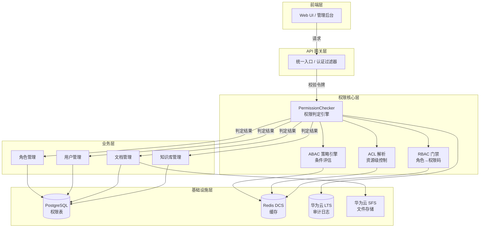
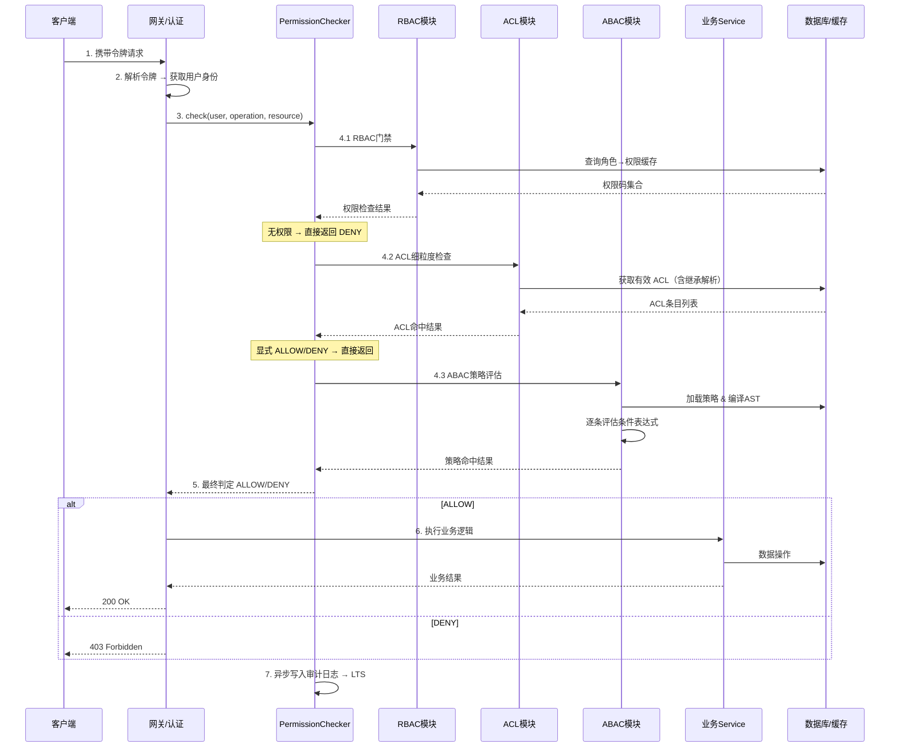
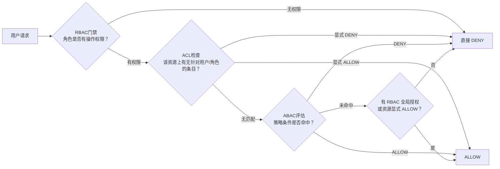
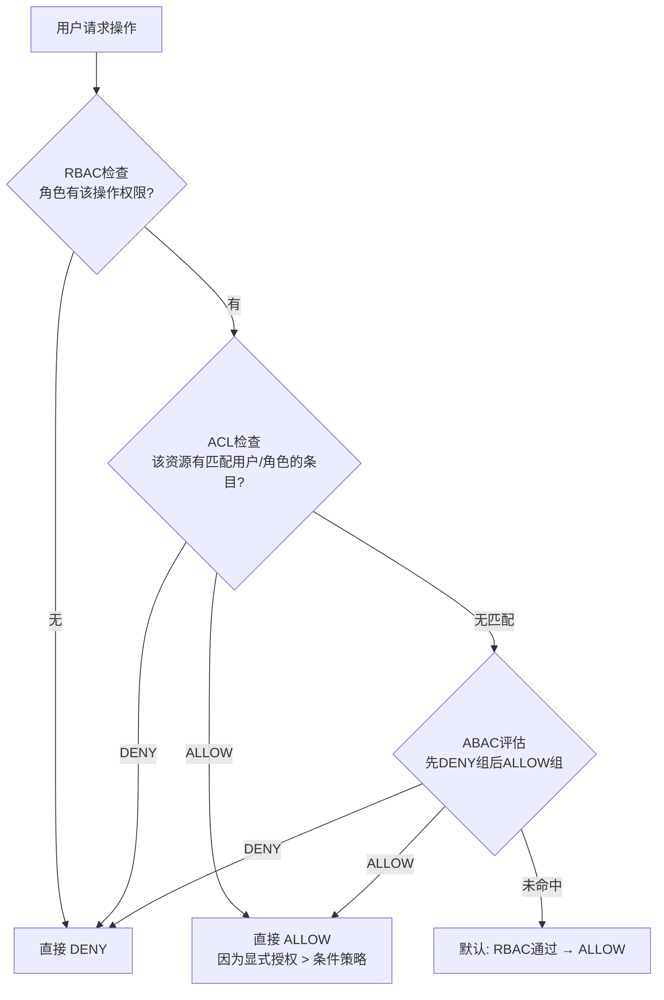
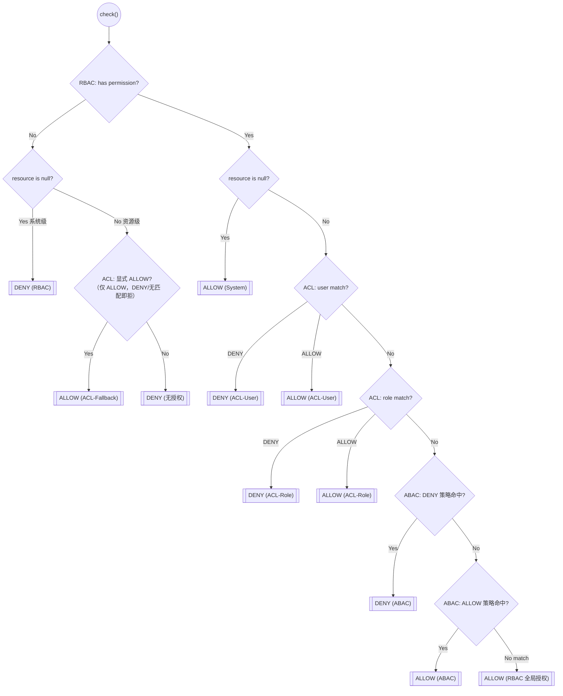
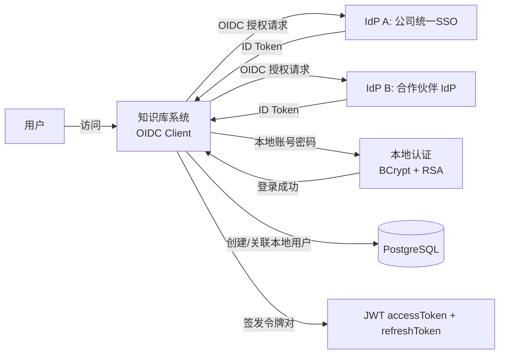
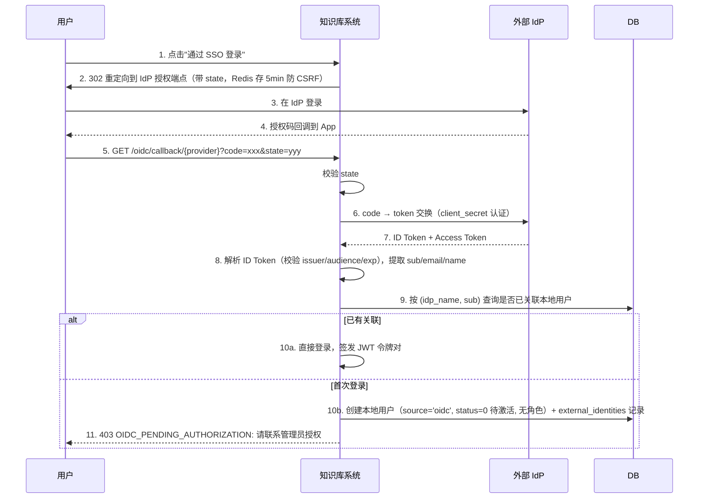

# 权限与安全设计

## 功能设计说明书

海思知识库架构设计 — 权限与安全设计

### 产品版本 & 密级

| 产品版本 Product Version | 密级 Security Level |
|------------------------|-------------------|
| V1.5 | 保密 |

### 拟制信息

| 角色 | 姓名 | 日期 |
|------|------|------|
| 拟制 Prepared by | 架构组 | 2026-08-20 |
| 评审 Reviewed by | | |
| 批准 Approved by | | |

### 修订记录

| 日期 | 修订版本 | 修改描述 | 作者 |
|------|---------|---------|------|
| 2026-07-20 | 1.0 | 初稿完成 | 架构组 |
| 2026-08-20 | 1.1 | 细化文档 | 架构组 |
| 2026-08-20 | 1.2 | 修正 2.1 权限判定措辞（短路语义，对齐 3.2 设计原则） | 架构组 |
| 2026-08-20 | 1.3 | 合并实施级详细设计：ABAC 评估语义改为 DENY 优先；ID 统一 String；模块/包规划；响应式接口契约；哈希链并发串行化；审计 AOP 去 SpEL 与采样；错误码与实施顺序；删除独立详细设计文档 | 架构组 |
| 2026-08-20 | 1.4 | 细化：新增社区用户预置角色（community）与 kb:doc:chat 权限码；公开资源判定规则（字典来源 + 实体元数据最具体层覆盖）；社区问答 kbIds 过滤；回答引用文档经下载接口查看的放行规则；hispark OIDC 首登自动赋角色；管理人员问答不受公开过滤限制（效果验证复用 /auth/preview 与 /kb/public）；res.sensitivity 修正为 STRING 字典值 | 架构组 |
| 2026-08-20 | 1.5 | 角色体系重构：判定语义修订（资源操作 = RBAC 全局授权 ∪ 资源显式 ACL 授权，不再默认放行）；角色二分（全局角色 / KB 域角色）；系统管理员瘦身（仅 sys:*）；KB 域角色按库生效（复用 acl_entries 承载授权）；新增 kb_platform 平台角色集中建库/删库，创建者自动成为该 KB 管理员；新增 4.13 KB 域授权机制 | 架构组 |

### Keywords 关键词

RBAC, ABAC, ACL, OIDC, 权限控制, 安全审计, 策略引擎

### Abstract 摘要

本文档基于 DDD（领域驱动设计）+ Quarkus 框架，从 RBAC、ABAC、ACL 三层门禁模型出发，详细描述了海思知识库平台的权限与安全体系设计。包含资源与操作定义、用户角色设计、ABAC 策略引擎、ACL 继承解析、OIDC 单点登录集成、审计日志与合规等核心功能。**本文档提供完整数据表定义、核心类/方法签名、缓存策略、判定流程、模块包规划与实施顺序，开发人员可据此直接编码实现。**所有接口契约遵循 `quarkus规范.md`：Mutiny 响应式、`Uni<ResponseResult<T>>` / `Uni<PageResult<T>>`、record Command、MapStruct、Repository 模式。

### List of abbreviations 缩略语清单

| Abbreviations | Full spelling | 中文解释 |
|---------------|---------------|---------|
| RBAC | Role-Based Access Control | 基于角色的访问控制 |
| ABAC | Attribute-Based Access Control | 基于属性的访问控制 |
| ACL | Access Control List | 访问控制列表 |
| OIDC | OpenID Connect | 开放身份连接 |
| SSO | Single Sign-On | 单点登录 |
| DDD | Domain-Driven Design | 领域驱动设计 |
| AST | Abstract Syntax Tree | 抽象语法树 |
| LTS | Log Tank Service | 华为云日志服务 |
| DCS | Distributed Cache Service | 华为云分布式缓存 |
| SFS | Scalable File Service | 华为云弹性文件服务 |
| JPA | Jakarta Persistence API | Jakarta 持久化 API |
| RSA | Rivest-Shamir-Adleman | 非对称加密算法 |
| BCrypt | password hashing | 密码哈希算法 |

---

## 1 前言

本系统采用 **三层门禁（RBAC → ACL → ABAC）** 对整个系统的权限进行控制，保障系统安全。本文档是后端架构设计文档的权限安全子集，与 `海思知识库架构设计-后端架构设计.md`、`quarkus规范.md` 配套使用。

---

## 2 功能域概述

### 2.1 权限控制在系统中的位置

下图展示了权限子系统在整个平台中的位置及其与周边模块的关系：



整体自下而上可分为基础设施层、业务层、权限核心层、API网关层以及前端层：

* 前端层：作为用户交互的入口，主要通过 Web UI 或管理后台发起业务请求。
* API网关层：充当系统的统一入口，内置认证过滤器，负责对 incoming 请求进行统一的拦截与身份令牌校验，确保访问的合法性。
* 权限核心层：这是系统安全的核心枢纽，由 PermissionChecker 权限判定引擎统筹。引擎采用三层复合判定机制，依次进行 RBAC（角色-权限码门禁）、ACL（资源级解析控制）以及 ABAC（策略引擎条件评估）。采用短路判定：RBAC 不通过即直接 DENY，ACL 显式 ALLOW/DENY 即直接返回、不再评估 ABAC，三层均未拒绝方放行至下游业务层（DENY 优先 + RBAC 为地板）。
* 业务层：承载具体的业务逻辑，涵盖了角色管理、用户管理、文档管理和知识库管理等核心模块，直接响应前端的具体业务需求。
* 基础设施层：为上层提供数据与存储支撑。其中，PostgreSQL 用于存储权限表等结构化核心数据；Redis DCS 提供高速缓存能力，加速权限等热点数据的读取；华为云 LTS 负责记录审计日志，保障操作可追溯；华为云 SFS 则提供文件存储服务，支撑知识库文档的存放。

### 2.2 与其他模块的关系



系统在处理客户端请求时，与各模块之间进行全链路权限校验及业务执行，核心在于 PermissionChecker（权限判定引擎）对 RBAC、ACL 和 ABAC 三种策略的逐级调度：

* 请求接入与身份解析：客户端携带令牌发起请求，网关或认证层首先拦截请求并解析令牌以获取用户身份，随后向权限判定引擎发起包含用户、操作和资源信息的校验指令 check(user, operation, resource)。
三层权限递进校验：
* RBAC 门禁（第一层）：引擎首先调用 RBAC 模块，查询数据库或缓存获取角色的权限码集合。若在此阶段判定无权限，系统将直接返回拒绝（DENY），实现快速拦截。
* ACL 细粒度检查（第二层）：若 RBAC 层放行，引擎继续调用 ACL 模块，获取含继承解析的有效 ACL 条目列表。若 ACL 中命中了显式的允许（ALLOW）或拒绝（DENY）规则，引擎将直接返回最终结果，不再向下执行。
* ABAC 策略评估（第三层）：若前两层未产生明确结果，引擎最后调用 ABAC 模块，加载策略并编译为 AST（抽象语法树），逐条评估条件表达式，得出最终的策略命中结果。
* 结果处理与业务执行：权限判定引擎汇总三层结果后，向网关返回最终的允许（ALLOW）或拒绝（DENY）判定。若为 ALLOW，网关则放行并调用业务 Service 进行数据操作，最终向客户端返回 200 OK；若为 DENY，则直接返回 403 Forbidden 拒绝访问。
* 异步审计：在整个权限判定流程结束后，引擎会在后台异步将本次操作的审计日志写入 LTS（日志服务），确保系统操作可追溯，同时不阻塞主业务流程的响应速度。

### 2.3 三层门禁设计总览

| 层级 | 模型 | 决定 | 粒度 | 配置方式 |
|------|------|------|------|---------|
| **第一层** | RBAC | 用户"能做什么操作" | 全局（操作级） | 角色→权限码映射 |
| **第二层** | ACL | "对这个资源能不能做" | 资源级 | 资源→主体→权限码条目 |
| **第三层** | ABAC | "在什么条件下能做" | 条件级 | 基于属性的策略规则 |

**判定优先级（从高到低）：**

```
ACL显式DENY > ACL显式ALLOW > ABAC DENY > ABAC ALLOW > RBAC全局授权路径默认放行
（资源操作无 RBAC 全局授权时：资源上存在显式 ALLOW 条目 → 放行；否则 DENY，见 3.2 原则 4）
```

### 2.4 设计目标

| # | 目标 | 实现手段 |
|---|------|---------|
| 1 | 控制不同角色对知识库的访问权限 | RBAC 角色→权限码映射 |
| 2 | 控制不同文档类型、保密等级、部门、地域的权限策略 | ABAC 条件表达式策略 |
| 3 | 防止多策略融合下敏感信息泄露 | DENY 优先 + ACL 显式拒绝 |
| 4 | 确保多角色场景下的数据安全 | 三层联合判定 + 角色隔离 |
| 5 | 审计留痕，满足合规要求 | 不可篡改审计日志 → 华为云 LTS |

---

## 3 功能域总体方案

### 3.1 总体架构


总体架构采用 RBAC（基于角色的访问控制）、ACL（访问控制列表）与 ABAC（基于属性的访问控制）三层递进式的判定机制，具体执行过程如下：

* 第一层：RBAC 门禁（粗粒度校验）：用户发起请求后，系统首先校验该用户所属角色是否具备基本的操作权限。若判定为"无权限"，对**系统级操作**直接返回 DENY；对**资源级操作**降级检查该资源上的显式 ACL 授权（见下文第 2 层与 3.2 原则 4），实现快速拦截与最小授权。
* 第二层：ACL 检查（细粒度校验）：若 RBAC 校验通过（有权限），系统进一步针对具体资源检查是否存在针对该用户或角色的 ACL 条目。若存在且命中"显式 DENY"，则直接拒绝；若命中"显式 ALLOW"，则直接允许访问；若无匹配条目，则进入下一层评估。若 RBAC 无全局权限，ACL 命中显式 ALLOW（含 KB 域角色授权，见 4.13）同样放行。
* 第三层：ABAC 评估（动态策略校验）：当 ACL 无匹配时，系统启动 ABAC 引擎评估动态策略条件是否命中。若策略条件满足（ALLOW），则允许访问；若策略评估为 DENY，则拒绝访问。
* 默认兜底机制：若 ABAC 策略也未命中，系统按"RBAC 全局授权通过 → ALLOW"放行；**无 RBAC 全局授权的资源操作默认 DENY**（资源级最小授权，见 3.2 原则 4）。

### 3.2 设计原则

1. **DENY 覆盖 ALLOW**：任何层的 DENY 都能否决下层的 ALLOW（**含 ABAC 层内部**：DENY 策略组优先于 ALLOW 策略组评估，见 4.3.3.2）
2. **显式覆盖隐式**：ACL 的显式配置 > ABAC 的自动策略
3. **用户主体覆盖角色主体**：用户级 ACL > 角色级 ACL
4. **资源操作最小授权**（修订原"RBAC 是地板"）：系统级操作 RBAC 通过即放行；**资源级操作需 RBAC 全局授权 或 该资源上的显式 ACL ALLOW 二者其一**，均无则 DENY。全局授权走"ACL 可收紧"路径（默认放行），KB 域授权（4.13）走"显式才放行"路径
5. **短路优先**：RBAC 不通过时，系统级操作直接返回；资源级操作降级检查 ACL 显式条目（4.6.3.2），跳过 ABAC 评估

### 3.3 技术选型

| 组件 | 选型 | 用途 |
|------|------|------|
| 权限缓存 | Redis DCS | RBAC 角色权限缓存、ABAC 策略缓存、ACL 有效权限缓存 |
| 审计日志 | 华为云 LTS | 不可篡改日志存储 |
| 身份认证 | OIDC Client + 本地账号 | 对接外部 IdP、本地密码登录 |
| 密码加密 | BCrypt | 用户密码存储 |
| 传输加密 | RSA（前端→后端） | 登录密码前端加密传输 |

---
* 权限缓存：选用 Redis DCS 作为高性能缓存组件，主要用于存储 RBAC 角色权限、ABAC 策略以及 ACL 有效权限数据。通过缓存机制，能够大幅提升高频权限判定引擎的响应速度，降低底层数据库的访问压力。
* 审计日志：采用华为云 LTS（日志服务）来存储审计日志，利用其特性实现不可篡改的日志存储。这为系统的安全合规审查、操作追溯以及故障排查提供了坚实可靠的数据保障。
* 身份认证：技术方案采用 OIDC Client 结合本地账号的混合模式。这种架构既支持对接外部身份提供商（IdP）实现单点登录或联邦身份认证，又兼容传统的本地密码登录方式，兼顾了企业级集成的灵活性与本地管理的便利性。
* 密码加密：在用户密码存储环节选用 BCrypt 算法。BCrypt 具备自适应哈希和加盐机制，能够有效抵御彩虹表攻击和暴力破解，确保即使数据库泄露，用户密码依然高度安全。
* 传输加密：针对登录过程中敏感密码的传输，采用 RSA 非对称加密算法（前端到后端）。密码在前端使用公钥加密后传输，后端再用私钥解密，从而防止密码在网络传输过程中被窃听或中间人攻击，保障数据传输的机密性。
---

## 3A 模块与包规划（实施约束）

### 3A.1 职责划分

| 模块 | 承载内容 | 不承载 |
|------|---------|--------|
| `commons/commons-abac` | 纯表达式引擎：Token、Lexer、Parser、AST 节点、Operator、EvalContext（接口）、表达式异常 | 任何 Quarkus 注解、任何 IO/数据库/Redis 依赖。必须是可独立 JUnit 测试的纯 Java |
| `system` | 用户/角色/权限 RBAC 全套；`abac_attributes`、`abac_policies` 管理（属系统管理域）；ACL 条目管理；PermissionChecker、AclService、PolicyEvaluator、HashChainService、AuditLogService；认证（本地 + OIDC）；审计查询 | 知识库资源本身的属性解析 |
| `knowledge` | 类别/文档资源、`inheritParent` 字段；实现 `ResourceAttrResolver` SPI（供 EvalContext 取 `res.*`）；列表/搜索结果按权限后过滤 | 判定逻辑本身 |
| `commons-web` | `@RequirePermission` 注解 + 拦截器；DENY → 统一 403 错误响应 | 三层判定细节 |
| `commons-errorcode` | 权限域错误码段（见 4.9） | — |
| `hisilicon-knowledge-platform-service` | Flyway 迁移脚本、application.yaml 安全配置段 | 业务逻辑 |

### 3A.2 包结构（以 system 模块为例，遵循 quarkus规范）

```
com.hisilicon.knowledge.platform.system
├── facade
│   ├── UserResource            （已有，扩展角色绑定端点）
│   ├── RoleResource            （新增）
│   ├── AclResource             （新增）
│   ├── PolicyResource          （新增，挂 /kb/{kbId}/policies）
│   ├── AuditLogResource        （新增）
│   └── AuthCheckResource       （新增，/auth/check 等）
├── command
│   ├── CreateUserCommand / EditUserCommand / BindRoleCommand ...
│   ├── CreateRoleCommand / EditRoleCommand / CopyRoleCommand
│   ├── CreateAclEntryCommand / EditAclEntryCommand / SwitchInheritCommand
│   ├── CreatePolicyCommand / EditPolicyCommand / TogglePolicyCommand / ValidateExprCommand
│   └── UserCommandService / RoleCommandService / AclCommandService / PolicyCommandService
├── query
│   ├── UserQueryService / RoleQueryService / AclQueryService / AuditLogQueryService
│   └── dto/ UserItem / RoleItem / AclEntryItem / PolicyItem / AuditLogItem
├── domain
│   ├── entity
│   │   ├── UserEntity（扩展 ABAC 四属性）
│   │   ├── RoleEntity / AclEntryEntity / AbacPolicyEntity / AbacAttributeEntity / AuditLogEntity
│   │   └── value: UserId / RoleId / ResourceRef(type, id, kbId)
│   ├── service
│   │   ├── PermissionChecker      （接口，实现组装见 4.6）
│   │   ├── AclService             （接口）
│   │   ├── PolicyEvaluator        （接口）
│   │   ├── PermissionService      （PermissionChecker 的 @ApplicationScoped 实现，组装三层）
│   │   └── HashChainService
│   ├── event
│   │   ├── RolePermissionsChangedEvent
│   │   ├── AclChangedEvent(resourceType, resourceId)
│   │   ├── AbacPolicyChangedEvent(kbId)
│   │   └── AuditEvent(type, operator, target, detail, decision, reason)
│   └── repository
│       ├── RoleRepository / AclEntryRepository / AbacPolicyRepository
│       ├── AbacAttributeRepository / AuditLogRepository
│       └── （UserRepository 已有，扩展）
├── infrastructure
│   ├── repository/ *RepositoryImpl（Panache Reactive）
│   ├── repository/po/ RolePO / AclEntryPO / AbacPolicyPO / AbacAttributePO / AuditLogPO（扩展）
│   ├── mapper/ MapStruct 接口
│   ├── permission/ PermissionServiceImpl 组装依赖、缓存适配
│   ├── cache/ PermissionCache（Redis 适配，key 常量集中在此）
│   ├── audit/ AuditLogInterceptor / LtsPublisher（接口+SLF4J 默认实现+华为云适配器）
│   └── oidc/ OidcLoginService / ExternalIdentityRepository
└── spi（对外 SPI，供 knowledge 模块实现）
    └── ResourceAttrResolver.java  （knowledge 模块实现，@ApplicationScoped 注入回 PermissionService）
```

> 说明：`PermissionChecker` 的三层组装需要缓存、SPI、审计等基础设施，属于"跨聚合协调 + 技术设施"，实现放在 `infrastructure.permission`；`domain.service` 只留接口，保证领域层零 Quarkus 依赖。领域事件用 Vert.x EventBus（`eventBus.publish(...)`）发布，不引入额外 MQ。

---

## 4 功能实现设计

### 4.1 功能编号：资源与操作定义

#### 4.1.1 功能概述

本章对系统资源和操作权限进行统一定义，所有权限控制组件（RBAC / ACL / ABAC）均基于此定义工作。操作权限使用**权限码（Permission Code）** 作为唯一标识。

#### 4.1.2 资源树

```
系统 (System)
├── 知识库 (KnowledgeBase)
│   ├── 类别 (Category)           — 树形结构，知识库下的子目录
│   │   ├── 文档 (Document)       — 叶子节点，具体知识条目
│   │   └── 子类别...
│   └── 文档 (Document)           — 可直接挂在知识库根目录下
└── 系统资源
    ├── 用户 (User)
    ├── 角色 (Role)
    └── 审计日志 (AuditLog)
```

#### 4.1.3 操作权限定义

| 权限码 | 作用资源 | 描述 | 归属模块 |
|--------|---------|------|---------|
| `kb:create` | KnowledgeBase | 新建知识库 | knowledge |
| `kb:delete` | KnowledgeBase | 删除知识库 | knowledge |
| `kb:config` | KnowledgeBase | 修改知识库设置（名称、描述、策略绑定） | knowledge |
| `kb:list` | KnowledgeBase | 列出所有知识库 | knowledge |
| `kb:cat:create` | KnowledgeBase / Category | 在知识库下创建类别 | knowledge |
| `kb:cat:delete` | KnowledgeBase / Category | 删除类别（级联删除子类别和文档） | knowledge |
| `kb:cat:move` | KnowledgeBase / Category | 移动类别到其他位置 | knowledge |
| `kb:doc:upload` | KnowledgeBase / Category | 上传/新建文档 | knowledge |
| `kb:doc:edit` | KnowledgeBase / Document | 修改文档内容或元数据 | knowledge |
| `kb:doc:read` | KnowledgeBase / Document | 查看文档内容 | knowledge |
| `kb:doc:search` | KnowledgeBase / Document | 检索/搜索文档（可发现文档存在） | knowledge |
| `kb:doc:delete` | KnowledgeBase / Document | 删除文档 | knowledge |
| `kb:doc:review` | KnowledgeBase / Document | 审核文档（通过/驳回/标记） | knowledge |
| `kb:doc:export` | KnowledgeBase / Document | 导出文档 | knowledge |
| `kb:doc:chat` | KnowledgeBase / Document | 知识库问答（仅限公开知识库/公开文档） | llm / knowledge |
| `sys:user` | System | 管理用户（增删改、分配角色） | system |
| `sys:role` | System | 管理角色（创建/编辑/删除自定义角色） | system |
| `sys:audit` | System | 查看审计日志 | system |
| `sys:config` | System | 修改系统配置 | system |

#### 4.1.4 SR 设计

| 系统需求编号 | 系统需求 | 系统需求描述 |
|-------------|---------|-------------|
| F-097 | RBAC | 用户通过角色获得操作权限，支持多角色组合 |
| F-098 | ABAC | 用户属性（部门、地域、雇佣类型、安全级别）参与 ABAC 策略条件判定 |
| F-099 | 细粒度 | 用户可作为 ACL 条目的主体，被授予或拒绝特定资源的访问权限 |

#### 4.1.5 实现设计：权限码枚举（开发指引）

```java
package com.hisilicon.knowledge.platform.system.domain.entity;

/**
 * 系统所有操作权限码枚举。作为唯一权威来源：
 * 角色配置页面通过 GET /role/permissions 读取枚举渲染。
 * 新增权限码时追加枚举值 + 迁移脚本 INSERT，前端角色配置页面自动渲染。
 */
public enum PermissionCode {
    // 知识库级
    KB_CREATE("kb:create", "新建知识库"),
    KB_DELETE("kb:delete", "删除知识库"),
    KB_CONFIG("kb:config", "修改知识库设置"),
    KB_LIST("kb:list", "列出知识库"),

    // 类别级
    KB_CAT_CREATE("kb:cat:create", "创建类别"),
    KB_CAT_DELETE("kb:cat:delete", "删除类别"),
    KB_CAT_MOVE("kb:cat:move", "移动类别"),

    // 文档级
    KB_DOC_UPLOAD("kb:doc:upload", "上传文档"),
    KB_DOC_EDIT("kb:doc:edit", "编辑文档"),
    KB_DOC_READ("kb:doc:read", "查看文档"),
    KB_DOC_SEARCH("kb:doc:search", "搜索文档"),
    KB_DOC_DELETE("kb:doc:delete", "删除文档"),
    KB_DOC_REVIEW("kb:doc:review", "审核文档"),
    KB_DOC_EXPORT("kb:doc:export", "导出文档"),
    KB_DOC_CHAT("kb:doc:chat", "知识库问答"),

    // 系统级
    SYS_USER("sys:user", "管理用户"),
    SYS_ROLE("sys:role", "管理角色"),
    SYS_AUDIT("sys:audit", "查看审计日志"),
    SYS_CONFIG("sys:config", "修改系统配置");

    private final String code;
    private final String displayName;

    // constructor, getter...
}
```

**权限码命名约定**：`<域>:<子域>:<操作>`，域为 `kb`（知识库）或 `sys`（系统），操作动词用英文小写。

---

### 4.2 功能编号：用户角色设计（RBAC）

#### 4.2.1 功能概述

本章对系统用户、角色、权限进行设计，这是权限控制的基础。在此基础上扩展出 ABAC 和 ACL。RBAC 层决定用户"能做什么操作"——是第一道门禁。

#### 4.2.2 SR 设计

| 系统需求编号 | 系统需求 | 系统需求描述 |
|-------------|---------|-------------|
| F-097 | RBAC | 用户通过角色获得操作权限，支持多角色组合 |

#### 4.2.3 实现设计

##### 4.2.3.1 领域数据模型

> **ID 约定**：全系统主键统一为 **String（UUID，VARCHAR(36)）**，与现有 `users` 表及 `UserId.of(String)` 值对象对齐。领域层 ID 用值对象包装，PO 层用普通 `String`。

**`users` 表**（已有表，迁移脚本仅新增 ABAC 四列）：

| 字段 | 类型 | 约束 | 说明 |
|------|------|------|------|
| id | VARCHAR(36) | PK | 用户 ID（UUID） |
| username | VARCHAR(64) | UNIQUE, NOT NULL | 用户名 |
| password_hash | VARCHAR(256) | NOT NULL | BCrypt 哈希值 |
| email | VARCHAR(128) | | 邮箱 |
| display_name | VARCHAR(64) | | 显示名 |
| status | SMALLINT | DEFAULT 1 | 0=待激活(oidc 首次登录), 1=启用, 2=停用 |
| source | VARCHAR(16) | DEFAULT 'local' | 来源: local, oidc |
| department | VARCHAR(64) | | ABAC: 部门 |
| region | VARCHAR(32) | | ABAC: 地域 |
| employment_type | VARCHAR(16) | | ABAC: 雇佣类型 |
| clearance | SMALLINT | DEFAULT 0 | ABAC: 安全级别(0=未定级, 1-5) |
| created_at | TIMESTAMP | | |
| updated_at | TIMESTAMP | | |

**`roles` 表**

| 字段 | 类型 | 约束 | 说明 |
|------|------|------|------|
| id | VARCHAR(36) | PK | 角色 ID |
| role_key | VARCHAR(64) | UNIQUE, NOT NULL | 角色唯一标识，如 `admin` |
| name | VARCHAR(64) | NOT NULL | 角色名称 |
| description | VARCHAR(256) | | 描述 |
| is_preset | BOOLEAN | DEFAULT false | 是否为预设角色（不可删除） |
| created_at | TIMESTAMP | | |
| updated_at | TIMESTAMP | | |

**`user_roles` / `role_permissions` 关联表**：结构同原有设计（复合主键），ID 类型改为 VARCHAR(36) / permission_code 为 VARCHAR(64)。

##### 4.2.3.2 预制角色及权限矩阵

**角色二分**：预设角色分为**全局角色**（权限全系统生效）与 **KB 域角色**（仅在用户被绑定该角色的知识库内生效，授权机制见 4.13）。

| 类型 | role_key | 角色 | 说明 |
|------|----------|------|------|
| 全局 | `admin` | 系统管理员 | **纯系统管理**：仅 sys:* 四项，不持有任何 kb:* 权限码（含 kb:list），退出业务域；KB 层面情况经 `sys:audit` 审计日志可见 |
| 全局 | `kb_platform` | 知识库平台管理员 | 集中建库/删库/浏览全量清单；建库后自动成为该 KB 的 kb_admin（见 4.13.3），日常管理走 KB 域授权 |
| 全局 | `community` | 社区用户 | 仅知识库问答（公开 KB + 公开文档，见 4.12） |
| KB 域 | `kb_admin` | 知识库管理员 | 管理绑定的知识库：配置、成员分配、删除文档等 |
| KB 域 | `reviewer` | 审核员 | 绑定的知识库内审核文档 |
| KB 域 | `editor` | 编辑者 | 绑定的知识库内上传/编辑文档 |
| KB 域 | `developer` | 开发者 | 绑定的知识库内检索/查看/导出 |

**权限矩阵**（KB 域角色的 ✔ 表示"绑定到某 KB 后，在该 KB 内生效"）：

| 权限码 | admin | kb_platform | community | kb_admin | reviewer | editor | developer |
|--------|-------|-------------|-----------|----------|----------|--------|-----------|
| `kb:create` | — | ✔ | — | — | — | — | — |
| `kb:delete` | — | ✔ | — | — | — | — | — |
| `kb:config` | — | — | — | ✔ | — | — | — |
| `kb:list` | — | ✔ | — | ✔¹ | — | — | — |
| `kb:cat:create` | — | — | — | ✔ | — | — | — |
| `kb:cat:delete` | — | — | — | ✔ | — | — | — |
| `kb:cat:move` | — | — | — | ✔ | — | — | — |
| `kb:doc:upload` | — | — | — | ✔ | — | ✔ | — |
| `kb:doc:edit` | — | — | — | ✔ | — | ✔ | — |
| `kb:doc:read` | — | — | — | ✔ | ✔ | ✔ | ✔ |
| `kb:doc:search` | — | — | — | ✔ | ✔ | ✔ | ✔ |
| `kb:doc:delete` | — | — | — | ✔ | — | — | — |
| `kb:doc:review` | — | — | — | ✔ | ✔ | — | — |
| `kb:doc:export` | — | — | — | ✔ | ✔ | ✔ | ✔ |
| `kb:doc:chat` | — | ✔ | ✔ | ✔ | ✔ | ✔ | ✔ |
| `sys:user` | ✔ | — | — | — | — | — | — |
| `sys:role` | ✔ | — | — | — | — | — | — |
| `sys:audit` | ✔ | — | — | — | — | — | — |
| `sys:config` | ✔ | — | — | — | — | — | — |

> ¹ `kb_admin` 的 `kb:list` 为 KB 域权限码：绑定后仅能列出**其绑定的**知识库（实现：`/kb/list` 对无全局 `kb:list` 的用户返回绑定 KB 子集），非全局清单。
>
> **社区用户（`community`）**：仅 `kb:doc:chat` 一项权限。问答与公开文档查看的门禁细节见 4.12。社区用户**不授 `kb:list`**（避免看到内部知识库名称，公开 KB 列表走独立端点，见 4.12.4），**不授 `kb:doc:read`**（内部文档查看走 RBAC/ACL；公开文档查看经 `kb:doc:chat` + 公开判定放行，见 4.12.3）。
>
> **约束**：自定义角色不可授予 `sys:role` 和 `sys:user` 权限（防止权限扩散），该约束在后端 `RoleCommandService.createRole()` 中硬编码校验，违反抛 `BusinessException(ErrorCode.ROLE_FORBIDDEN_PERMISSION)`。自定义角色创建时需声明作用域（全局 / KB 域）：KB 域自定义角色同 KB 域预设角色按库生效。

预设角色 role_key：`admin` / `kb_platform` / `community` / `kb_admin` / `reviewer` / `editor` / `developer`，`is_preset=true`，以 Flyway 迁移脚本 INSERT 预置（含 `role_scope` 标记，见 4.13.1）。

**关键问答**：系统管理员能建库吗——**不能**（无 kb:create）；知识库管理员能管几个库——**只管被绑定的**；谁能删库——**仅 kb_platform**。

##### 4.2.3.3 关键行为规则

- `RoleCommandService.deleteRole`：仅允许删除自定义角色；删除前查询引用该角色的用户数，非零时仍允许删除但**强制解绑**（先解绑 `user_roles` 再删角色），响应中返回告警字段 `unboundUserCount`。
- 预设角色（`is_preset=true`）禁止删除、禁止修改 `role_key`，允许修改权限码集合。
- OIDC 来源用户：`UserCommandService.editUser` 拒绝修改 `username`、`email`（`ErrorCode.USER_OIDC_FIELD_READONLY`）。
- **hispark 社区用户自动授权**：IdP `hispark` 的用户首次登录时自动创建本地用户、绑定 `community` 角色、直接激活（status=1），无需管理员授权（流程见 4.8.2.2，配置见 4.8.2.5）；自动赋角色写审计 `USER_ROLES_CHANGED`（reason=oidc_auto_assign）。
- **全局角色绑定接口排除 KB 域角色**：`/user/bindRole`、`/user/unbindRole` 仅允许全局角色（`admin`/`kb_platform`/`community`/自定义全局角色）；KB 域角色（预设及自定义 KB 域角色）经 KB 成员管理接口（4.13.2）按库授予，走全局绑定接口返回 `ErrorCode.ROLE_KB_SCOPED_BIND_FORBIDDEN`。
- `roles` 表新增 `role_scope VARCHAR(16) NOT NULL DEFAULT 'GLOBAL'`（`GLOBAL` / `KB_SCOPED`），KB 域自定义角色需声明 `KB_SCOPED`。

##### 4.2.3.4 核心服务接口（开发指引）

```java
package com.hisilicon.knowledge.platform.system.domain.repository;

public interface UserRepository {
    /** 加载用户所有权限码（JOIN user_roles + role_permissions，合并多角色） */
    Uni<Set<String>> loadPermissionCodes(UserId userId);
    /** 角色权限变更后，反查需失效缓存的用户 */
    Uni<List<UserId>> findUserIdsByRoleId(RoleId roleId);

    // ... 既有方法
}
```

缓存（`infrastructure/cache/PermissionCache`，Redis，优先 ReactiveStreamCommands）：

| 缓存项 | Key | TTL | 失效 |
|--------|-----|-----|------|
| 用户权限码集合 | `perm:user:{userId}` | 30min | `RolePermissionsChangedEvent` → DEL 该用户；角色权限码变更 → 该角色下所有用户 key |

##### 4.2.3.5 RBAC 判定逻辑（Layer 1，响应式）

```java
// PermissionServiceImpl 内（语义示意；实施时必须用 chain() 串联，禁止在响应式链中 .await() 阻塞）
Uni<Set<String>> perms = permissionCache.get(userId)
    .chain(opt -> opt.isPresent()
        ? Uni.createFrom().item(opt.get())
        : userRepository.loadPermissionCodes(userId)
              .invoke(p -> permissionCache.put(userId, p)));
// 不含 operation → Decision.DENY_RBAC（审计 PERMISSION_DENIED）；否则进入 ACL 检查
```

##### 4.2.3.6 用户接口设计

所有端点返回 `Uni<ResponseResult<T>>`（分页为 `Uni<PageResult<T>>`）；入参为 record Command，接口层做 `@NotNull/@Size` 校验。

| 方法 | 路径 | 说明 | 权限要求 |
|------|------|------|---------|
| GET | `/user/pageUsers` | 分页查询用户列表（支持用户名、部门、状态筛选），UserItem 含角色摘要与 ABAC 四属性 | `sys:user` |
| GET | `/user/users/{id}` | 查询用户详情（含角色列表和 ABAC 属性） | `sys:user` |
| POST | `/user/createUser` | 创建用户 | `sys:user` |
| POST | `/user/editUser` | 编辑用户信息和 ABAC 属性 | `sys:user` |
| DELETE | `/user/deleteUser/{id}` | 软删除用户 | `sys:user` |
| POST | `/user/bindRole` | 为用户分配角色，body `{userId, roleIds[]}`；成功后发 `RolePermissionsChangedEvent` | `sys:user` |
| DELETE | `/user/unbindRole` | 移除用户角色，query `userId, roleId` | `sys:user` |
| GET | `/role/pageRoles` | 角色列表 | `sys:role` |
| GET | `/role/roles/{id}` | 角色详情（含权限码列表） | `sys:role` |
| POST | `/role/createRole` | 创建自定义角色 | `sys:role` |
| POST | `/role/editRole` | 编辑角色 | `sys:role` |
| DELETE | `/role/deleteRole/{id}` | 删除角色（仅自定义角色，响应含 `unboundUserCount`） | `sys:role` |
| POST | `/role/copyRole` | 复制角色，body `{roleId, newRoleKey, newName}` | `sys:role` |
| GET | `/role/permissions` | 获取全部可用权限码列表 `[{code, displayName}]` | `sys:role` |

**前提条件**：所有接口需登录（携带有效 accessToken）。

**约束与限制**：
- 预设角色（`admin`, `kb_admin`, `reviewer`, `editor`, `developer`）不可删除，`is_preset` 标记为 true
- 删除自定义角色前检查是否有用户仅依赖此角色，如有则给出告警并强制解绑
- OIDC 来源的用户，其 `username`、`email` 字段为只读

---

### 4.3 功能编号：ABAC 设计

#### 4.3.1 功能概述

ABAC（Attribute-Based Access Control）在 RBAC、ACL 基础上追加条件过滤。基于用户属性、资源属性、环境属性定义策略，实现组织级的自动化权限管控。ABAC 是**第三层门禁（策略层）**，仅当 RBAC 通过且 ACL 无显式命中时评估。

#### 4.3.2 SR 设计

| 系统需求编号 | 系统需求 | 系统需求描述 |
|-------------|---------|-------------|
| F-098 | ABAC | 用户属性（部门、地域、雇佣类型、安全级别）参与 ABAC 策略条件判定 |

#### 4.3.3 实现设计

##### 4.3.3.1 属性定义

属性通过 `abac_attributes` 表统一管理，支持动态扩展。PO/仓储归 `system` 模块（系统管理域），表达式引擎归 `commons-abac`。

**`abac_attributes` 表**

```sql
CREATE TABLE abac_attributes (
    id                  VARCHAR(36)  PRIMARY KEY,
    attr_key            VARCHAR(64)  NOT NULL UNIQUE,  -- e.g. 'user.dept', 'res.sensitivity'
    attr_name           VARCHAR(64)  NOT NULL,          -- e.g. '部门', '敏感等级'
    attr_type           VARCHAR(16)  NOT NULL,          -- STRING | NUMBER | ARRAY
    target_entity_types VARCHAR(128) NOT NULL,          -- 适用实体: USER,KB,CATEGORY,DOCUMENT（逗号分隔）
    description         VARCHAR(256),
    sort_order          INT          NOT NULL DEFAULT 0,
    created_at          TIMESTAMP    NOT NULL DEFAULT NOW()
);
```

**预制属性数据**（迁移脚本 INSERT；`res.org` 为补充项，"部门数据隔离"示例策略依赖它）：

```sql
INSERT INTO abac_attributes (id, attr_key, attr_name, attr_type, target_entity_types, sort_order) VALUES
 (gen_random_uuid()::text, 'user.dept',            '部门',     'STRING', 'USER',                   1),
 (gen_random_uuid()::text, 'user.region',          '地域',     'STRING', 'USER',                   2),
 (gen_random_uuid()::text, 'user.employment_type', '雇佣类型', 'STRING', 'USER',                   3),
 (gen_random_uuid()::text, 'user.clearance',       '安全级别', 'NUMBER', 'USER',                   4),
 (gen_random_uuid()::text, 'res.doc_type',         '文档类型', 'STRING', 'DOCUMENT',               5),
 (gen_random_uuid()::text, 'res.sensitivity',      '敏感等级', 'STRING', 'KB,CATEGORY,DOCUMENT',   6),
 (gen_random_uuid()::text, 'res.data_region',      '数据地域', 'STRING', 'DOCUMENT',               7),
 (gen_random_uuid()::text, 'res.compliance',       '合规标签', 'ARRAY',  'DOCUMENT',               8),
 (gen_random_uuid()::text, 'res.org',              '所属组织', 'STRING', 'KB,CATEGORY,DOCUMENT',   9),
 (gen_random_uuid()::text, 'env.network',          '网络类型', 'STRING', 'NONE',                   10);
```

**`target_entity_types` 说明**：

| 值 | 含义 |
|----|------|
| `USER` | 用户实体持有该属性（存储在 `users` 表对应字段） |
| `KB` | 知识库实体持有该属性 |
| `CATEGORY` | 类别实体持有该属性 |
| `DOCUMENT` | 文档实体持有该属性 |
| `NONE` | 环境属性，由系统上下文提供 |

##### 4.3.3.2 策略模型与评估语义

**`abac_policies` 表**

```sql
CREATE TABLE abac_policies (
    id                   VARCHAR(36)  PRIMARY KEY,
    kb_id                VARCHAR(36)  NOT NULL REFERENCES knowledge_bases(id),
    name                 VARCHAR(128) NOT NULL,
    priority             INT          NOT NULL DEFAULT 0,     -- 数值越大优先级越高
    target_resource_type VARCHAR(32),                          -- KB | CATEGORY | DOCUMENT | NULL(全部)
    target_operation     VARCHAR(64)  NOT NULL,               -- e.g. 'kb:doc:read', '*' 通配
    condition_expr       TEXT         NOT NULL,               -- 条件表达式字符串
    effect               VARCHAR(8)   NOT NULL CHECK (effect IN ('ALLOW','DENY')),
    is_enabled           BOOLEAN      NOT NULL DEFAULT true,
    description          VARCHAR(256),
    created_at           TIMESTAMP    NOT NULL DEFAULT NOW(),
    updated_at           TIMESTAMP    NOT NULL DEFAULT NOW(),
    CONSTRAINT uq_abac_policy_name UNIQUE (kb_id, name)
);
CREATE INDEX idx_abac_policies_kb ON abac_policies(kb_id, is_enabled);
```

策略 = **WHEN `<条件>` THEN `<效果>`**，每条策略是一个规则，绑定到知识库。

**评估语义（DENY 优先）**——为保证设计原则 1（DENY 覆盖 ALLOW）在 ABAC 层内部成立，评估顺序为：

1. 取该知识库启用策略，按 `target_operation` 过滤（支持 `*` 通配），按 `priority DESC` 排序；
2. **先评估全部 DENY 策略**（priority 降序），任一条件命中 → `DENY`；
3. 未命中再评估 ALLOW 策略（priority 降序），任一条件命中 → `ALLOW`；
4. 均未命中 → `NOT_APPLICABLE`（落回默认放行）。

"首命中"仅在同一 effect 组内适用。

**条件表达式语法（DSL 定义）：**

```
<属性路径> <操作符> <值>
```

| 操作符 | 支持类型 | 说明 |
|--------|---------|------|
| `=`, `!=` | STRING, NUMBER | 等于/不等于；实际值缺失(null)时 `!=` 返回 true，其余返回 false |
| `>`, `>=`, `<`, `<=` | NUMBER | 数值比较 |
| `IN` | STRING, NUMBER | 在列表中 |
| `CONTAINS` | ARRAY | 数组包含元素 |
| `AND`, `OR` | 组合 | 逻辑组合，支持括号 `()`，AND 优先级高于 OR |

**示例策略：**

| 名称 | 条件表达式 | 效果 | 优先级 |
|------|-----------|------|--------|
| 研发文档隔离 | `res.doc_type = "代码" AND user.dept = "研发部"` | ALLOW | 10 |
| 机密文档控制 | `res.sensitivity IN ["INTERNAL", "TOP_SECRET"] AND user.employment_type = "正式员工"` | ALLOW | 10 |
| 部门数据隔离 | `user.dept = res.org AND NOT (res.sensitivity = "PUBLIC")` | ALLOW | 5 |
| 地域限制 | `res.data_region = "EU" AND user.region != "EU"` | DENY | 20 |
| 公网访问拒绝 | `env.network = "公网" AND res.sensitivity = "TOP_SECRET"` | DENY | 20 |

> **注意**：`res.sensitivity` 为 STRING（字典值，如 `PUBLIC`/`INTERNAL`/`TOP_SECRET`），取值来自 `document_metadata`/`category_metadata`/`knowledge_base_metadata`（取值规则见 4.12.1）。不做数值比较；早期版本的 NUMBER 1~5 设计已废弃。

**策略评估逻辑（实现指引，响应式）：**

```java
// PolicyEvaluator 实现
Uni<PolicyResult> evaluate(String kbId, String operation, EvalContext ctx) {
    return policyCache.get(kbId)   // List<CachedPolicy{policy, ast}>，TTL 60min
      .map(list -> list.stream().filter(p -> p.enabled && match(p.targetOperation, operation)))
      .map(matched -> {
          PolicyResult r = matched.filter(DENY).sorted(priorityDesc)
              .findFirst().map(PolicyResult::deny).orElse(null);
          if (r != null) return r;
          r = matched.filter(ALLOW).sorted(priorityDesc)
              .findFirst().map(PolicyResult::allow).orElse(null);
          return r != null ? r : PolicyResult.NOT_APPLICABLE;
      });
}
// match(op, target): target == "*" 或相等
```

##### 4.3.3.3 表达式解析器实现指引（commons-abac 模块，纯 Java）

包结构：

```
com.hisilicon.knowledge.platform.commons.abac
├── token/ TokenType, Token
├── lexer/ Lexer（输入表达式字符串 → List<Token>，记录 position 供错误定位）
├── parser/ Parser（递归下降）
├── ast/ ExpressionNode / ConditionNode / AndNode / OrNode / Operator
├── eval/ EvalContext（接口：Object resolve(String attrPath)）
└── exception/ ExpressionParseException(line, column, message)
```

该模块**禁止**依赖任何 Quarkus 注解与 IO，保证可独立 JUnit 测试。评估入口 `static boolean evaluate(String expr, EvalContext ctx)` 内置进程内 LRU（expr→AST，容量 1000）；策略本身另有 Redis 缓存层。

**阶段一：词法分析（Lexer）**

```java
// Token 类型枚举
enum TokenType {
    ATTR,       // 属性路径: res.doc_type
    OP,         // 操作符: =, !=, >, >=, <, <=
    STRING,     // 字符串: "代码"
    NUMBER,     // 数值: 3
    AND, OR,    // 逻辑符
    LPAREN, RPAREN, COMMA, LBRACKET, RBRACKET,
    EOF
}

class Token {
    TokenType type;
    String value;
    int position;
}
```

**阶段二：语法分析（Parser）—— 递归下降**

```
文法规则 (EBNF):
    expression  := or_expr
    or_expr     := and_expr (OR and_expr)*
    and_expr    := primary (AND primary)*
    primary     := condition | LPAREN expression RPAREN
    condition   := ATTR OP value
    value       := STRING | NUMBER | list
    list        := LBRACKET value (COMMA value)* RBRACKET
```

```java
// AST 节点接口
interface ExpressionNode {
    boolean evaluate(EvalContext ctx);
}

// 条件节点：比较前做类型检查，NUMBER 操作符遇 STRING 抛 ExpressionTypeException（创建策略时即拦截）
class ConditionNode implements ExpressionNode {
    String attrPath;       // e.g. "res.doc_type"
    Operator operator;     // EQ, NEQ, GT, GTE, LT, LTE, IN, CONTAINS
    Object expectedValue;  // 右值

    boolean evaluate(EvalContext ctx) {
        Object actual = ctx.resolve(attrPath);
        if (actual == null) return operator == Operator.NEQ;
        return switch (operator) {
            case EQ  -> actual.equals(expectedValue);
            case NEQ -> !actual.equals(expectedValue);
            case GT  -> ((Comparable) actual).compareTo(expectedValue) > 0;
            case GTE -> ((Comparable) actual).compareTo(expectedValue) >= 0;
            case LT  -> ((Comparable) actual).compareTo(expectedValue) < 0;
            case LTE -> ((Comparable) actual).compareTo(expectedValue) <= 0;
            case IN  -> ((List<?>) expectedValue).contains(actual);
            case CONTAINS -> ((List<?>) actual).contains(expectedValue);
        };
    }
}
```

**`EvalContext` 实现（system 模块）：**

```java
public class PermissionEvalContext implements EvalContext {
    // 构造参数：UserEntity、ResourceRef、HttpRequestInfo(clientIp 等)
    Object resolve(String attrPath) { return attributes.get(attrPath); }
}
```

- `user.*` 取自当前登录用户；
- `res.*` 由 **`ResourceAttrResolver` SPI** 提供（system 定义，knowledge 实现）：

```java
public interface ResourceAttrResolver {
    Uni<Map<String, Object>> resolveAttributes(ResourceRef ref); // doc_type/sensitivity/data_region/compliance/org
    Uni<String> getKbId(ResourceRef ref);
    Uni<List<ResourceRef>> descendantIds(ResourceRef ref);       // ACL 缓存级联用
    Uni<List<ResourceRef>> parentChain(ResourceRef ref);         // ACL 继承链用
}
```

- `env.network` 取值：从配置 `hisilicon.security.network-ranges`（内网 CIDR 列表）匹配 clientIp（`X-Forwarded-For` 优先）→ `内网`，否则 `公网`；配置缺省时返回 `内网`（保守值，避免误 DENY）。

knowledge 模块的文档/类别/知识库 PO 需具备：`docType`、`sensitivity`、`dataRegion`、`compliance`（ARRAY 存 JSONB）、`org`；缺列在其迁移脚本中补齐。

**表达式引擎单测边界清单**：括号优先级、AND/OR 短路、类型不匹配、null 属性、IN 空列表、CONTAINS 非 ARRAY 实际值、表达式为空/超长（>2000 字符拒绝）、括号不闭合、非法字符。

##### 4.3.3.4 缓存策略

| 缓存项 | Key 格式 | TTL | 失效时机 |
|--------|---------|-----|---------|
| 知识库策略列表（Redis 存表达式字符串，加载后本地编译 AST + LRU） | `abac:policy:{kbId}` | 60min | `AbacPolicyChangedEvent(kbId)` → DEL 对应 key |
| 属性定义 | `abac:attributes` | 30min | 属性变更时清除（低频操作） |

##### 4.3.3.5 用户接口设计

| 方法 | 路径 | 说明 | 权限要求 |
|------|------|------|---------|
| GET | `/kb/{kbId}/policies` | 获取知识库策略列表（按优先级降序） | `kb:config` |
| GET | `/kb/{kbId}/policies/{id}` | 获取策略详情 | `kb:config` |
| POST | `/kb/{kbId}/createPolicy` | 创建策略（后端校验表达式语法） | `kb:config` |
| POST | `/kb/editPolicy/{id}` | 编辑策略 | `kb:config` |
| DELETE | `/kb/deletePolicy/{id}` | 删除策略（物理删除→发送 `AbacPolicyChangedEvent`） | `kb:config` |
| POST | `/kb/policies/{id}/toggle` | 启用/禁用策略 | `kb:config` |
| POST | `/kb/policies/validate-expr` | 校验条件表达式语法（前端实时校验） | `kb:config` |
| GET | `/system/abac-attributes` | 获取全部 ABAC 属性定义（策略编辑器下拉用） | `sys:config` |

**请求/响应示例**（创建策略）：

```json
POST /kb/{kbId}/createPolicy
Content-Type: application/json

{
    "name": "研发文档隔离",
    "priority": 10,
    "targetOperation": "kb:doc:read",
    "conditionExpr": "res.doc_type = \"代码\" AND user.dept = \"研发部\"",
    "effect": "ALLOW",
    "isEnabled": true
}
```

**校验失败响应**（语法/类型/属性错误统一 400）：

```json
{
    "code": "40305",
    "message": "表达式错误",
    "line": 1,
    "column": 12,
    "detail": "期望操作符，实际 'AND'"
}
```

**前提条件**：知识库已存在，当前用户有 `kb:config` 权限。

**约束与限制**：
- `conditionExpr` 语法错误时返回 400 + 具体错误位置（行/列）；表达式中的属性路径必须在 `abac_attributes` 注册且 `target_entity_types` 覆盖当前资源类型，未注册 → `ErrorCode.ABAC_ATTR_UNKNOWN`
- 策略 `effect` 仅允许 `ALLOW` 或 `DENY`
- 同一知识库下策略名称不可重复（唯一约束 `uq_abac_policy_name`）
- 不建议超过 50 条策略/知识库（过多策略影响评估性能）
- 创建/编辑/删除均发送 `AbacPolicyChangedEvent`

---

### 4.4 功能编号：ACL 设计

#### 4.4.1 功能概述

ACL（访问控制列表）提供资源级别的细粒度权限控制。与 RBAC 的全局角色权限和 ABAC 的条件策略不同，ACL 直接绑定在具体资源上，精确控制"谁对这个资源能做什么"。ACL 支持对知识库、类别、文档三级资源分别设置权限，并通过继承机制实现上级权限向下传递。

#### 4.4.2 SR 设计

| 系统需求编号 | 系统需求 | 系统需求描述 |
|-------------|---------|-------------|
| F-099 | 细粒度 | 用户可作为 ACL 条目的主体，被授予或拒绝特定资源的访问权限。权限粒度覆盖读、写、删、审、管。支持继承阻断 |

#### 4.4.3 领域数据模型

**`acl_entries` 表**

```sql
CREATE TABLE acl_entries (
    id            VARCHAR(36)  PRIMARY KEY,
    resource_type VARCHAR(16)  NOT NULL,           -- KB | CATEGORY | DOCUMENT
    resource_id   VARCHAR(36)  NOT NULL,           -- 资源 ID
    subject_type  VARCHAR(8)   NOT NULL,           -- USER | ROLE
    subject_id    VARCHAR(36)  NOT NULL,           -- 用户 ID 或角色 ID
    permission    VARCHAR(64)  NOT NULL,           -- 权限码, 如 'kb:doc:read'
    effect        VARCHAR(8)   NOT NULL CHECK (effect IN ('ALLOW','DENY')),
    created_at    TIMESTAMP    NOT NULL DEFAULT NOW(),
    -- 唯一约束：同一资源上同一主体对同一权限只能有一条记录
    CONSTRAINT uq_acl_entry UNIQUE (resource_type, resource_id, subject_type, subject_id, permission)
);

CREATE INDEX idx_acl_resource ON acl_entries(resource_type, resource_id);
CREATE INDEX idx_acl_subject  ON acl_entries(subject_type, subject_id);
```

**资源继承控制字段**（迁移脚本新增）：

| 表 | 字段 | 类型 | 默认 | 说明 |
|----|------|------|------|------|
| `knowledge_bases` | — | — | — | 知识库为顶层资源，恒为继承终点 |
| `categories` | `inherit_parent` | BOOLEAN NOT NULL | true | 是否继承父类别的 ACL |
| `documents` | `inherit_parent` | BOOLEAN NOT NULL | true | 是否继承所属类别的 ACL |

**资源父链（统一约定）**：`DOCUMENT(id) → 所属 CATEGORY（categories.id）→ 逐级向上 CATEGORY 链 → KB`。文档直接挂 KB 根（无 category）时父链为 `DOCUMENT → KB`。KB 是顶层，无父，遍历必然终止。每个节点有 `inheritParent`；**遍历在"当前节点"检查自身的 `inheritParent`**：为 false 时合并完当前节点条目后停止向上（该节点的 ACL 是其子树继承的终点，包含自身）。

继承链与后代查询通过 `ResourceAttrResolver.parentChain / descendantIds`（knowledge 模块实现）提供。

#### 4.4.4 实现设计

##### 4.4.4.1 服务接口

```java
// domain/service/AclService.java
public interface AclService {
    /** 有效 ACL = 自节点沿父链合并（子覆盖父同维度），缓存于 Redis */
    Uni<List<AclEntryEntity>> resolveEffectiveAcl(ResourceRef ref);
    Uni<Map<String, List<AclEntryEntity>>> batchResolve(List<ResourceRef> refs);
}
```

继承链各节点直接条目用 Panache `IN` 查询一次取回（`resource_id IN (...)` 按链顺序内存合并），避免逐层往返。

##### 4.4.4.2 ACL 继承解析算法

```java
// 实现示意（响应式：父链查询 Uni<List<ResourceRef>> 后 chain 合并）
List<AclEntry> merged = new ArrayList<>();
for (node : parentChain) {                 // 自节点 → ... → KB
    merged = mergeWithOverride(merged, node.directAcl);
    if (!node.inheritParent()) break;
}

/**
 * 合并规则：childAcl 中同维度的条目覆盖 parentAcl
 * 同维度 = 相同 (subjectType, subjectId, permission)
 */
private List<AclEntry> mergeWithOverride(List<AclEntry> parentAcl, List<AclEntry> childAcl) {
    List<AclEntry> result = new ArrayList<>(parentAcl);
    result.removeIf(parentEntry ->
        childAcl.stream().anyMatch(e -> e.sameDimension(parentEntry)));
    result.addAll(childAcl);
    return result;
}
```

**继承遍历路径示例：**

```
文档 (id=42, inherit=true) → 类别 (id=5, inherit=true) → 类别 (id=2, inherit=false) → [停止]
最终有效 ACL = 合并(文档ACL, 类别5的ACL, 类别2的ACL)   // 不包含知识库的ACL
```

##### 4.4.4.3 ACL 冲突解决规则

| 优先级 | 规则 | 说明 |
|--------|------|------|
| 1 | **层级优先** | 子节点 ACL > 父节点 ACL。子节点显式条目完全覆盖父节点同维度条目 |
| 2 | **DENY 优先** | 同一层级同一维度，DENY 覆盖 ALLOW（唯一约束保证同维度唯一条目） |
| 3 | **用户 > 角色** | USER 主体条目 > ROLE 主体条目（用户级别授权更精确），判定时先查 USER 再查 ROLE |

**判定场景示例：**

```
场景：知识库 ACL 允许开发者角色读取，但文档 ACL 拒绝张三读取
→ 知识库 ACL: [ROLE:开发者, doc:read, ALLOW]
→ 文档 ACL:   [USER:张三,   doc:read, DENY]
→ 结果：张三无法读取该文档（子节点 DENY 覆盖 + 用户主体优先）
```

##### 4.4.4.4 缓存策略

| 缓存项 | Key 格式 | TTL | 失效时机 |
|--------|---------|-----|---------|
| 资源有效 ACL | `acl:{resourceType}:{resourceId}` | 30min | `AclChangedEvent` → 级联清除该资源及所有子孙资源的缓存 |

**缓存级联失效**：不使用 Redis `SCAN MATCH acl:*`（会误伤），**必须**用数据库 descendant 查询（categories 树用 `parent_id` 递归 CTE，documents 按 `category_id` 反查），再逐个 DEL：

```java
@Component
@ApplicationScoped
class AclChangedEventHandler {
    void onAclChanged(AclChangedEvent event) {
        aclCache.evict("acl:" + event.resourceType() + ":" + event.resourceId());   // 自身
        resourceAttrResolver.descendantIds(event.ref())                              // 子孙
            .invoke(ids -> ids.forEach(id -> aclCache.evict("acl:" + id.type() + ":" + id.id())));
    }
}
```

**缓存预热**：知识库被访问时，后台异步预加载该知识库下所有文档的 ACL 缓存，避免首次访问冷启动延迟。

#### 4.4.5 用户接口设计（AclResource）

| 方法 | 路径 | 说明 | 权限要求 |
|------|------|------|---------|
| GET | `/acl/{resourceType}/{resourceId}` | 获取资源有效 ACL（含继承解析），每条附加 `sourceType/sourceId`（条目来源节点，前端展示继承来源） | 资源对应管理权 |
| GET | `/acl/{resourceType}/{resourceId}/explicit` | 获取资源自身 ACL（不含继承） | 资源对应管理权 |
| POST | `/acl/{resourceType}/{resourceId}` | 新增 ACL 条目；唯一约束冲突 → `ErrorCode.ACL_ENTRY_DUPLICATE` | `kb:config` 或文档管理权 |
| POST | `/acl/edit` | 编辑 ACL 条目（body 含 `entryId`，等价删旧插新） | `kb:config` 或文档管理权 |
| DELETE | `/acl/{resourceType}/{resourceId}/{entryId}` | 删除 ACL 条目 | `kb:config` 或文档管理权 |
| POST | `/acl/{resourceType}/{resourceId}/inherit` | 切换继承开关；仅 CATEGORY/DOCUMENT 可设置，KB 恒 false（传入返回 `ErrorCode.ACL_KB_TOP_RESOURCE`） | `kb:config` 或文档管理权 |

权限判定实现：KB/CATEGORY 资源需 `kb:config`；DOCUMENT 资源需 `kb:config` **或**该文档上 `kb:doc:edit` 的显式 ALLOW（调用 `PermissionChecker.check` 任一 ALLOW 即放行）。所有写操作发送 `AclChangedEvent`。

**请求/响应示例**（新增 ACL 条目）：

```json
POST /acl/DOCUMENT/42
Content-Type: application/json

{
    "subjectType": "USER",
    "subjectId": "5",
    "permission": "kb:doc:read",
    "effect": "DENY"
}
```

**切换继承开关**：

```json
POST /acl/DOCUMENT/42/inherit
Content-Type: application/json

{
    "inheritParent": false
}
```

**前提条件**：资源（知识库/类别/文档）已存在。

**约束与限制**：
- AclEntries 表唯一约束确保同资源+同主体+同权限不重复
- 知识库的 `inherit_parent` 恒为 false（顶层资源）
- 新增 ACL 时自动发送 `AclChanged` 领域事件，触发缓存级联失效

---

### 4.5 ABAC 与 ACL 详细对比

ABAC 和 ACL 是系统中互补的两种权限机制，设计上解决不同维度的问题。下表从多个关键维度进行对比：

| 对比维度 | ABAC（基于属性的访问控制） | ACL（访问控制列表） |
|---------|--------------------------|-------------------|
| **核心模型** | WHEN-`条件` THEN-`效果` 规则 | 资源→`主体`→`权限码`→`效果` 条目 |
| **授权方式** | **自动化** — 引擎根据属性自动匹配策略，无需人工逐条设置 | **显式化** — 管理员逐条配置谁可以对什么资源做什么 |
| **粒度** | **条件级** — 通过属性组合实现批量控制（如"所有机密文档"） | **资源级** — 精确到单个文档/类别/知识库 |
| **管控范围** | **面** — 批量生效，适用于组织级/部门级管控 | **点** — 点对点授权，适用于白名单/黑名单/例外场景 |
| **典型场景** | • 跨部门数据隔离<br>• 文档机密等级控制<br>• 地域限制<br>• 合规标签过滤 | • 文档级白名单授权<br>• 黑名单拒绝某人访问<br>• 给外部协作者单独授权 |
| **配置复杂度** | **低** — 定义一组策略即可覆盖大量资源 | **高** — 每条 ACL 需逐个资源配置 |
| **适用范围** | 整个知识库或知识库下的同类资源 | 单个资源节点 |
| **与 RBAC 关系** | 在 RBAC 之上做条件过滤 | 在 RBAC 之上做资源级覆盖 |
| **判定时机** | **运行时动态评估** — 每次请求都根据最新属性重新计算 | **预计算 + 继承解析** — 通过继承算法合并有效 ACL |
| **性能特征** | 条件表达式解析+评估，复杂度 O(N×M)（N=策略数, M=条件数） | 资源树向上遍历合并，复杂度 O(H×L)（H=树高, L=每层条目数） |
| **缓存策略** | 策略列表+编译后 AST 缓存于 Redis，TTL=60min | 有效 ACL 列表缓存于 Redis，TTL=30min，级联失效 |
| **变更影响** | 策略变更仅影响该知识库的后续判定 | 父节点 ACL 变更影响所有子孙节点的有效 ACL |
| **用户感知** | **透明** — 用户不感知策略存在 | **显式** — ACL 变更可通过审计日志追溯 |
| **互斥关系** | 与 ACL 不互斥，同一请求同时经过两者判定 | 与 ABAC 不互斥，ACL 优先于 ABAC |
| **判定优先级** | **DENY 策略组优先于 ALLOW 策略组**（组内按 priority 降序首命中） | ACL 显式 DENY > ACL 显式 ALLOW |
| **整体优先级** | ACL DENY > ABAC DENY > ACL ALLOW > ABAC ALLOW | ACL 条目在所有 ABAC 策略之前评估 |

**协同工作流程**：



**何时用 ABAC，何时用 ACL？**

- **优先用 ABAC**：需要按属性批量控制（部门隔离、安全等级、地域限制），只需要定义策略，无需逐条配置
- **优先用 ACL**：需要给特定用户/角色授权特定资源（白名单、黑名单），需要精确到单个资源的管控
- **两者组合**：ACL 做精确授权，ABAC 做通用管控；ACL 优先，ABAC 兜底

---

### 4.6 功能编号：权限判定引擎

#### 4.6.1 功能概述

权限判定引擎（`PermissionChecker`）是系统授权的统一入口，整合 RBAC、ACL、ABAC 三层机制，对每一次资源访问请求做出 ALLOW 或 DENY 的判定。判定结果写入审计日志。**开发者只需调用 `PermissionChecker.check()` 一个方法，无需关心内部三层逻辑。**

#### 4.6.2 SR 设计

| 系统需求编号 | 系统需求 | 系统需求描述 |
|-------------|---------|-------------|
| F-097 | RBAC | 角色→权限码映射作为第一道门禁 |
| F-098 | ABAC | 策略引擎基于属性条件进行二次过滤 |
| F-099 | 细粒度 | ACL 解析结果作为资源级权限覆盖 |

#### 4.6.3 实现设计

##### 4.6.3.1 对外接口

```java
package com.hisilicon.knowledge.platform.system.domain.service;

public interface PermissionChecker {
    /** 单次判定。resource 为 null 表示系统级操作（RBAC 通过即放行） */
    Uni<Decision> check(UserId userId, PermissionCode operation, @Nullable ResourceRef resource);

    /** 批量判定：列表/搜索后过滤用。合并预加载 ACL 与 ABAC 策略 */
    Uni<Map<String, Decision>> batchCheck(UserId userId, PermissionCode operation, List<ResourceRef> resources);
}

/** 值对象 */
public record ResourceRef(ResourceType type, String id, String kbId) {}
public enum ResourceType { KB, CATEGORY, DOCUMENT }
public enum Decision { ALLOW, DENY_RBAC, DENY_ACL, DENY_ABAC }  // 携带层级，便于审计归因
```

判定结果到 HTTP 的映射：`ALLOW` → 放行；`DENY_*` → 403，`decision_reason` 分别为 `RBAC: 角色无此权限` / `ACL: 显式拒绝` / `ABAC: 命中策略 {policyName}`。

##### 4.6.3.2 判定流程（实现组装在 `infrastructure.permission.PermissionServiceImpl`）

```text
check(userId, op, resource):
  1. RBAC（4.2.3.5）：权限集含 op → 走 2（全局授权路径）
     不含 op：
       a. resource == null（系统级操作）→ return DENY_RBAC（审计：PERMISSION_DENIED）
       b. resource != null → 降级检查 ACL 显式授权（步骤 3'），跳过 ABAC
  2. resource == null → return ALLOW（全局授权路径，系统级操作）
  3. ACL（4.4）：解析有效 ACL（缓存）
     3.1 先查 USER 主体匹配 (subjectType=USER, subjectId=userId, permission=op) → 命中即返回其 effect
     3.2 再遍历用户角色查 ROLE 主体匹配 → 命中即返回其 effect
     （命中 = 直接终止，ALLOW/DENY 都不再看 ABAC —— 显式覆盖隐式）
  3'. RBAC 无全局授权时的降级检查：与 3 相同的匹配逻辑，但**仅显式 ALLOW 放行**；
      显式 DENY / 无匹配 → return DENY_RBAC（reason: 无全局授权且资源无显式授权）
  4. ABAC（4.3.3.2）：resource.kbId != null 时评估（仅全局授权路径到达此处）
     4.1 DENY 策略命中 → DENY_ABAC
     4.2 ALLOW 策略命中 → ALLOW
     4.3 NOT_APPLICABLE → 落到 5
  5. 默认（仅全局授权路径）：RBAC 已通过 → ALLOW（理由 "RBAC 全局授权通过"，不写审计）
```

同层内多主体冲突规则：**层级**（有效 ACL 合并时子覆盖父同维度）> **DENY > ALLOW**（唯一约束保证同维度唯一条目）> **用户 > 角色**（先查 USER 再查 ROLE 的原因）。

##### 4.6.3.3 判定流程图



**判定结果汇总：**

| 节点 | 触发条件 | 说明 |
|------|---------|------|
| DENY (RBAC) | 系统级操作且角色无该权限码 | 第一层直接拒绝 |
| ALLOW (System) | 系统级操作，RBAC 通过 | 无资源对象，不需要 ACL/ABAC |
| ALLOW (ACL-Fallback) | RBAC 无全局授权，但资源上存在显式 ALLOW | **KB 域授权通道**（4.13），仅认 ALLOW |
| DENY (无授权) | RBAC 无全局授权，且 ACL 显式 DENY 或无匹配 | **资源操作默认收紧** |
| DENY (ACL-User) | 用户主体 ACL 条目为 DENY | ACL 是显式授权，优先级最高 |
| ALLOW (ACL-User) | 用户主体 ACL 条目为 ALLOW | 用户级授权 > 角色级 |
| DENY (ACL-Role) | 角色主体 ACL 条目为 DENY | 角色级拒绝 |
| ALLOW (ACL-Role) | 角色主体 ACL 条目为 ALLOW | 角色级允许 |
| DENY (ABAC) | ABAC DENY 策略命中 | 条件策略拒绝 |
| ALLOW (ABAC) | ABAC ALLOW 策略命中（且无 DENY 命中） | 条件策略允许 |
| ALLOW (RBAC 全局授权) | 全局授权路径：无 ACL 匹配、无 ABAC 命中 | 仅此路径默认放行；KB 域授权路径不存在默认放行 |

##### 4.6.3.4 批量判定接口

```java
/**
 * 批量判定 — 用于文档列表查询等场景
 * 合并加载 ACL 缓存和 ABAC 策略，减少 Redis 往返次数
 */
public Uni<Map<String, Decision>> batchCheck(UserId user, PermissionCode operation, List<ResourceRef> resources) {
    // 1. 预加载所有资源的 ACL（AclService.batchResolve）
    // 2. 按 kbId 分组，预加载 ABAC 策略（PolicyEvaluator.batchLoad）
    // 3. 循环复用预载数据跑 4.6.3.2 步骤 3~5（RBAC 每请求只算一次）
}
```

##### 4.6.3.5 接入方式：`@RequirePermission`（commons-web）

```java
@RequirePermission(operation = PermissionCode.KB_DOC_READ,
                   resourceParam = "docId", resourceType = ResourceType.DOCUMENT)
public Uni<ResponseResult<DocumentItem>> getDocument(String docId) { ... }
```

拦截器行为：
1. 从 `SecurityIdentity` 取当前 `UserId`（未认证 → 401）；
2. `resourceParam` 为空 → 系统级判定；否则按 `resourceType` 组装 `ResourceRef`（`kbId` 通过 `ResourceAttrResolver.getKbId` 解析）；
3. 调用 `PermissionChecker.check`，DENY → 抛 `BusinessException`，由 commons-web 统一异常处理渲染 403；
4. 需要自定义判定逻辑（如 body 里的批量 id）的端点不使用注解，直接注入 `PermissionChecker` 编码调用。

##### 4.6.3.6 性能优化

| 优化手段 | 说明 |
|---------|------|
| RBAC 缓存 | 用户权限集 `perm:user:{userId}` Redis 缓存，TTL=30min |
| ABAC 策略缓存 | 策略列表 `abac:policy:{kbId}`，TTL=60min；AST 进程内 LRU |
| ACL 有效权限缓存 | `acl:{type}:{id}`，TTL=30min，级联失效 |
| 短路优化 | RBAC 不通过 → 直接 DENY（跳过 ACL+ABAC）；ACL 命中 → 直接返回（跳过 ABAC） |
| 批量判定 | `batchCheck` 合并缓存加载，减少 Redis 往返 |

#### 4.6.4 用户接口设计

| 方法 | 路径 | 说明 | 权限要求 |
|------|------|------|---------|
| POST | `/auth/check` | 单次权限判定 | 登录即可（自身权限查询） |
| POST | `/auth/batch-check` | 批量权限判定 | 登录即可 |
| POST | `/auth/preview` | 管理员模拟判定 | `sys:user` |

**请求/响应示例：**

```json
POST /auth/check
Content-Type: application/json

{
    "operation": "kb:doc:read",
    "resourceType": "DOCUMENT",
    "resourceId": "42"
}

// 200 OK
{
    "decision": "DENY",
    "reason": "ACL: 用户级显式拒绝",
    "policyName": null
}
```

```json
POST /auth/preview
Content-Type: application/json

{
    "userId": "5",
    "operation": "kb:doc:edit",
    "resourceType": "DOCUMENT",
    "resourceId": "42"
}

// 200 OK
{
    "decision": "ALLOW",
    "layers": [
        { "layer": "RBAC", "result": "PASS", "detail": "角色:编辑者有 kb:doc:edit 权限" },
        { "layer": "ACL", "result": "NOT_FOUND", "detail": "无匹配 ACL 条目" },
        { "layer": "ABAC", "result": "ALLOW", "detail": "策略: 研发文档隔离" }
    ]
}
```

---

### 4.7 功能编号：审计日志与合规

#### 4.7.1 功能概述

审计日志记录系统中所有敏感操作，包括：用户登录/登出、权限变更、知识库操作、文档操作、策略变更、ACL 变更等。审计日志**不可删除、不可修改**，用于安全审计和合规追溯。

**合规要求**：
- 日志保留期 ≥ 180 天（按 GB/T 22239-2019 等保三级要求）
- 日志不可篡改（采用追加写 + 哈希链技术）
- 支持按操作人、操作类型、时间范围、资源类型组合查询
- 支持导出

#### 4.7.2 SR 设计

| 系统需求编号 | 系统需求 | 系统需求描述 |
|-------------|---------|-------------|
| F-100 | 审计 | 所有敏感操作记录审计日志，含操作者、时间、对象、操作前后值、来源 IP |
| F-101 | 合规 | 审计日志不可篡改（追加写 + 防篡改校验），保留期 180 天 |

#### 4.7.3 实现设计

##### 4.7.3.1 审计事件类型枚举

```java
public enum AuditEventType {
    USER_LOGIN,          // 用户登录
    USER_LOGOUT,         // 用户登出
    USER_CREATED,        // 创建用户
    USER_DELETED,        // 删除用户
    USER_ROLES_CHANGED,  // 用户角色变更
    KB_CREATED,          // 创建知识库
    KB_DELETED,          // 删除知识库
    KB_CONFIG_CHANGED,   // 知识库配置变更
    DOC_UPLOADED,        // 文档上传
    DOC_EDITED,          // 文档编辑
    DOC_DELETED,         // 文档删除
    DOC_REVIEWED,        // 文档审核
    DOC_EXPORTED,        // 文档导出
    POLICY_CHANGED,      // ABAC 策略变更
    ACL_CHANGED,         // ACL 条目变更
    PERMISSION_DENIED,   // 权限被拒绝（受 4.7.3.6 采样开关控制）
    SYSTEM_CONFIG_CHANGED // 系统配置变更
}
```

**事件触发点对应关系**：

| 事件 | 触发位置 |
|------|---------|
| USER_LOGIN/LOGOUT | 登录/刷新令牌成功与登出端点 |
| USER_CREATED/DELETED/ROLES_CHANGED | UserCommandService |
| KB_*、DOC_* | knowledge 模块对应 CommandService |
| POLICY_CHANGED | PolicyCommandService |
| ACL_CHANGED | AclCommandService |
| PERMISSION_DENIED | PermissionService 判定 DENY 时（受采样控制） |
| SYSTEM_CONFIG_CHANGED | 系统配置服务 |

##### 4.7.3.2 数据模型

**本地数据库 `audit_logs` 表**（用于快速查询，存核心字段）

```sql
CREATE TABLE audit_logs (
    id              VARCHAR(36)  PRIMARY KEY,
    event_type      VARCHAR(32)  NOT NULL,       -- 事件类型枚举
    operator_id     VARCHAR(36)  NOT NULL,       -- 操作人 ID
    operator_name   VARCHAR(64)  NOT NULL,       -- 操作人用户名（冗余，用户删除后仍可追溯）
    target_type     VARCHAR(32),                 -- 目标资源类型: KB | DOCUMENT | USER | ROLE | POLICY | ACL
    target_id       VARCHAR(36),                 -- 目标资源 ID
    target_name     VARCHAR(256),                -- 目标名称（冗余）
    detail          JSONB,                       -- 操作详情 JSON，含操作前后值快照
    client_ip       VARCHAR(64),                 -- 客户端 IP
    decision        VARCHAR(8),                  -- ALLOW | DENY（仅权限判定事件有）
    decision_reason VARCHAR(256),                -- 判定原因
    previous_hash   VARCHAR(64),                 -- 上一条日志的 SHA-256（哈希链防篡改）
    current_hash    VARCHAR(64),                 -- 本条日志的 SHA-256
    created_at      TIMESTAMP    NOT NULL DEFAULT NOW()
);

CREATE INDEX idx_audit_operator    ON audit_logs(operator_id, created_at DESC);
CREATE INDEX idx_audit_event_type  ON audit_logs(event_type, created_at DESC);
CREATE INDEX idx_audit_target      ON audit_logs(target_type, target_id, created_at DESC);
CREATE INDEX idx_audit_created_at  ON audit_logs(created_at DESC);
```

**防篡改的 DB 层保障**：生产库为应用配置的 DB 用户仅授予 `audit_logs` 的 `INSERT, SELECT`（无 UPDATE/DELETE），在 K8s/DB 初始化脚本中落地，代码无需处理。

##### 4.7.3.3 哈希链防篡改机制

```java
@ApplicationScoped
public class HashChainService {
    /** SHA-256（JDK 内置，hex 64 字符） */
    public String hash(String plainContent) { ... }
}

// plainContent 确定序列化（key 排序规范化）：
// eventType|operatorId|targetType|targetId|detailJson|clientIp|decision|decisionReason|previousHash|createdAt(毫秒)
// detail JSON 序列化使用 Quarkus 托管 ObjectMapper 的 copy（禁止 new ObjectMapper）
// 首条 previous_hash = "GENESIS"
```

```java
@ApplicationScoped
public class AuditLogService {

    public Uni<Void> log(AuditEvent event) {
        // 1. 取 lastHash（单写者内存态，见下方串行化）
        // 2. buildPlainContent → hash → persist
        // 3. 异步发送到 AuditSink（LTS/日志），不阻塞主链路
    }

    /**
     * 校验日志完整性：从指定 ID 到最新，分段（每批 1000 条游标推进）逐条验证哈希链
     * @return 校验通过/失败，及第一条异常记录 ID
     */
    public Uni<IntegrityReport> verifyChain(@Nullable String fromId) {
        // 校验 prev.currentHash == curr.previousHash 且重算 hash 一致
    }
}
```

**并发串行化**（哈希链要求全序，`findLatestHash → insert` 并发下会产生链分叉）：
- 单实例：`AuditLogService` 内部使用 Vert.x 写队列（`Uni` 串联 / `OrderedExecutor`），写入按提交顺序串行；启动时从 DB 取最新行的 `current_hash` 作为内存 lastHash。
- 多实例（K8s 扩缩容场景）：写事务内先 `SELECT pg_advisory_xact_lock(hashtext('audit_hash_chain'))`，再读 lastHash、写行。审计写入是异步低频路径，锁代价可接受。
- 异步化：业务线程只投递 `AuditEvent` 到 EventBus，消费者落库 + 发送 Sink；队列积压超阈值（1000）时降级为仅写 Sink 结构化日志（DB 缺口在 verifyChain 报告中体现）。

##### 4.7.3.4 AOP 切面实现

通过注解 `@AuditLog` 自动拦截需要审计的方法（ArC `@Interceptor`，`@Priority(Interceptor.Priority.APPLICATION)`）。**放弃 SpEL**（引擎重、native 镜像不友好），改用参数名索引取值器：

```java
@Target(ElementType.METHOD)
@Retention(RetentionPolicy.RUNTIME)
public @interface AuditLog {
    AuditEventType eventType();
    String targetArg() default "";                       // 目标资源参数名（对应 targetId）
    ResourceType targetType() default ResourceType.KB;   // 目标类型直接声明
    String[] detailArgs() default {};                    // 参数名列表，值取自同名方法参数，detail = {参数名: 值} 扁平 JSON
}

// 使用示例
@AuditLog(
    eventType = AuditEventType.DOC_DELETED,
    targetArg = "documentId", targetType = ResourceType.DOCUMENT,
    detailArgs = {"title", "kbId"}
)
public Uni<Void> deleteDocument(Long documentId, String title, Long kbId) { ... }
```

拦截器自动填充：操作人（从 `SecurityIdentity` 获取）、客户端 IP（从 `RoutingContext` 获取）、时间戳。**业务抛异常时不写审计**（操作未成功）；`USER_LOGIN` 失败事件在登录服务内显式记录。编译需 `-parameters`（Gradle 配置确认，Quarkus 默认开启）。

##### 4.7.3.5 LTS 集成（可插拔 Sink）

```java
public interface AuditSink { Uni<Void> publish(AuditLog log); }
// 实现1：Slf4jAuditSink（默认 @Default，结构化 JSON 日志，供采集器旁路采集）
// 实现2：HwLtsAuditSink（@Named("hwLts")，华为云 SDK putLogs，配置 hisilicon.security.audit.lts.* 时启用）
// 日志结构:
// {
//   "log_stream": "audit-log",
//   "log_group": "hisilicon-knowledge-platform",
//   "logs": [{ "event_type": "DOC_DELETED", "operator_id": "...", "target_type": "DOCUMENT",
//              "target_id": "...", "detail": "...", "client_ip": "10.0.0.1",
//              "current_hash": "...", "@timestamp": "2026-07-27T10:30:00Z" }]
// }
```

- 异步发送失败重试 3 次（间隔 1s/5s/30s），仍失败写 ERROR 日志告警，**不阻塞、不重排哈希链**（LTS 仅异地备份，DB 是链的权威）。
- 开发/测试环境用默认 Sink，生产配置切华为云。

**查询审计日志**（优先查本地 DB，支持全量查询 LTS）：筛选条件 `eventType, operatorId, targetType, targetId, startTime, endTime`，按 `created_at DESC` 分页，返回 `Uni<PageResult<AuditLogItem>>`。

##### 4.7.3.6 日志保留策略与 DENY 采样

| 存储位置 | 保留期 | 说明 |
|---------|--------|------|
| 本地 PostgreSQL `audit_logs` 表 | 180 天 | 快速查询，定时任务分批（每批 5000）删除过期记录，避免长事务 |
| 华为云 LTS | 1 年（按需配置） | 异地备份，全量长期存储 |
| 离线归档 | 3 年 | 按合规要求导出归档 |

**定时清理任务**：

```java
@Scheduled(every = "24h")
Uni<Void> cleanExpiredAuditLogs() {
    LocalDateTime deadline = LocalDateTime.now().minusDays(180);
    return auditLogRepository.deleteByCreatedAtBefore(deadline);  // 内部分批 5000/批
}
```

**PERMISSION_DENIED 采样配置**：

```yaml
hisilicon:
  security:
    audit:
      denied-log:
        enabled: true
        sample-rate: 1.0          # 1.0=全量；搜索/列表类批量 DENY 建议调低
        always-log-permissions: [kb:doc:export, sys:config]  # 高敏操作不受采样影响
```

批量判定（batchCheck）中 DENY 的审计按采样汇总：单请求最多写 1 条聚合审计（detail 记录 deniedIds 数量与样例）。

#### 4.7.4 用户接口设计

| 方法 | 路径 | 说明 | 权限要求 |
|------|------|------|---------|
| GET | `/log/audit-logs` | 分页查询审计日志（支持 eventType/operator/time 筛选） | `sys:audit` |
| GET | `/log/audit-logs/{id}` | 查询审计日志详情 | `sys:audit` |
| GET | `/log/audit-logs/export` | 导出审计日志（CSV/JSON，流式写出，上限 10000 条，超出 `ErrorCode.AUDIT_EXPORT_LIMIT`） | `sys:audit` |
| POST | `/log/audit-logs/verify` | 校验哈希链完整性，body `{fromId?}`，返回 `{passed, checkedCount, firstBrokenId?, reason?}` | `sys:audit` |

**请求/响应示例**：

```json
GET /log/audit-logs?eventType=DOC_DELETED&operatorId=1&startTime=2026-07-01T00:00:00Z&endTime=2026-07-27T23:59:59Z&page=1&size=20

{
    "total": 5,
    "records": [
        {
            "id": "0c9e...",
            "eventType": "DOC_DELETED",
            "operatorName": "张三",
            "targetType": "DOCUMENT",
            "targetId": "42",
            "targetName": "产品需求文档 v2",
            "detail": {
                "title": "产品需求文档 v2",
                "kbId": "3",
                "categoryId": "15",
                "fileSize": 2048000
            },
            "clientIp": "10.0.0.1",
            "createdAt": "2026-07-27T10:30:00Z"
        }
    ]
}
```

**约束与限制**：
- 审计日志不允许任何 UPDATE 或 DELETE 操作（物理约束：数据库用户只配 INSERT + SELECT 权限）
- 查询默认按 `created_at DESC` 排序
- 导出接口单次最多导出 10000 条

---

### 4.8 功能编号：OIDC 与 SSO

#### 4.8.1 功能概述

在知识库系统应用内嵌 OIDC Client + 多 IdP 适配层，支持对接多个外部身份提供商（IdP）。用户首次通过外部 IdP 接入后，需要系统管理员或知识库管理员为其赋予权限才能访问系统资源。

#### 4.8.2 实现设计

##### 4.8.2.1 认证架构


该架构图展示了知识库系统的认证实现设计，核心在于以"知识库系统 OIDC Client"为统一入口，构建了支持多身份源接入的灵活认证体系。具体交互流程如下：

* 多通道身份认证：
* 外部联邦认证：当用户访问系统时，可根据需求发起 OIDC 授权请求至外部身份提供商，包括"IdP A: 公司统一SSO"或"IdP B: 合作伙伴 IdP"。外部 IdP 验证通过后，将 ID Token 返回给知识库系统，实现无缝的单点登录体验。
* 本地自主认证：系统同时支持传统的本地账号密码登录。在此过程中，系统采用 BCrypt 算法校验密码哈希，并结合 RSA 加密传输，确保用户凭证在验证过程中的绝对安全。
* 用户映射与令牌签发：
* 无论是外部 IdP 返回的合法身份还是本地认证登录成功，知识库系统都会在 PostgreSQL 数据库中自动完成本地用户的创建或身份关联，实现外部账号与内部用户体系的打通。
* 身份确认后，系统最终会向客户端签发 JWT accessToken 和 refreshToken 令牌对，用于后续业务请求的鉴权与无感刷新，保障会话的安全与连续性。

##### 4.8.2.2 OIDC 登录流程



**关键规则**：
- OIDC 用户无角色时任何业务端点都过不了 RBAC 层，天然满足"管理员授权后才可用"；`status=0 待激活` 与 `status=2 停用` 区分，便于前端展示不同提示。
- **hispark 社区用户自动授权**：provider 配置 `auto-assign-role: community` 时（hispark 启用），首次登录分支改为——创建本地用户（source='oidc'）→ **自动绑定 `community` 角色 → status 直接置 1（激活）** → 记审计 `USER_ROLES_CHANGED`（reason=oidc_auto_assign）→ 签发令牌对，正常进入系统。不返回 OIDC_PENDING_AUTHORIZATION。
- 其他 IdP（未配 `auto-assign-role`）维持"待激活 + 管理员授权"流程。
- 登录方式开关：`hisilicon.auth.local.enabled=false` 时 `/login` 返回 404（企业纯 SSO 部署）。

##### 4.8.2.3 数据模型

**`external_identities` 表**

```sql
CREATE TABLE external_identities (
    id             VARCHAR(36)  PRIMARY KEY,
    user_id        VARCHAR(36)  NOT NULL REFERENCES users(id),
    idp_name       VARCHAR(32)  NOT NULL,        -- 'azure_ad', 'okta', 'custom'
    subject        VARCHAR(256) NOT NULL,        -- IdP 侧的 sub 声明
    email          VARCHAR(128),
    display_name   VARCHAR(128),
    raw_attributes JSONB,                        -- 原始 ID Token claims
    created_at     TIMESTAMP    NOT NULL DEFAULT NOW(),
    UNIQUE (idp_name, subject)
);

CREATE INDEX idx_ext_id_user ON external_identities(user_id);
```

##### 4.8.2.4 本地登录令牌与会话安全（增量规则）

- accessToken TTL 2h，refreshToken TTL 7d；`/refreshToken` 时**轮换**：旧 refresh 立即失效（Redis DEL），签发新对；检测到已失效的 refresh 被重放 → 强制下线该用户全部会话并审计 `USER_LOGOUT` reason=refresh_replay。
- 登录失败统一错误 `ErrorCode.LOGIN_FAILED`（不区分"用户不存在/密码错误"，防枚举）；连续失败 5 次锁 15min（Redis 计数 `login:fail:{username}`）。
- 停用用户（status=2）登录拒绝 `ErrorCode.USER_DISABLED`。

##### 4.8.2.5 配置设计

```yaml
# application.yaml
hisilicon:
  auth:
    oidc:
      enabled: true
      providers:
        - name: azure-ad
          issuer-uri: https://login.microsoftonline.com/{tenant}/v2.0
          client-id: ${OIDC_AZURE_CLIENT_ID}
          client-secret: ${OIDC_AZURE_CLIENT_SECRET}
          scopes: openid,profile,email
          redirect-uri: ${BASE_URL}/oidc/callback/azure-ad
        - name: hispark
          issuer-uri: ${OIDC_HISPARK_ISSUER_URI}
          client-id: ${OIDC_HISPARK_CLIENT_ID}
          client-secret: ${OIDC_HISPARK_CLIENT_SECRET}
          scopes: openid,profile,email
          redirect-uri: ${BASE_URL}/oidc/callback/hispark
          auto-assign-role: community    # 首登自动绑定社区用户角色并激活（仅 hispark 启用）
        - name: okta
          issuer-uri: https://{org}.okta.com
          client-id: ${OIDC_OKTA_CLIENT_ID}
          client-secret: ${OIDC_OKTA_CLIENT_SECRET}
          scopes: openid,profile,email
          redirect-uri: ${BASE_URL}/oidc/callback/okta
    local:
      enabled: true
      rsa:
        public-key: ${RSA_PUBLIC_KEY}
        private-key: ${RSA_PRIVATE_KEY}
  security:
    network-ranges: ["10.0.0.0/8", "172.16.0.0/12"]   # env.network 判定（缺省视为内网）
    audit:
      denied-log:
        enabled: true
        sample-rate: 1.0
        always-log-permissions: [kb:doc:export, sys:config]
```

密钥均走环境变量 / K8s Secret（参照《生产配置安全-K8s密钥注入.md》）。

#### 4.8.3 用户接口设计

| 方法 | 路径 | 说明 |
|------|------|------|
| GET | `/oauth2/login/{provider}` | 生成 state → 302 重定向到外部 IdP 登录页 |
| GET | `/oidc/callback/{provider}` | IdP 授权回调处理（校验 state → code 换 token → 用户关联） |
| POST | `/login` | 本地账号密码登录 |
| POST | `/refreshToken` | 刷新令牌对（轮换） |

**认证过滤器**（commons-web）：`/login`、`/refreshToken`、`/oauth2/*`、`/oidc/*`、`/publicKey`、健康检查路径豁免；其余解析 `Authorization: Bearer`，校验 JWT 签名/exp + Redis 会话存在性（支持强制下线），构建 `SecurityIdentity`。

---

### 4.9 错误码（commons-errorcode 权限域新增段）

| code 建议值 | 名称 | HTTP |
|------------|------|------|
| 40300 | PERMISSION_DENIED 权限不足 | 403 |
| 40301 | ROLE_FORBIDDEN_PERMISSION 自定义角色含保留权限码 | 400 |
| 40302 | ROLE_PRESET_IMMUTABLE 预设角色不可删除 | 400 |
| 40303 | ACL_ENTRY_DUPLICATE 条目重复 | 400 |
| 40304 | ACL_KB_TOP_RESOURCE KB 不可关闭继承 | 400 |
| 40305 | ABAC_EXPR_INVALID 表达式语法错误 | 400 |
| 40306 | ABAC_ATTR_UNKNOWN 属性未注册 | 400 |
| 40307 | OIDC_PENDING_AUTHORIZATION 待管理员授权 | 403 |
| 40100 | LOGIN_FAILED | 401 |
| 40101 | USER_DISABLED | 403 |
| 40102 | TOKEN_EXPIRED | 401 |
| 40308 | AUDIT_EXPORT_LIMIT | 400 |

具体编号以 commons-errorcode 现有分段规则顺延。

### 4.10 与 knowledge 模块的集成清单

1. categories/documents/knowledge_bases PO 补 ABAC 属性列（doc_type/sensitivity/data_region/compliance/org）+ `inherit_parent`。
2. 实现 `ResourceAttrResolver`（knowledge → system SPI）。
3. 知识库/文档列表、搜索端点：结果按 `batchCheck(userId, kb:doc:search|kb:doc:read, refs)` 过滤后返回；搜索命中文档但对 `kb:doc:read` DENY 时**完全过滤**（防敏感 title 泄露，不是占位打码），`filteredCount` 仅管理员可见。
4. 文档上传/编辑/删除/审核/导出端点挂 `@RequirePermission` 或显式 check 调用。

### 4.11 Flyway 迁移脚本约定

- 位置：`hisilicon-knowledge-platform-service/src/main/resources/db/migration/`，命名 `V{n}__permission_security.sql`（n 接现有最大版本号顺延）。
- 一个 PR 一组脚本，禁止修改已合入的迁移。
- 预置数据（预设角色 + 权限矩阵 + abac_attributes 种子）与 DDL 同脚本 INSERT；新增权限码时同步追加。

---

### 4.12 功能编号：公开资源判定与社区问答门禁

#### 4.12.1 公开判定规则

**"是否公开"的来源与取值分离**：

| 层面 | 说明 |
|------|------|
| **值域来源** | 字典管理的 `sensitivity` 类型字典项（如 `公开=PUBLIC` / `内部=INTERNAL` / `绝密=TOP_SECRET`）。字典只定义合法值，**不承载判定** |
| **判定取值** | 从对应实体**自己的元数据**读取：KB → `knowledge_base_metadata`（key=`default_sensitivity`）；类别 → `category_metadata`（key=`sensitivity`）；文档 → `document_metadata`（key=`sensitivity`） |
| **合并语义** | **最具体层覆盖**：document > category > KB default。文档未标注 → 继承类别 → 再继承 KB 默认值；任一层显式标注即以该层为准 |

> **勘误与红线**：现有元数据读取存在"三层 OR-overlay（任一层命中即算）"实现（如 `KnowledgeBaseChatResolver` 的就绪过滤）。该语义只适用于"key 是否有值"场景，**严禁用于敏感等级判定**——KB 默认公开 + 文档显式标内部，按 OR-overlay 会误判为公开，直接泄露。公开判定必须按最具体层覆盖实现。

**公开值配置化**（不硬编码"公开"字样，字典值调整只改配置）：

```yaml
hisilicon:
  security:
    public-sensitivity-values: [PUBLIC]   # 命中即视为公开
```

**统一判定器**（knowledge 模块，问答与下载共用同一实现，保证"可被引用的"与"可点开的"是同一批文档）：

```java
public interface PublicVisibilityResolver {
    /** KB 级：过滤出有效敏感等级=公开的知识库 id（KB 未标注 default_sensitivity 时视为非公开） */
    Uni<List<String>> filterPublicKbIds(List<String> kbIds);
    /** 文档级：单个文档是否公开（document > category > KB default 最具体层覆盖后比对公开值集合） */
    Uni<Boolean> isDocumentPublic(String documentId);
    Uni<List<String>> filterPublicDocIds(List<String> documentIds);
}
```

#### 4.12.2 社区用户与问答链路

- 权限码 `kb:doc:chat`（知识库问答），预置角色 `community` 仅此一项权限（矩阵见 4.2.3.2）。
- `POST /chat/messages/send`（llm 模块）携带 `kbIds` 时：`ChatQueryService` 将用户权限上下文传入 `KnowledgeBaseChatResolver`（**签名扩展**：`resolveKbIds(kbIds, ChatPermissionContext)`）；无 `kb:doc:read` 权限的用户（社区用户）→ resolver 追加调用 `PublicVisibilityResolver.filterPublicKbIds` 过滤，仅保留公开 KB；有完整读权限的用户不过滤（行为不变）。
- 过滤后 kbIds 为空 → 不调 `multi_knowledge_base_chat`，按纯 LLM 对话路径返回，并在 SSE 事件中提示"无可用公开知识库"。
- **纯 LLM 对话与 file_chat（会话文件问答）对社区用户开放**——不走知识库检索，与知识库权限无关；门禁只约束知识库问答来源。
- **文档级检索过滤（二期）**：检索发生在模型服务侧、当前协议只传 kb_ids，公开 KB 内混标内部的文档存在泄露窗口。模型协议后续将支持文档级过滤参数（在 `multi_knowledge_base_chat` 请求中预留公开文档过滤参数扩展位）；本期以 KB 级门禁过渡，文档编辑时敏感等级高于所属 KB 默认值的，前端软提示（不硬阻断）。

**管理人员问答与效果验证**：
- `kb:doc:chat` 已授予全部员工/管理角色（4.2.3.2 矩阵），**管理人员（及所有具备 `kb:doc:read` 的角色）同样可发起知识库问答，且不受公开过滤限制**——过滤仅对"无 `kb:doc:read`"的用户（社区用户）生效。管理人员的问答范围 = 其权限可见的全量知识库（RBAC→ACL→ABAC 判定通过的 KB，含非公开）。
- 管理人员确认"社区用户能看到什么"复用既有机制，不新增开关：
  - `POST /auth/preview`（4.6.4）：模拟任意用户的 `kb:doc:chat` / `kb:doc:read` 判定，查看三层明细，确认某文档/知识库对社区用户是否放行；
  - `GET /kb/public`（4.12.4）：管理人员直接调用，核对公开知识库清单与 `PublicVisibilityResolver` 判定结果一致。
- **明确不做**：不给 chat 接口加"模拟社区视角"参数（避免权限语义混杂，preview 已覆盖验证需求）。

#### 4.12.3 回答引用文档的查看/下载放行

**场景**：回答中引用文档并带链接，前端点击后调用**文档下载接口**展示内容。社区用户没有 `kb:doc:read`，必须放行公开文档的下载与详情查看。

**下载/详情接口的权限规则**：

```
下载/查看文档内容 = ALLOW 当且仅当：
  a) 用户有 kb:doc:read（走既有 RBAC→ACL→ABAC 判定），或
  b) 用户有 kb:doc:chat 且 PublicVisibilityResolver.isDocumentPublic(docId) == true
否则 403 PERMISSION_DENIED
```

- **覆盖端点**：文档下载接口（内容展示主通道）与文档详情接口（引用卡片展示标题/元数据）。
- **字段裁剪**：仅经 (b) 路径放行的用户，详情响应只返回公开展示字段（title/摘要/来源 KB/定位页码），裁剪内部字段（ACL、审核历史、内部元数据）；下载不受影响（内容本身即公开）。
- **引用链接防绕过**：引用中的文档 id 若为非公开文档，下载接口拒绝（403），前端对失败引用降级显示"无权限查看"；不做服务端静默过滤（引用已存在于回答文本中）。
- **审计**：经 (b) 路径的下载记 `DOC_EXPORTED`（decision=ALLOW，reason=community_public_download），可追溯公开内容消费。

#### 4.12.4 社区用户接口清单

| 方法 | 路径 | 说明 | 权限要求 |
|------|------|------|---------|
| GET | `/kb/public` | 公开知识库列表（仅返回有效敏感等级=公开且向量库就绪的 KB，含名称/描述） | `kb:doc:chat` |
| POST | `/chat/messages/send` | 问答（kbIds 自动过滤为公开 KB） | `kb:doc:chat`（kbIds 路径） |
| GET | `/kb/documents/download/{id}` | 文档内容下载/预览 | `kb:doc:read` 或 (`kb:doc:chat` + 文档公开) |
| GET | `/kb/documents/{id}` | 文档详情（仅公开字段，见 4.12.3 字段裁剪） | `kb:doc:read` 或 (`kb:doc:chat` + 文档公开) |

> 现有问答/下载端点中"登录即可"的描述以本节为准：知识库问答路径收敛到 `kb:doc:chat`，下载/详情按上述双通道规则。社区公开通道与 KB 域授权（4.13）互不影响：社区判定走公开值集合，KB 域授权走显式 ACL 条目。

---

### 4.13 功能编号：KB 域授权机制（角色按库生效）

#### 4.13.1 模型

KB 域角色（`kb_admin`/`reviewer`/`editor`/`developer` 及自定义 `KB_SCOPED` 角色）的权限码**不进全局权限集**参与默认放行，仅当用户在某 KB 上绑定了该角色时，在该 KB 资源范围内生效。**存储复用 `acl_entries`，不建新表**：

- 绑定 = 批量生成该角色权限码的条目：`(resource_type=KB, resource_id={kbId}, subject_type=ROLE, subject_id={roleId}, permission={角色权限码}, effect=ALLOW)`
- 解绑 = 按同维度批量删除
- `roles` 表增加 `role_scope VARCHAR(16) NOT NULL DEFAULT 'GLOBAL'`（`GLOBAL` | `KB_SCOPED`），KB 成员管理仅允许绑定 `KB_SCOPED` 角色
- 生效范围：条目生成在 KB 节点上，经 ACL 继承解析（4.4.4.2）自然覆盖该 KB 下所有类别与文档——**继承机制免费获得，无需额外代码**

判定接入：4.6.3.2 步骤 3'（ACL-Fallback 通道）。绑定变更后发 `AclChangedEvent(KB, kbId)`，复用既有级联失效（机制零新增）。

#### 4.13.2 KB 成员管理接口

| 方法 | 路径 | 说明 | 权限要求 |
|------|------|------|---------|
| GET | `/kb/{kbId}/members` | 成员列表（用户 + 所绑 KB 域角色） | 该 KB `kb:config` |
| POST | `/kb/{kbId}/members` | 绑定成员角色，body `{userId, roleIds[]}`（仅 KB_SCOPED 角色） | 该 KB `kb:config` |
| DELETE | `/kb/{kbId}/members` | 解绑，query `userId, roleId` | 该 KB `kb:config` |

- "该 KB `kb:config`"的判定即 4.6.3.2 全流程（KB 域管理员对自己绑定的 KB 有 `kb:config` 的显式 ALLOW；kb_platform 有全局 `kb:create/delete/list` 但无 `kb:config`——如需代管，将自己绑为该库 kb_admin 即可）。
- `RoleCommandService` 校验：KB 成员接口拒绝绑定 `GLOBAL` 角色与 `sys:*` 权限码角色。
- 绑定/解绑写审计 `ACL_CHANGED`（detail 记录 kbId/userId/roleId）。

#### 4.13.3 建库自动授权

`kb:create` 成功后（`kb_platform` 执行）：

1. 自动为创建者绑定该 KB 的 `kb_admin`（生成 4.13.1 ACL 条目）；
2. 写审计 `KB_CREATED`（detail 记录 autoBindKbAdmin=true）；
3. 创建者随即可以：配置 KB（kb:config）、分配成员（4.13.2）、上传/审核/删除该库文档——**平台管理员无需逐库授权**。

**删除规则**：`kb:delete` 仅 `kb_platform` 全局持有；KB 域管理员不能删除自己管理的库（删除是平台级治理动作）。删除时级联清理该 KB 子树的 ACL 条目与缓存。

#### 4.13.4 实施注意事项

- **存量 ACL 数据盘点**：历史数据若存在依赖旧"默认放行"语义的宽松配置（如有 ALLOW 条目即期待放行的场景），切换到新语义后行为不变（ALLOW 本就放行）；真正变化的是"RBAC 无全局授权且无显式 ALLOW"从放行变拒绝——上线前用 `/auth/preview` 对存量用户角色组合抽样回归。
- **性能**：KB 域用户（无全局权限）的每次资源判定多一次 ACL 解析，命中既有 `acl:{type}:{id}` 缓存，无额外开销；其全局权限集缓存（`perm:user:{userId}`）中 KB 域角色贡献的权限码应**剔除**（`loadPermissionCodes` 按 `role_scope=GLOBAL` 过滤），避免错误进入全局放行路径。

---

## 5 ABAC 与 ACL 设计对比总结（速查表）

| 决策场景 | 推荐方案 | 理由 |
|---------|---------|------|
| 部门之间数据隔离 | **ABAC** | 策略 `user.dept = res.org` 一条覆盖全部 |
| 机密文档仅限正式员工 | **ABAC** | 策略 `res.sensitivity IN ["INTERNAL","TOP_SECRET"] AND user.employment = "正式员工"` |
| 编辑者角色默认可读所有文档 | **RBAC** | 角色权限码 `kb:doc:read` |
| 给张三单独授权某个文档 | **ACL** | `(DOCUMENT, 42, USER, 张三, doc:read, ALLOW)` |
| 禁止李四查看某文档 | **ACL** | `(DOCUMENT, 42, USER, 李四, doc:read, DENY)` |
| 文档导出加地域限制 | **ABAC** | 策略 `res.data_region = user.region` |
| 外包人员只能看公开文档 | **ABAC** | 策略 `user.employment = "外包" AND res.sensitivity = "PUBLIC"` |
| 知识库级别设置白名单 | **ACL** | 在知识库节点设置 `ALLOW` 条目 |
| 某个类别仅限特定部门 | **ACL + ABAC 组合** | ACL 设置部门级条目 + ABAC 策略兜底 |

---

## 6 ABAC 条件表达式快速参考（开发者用）

### 语法速查

```
# 基本条件
<attr_path> <op> <value>

# 逻辑组合
<condition> AND <condition>
<condition> OR <condition>
(<condition>)                   # 括号控制优先级，AND 优先级高于 OR

# 列表
<attr_path> IN [val1, val2]
<attr_path> CONTAINS val
```

### 常用属性路径速查

| 属性路径 | 含义 | 类型 | 示例 |
|---------|------|------|------|
| `user.dept` | 部门 | STRING | `"研发部"` |
| `user.region` | 地域 | STRING | `"深圳"` |
| `user.employment_type` | 雇佣类型 | STRING | `"正式员工"`, `"外包"` |
| `user.clearance` | 安全级别 | NUMBER | 1 ~ 5 |
| `res.doc_type` | 文档类型 | STRING | `"代码"`, `"设计文档"`, `"测试报告"` |
| `res.sensitivity` | 敏感等级 | STRING | `"PUBLIC"`, `"INTERNAL"`, `"TOP_SECRET"` |
| `res.data_region` | 数据地域 | STRING | `"深圳"`, `"上海"`, `"EU"` |
| `res.compliance` | 合规标签 | ARRAY | `["GDPR", "ISO27001"]` |
| `res.org` | 所属组织 | STRING | `"海思"`, `"2012实验室"` |
| `env.network` | 网络类型 | STRING | `"内网"`, `"公网"`, `"VPN"` |
| `env.time` | 请求时间 | TIME | 系统自动提供 |

---

## 7 词汇表

| 名称 | 描述 |
|------|------|
| RBAC | 基于角色的访问控制，通过角色→权限码映射管理授权 |
| ABAC | 基于属性的访问控制，通过用户/资源/环境属性动态判定权限 |
| ACL | 访问控制列表，资源级别的细粒度权限条目（主体→权限→允许/拒绝） |
| OIDC | 基于 OAuth 2.0 的身份认证协议，用于外部身份集成 |
| SSO | 单点登录，用户一次登录可访问多个系统 |
| AST | 抽象语法树，用于表示条件表达式的树形结构 |
| 权限码 | 系统独一无二的操作标识，如 `kb:doc:read` |
| 策略 | ABAC 中的 WHEN-THEN 规则：当条件满足时执行某效果 |
| 继承阻断 | ACL 中通过 `inherit_parent=false` 阻止父级 ACL 向下传递 |
| 哈希链 | 每条日志包含上一条的哈希值，形成链式结构防篡改 |
| 条件表达式 | ABAC 策略中的布尔表达式，用于描述权限判定的属性条件 |

---

## 8 需求分解分配表

| 系统需求编号 | 系统需求 | 分配需求编号 | 分配需求描述 | 系统元素 |
|-------------|---------|-------------|-------------|---------|
| F-097 | RBAC | | | |
| F-098 | ABAC | | | |
| F-099 | 细粒度（ACL） | | | |
| F-100 | 审计日志 | | | |
| F-101 | 合规（哈希链） | | | |

---

## 9 实施顺序（PR 粒度）

| PR | 内容 | 验证 |
|----|------|------|
| 1 | Flyway DDL + 种子数据；PO/Mapper 补齐；PermissionCode 枚举；错误码 | 迁移可重复执行、单测 |
| 2 | commons-abac 表达式引擎（含完整边界单测） | 纯 JUnit，覆盖率分支 ≥90% |
| 3 | RBAC：Role/User 服务扩展（含 role_scope、全局绑定接口排除 KB 域角色）、缓存与事件失效、RoleResource/UserResource 端点 | 单测 + 接口测试 |
| 4 | ACL：AclService 继承解析、缓存级联、AclResource；PermissionChecker 三层组装（含 4.6.3.2 ACL-Fallback 通道与资源操作默认收紧）+ `@RequirePermission`；KB 成员管理与建库自动授权（4.13）；**存量 ACL 数据盘点与 preview 抽样回归** | 判定矩阵集成测试（覆盖 4.6.3.3 结果表全部节点，重点 ACL-Fallback 放行/无授权拒绝） |
| 5 | ABAC 策略管理与评估；审计（哈希链 + AOP + Sink）；OIDC（含 hispark 自动赋 community）；knowledge 集成（4.10）；社区问答门禁（kb:doc:chat + PublicVisibilityResolver + 下载/详情放行，4.12） | 篡改检测用例、OIDC 流程用例、社区问答与公开下载门禁用例（公开放行/非公开 403） |

## 10 遗留决策（需产品/架构确认后实施，不阻塞 PR1–3）

1. `res.compliance` 等文档属性由谁维护（上传时人工标注 or 分类规则自动打标）——影响 knowledge 模块表单设计。
2. 多实例部署下审计写队列 + advisory lock 的性能压测基线（预计 <100 TPS 审计写入，无风险）。
3. `env.network` 内网 CIDR 清单由运维提供。
4. LTS 华为云 SDK 具体版本与凭据注入方式（K8s Secret，参照《生产配置安全-K8s密钥注入.md》）。
5. 文档级检索过滤（4.12.2 二期）：等待模型服务 `multi_knowledge_base_chat` 协议增加文档级过滤参数后落地；本期公开 KB 内混标内部文档的泄露窗口以"编辑软提示"缓解。
6. 公开知识库内混级文档是否升级为硬约束（禁止保存），待运营确认。
7. `kb_platform` 角色的授予方式（系统管理员手动分配 vs OIDC 属性映射自动授予）待定；上线初期建议手动分配、人数控制在个位数。
8. KB 域自定义角色的开放程度（是否允许普通用户自建 KB_SCOPED 角色）待定；初期建议仅 kb_platform/admin 可创建自定义角色。

---

## 11 参考资料清单

| 资料名称 | 说明 |
|---------|------|
| `海思知识库架构设计-后端架构设计.md` | 配套的后端架构设计文档 |
| `quarkus规范.md` | 编码分层与响应式约定（本文档接口契约的上位规范） |
| Quarkus Security 官方指南 | https://quarkus.io/guides/security |
| 华为云 LTS SDK 文档 | https://support.huaweicloud.com/sdk-java-reference-lts/ |
| 华为云 DCS Redis 文档 | https://support.huaweicloud.com/dcs/ |
| OIDC Core 1.0 规范 | https://openid.net/specs/openid-connect-core-1_0.html |
| 《阿里巴巴 Java 开发手册》 | 编码规范参考 |
| GB/T 22239-2019 等保三级 | 日志留存合规要求 |
