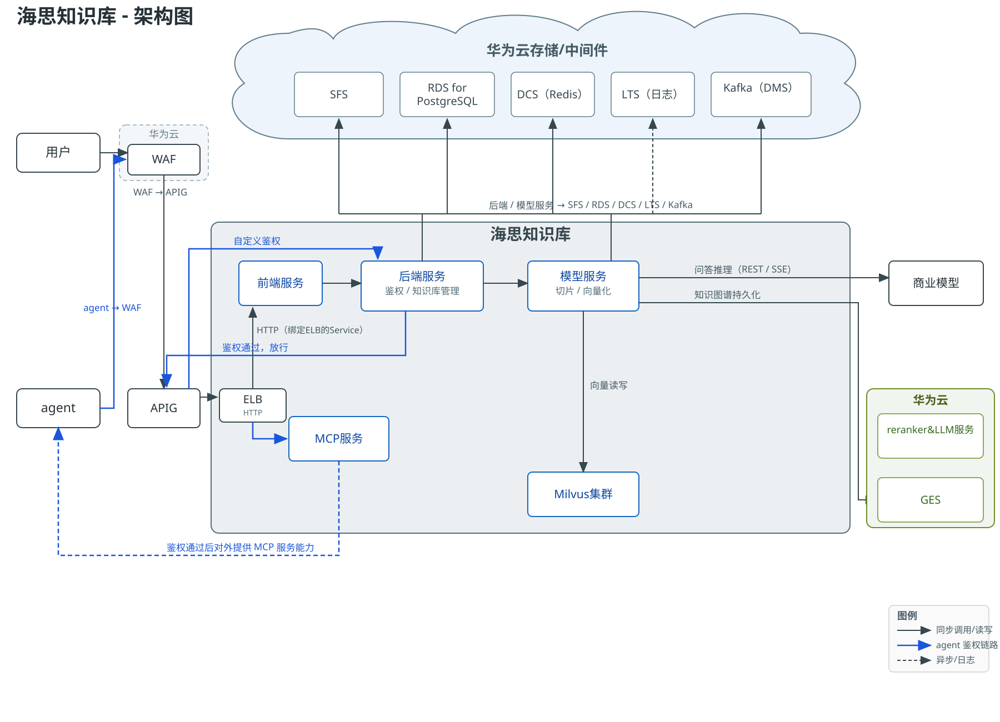
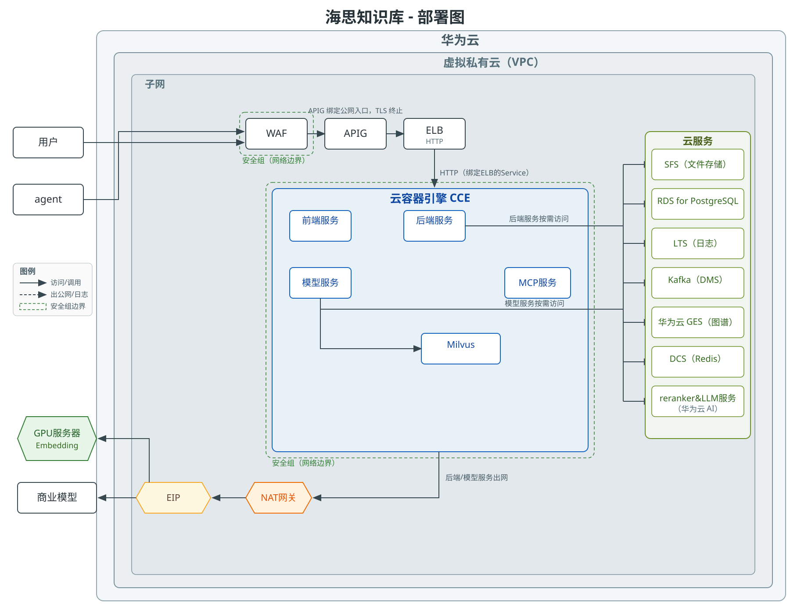
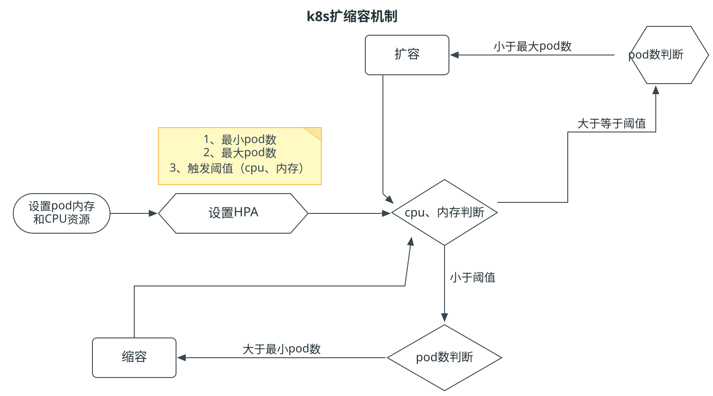
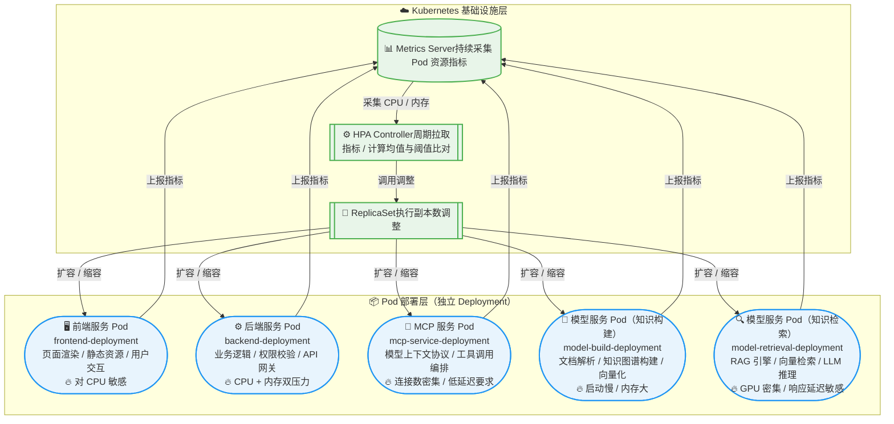

# 部署与运维设计

## 功能设计说明书

海思知识库架构设计 - 部署与运维设计

### 产品版本 & 密级

| 产品版本 Product Version | 密级 Security Level |
| ------------------------ | ------------------- |
| 1.4                      | 内部资料            |

### 拟制信息

| 角色             | 姓名  | 日期         |
| -------------- | --- | ---------- |
| 拟制 Prepared by | 架构组 | 2026-07-20 |
| 评审 Reviewed by |     |            |
| 批准 Approved by |     |            |

### 修订记录

| 日期       | 修订版本 | 修改描述               | 作者   |
| ---------- | -------- | ---------------------- | ------ |
| 2026-07-20 | 0.1      | 初稿                   | 架构组 |
| 2026-07-30 | 1.0      | 完善部署与运维设计内容 | 架构组 |
| 2026-08-12 | 1.1      | 增加动态扩容原理的内容 | 架构组 |
| 2026-08-28 | 1.2      | 增加 SFS 存储属主统一约定、前端代理超时配置、删除并发与批量删除行为说明 | 架构组 |
| 2026-08-28 | 1.3      | 修正 SFS 挂载路径与文件布局描述；补充回收站机制说明（同名副本唯一化、保留期自移入时刻起算、空目录清理、保留期可配置口径） | 架构组 |
| 2026-09-09 | 1.4      | 矫正接入链路与 agent 鉴权口径（WAF→APIG 自定义鉴权→ELB→CCE）；统一 Embedding 口径（优先 GPU 服务器、降级商业模型）；修正 Autopilot 日志采集方式；补充 Kafka/GES/Milvus 配置小节、部署对照表、发布与回滚、故障应急预案 | 架构组 |

### Keywords 关键词

> Kubernetes, CCE Autopilot, 容器化部署, 弹性伸缩, 监控告警, 灾备, 云原生

### Abstract 摘要

> 本文档描述海思知识库平台的部署架构与运维方案。平台基于华为云 CCE Autopilot（托管 Kubernetes）部署，采用云原生架构，配套使用华为云 SFS、RDS for PostgreSQL、DCS（Redis）、LTS、GES 等云服务及 Milvus 向量数据库。文档涵盖应用部署、云组件配置、弹性伸缩、监控告警、备份与灾备等运维域设计。

### List of abbreviations 缩略语清单

| Abbreviations 缩略语 | Full spelling 英文全名            | Chinese explanation 中文解释 |
| -------------------- | --------------------------------- | ---------------------------- |
| CCE                  | Cloud Container Engine            | 云容器引擎                   |
| SFS                  | Scalable File Service             | 弹性文件服务                 |
| RDS                  | Relational Database Service       | 关系型数据库服务             |
| DCS                  | Distributed Cache Service         | 分布式缓存服务               |
| LTS                  | Log Tank Service                  | 云日志服务                   |
| APIG                 | API Gateway                       | API网关                      |
| SWR                  | Software Repository for Container | 容器镜像服务                 |
| HPA                  | Horizontal Pod Autoscaler         | 水平Pod自动伸缩              |
| VPC                  | Virtual Private Cloud             | 虚拟私有云                   |
| AZ                   | Availability Zone                 | 可用区                       |
| DR                   | Disaster Recovery                 | 灾难恢复                     |
| EVS                  | Elastic Volume Service            | 云硬盘                       |
| WAF                  | Web Application Firewall          | Web应用防火墙                |
| GES                  | Graph Engine Service              | 图引擎服务                   |
| ELB                  | Elastic Load Balance              | 弹性负载均衡                   |
| NAT                  | Network Address Translation       | 网络地址转换网关               |
| EIP                  | Elastic IP                        | 弹性公网 IP                   |
| SMN                  | Simple Message Notification       | 消息通知服务                   |
| Kafka/DMS            | Distributed Message Service       | 分布式消息服务（Kafka版）         |
| MCP                  | Model Context Protocol            | 模型上下文协议                   |
| RAG                  | Retrieval-Augmented Generation    | 检索增强生成                   |
| SSE                  | Server-Sent Events                | 服务器单向推送事件流               |

---

## 1 部署域概述

海思知识库平台部署于华为云，采用云原生架构。应用服务基于容器化部署在 CCE Autopilot（托管 Kubernetes 集群），配套云组件提供存储、数据库、缓存、日志、图计算、向量检索、API 网关等基础设施能力。

**部署范围：**

- **应用服务**：前端服务、后端服务、模型服务、MCP服务
- **基础设施组件**：SFS（文件存储）、RDS for PostgreSQL（数据库）、DCS/Redis（缓存）、LTS（日志）、分布式消息服务 Kafka版、GES（图引擎）、Milvus（向量数据库）
- **网关与链路组件**：WAF、APIG（API 网关）、ELB、NAT 网关 + EIP
- **模型算力**：GPU 服务器（承载 Embedding 向量化）、华为云 / 商业模型 Reranker / LLM 服务

**部署目标：**

- 高可用：应用多副本部署，基础设施使用华为云组件
- 弹性伸缩：基于负载自动扩缩 Pod 实例
- 安全合规：VPC 内网隔离，密钥加密存储，传输层 TLS
- 可观测性：全链路日志、指标监控、告警通知

---

## 2 部署总体方案

### 2.1 部署架构



平台整体基于华为云底座构建，采用云原生架构设计，通过 VPC 网络实现内部资源隔离与安全互通。在接入安全层，系统构建了"WAF + APIG"的双层防护体系：用户与 agent 的所有请求首先经过华为云 Web应用防火墙（WAF），利用WAF强大的云端流量清洗能力抵御 SQL注入、XSS 攻击等 Web 安全威胁，随后再统一经由华为云 API 网关（APIG，绑定公网入口，TLS 终止）接入系统。APIG 通过**自定义鉴权**调用后端服务完成 Token 与权限校验（后端只承担鉴权职责），鉴权通过后放行：前端请求经 ELB 以 HTTP 路由至前端服务；agent 请求路由至 MCP 服务，对外提供模型上下文协议（MCP）能力。

**WAF 安全防护能力**：作为公网流量的第一道防线，WAF 基于内置规则库与语义检测引擎，重点防范以下攻击：

- **注入类攻击**：SQL 注入、XSS 跨站脚本、命令注入、代码执行等 OWASP Top 10 常见 Web 攻击；
- **CC 攻击与资源耗尽**：识别并限流高频恶意请求，防止应用层洪水攻击拖垮服务；
- **恶意扫描与爬虫**：拦截目录遍历、漏洞扫描器（Scanner）探测、恶意爬虫抓取，防止知识库内容与接口结构被批量爬取；
- **Webshell 与文件上传攻击**：检测上传内容中的 Webshell、木马特征，配合后端文件类型白名单形成双重防护；
- **协议与签名违规**：拦截畸形 HTTP 报文、非法 Method、越界超长字段等协议异常请求。

经 WAF 清洗后的可信流量才进入 APIG，使攻击拦截尽量前置，降低后端服务与网关自身的防护压力。

**APIG 安全作用**：作为统一流量入口，APIG 在 WAF 防护基础上叠加业务层安全控制，核心作用包括：

- **TLS 终止**：对外统一 HTTPS 接入并卸载 TLS，内网以 HTTP 转发，兼顾安全与性能；
- **自定义鉴权**：通过自定义鉴权策略调用后端服务完成 Token 签名与权限校验，未授权请求在网关层直接拒绝，不进入业务集群；
- **流量限流**：按 API 维度配置限流（如 1000 QPS/实例）与突发流量控制，防止突发流量或恶意刷接口击穿应用；
- **访问控制**：支持 IP 黑白名单、API-Key、防重放（时间戳+Nonce）等策略，收敛攻击面；
- **请求校验与路由**：对请求参数、报文大小做合法性校验，并将流量精准路由至前端服务/MCP 服务，实现内外网协议分离与后端拓扑隐藏。

核心计算层部署在 CCE Autopilot 容器集群中，包含前端服务、后端服务、模型服务（覆盖切片、向量化及知识检索/构建）和 MCP 服务，均采用多副本部署以保障系统高可用。其中，后端服务承载核心业务逻辑与权限管理，模型服务负责文档的切片与向量化推理；向量化（Embedding）环节**优先调用内部 GPU 服务器**，**GPU 服务器不可用时自动降级为调用商业模型 HTTPS API**；Reranker 与 LLM 服务则通过 HTTPS API 对接。

在数据持久化层，架构采用了“分层分类”的存储策略：知识关系图谱持久化于华为云图引擎服务（GES）；向量数据写入 Milvus 集群，支撑大模型的高并发向量检索；知识库文件存放于弹性文件服务（SFS）；关系型业务数据由 RDS for PostgreSQL 承载；热点数据及会话/权限缓存置于分布式缓存服务（DCS）；异步任务则通过分布式消息服务 Kafka 版实现解耦，确保多源异构数据的高效流转。

在运维与安全保障方面，应用与业务日志统一采集至云日志服务（LTS，业务侧与MCP侧独立采集）。整体架构通过 WAF 入口防护、APIG 统一鉴权路由、VPC 内网隔离、密钥与传输加密以及存储高可用等策略，全面满足知识库在高并发检索、多源异构数据接入和大模型推理场景下的安全合规、弹性伸缩与可观测性要求，为业务提供稳定可靠的智能底座。

### 2.2 技术选型

| 维度     | 选型                              | 说明                                             |
| -------- | --------------------------------- | ------------------------------------------------ |
| 容器编排 | 华为云 CCE Autopilot              | 全托管 Kubernetes，免运维 Master 节点            |
| 镜像仓库 | 华为云 SWR                        | 私有容器镜像仓库，与 CCE 集成                    |
| 文件存储 | 华为云 SFS Turbo                  | 多 Pod 共享挂载                                  |
| 数据库   | 华为云 RDS for PostgreSQL         | 主备架构，自动备份                               |
| 缓存     | 华为云 DCS（Redis）               | 主备/集群模式                                    |
| 日志     | 华为云 LTS                        | 结构化日志采集、查询、告警                       |
| 消息队列 | 分布式消息服务 Kafka版            | 用于后端服务和模型服务消息互通                   |
| 向量数据库 | Milvus（CCE 内部署）             | 向量索引，云硬盘（EVS）持久化存储           |
| API 网关 | 华为云 APIG                       | 统一入口，鉴权、限流、路由                       |
| AI 服务  | GPU 服务器（Embedding）+ 华为云/商业模型 Reranker / LLM | Embedding 优先内网 GPU，降级商业模型；Reranker/LLM 走 HTTPS API |
| 图引擎   | 华为云GES                         | 针对以“关系”为基础的“图”结构数据，进行查询、分析 |

以上选型面向海思知识库生产部署场景，整体优先采用华为云全托管服务，以降低运维复杂度并获取高可用、自动备份、弹性扩缩、安全合规及可观测等基础能力。

在基础设施与容器层，采用 **华为云CCE Autopilot** 实现全托管 Kubernetes 编排，免运维 Master 节点，并结合 **华为云SWR** 私有镜像仓库，实现与 CCE 的无缝集成与镜像分发；文件存储选用 **SFS Turbo**，满足多 Pod 的共享挂载需求。

存储与数据层按业务类型进行精细化分型：关系型业务数据由 **RDS for PostgreSQL** 提供主备架构并自动备份；热点数据与权限会话采用 **DCS（Redis）** 提供主备/集群模式的高性能缓存；后端服务与模型服务间的消息互通由 **分布式消息服务Kafka版** 解耦承载；全量业务日志统一接入 **华为云LTS**，实现结构化采集、查询与告警；而针对以“关系”为基础的“图”结构数据，则采用 **华为云GES** 进行专项查询与分析，以此支撑知识库管理、图谱关联分析与 RAG 检索生成的完整流程。

接入与智能交互层面，**华为云APIG** 作为统一入口，提供鉴权、限流和路由能力；AI 服务通过 **华为云 Embedding、Reranker及LLM** 能力，完成向量化、召回重排与模型推理。

### 2.3 部署拓扑



该方案基于华为云构建海思知识库系统，整体部署在华为云 VPC 虚拟私有云内，通过子网与安全组实现网络隔离。用户与 agent 经 WAF → APIG（绑定公网入口，TLS 终止）接入，APIG 通过自定义鉴权调用后端服务完成校验，鉴权通过后经 ELB 以 HTTP 与 CCE 内服务互联（CCE 应用通过绑定 ELB 的 Service 对接 APIG），运行前端服务、后端服务、模型服务及 MCP 服务。AI 向量化环节优先由 GPU 服务器承载 Embedding 能力（由模型服务内网调用），GPU 服务器不可用时降级调用商业模型。托管云服务包括 SFS 文件存储、RDS for PostgreSQL、LTS 日志、DCS 缓存、GES 图引擎、Milvus 向量数据库、Reranker & LLM 服务及 DMS 消息队列，支撑知识存储、图谱、向量检索与模型推理。对外通过 NAT 网关 + EIP 对接商业模型，保障出网访问与安全边界，形成云原生 AI 知识库端到端部署架构。

### 2.4 网络规划

| 网络资源 | 配置                         | 说明                                                         |
| -------- | ---------------------------- | ------------------------------------------------------------ |
| VPC      | 独立 VPC（如 10.247.0.0/16） | 所有资源部署在同一 VPC 内，内网互通                          |
| 子网     | 应用子网 + 数据子网          | 应用 Pod 与数据库/缓存分层部署                               |
| 安全组   | 最小权限原则                 | 仅开放必要端口（前端 80、后端 8080、Milvus 19530、Kafka 9092、Redis 6379、PostgreSQL 5432 等，按需开放） |
| NAT 网关 | 出方向                       | Pod 访问外部模型服务时通过 NAT 网关出公网                    |
| DNS      | 云解析服务                   | 内网域名解析，服务间通过域名访问                             |

网络层面采用独立 VPC（如 10.247.0.0/16）部署全部资源，内网互通；划分应用子网与数据子网，实现应用 Pod 与数据库/缓存分层部署。安全组遵循最小权限原则，仅开放必要端口（前端 80、后端 8080、Milvus 19530、Kafka 9092、Redis 6379、PostgreSQL 5432 等，按需开放）。通过 NAT 网关提供出方向访问，支持 Pod 调用外部模型服务；DNS 使用云解析服务，实现内网域名解析及服务间域名访问，保障网络隔离、安全可控与可访问性。

## 3 功能实现设计

### 3.1 功能编号：应用部署

#### 3.1.1 功能概述

将应用以容器化方式部署到华为云 CCE Autopilot 集群，实现应用的扩缩容、滚动更新、健康检查和故障自愈。

#### 3.1.2 实现思路

**为什么选择 CCE Autopilot？**

| 方案                    | 优点                                     | 缺点                 | 结论     |
| --------------------- | -------------------------------------- | ------------------ | ------ |
| CCE Autopilot（托管 K8s） | 免运维 Master 节点；按 Pod 资源计费，成本可控；华为云生态集成好 | 对 K8s 能力有一定封装限制    | **选用** |
| CCE Standard（自管 K8s）  | 完全控制集群；支持更多自定义配置                       | 需运维 Master 节点；成本较高 | 不选     |
| ECS 裸部署               | 简单直接                                   | 无弹性伸缩；无自愈；运维成本高    | 不选     |

在容器集群方案选型中，对比了 CCE Autopilot（托管 K8s）、CCE Standard（自管 K8s）与 ECS 裸部署三种模式。CCE Autopilot 免运维 Master 节点，按 Pod 资源计费使成本可控，且华为云生态集成好，虽对 K8s 能力有一定封装限制，但综合最优，结论为选用。CCE Standard 虽可完全控制集群并支持更多自定义配置，但需自行运维 Master 节点且成本较高，故不选用。ECS 裸部署方式简单直接，但缺乏弹性伸缩与自愈能力，运维成本高，亦不选用。最终采用 CCE Autopilot，兼顾托管免运维、成本效率与云原生弹性，适配项目快速交付与 知识库服务稳定运行需求。

#### 3.1.3 实现设计

**集群配置：**

| 配置项          | 推荐值         | 说明                               |
| --------------- | -------------- | ---------------------------------- |
| Kubernetes 版本 | ≥ 1.32         | 与华为云 CCE 当前支持版本一致      |
| 容器网络        | VPC 容器网络   | Pod 直接使用 VPC 子网 IP，简化网络 |
| 集群规模        | Autopilot 按需 | Autopilot 自动管理节点池           |

**集群名称规划：**

| 集群名称                    | 用途       |
| --------------------------- | ---------- |
| `rag-knowledge-prod`        | 生产环境   |
| `rag-knowledge-pre-release` | 预发布环境 |
| `rag-knowledge-dev`         | 开发环境   |

**密钥管理：**

| 凭据类型       | 存储方式       | 明文存储                     | 注入方式                 | 加密保护                        | 访问控制               |
| ---------- | ---------- | ------------------------ | -------------------- | --------------------------- | ------------------ |
| 数据库密码      | K8s Secret | ❌ 禁止（不在 ConfigMap 中明文存储） | 环境变量或 Volume 挂载至 Pod | 建议启用 KMS 对 etcd 中 Secret 加密 | IAM 策略限制仅必要服务账户可读取 |
| Redis 密码   | K8s Secret | ❌ 禁止（不在 ConfigMap 中明文存储） | 环境变量或 Volume 挂载至 Pod | 建议启用 KMS 对 etcd 中 Secret 加密 | IAM 策略限制仅必要服务账户可读取 |
| 模型服务 AK/SK | K8s Secret | ❌ 禁止（不在 ConfigMap 中明文存储） | 环境变量或 Volume 挂载至 Pod | 建议启用 KMS 对 etcd 中 Secret 加密 | IAM 策略限制仅必要服务账户可读取 |

在集群配置方面，Kubernetes 版本建议不低于 1.32，以匹配华为云 CCE 当前支持的稳定版本；容器网络采用 VPC 容器网络模式，Pod 直接使用 VPC 子网 IP，简化网络路由与策略配置；集群规模由 Autopilot 按需自动管理节点池。集群名称按环境划分为 `rag-knowledge-prod`（生产环境）、`rag-knowledge-pre-release`（预发布环境）和 `rag-knowledge-dev`（开发环境），实现环境隔离与资源管控。在密钥管理方面，数据库密码、Redis 密码及模型服务 AK/SK 等敏感凭据统一通过 Kubernetes Secret 管理，严禁在 ConfigMap 中明文存储。Secret 通过环境变量或 Volume 挂载方式注入 Pod，建议启用华为云 KMS 对 etcd 中存储的 Secret 进行加密保护，并通过 IAM 策略限制仅必要的服务账户具备读取权限，确保凭据全生命周期的安全可控。

#### 3.1.4 可靠性及安全性分析

**可靠性：**

| 风险     | 措施                                |
| -------- | ----------------------------------- |
| Pod 崩溃 | `livenessProbe` 检测 → K8s 自动重启 |
| 节点故障 | Autopilot 自动迁移 Pod 到健康节点   |

在可靠性方面，系统通过 `livenessProbe` 健康检查检测 Pod 状态，异常时由 K8s 自动重启；当发生节点故障时，由 CCE Autopilot 自动将 Pod 迁移至健康节点，保障业务连续性。

**安全：**

| 检查项   | 措施                                                         |
| -------- | ------------------------------------------------------------ |
| 镜像安全 | SWR 镜像扫描，禁止使用 `latest` 标签部署到生产               |
| 密钥管理 | 数据库密码/API Key 使用 K8s Secret，禁止明文入镜像           |
| 网络隔离 | Pod 仅暴露 80 等必要端口（如前端 80、后端 8080、Milvus 19530、Kafka 9092、Redis 6379、PostgreSQL 5432 等） |
| 容器权限 | 禁止 `privileged` 模式，`runAsNonRoot: true`                 |
| 资源限制 | 设置 CPU/Memory requests 和 limits，防止资源耗尽             |

在安全方面，镜像通过 SWR 进行安全扫描，生产环境禁止使用 `latest` 标签部署；数据库密码、API Key 等敏感信息使用 K8s Secret 管理，禁止明文写入镜像；网络层面仅暴露 80、8080 等必要端口；容器运行时禁止 `privileged` 模式，并以非 root 用户运行（`runAsNonRoot: true`）；同时为容器设置 CPU/Memory 的 requests 和 limits，防止资源耗尽影响节点及其他负载。

### 3.2 功能编号：云组件配置

#### 3.2.1 功能概述

负责华为云 PaaS 基础设施组件的选型、网络接入与安全策略配置，覆盖文件存储（SFS）、关系型数据库（RDS）、分布式缓存（DCS）、日志服务（LTS）、图引擎（GES）及向量检索（Milvus）等核心依赖。通过 VPC 内网通信、安全组与 IAM 权限最小化、密钥托管（K8s Secret / KMS）以及传输加密等手段，保障应用对存储、数据库、缓存、日志、图计算、向量检索等能力的访问既安全又高效；同时结合高可用架构、自动备份、监控告警及可观测能力，为海思芯片知识库的多源异构数据接入、知识构建、检索增强生成（RAG）及大模型推理场景提供稳定、可维护、可弹性扩展的基础设施支撑。

#### 3.2.2 实现设计

##### 3.2.2.1 弹性文件服务 SFS

| 配置项  | 值                       | 说明                    |
| ---- | ----------------------- | --------------------- |
| 类型   | SFS Turbo               | 高性能，POSIX 兼容，多 Pod 共享 |
| 挂载路径 | `/kb-files` | 必须与后端配置 `kb.storage.local-path` 一致 |
| 容量   | 根据文档量评估（初始 500GB）       | 支持在线扩容                |

**文件组织规则**：

```
/kb-files/
├── kb/{知识库名}/{类别名链…}/{清洗后原始文件名}   # 文档树（模型服务按同卷 /kb-files 访问）
├── mineru_output/{任务hash}/images/…              # 模型服务解析产物区（PDF 抽图，属主=模型服务，见下）
├── .uploads/{上传会话ID}/                        # tus 断点续传临时区
├── .zip-extract/{上传会话ID}/{序号}.bin            # zip 解压临时区
└── .trash/{原相对路径}[_{序号}]                   # 回收站（两阶段删除第一站）
```

采用 SFS Turbo 作为高性能共享文件存储，提供 POSIX 兼容接口并支持多 Pod 并发访问，挂载至容器内 `/kb-files` 路径（必须与后端 `kb.storage.local-path` 配置一致），用于集中存放知识库文档附件。初始容量按文档规模评估为 500GB，并支持在线扩缩容以满足后续增长。文件名沿用上传时的原始名称（清洗非法字符），按知识库/类别分层组织，实现资源的业务域隔离，便于文档同步、检索与生命周期维护。

**回收站机制（两阶段删除）：** 删除文档/目录/知识库仅将文件从文档树 **move** 进 `.trash/`（同卷 rename，原位置即刻腾空；回收站内同名副本自动追加序号唯一化，绝不覆盖既有副本），每日清理任务只遍历 `.trash/`，对"移入时刻"超过保留期（`kb.storage.trash-retention-days`，默认 7 天）的文件执行物理删除——**文档树中的在用文件永远不会被清理任务触碰**；同名重传场景由回收前的文件身份校验兜底（删除时快照 size+mtime、回收前复检，不一致即跳过）。回收站与文档树、临时区同在 SFS 卷上，Pod 重建/事故不丢数据。回收为文件级 move（从不移动目录），完成后顺带清理变空的目录（只删空目录，目录内有新文件则保留）。

**存储属主统一约定（强制）：**

| 约定 | 内容 | 原因 |
| ---- | ---- | ---- |
| 统一运行 uid | 知识库后端与模型服务（向量化）Pod 统一以 uid 1001 运行：`securityContext.runAsNonRoot: true`、`runAsUser: 1001`、`fsGroup: 1001`，**禁止以 root 运行** | 共享存储文件属主一致，任何一方均可删除/回收；root 运行违反 K8s restricted 标准，且 NFS `root_squash` 会将 root 映射为匿名 uid，属主更不可控 |
| 中间产物不落文档树 | 文档流水线中间产物（chunk_json、切片索引等，向量化/预处理/解析阶段产生，具体来源以现场取证为准）一律写入产生方自己的 scratch 区（emptyDir / 专用临时目录），或经 API 返回不落盘，**禁止写入源文档树** | 后端删除文档/知识库时不感知中间文件，混入文档树会持续堆积孤儿 |
| 解析产物区属主=模型服务 | `mineru_output/` 由模型服务写入与清理（按归档/废弃事件删除对应图片），后端不清理、不登记 documents 行；后端仅经 `GET /hisilicon-knowledge/kb/chat/assets`（签名 + `kb.chat.image-fallback-dirs` 目录白名单 + 真实路径复核）向问答前端出图 | 图片非文档树文件、无行可签，兜底端点的可访问范围只能由白名单收敛；目录名是模型端内部命名，**改名须同步后端 `kb.chat.image-fallback-dirs` 配置**，否则问答图片静默不显示 |

##### 3.2.2.2 云数据库 RDS for PostgreSQL

| 配置项   | 值               | 说明           |
| -------- | ---------------- | -------------- |
| 引擎版本 | PostgreSQL 18.4  | 稳定版本       |
| 实例规格 | 4 vCPU / 8 GB    | 按实际负载调整 |
| 存储类型 | SSD 云盘         | 高性能         |
| 存储容量 | 100 GB（初始）   | 支持自动扩容   |
| 架构     | 主备（一主一备） | 自动故障切换   |

选用 PostgreSQL 18 稳定引擎，实例规格配置为 4 vCPU / 8 GB（可按实际负载动态调整），底层采用 SSD 云盘保障高性能 IO，初始存储容量 100GB 并支持自动扩容。数据库采用一主一备高可用架构，支持自动故障切换，确保业务连续性；为知识库业务结构化数据提供稳定的持久化支撑。

##### 3.2.2.3 分布式缓存 DCS（Redis）

| 配置项   | 值                                                   | 说明               |
| -------- | ---------------------------------------------------- | ------------------ |
| 引擎版本 | Redis 6.0                                            |                    |
| 实例类型 | 主备（或 Cluster 集群）                              | 主备满足大部分场景 |
| 内存规格 | 16 GB                                                | 按需调整           |
| 用途     | Session 存储 / Token 缓存 / 权限缓存 / ABAC 策略缓存 |                    |

采用 Redis 6.0 引擎构建分布式缓存层，实例类型默认采用主备架构（亦可根据业务规模扩展为 Cluster 集群），主备模式可满足大部分高并发访问场景；内存规格初始为 16GB，支持按实际负载动态调整。缓存主要用于 Session 存储、Token 缓存、权限缓存及 ABAC 策略缓存等高频读取场景，降低后端数据库压力并提升鉴权与接口响应效率。

##### 3.2.2.4 云日志服务 LTS（实际对接后修改）

| 配置项  | 值                                | 说明            |
| ---- | -------------------------------- | ------------- |
| 日志组  | `hisilicon-knowledge`            | 应用日志统一归组      |
| 日志流  | 按环境划分：`prod` / `staging` / `dev` |               |
| 采集方式 | LTS 采集插件（Autopilot 托管安装）        | 采集容器标准输出和文件日志，无需自管 DaemonSet |
| 保留时长 | 90 天（热存储） + 180 天（冷存储）           |               |

日志体系接入华为云 LTS，日志组统一命名为 `hisilicon-knowledge`，并按环境划分日志流为 prod / staging / dev，实现多环境应用日志的逻辑隔离与统一归组。采集侧通过 LTS 采集插件以托管方式安装采集组件（Autopilot 下无需自管 DaemonSet），自动采集容器标准输出及文件日志，避免侵入业务代码。保留策略采用分层存储：热数据存储 90 天，满足日常监控与实时检索；冷数据存储 180 天，用于审计追溯与合规分析，兼顾查询性能与长期成本。整体方案为故障定位、安全审计及业务运行分析提供完整的可观测数据底座。

##### 3.2.2.5 API 网关 APIG

| 配置项     | 值             | 说明            |
| ------- | ------------- | ------------- |
| 入口协议    | HTTPS         |               |
| 后端协议    | HTTP（VPC 内网）  |               |
| 鉴权方式    | 自定义鉴权（调用后端服务校验） | APIG 调用后端完成 Token 与权限校验，通过后放行；JWT Token 透传供业务侧使用 |
| 限流策略    | 1000 QPS / 实例 | 保护后端服务        |
| 跨域 CORS | 配置允许的前端域名     |               |

API 网关 APIG 作为业务流量统一入口，对外提供 HTTPS 接入，后端通过 VPC 内网 HTTP 协议转发至 CCE 服务，实现内外网协议分离与流量卸载。鉴权方面采用 JWT Token 透传机制，由应用侧完成 Token 校验与身份解析，网关层聚焦路由与访问控制；限流策略按 1000 QPS/实例配置，防止突发流量击穿后端服务。同时按实际需要配置 CORS 跨域规则，仅放行受信前端域名，兼顾浏览器侧跨域访问与安全边界。

##### 3.2.2.6 AI 模型服务

| 服务           | 用途      | 访问方式              |
| ------------ | ------- | ----------------- |
| Embedding 服务 | 文档向量化   | 优先 GPU 服务器内网调用；GPU 服务器不可用时降级走商业模型 HTTPS API |
| Reranker 服务  | 检索结果重排序 | HTTPS API         |
| LLM 服务       | 知识库问答生成 | HTTPS API（流式 SSE） |

AI 模型服务为知识库问答与 RAG 流程提供端到端的智能推理能力。其中，Embedding 服务负责将文档片段及用户查询转化为向量表示，**优先调用 GPU 服务器完成向量化，GPU 服务器不可用时自动降级为调用商业模型 HTTPS API**，向量结果统一写入 Milvus 向量数据库，支撑后续语义检索与相似度匹配；Reranker 服务在召回阶段后对候选文档进行相关性重排序，提升检索结果的精准度与上下文质量；LLM 服务承担知识库问答的生成任务，基于检索到的上下文与用户问题生成最终答复，并通过 SSE（Server-Sent Events）流式方式逐字/逐段返回，降低首字响应延迟、优化前端交互体验。三类服务解耦部署，可独立扩缩容，与向量检索、图引擎及业务后端协同构成完整的检索增强生成链路。

##### 3.2.2.7 分布式消息服务 Kafka（DMS）

| 配置项       | 值                                | 说明                          |
| ---------- | -------------------------------- | --------------------------- |
| 实例规格       | kafka.2u4g.cluster.small * 3 broker | 按吞吐量评估，支持横向扩容               |
| Topic 规划   | 入站 `kb-document-processed`(6 分区) / 出站 `kb-document-processing`(8 分区)，各环境带 `-test` / `-release` 后缀 | 后端→模型服务的处理请求、模型服务→后端的处理结果；**分区数即消费并行度上限**（出站 8 ⇒ 模型端消费者 ≤ 8） |
| 副本因子       | 3                                | 消息可靠性保障                     |
| 消息保留期      | 72 小时（线上实际，控制台可查）                | 按任务积压情况调整；需与幂等去重表保留期匹配（重放窗口） |
| 访问方式       | VPC 内网（9092 端口，SASL_SSL）         | 禁止公网接入                      |
| 消费语义       | 至少一次（At-Least-Once）+ 幂等消费        | 防止重复处理                      |

Kafka 用于后端服务与模型服务间的异步任务解耦：后端服务将文档处理请求写入 `kb-document-processing`，模型服务消费后执行切片/向量化/图谱构建，处理结果写回 `kb-document-processed`，由后端服务消费更新文档状态。采用 3 副本保障消息可靠性，消费端以幂等方式处理至少一次语义；消息保留期 **72 小时**，消费延迟告警纳入 §3.4 监控体系。

**⚠️ 环境隔离三件套与配置来源（2026-10-13 故障后固化，必读）**

后端的消息配置**不在镜像里，而是 CCE 挂载的配置文件**（每个环境一份）。由此有两条硬约束：

1. **改仓库的 `application.yml` 不影响任何环境**——必须同步修改各环境挂载的那份文件。否则就是
   "仓库改了、线上没改"，下次排障还会在"代码与线上不一致"上浪费大量时间（2026-10 故障排查即栽在这里）。
   建议把各环境挂载文件的副本（或至少其 `mp.messaging` 段）纳入版本管理，作为唯一事实源。
2. **topic / 消费组 / 死信主题（三件套）必须按环境一一对应，消费组绝不能跨环境共用**：

| 环境 | 入站 topic | 消费组 | 死信主题 |
|------|-----------|--------|---------|
| dev | `kb-document-processed` | `kb-document-processed-consumer` | `kb-document-processed-dlq` |
| test | `kb-document-processed-test` | `kb-document-processed-consumer-test` | `kb-document-processed-dlq-test` |
| release | `kb-document-processed-release` | `kb-document-processed-consumer-release` | `kb-document-processed-dlq-release` |

   每环境在挂载文件里**显式写这三行**（命名统一为 `<base>[-suffix]` / `<base>-consumer[-suffix]` /
   `<base>-dlq[-suffix]`，后缀永远在最后，与 DMS 控制台逐字一致）：

   ```yaml
   # dev 取值；test 加 -test、release 加 -release，三行必须同时改
   mp.messaging.incoming.kb-document-processed-in:
     topic: kb-document-processed
     group.id: kb-document-processed-consumer
     dead-letter-queue.topic: kb-document-processed-dlq
   ```

   > ⚠️ **不要用 `${...topic}-consumer` / `${...topic}-dlq` 派生**：DMS 里 release 的死信真实名字是
   > `kb-document-processed-dlq-release`（后缀在最后），而派生会得到 `kb-document-processed-release-dlq`，
   > 指向一个**不存在的主题** → nack 写死信失败 → 终止整条消费通道。组名可自定，只要每环境唯一。
   > 另注意配置优先级：**环境变量 > 挂载的 application.yml**，pod 里若配了同名环境变量会把 yaml 顶掉。

   **为什么必须这么做**：各环境的应用名相同，若 `group.id` 缺省（或被各环境统一写成应用名 /
   `knowledge-service`），所有环境会落进**同一个消费组**。Kafka 语义保证一个分区在组内只被一个成员消费，
   于是先启动的环境把分区与位点全部占走，后启动环境的 Pod **成员在线、探针全绿、零 ERROR 日志，却永不消费**
   （2026-10-13 dev 静默 23 小时即此形态：分区 lag 几乎为 0，位点其实是被别的环境的成员推着走的）。

3. **上线后必查**：
   - 启动日志三行：`SRMSG18229`（通道 topic）、`SRMSG18257`（consumer 所属消费组）、`SRMSG18258`（死信主题），
     三者必须与上表本环境一行一致；
   - DMS 控制台「消费组」列表：本环境只应出现自己那一个组。同一个组同时出现在多个环境的运维清单里
     ⇒ 立即停止上线并排查。
4. **死信主题必须真实存在**：写死信失败会让 nack 失败并**终止整条消费通道**（该 Pod 此后永不消费、无 ERROR 日志、
   探针全绿）。当前已按环境创建 `-dlq` / `-dlq-test` / `-dlq-release`（各 3 分区）。死信分区数与源 topic 不同
   **不影响**——死信写入不带源分区号，由分区器自行选择。

##### 3.2.2.8 图引擎服务 GES（实际对接后修改）

| 配置项       | 值                  | 说明                    |
| ---------- | ------------------ | --------------------- |
| 实例规格       | 中型（按图规模评估）         | 支持在线扩容                |
| 图数据        | 知识图谱（实体/关系/属性）     | 模型服务在知识构建阶段写入         |
| 访问方式       | VPC 内网 SDK/API     | 禁止公网接入                |
| 备份         | 自动备份，保留 7 天        | 支持按时间点恢复              |
| 高可用        | 主备/集群部署            | 故障自动切换                |

GES 承载知识关系图谱的持久化存储与查询分析。模型服务（知识构建）在文档解析与图谱构建阶段将实体、关系写入 GES；检索阶段由模型服务按需执行图查询以补充多跳关联上下文。实例部署于 VPC 内网，通过安全组白名单限制访问来源；开启自动备份并纳入季度恢复演练范围（与 RDS 演练同期执行）。

##### 3.2.2.9 向量数据库 Milvus

| 配置项       | 值                                | 说明                          |
| ---------- | -------------------------------- | --------------------------- |
| 部署形态       | StatefulSet 部署于 CCE 集群内          | 与应用同 VPC，内网互通               |
| 持久化存储     | 云硬盘（EVS）持久卷                      | 数据持久化，支持扩容                  |
| 索引类型       | HNSW                             | 高召回、低延迟的近似最近邻检索             |
| 集合规划       | 按知识库分集合（Collection）               | 便于按库备份、重建与权限隔离              |
| 副本与资源配置    | 按向量规模评估；CPU/Memory 设置 requests/limits | 纳入 HPA 之外的资源基线管理        |
| 访问方式       | VPC 内网（19530 端口）                 | 仅模型服务/后端服务可访问               |
| 备份策略       | 集合级快照/导出至 SFS，定期归档（还未做。。。。）      | 向量数据可由源文档重建，备份为加速恢复手段       |

Milvus 承载文档向量与查询向量的高并发语义检索，使用云硬盘（EVS）持久化存储保证数据可靠。向量数据来源于源文档的 Embedding 结果，具备"可从源数据重建"的属性，因此备份策略以集合级定期快照加速恢复为主，极端场景下可全量重建。索引统一采用 HNSW，检索侧通过内网 19530 端口访问，纳入监控告警（连接数、内存、查询延迟）。

##### 3.2.2.10 部署视图与云服务清单对照表

| 服务/组件         | 部署形态                    | 副本数   | 端口    | 依赖组件                                        |
| ------------- | ----------------------- | ----- | ----- | ------------------------------------------- |
| 前端服务          | CCE Deployment          | ≥2    | 80    | 后端服务                                        |
| 后端服务          | CCE Deployment          | ≥2    | 8080  | RDS、DCS、SFS、LTS、Kafka              |
| 模型服务          | CCE Deployment（构建/检索两类） | ≥2    | 47861,8777 | Milvus、GES、Kafka、LTS、GPU 服务器（Embedding）、Reranker/LLM |
| MCP 服务        | CCE Deployment          | ≥2    | 9789 | 后端服务（经 ELB）、LTS                             |
| Milvus        | CCE StatefulSet + EVS   | 按规模评估 | 19530 | EVS 持久卷                                     |
| SFS Turbo     | 华为云托管                   | —     | 2049（NFS） | 挂载至后端/模型服务 Pod                          |
| RDS for PostgreSQL | 华为云托管（主备）          | —     | 5432  | 后端服务                                        |
| DCS（Redis）    | 华为云托管（主备）               | —     | 6379  | 后端服务                                        |
| Kafka（DMS）    | 华为云托管（集群）               | —     | 9092  | 后端服务、模型服务                                   |
| GES           | 华为云托管                   | —     | 内网 API | 模型服务                                       |
| GPU 服务器       | 独立 GPU 算力               | ≥1    | — | 模型服务（Embedding，降级走商业模型）                     |
| WAF/APIG/ELB/NAT+EIP | 华为云托管             | —     | 443/80 | 入口链路与出网链路                                   |

#### 3.2.3 可靠性及安全性分析

**可靠性：**

| 风险          | 措施                                     |
| ----------- | -------------------------------------- |
| RDS 主库故障    | 主备自动切换，切换时间 < 60s                      |
| Redis 主节点故障 | 主备自动切换 / 集群节点容错                        |
| SFS 不可用     | SFS Turbo 本身高可用（99.9% SLA），应用侧可加本地缓存降级 |
| 模型服务超时      | 设置合理超时 + 重试策略 + 降级返回提示                 |

系统从数据层、存储层到 AI 推理层构建了分层容错与故障自愈能力。数据库（RDS）与缓存（Redis）均采用主备架构，分别在主库或主节点故障时实现自动切换（RDS 切换时间 < 60s）及集群节点容错，保障核心数据服务持续可用；文件存储采用 SFS Turbo，本身提供 99.9% SLA 的高可用能力，应用侧可配合本地缓存降级进一步降低不可用影响；针对 AI 模型服务，通过合理配置超时时间、重试机制及降级返回提示，避免下游推理异常导致请求堆积或用户体验中断，整体确保业务在单点故障场景下仍具备快速恢复与连续服务能力。

**安全：**

| 检查项     | 措施                                                         |
| ---------- | ------------------------------------------------------------ |
| 数据库访问 | VPC 内网 + 安全组白名单，禁止公网访问                        |
| Redis 访问 | 密码认证 + VPC 内网                                          |
| 密钥安全   | RDS/Redis 密码通过 Secret 注入；模型服务 AK/SK 通过 Secret 注入 |

安全设计覆盖网络隔离、身份认证、凭据管理与传输加密等多个维度。数据库（RDS/Redis/Milvus/GES 等）及缓存服务均部署在 VPC 内网，通过安全组白名单严格限制访问来源，禁止公网直连，Redis 额外启用密码认证；敏感凭据（如 RDS/Redis 密码、模型服务 AK/SK）统一通过 Kubernetes Secret 注入容器，避免硬编码与明文暴露。

### 3.3 功能编号：K8s 弹性伸缩

#### 3.3.1 功能概述

系统基于 Kubernetes 原生 HPA（Horizontal Pod Autoscaler）机制，根据实时应用负载动态自动调整 Pod 副本数量，实现"高峰期自动扩容保可用、低峰期自动缩容省成本"的弹性闭环。HPA Controller 周期性地从 Metrics Server 拉取各 Pod 的 CPU、内存等资源指标，计算当前副本组的平均值，当超过预设的阈值时触发扩容，低于阈值且经过稳定窗口后执行缩容。针对海思知识库平台的不同服务，系统设计了差异化的弹性策略：前端和后端服务以 CPU 利用率为核心指标，配合保守的缩容窗口避免频繁抖动；MCP 服务额外参考并发连接数和请求速率；模型服务（知识检索）则引入 GPU 显存和自定义业务指标（如 QPS、P99 响应时间）进行精准扩缩。同时，通过 CronHPA 定时预扩容机制，在每日业务高峰前提前拉起副本，规避冷启动延迟。整体方案在保障高并发场景下服务稳定性的同时，最大化提升资源利用率并降低云资源开销。

#### 3.3.2 实现思路

| 方案              | 优点                | 缺点                     | 结论            |
| --------------- | ----------------- | ---------------------- | ------------- |
| HPA（CPU/Memory） | K8s 原生，配置简单       | 仅基于资源指标，反应较慢           | **选用（基础）**    |
| HPA（自定义指标）      | 可基于 QPS、响应时间等业务指标 | 需部署 Prometheus Adapter | **可选（高级）**    |
| VPA（Vertical）   | 自动调整 Pod 资源配额     | 需重启 Pod                | 不选（滚动重启影响可用性） |
| 定时伸缩（CronHPA）   | 可预判高峰低谷           | 无法应对突发流量               | **补充使用**      |

在弹性伸缩方案选型上，系统以 Kubernetes 原生 HPA（基于 CPU/Memory 指标）作为基础方案，其优势在于与 K8s 生态深度集成、配置简单、运维成本低，虽仅依赖资源指标导致对业务流量变化的反应相对滞后，但足以覆盖常规负载波动场景，故作为默认选用策略。针对检索、模型推理等需更敏锐感知业务压力的服务，可将 HPA 自定义指标（如 QPS、响应时间）作为高级可选能力，通过部署 Prometheus Adapter 对接业务监控数据，实现更精准的横向扩缩，但引入额外组件会增加架构复杂度。VPA（垂直伸缩）虽能自动调整 Pod 资源配额，但因调整时需重启 Pod，会中断服务可用性，与平台高可用目标冲突，故不采纳。此外，引入 CronHPA 定时伸缩作为补充手段，在已知业务高峰（如工作时段）前预扩容、低谷后回收资源，以弥补纯指标驱动无法预判周期性流量的不足，但其无法应对突发流量，因此与 HPA 组合形成“预测+响应式”的弹性体系。

#### 3.3.3 实现设计



该图展示了 Kubernetes 基于 HPA 的横向扩缩容运行机制。首先为 Pod 设置 CPU 与内存资源请求/限制，并配置 HPA 策略，包括最小 Pod 数、最大 Pod 数以及 CPU/内存使用率触发阈值。运行期间，HPA 持续采集 Pod 资源指标并进行 CPU、内存判断：当使用率大于等于阈值时，进入扩容判断，若当前 Pod 数小于最大 Pod 数则执行扩容；当使用率小于阈值时，进入缩容判断，若当前 Pod 数大于最小 Pod 数则执行缩容。通过资源阈值与 Pod 数量边界的双重约束，系统可在业务高峰自动增加副本保障可用性，在低峰自动减少副本节约资源，同时避免无限扩缩和频繁抖动，实现稳定、可控的弹性伸缩。

**HPA 配置示例：**

```yaml
apiVersion: autoscaling/v2
kind: HorizontalPodAutoscaler
metadata:
  name: hisilicon-knowledge-platform-hpa
  namespace: hisilicon-prod
spec:
  scaleTargetRef:
    apiVersion: apps/v1
    kind: Deployment
    name: hisilicon-knowledge-platform
  minReplicas: 2
  maxReplicas: 10
  metrics:
    - type: Resource
      resource:
        name: cpu
        target:
          type: Utilization
          averageUtilization: 70        # CPU 平均使用率达到 70% 触发扩容
    - type: Resource
      resource:
        name: memory
        target:
          type: Utilization
          averageUtilization: 80        # 内存平均使用率达到 80% 触发扩容
  behavior:
    scaleUp:
      stabilizationWindowSeconds: 60   # 扩容前 60s 稳定窗口
      policies:
        - type: Percent
          value: 100                    # 每次扩容 100%（翻倍）
          periodSeconds: 60
    scaleDown:
      stabilizationWindowSeconds: 300  # 缩容前 300s 稳定窗口（保守缩容）
      policies:
        - type: Pods
          value: 1                      # 每次缩容 1 个 Pod
          periodSeconds: 120
```

**配置说明：**

| 参数               | 值              | 理由              |
| ---------------- | -------------- | --------------- |
| minReplicas      | 2              | 保证至少 2 副本，满足高可用 |
| maxReplicas      | 10             | 上限防止资源失控        |
| CPU threshold    | 70%            | 预留 30% 缓冲       |
| Memory threshold | 80%            | 预留 20% 缓冲       |
| 扩容速度             | 快速（翻倍/60s）     | 知识库查询可能突发高负载    |
| 缩容速度             | 保守（1 Pod/120s） | 避免频繁缩容导致抖动      |

HPA 弹性伸缩策略围绕高可用、资源可控与流量特征进行精细调优：最小副本数设为 2，确保任意单节点或单 Pod 异常时服务仍具备冗余能力，满足高可用基线；最大副本数限定为 10，作为资源防护上限，防止异常流量或指标抖动引发无限扩容导致集群资源失控。资源阈值方面，CPU 阈值设定为 70%、内存为 80%，分别为计算与内存型负载预留 30% 和 20% 的缓冲空间，避免持续满载并给扩容动作争取响应时间。扩缩容节奏采用非对称设计：扩容执行快速策略（60 秒内副本数可翻倍），以应对知识库检索、模型推理等场景可能出现的突发高并发查询；缩容则采取保守节奏（每 120 秒减少 1 个 Pod），并设置稳定窗口，有效抑制因指标短期波动造成的频繁伸缩抖动，保障业务连接与会话稳定性，最终实现性能、成本与体验的平衡。

#### 3.3.4 动态扩容说明



本知识库项目整体基于 Kubernetes 架构进行部署，前端服务、后端服务、MCP 服务以及两类模型服务分别运行在独立的 Pod 中，并通过 Horizontal Pod Autoscaler（HPA）实现动态弹性伸缩。其核心原理是：由 Metrics Server 持续采集各 Pod 的 CPU、内存等运行时指标，HPA Controller 周期性拉取这些指标并计算副本平均值，与预设阈值进行比对后，调用 ReplicaSet 调整 Pod 副本数。需要明确的是，HPA 本身并非具备自主决策能力的智能调节器，其所有扩缩容行为均严格依赖于管理员预先设定的阈值参数，系统仅负责执行比对与调度逻辑。

在 Pod 部署与职责划分上，五类服务独立部署，以最大化弹性伸缩的针对性与资源利用率：

- **前端服务 Pod**：主要承载页面渲染、静态资源分发及用户交互逻辑，对 CPU 敏感，流量高峰时通过扩容快速提升并发处理能力。

- **后端服务 Pod**：作为系统的业务中枢，负责业务逻辑处理、权限校验、接口聚合及请求路由。该服务是请求链路的核心枢纽，同时受 CPU 与内存压力影响，需重点保障。

- **MCP 服务 Pod**：负责模型上下文协议（Model Context Protocol）的解析、工具调用编排及上下文状态管理。该服务连接数密集，对低延迟有较高要求，需根据并发连接数或请求速率进行弹性调整。

- **模型服务（知识构建）Pod**：运行文档解析、知识图谱构建及向量化任务（Embedding 优先调用内部 GPU 服务器，不可用时降级商业模型）。该服务属于重资源消耗型任务，启动慢、内存占用大，需采用保守的扩缩容策略以避免频繁重建。

- **模型服务（知识检索）Pod**：运行 RAG 检索引擎、向量相似度计算及大模型推理服务。该服务对 GPU 依赖度高，响应延迟敏感，需确保在高并发检索场景下具备稳定的推理能力。

在指标选择上，生产环境推荐以 CPU 平均使用率作为主要扩容触发信号。这是因为内存使用常受 JVM 缓存、Python GC 或模型加载机制影响而产生波动，难以真实反映瞬时请求压力；而 CPU 利用率则直接对应请求处理的计算负载，是判断服务“忙闲”的最可靠指标。因此，项目上线前必须通过充分的压力测试确定合理的 CPU 阈值——阈值过高会导致扩容滞后、请求堆积；阈值过低则引发频繁扩缩，影响系统稳定性。

在具体的弹性策略上，前端服务、后端服务、MCP 服务、模型服务-知识构建及模型服务-知识检索均配置 `minReplicas=2`、`maxReplicas=10`，CPU 阈值 70%、内存阈值 80%；扩容速度为快速（翻倍/60s），缩容速度为保守（1 Pod/120s），所有扩缩容行为由 HPA 依据 Metrics Server 采集的指标与预设参数执行。针对不同的业务场景，系统采用差异化的扩缩容策略：

**1、日常业务高峰场景（如工作时间集中查询）**

当前端服务 Pod 的 CPU 使用率 ≥70% 或内存使用率 ≥80%，且当前副本数小于 10 时，前端服务按当前副本数 100% 快速扩容，每 60 秒执行一次扩容决策，直至达到 10 个副本后不再扩容；当 CPU、内存指标持续低于阈值，且副本数大于 2 时，以每 120 秒缩容 1 个 Pod 的节奏收敛，最低保留 2 个副本。后端服务 Pod 在 CPU ≥70% 或内存 ≥80%、副本数小于 10 时同步快速扩容，最高扩至 10 个；负载回落后，在副本数大于 2 的前提下每 120 秒缩容 1 个，最低保持 2 个。MCP 服务 Pod 在连接数/请求速率上升引起 CPU ≥70% 或内存 ≥80%、且副本数小于 10 时快速扩容，最大 10 个；指标回落且副本数大于 2 时每 120 秒缩容 1 个，最低 2 个，与后端服务保持弹性协同。模型服务（知识检索）Pod 在 CPU ≥70% 或内存 ≥80%（并参考 GPU/推理负载）且副本数小于 10 时快速扩容，最多 10 个；低负载且副本数大于 2 时保守缩容，每 120 秒减少 1 个，最低 2 个。模型服务（知识构建）Pod 因属重资源、启动慢类型，在 CPU ≥70% 或内存 ≥80%、副本数小于 10 时仍允许快速扩容至最多 10 个以应对构建任务，但缩容时严格在副本数大于 2 后按每 120 秒 1 个 Pod 执行，避免频繁重建，最低保留 2 个副本。

**2、突发流量场景（如紧急芯片资料查询、线上故障排查）**

在 HPA 自动响应基础上，CronHPA 于每日 9:00–11:00 等可预判高频时段将前端、后端及 MCP 服务副本数提升至预设水平（不超过 10），避免冷启动延迟；若突发流量导致指标变化，则前端服务在 CPU ≥70% 或内存 ≥80% 且副本数小于 10 时继续快速扩容，最高 10 个，回落时副本数大于 2 后每 120 秒缩容 1 个至最低 2 个；后端服务在相同 CPU/内存条件下、副本数小于 10 时快速扩容至最多 10 个，负载下降且副本数大于 2 时每 120 秒缩容 1 个，最低 2 个；MCP 服务在 CPU ≥70% 或内存 ≥80%、副本数小于 10 时快速扩容，最大 10 个，指标恢复且副本数大于 2 时每 120 秒缩容 1 个，最低 2 个。模型服务（知识检索）面向用户查询，在 CPU ≥70%、内存 ≥80% 或 GPU/推理压力上升且副本数小于 10 时快速扩容，最多 10 个，配合就绪探针确保流量只进入已加载模型权重的 Pod；低负载且副本数大于 2 时每 120 秒缩容 1 个，最低 2 个。模型服务（知识构建）避开高峰，低峰期若 CPU ≥70% 或内存 ≥80% 且副本数小于 10 可扩容至最多 10 个处理离线任务，副本数大于 2 时按每 120 秒 1 个缩容，最低 2 个。

**3、重负载推理与构建场景（如批量文档入库、复杂问答生成）**

引入自定义指标 HPA 作为补充：当后端服务接口响应时间超过 500ms 或 QPS 持续高于阈值，或 CPU ≥70%/内存 ≥80%、副本数小于 10 时触发扩容，最高 10 个；负载下降且副本数大于 2 时每 120 秒缩容 1 个，最低 2 个。MCP 服务在请求时延或 QPS 触发、或 CPU ≥70%/内存 ≥80% 且副本数小于 10 时快速扩容，最多 10 个；恢复后副本数大于 2 时每 120 秒缩容 1 个，最低 2 个。模型服务（知识检索）重点监控 GPU 显存、内存及推理延迟，当 GPU/内存压力或 CPU ≥70%/内存 ≥80% 且副本数小于 10 时快速扩容，最大 10 个，防止 OOM 与推理延迟劣化；低负载且副本数大于 2 时保守每 120 秒缩容 1 个，最低 2 个。模型服务（知识构建）依据任务队列长度及 CPU ≥70%/内存 ≥80% 触发，副本数小于 10 时扩容至最多 10 个，保障批量文档入库与向量化构建资源；任务收敛后，在副本数大于 2 时按每 120 秒 1 个 Pod 缩容，最低保持 2 个副本，避免滚动重启影响可用性。

在此基础上，系统构建了 **“资源指标 + 定时策略 + 业务指标”三位一体**​ 的弹性伸缩体系：以 CPU 为核心驱动，以 CronHPA 预判业务周期，以 QPS、响应时间及 GPU 显存为业务稳定性兜底。这种分层递进的策略既保证了扩容的及时性，又避免了资源浪费与频繁抖动，能够充分适配海思芯片知识库在多源异构数据接入、高并发检索及大模型推理场景下的复杂负载需求。

#### 3.3.5 可靠性分析

**可靠性：**

| 风险          | 措施                                      |
| ----------- | --------------------------------------- |
| HPA 无法获取指标  | 依赖 Metrics Server，确保其部署和可用              |
| 扩容速度跟不上突发流量 | 预留一定资源冗余（`minReplicas=2` + 低 threshold） |

为保障 HPA 弹性伸缩机制可靠运行，系统重点防范两类风险。一是 HPA 无法获取指标的风险，因 HPA Controller 依赖 Metrics Server 周期性拉取 Pod 的 CPU、内存等运行时数据，若其缺失或异常将导致扩缩容失效，故需确保 Metrics Server 正确部署、持续可用并覆盖所有节点。二是扩容速度跟不上突发流量的风险，通过预留资源冗余应对：设置 minReplicas=2 保证基础高可用副本，并结合 CPU 70%、内存 80% 的相对低阈值提前触发扩容，为知识库突发查询争取缓冲；同时配合快速扩容（翻倍/60s）与 CronHPA 预扩容，形成指标、冗余与预判相结合的可靠性保障。

### 3.4 功能编号：监控告警

#### 3.4.1 功能概述

系统基于华为云 Cloud Eye 和 AOM（应用运维管理）构建全栈监控体系，对应用容器与云组件的运行状态进行实时采集与可视化。Cloud Eye 深度集成 CCE、RDS、DCS 等服务，持续获取 Pod CPU/内存、数据库主备切换、缓存命中率等核心指标；AOM 则聚焦应用层性能，通过自定义指标上报 HTTP 5xx 错误率、接口响应时间、JVM 状态等。在此基础上，配置分级告警规则：当指标突破阈值（如 Pod 重启次数 >3 次/小时、RDS 连接数 >80% 上限）时，通过 SMN 即时推送至短信、邮件等渠道，确保异常第一时间触达运维人员。同时结合 LTS 日志关键词告警（ERROR/FATAL），形成"指标+日志"双维度异常检测，实现从资源层到业务层的快速发现与闭环处理。

#### 3.4.2 实现设计

**监控指标体系：**

| 类别  | 指标           | 采集方式              | 告警阈值                                      |
| --- | ------------ | ----------------- | ----------------------------------------- |
| 应用  | Pod CPU 使用率  | Cloud Eye（CCE 集成） | > 80% 持续 5min                             |
| 应用  | Pod 内存使用率    | Cloud Eye         | > 85% 持续 5min                             |
| 应用  | Pod 重启次数     | Cloud Eye         | > 3 次/小时                                  |
| 应用  | HTTP 5xx 错误率 | AOM（自定义指标）        | > 1%                                      |
| 应用  | HTTP 平均响应时间  | AOM               | > 2000ms                                  |
| 数据库 | RDS CPU 使用率  | Cloud Eye（RDS 集成） | > 80% 持续 5min                             |
| 数据库 | RDS 连接数      | Cloud Eye         | > 80% 最大连接数                               |
| 数据库 | RDS 存储使用率    | Cloud Eye         | > 85%                                     |
| 缓存  | DCS CPU 使用率  | Cloud Eye（DCS 集成） | > 80%                                     |
| 缓存  | DCS 内存使用率    | Cloud Eye         | > 80%                                     |
| 缓存  | DCS 连接数      | Cloud Eye         | > 80% 最大连接数                               |
| 日志  | LTS 错误日志关键词  | LTS 告警规则          | 出现 `ERROR` / `FATAL` / `OutOfMemoryError` |

监控指标体系覆盖应用、数据库、缓存及日志四个层面，依托华为云 Cloud Eye、AOM 与 LTS 实现全栈可观测。应用侧通过 Cloud Eye（CCE 集成）采集 Pod CPU 使用率（>80% 持续 5min）、内存使用率（>85% 持续 5min）及重启次数（>3 次/小时），并通过 AOM 自定义指标与监控追踪 HTTP 5xx 错误率（>1%）和平均响应时间（>2000ms）。数据库侧由 Cloud Eye（RDS 集成）监控 RDS CPU（>80% 持续 5min）、连接数（>80% 最大连接数）及存储使用率（>85%）。缓存侧通过 Cloud Eye（DCS 集成）采集 DCS CPU、内存（均 >80%）及连接数（>80% 最大连接数）。日志侧基于 LTS 告警规则捕获 ERROR、FATAL、OutOfMemoryError 关键词，形成指标与日志联动的立体告警体系，确保异常及时发现与处理。

**告警通知渠道：**

- 短信（紧急级别）
- 邮件（警告级别）

告警通知采用分级触达策略，通过华为云 SMN（消息通知服务）对接不同渠道，确保运维团队按紧急程度及时响应。紧急级别告警（如 Pod 频繁重启、RDS/OOM 致命错误、HTTP 5xx 突增或核心接口响应超时）通过短信实时推送至值班负责人，保障秒级触达与处理优先级；警告级别告警（如资源使用率持续偏高、连接数接近上限、日志 ERROR 关键词等非即时致命异常）则以邮件形式通知相关开发与运维人员，便于后续排查与趋势分析。该分级机制既避免告警疲劳，又确保关键故障不遗漏，形成闭环处理。

**告警分级：**

| 级别  | 定义                                  | 响应要求     |
| --- | ----------------------------------- | -------- |
| 紧急  | 服务不可用或核心功能受损（如 Pod 全部 Crash、RDS 宕机） | 立即响应     |
| 警告  | 指标接近阈值或非核心功能异常                      | 30 分钟内响应 |

系统将告警明确划分为“紧急”与“警告”两级，以匹配差异化的响应节奏。紧急级别对应服务不可用或核心功能受损场景，例如全部 Pod Crash、RDS 宕机、OOM 致命错误等，要求立即响应，通常通过短信触达值班人员以压缩故障恢复时间。警告级别针对指标接近阈值或非核心功能异常，如资源使用率持续偏高、连接数逼近上限、日志出现 ERROR 等，要求在 30 分钟内响应，一般通过邮件通知开发与运维人员排查趋势风险。该分级机制与通知渠道、监控指标联动，既保障核心故障秒级介入，又避免非关键告警干扰，形成闭环运维。

**LTS 日志告警关键词：**

通过 LTS 的关键词告警功能，实时监控应用日志中的异常模式：

- `FATAL`：致命错误
- `OutOfMemoryError`：内存溢出
- `Connection refused`：组件连接失败
- `Timeout`：超时（高频出现时告警）

系统利用华为云 LTS（日志服务）的关键词告警能力，实时扫描应用日志以捕捉异常模式，作为指标监控的重要补充。重点监控 FATAL（致命错误）、OutOfMemoryError（内存溢出）、Connection refused（组件连接失败）以及高频出现的 Timeout（超时）等关键字。一旦日志流中出现这些模式，LTS 即刻触发告警并联动通知渠道，帮助运维在业务指标尚未明显恶化前定位代码异常、资源耗尽或依赖故障，实现从“指标异常”到“根因日志”的快速下钻，提升整体故障发现与排查效率。

#### 3.4.3 可靠性分析

**可靠性：**

| 风险       | 措施                           |
| -------- | ---------------------------- |
| 监控系统自身故障 | Cloud Eye 为华为云托管服务，SLA 99.9% |
| 告警风暴     | 设置告警聚合窗口（5 分钟），避免重复告警        |
| 误报       | 阈值设置需经过压测验证，结合环比异常检测         |

在可靠性设计方面，系统针对监控体系自身及告警链路的关键风险点制定了应对机制：对于监控系统自身故障风险，依托华为云托管的 Cloud Eye 服务，其自身 SLA 达 99.9%，保障监控底座的高可用；针对告警风暴问题，通过设置 5 分钟告警聚合窗口，对重复或抖动告警进行归并，避免通知渠道被刷屏并降低运维干扰；对于误报风险，所有告警阈值均经过压测验证，并引入环比异常检测机制，结合历史趋势与实时数据综合判断，提升告警准确率和有效性，从而确保整个可观测体系稳定、精准、可用。

### 3.5 功能编号：备份与灾备

#### 3.5.1 功能概述

本方案以保障数据安全性和服务连续性为核心目标。华为云 RDS、DCS、SFS 及 Milvus、GES 等数据组件自身已具备跨 AZ 高可用、自动主备切换及多副本冗余能力，为系统提供了坚实的底座。在此基础上，本文档进一步明确了各组件在业务层面的定制化备份策略与灾备要求：包括 RDS 自动全量/增量备份与跨 Region 复制、SFS 文件软删除与定期归档、DCS 持久化与缓存重建机制，以及应用层多 AZ 部署、CronHPA 预扩容等容灾手段。通过"平台高可用 + 业务级备份 + 分层灾备"的三重保障，确保数据可恢复、服务不中断，满足知识库平台在生产环境下的合规性与业务连续性要求。

#### 3.5.2 实现设计

##### 3.5.2.1 RDS 数据库备份

| 配置项  | 值                | 说明              |
| ---- | ---------------- | --------------- |
| 自动备份 | 启用               | 全量备份，每日一次（凌晨低峰） |
| 增量备份 | 启用（Binlog / WAL） | 持续归档            |
| 备份保留 | 7 天              | 可恢复至 7 天内任意时间点  |
| 手动备份 | 重大变更前执行          | 保留 30 天         |
| 异地备份 | 可选（跨 Region）     | 通过备份复制实现        |

RDS 数据库备份策略采用自动与手动相结合、本地与异地相补充的多层防护机制。系统启用每日凌晨低峰期的全量自动备份，并持续归档 Binlog/WAL 增量日志，支持数据恢复至 7 天内任意时间点；针对重大变更场景，要求变更前执行手动备份并延长保留至 30 天，作为兜底快照；同时可选配置跨 Region 备份复制，实现异地容灾。该策略在华为云 RDS 高可用能力基础上，兼顾日常恢复效率与极端灾难场景下的数据安全性。

##### 3.5.2.2 SFS 文件数据

| 配置项      | 值                   | 说明         |
| -------- | ------------------- | ---------- |
| SFS 自身保护 | SFS Turbo 数据持久化，多副本冗余 | 单 AZ 内数据冗余 |
| 定期备份     | 可选：通过 OBS 跨区域复制     | 成本较高，按需评估  |
| 文档软删除    | 应用侧回收站保留（`kb.storage.trash-retention-days`，默认 7 天，可按需调大） | 防御误删       |

针对 SFS 文件数据，系统依托 SFS Turbo 的数据持久化与三副本机制，在单可用区（AZ）内实现数据冗余保护；同时提供通过 OBS 跨区域复制的定期备份能力作为可选方案（因成本较高，需按业务实际需求评估开启），并在应用侧提供两阶段删除回收站机制——删除文件先移入 `.trash/`，保留期由 `kb.storage.trash-retention-days` 控制（默认 7 天，可按需调大以延长误删防御窗口），有效防御误删风险，兼顾性能、成本与数据可恢复性。

##### 3.5.2.3 DCS Redis 数据

| 配置项  | 值                | 说明                    |
| ---- | ---------------- | --------------------- |
| 持久化  | AOF `everysec`   | 最多丢失 1 秒数据            |
| 备份   | DCS 自动备份（RDB 快照） | 每日一次                  |
| 缓存数据 | 可丢失（重建）          | 权限缓存/Session 均可从数据库重建 |

针对 DCS Redis 数据，持久化采用 AOF everysec 策略，确保故障场景下最多丢失 1 秒数据；同步启用 DCS 自动 RDB 快照备份（每日一次）作为兜底。考虑到缓存数据（如权限缓存、Session）均可从后端数据库重建，明确其可丢失、可重建特性，在保障性能的同时降低强持久化带来的资源开销，实现缓存层高可用与数据最终一致性的平衡。

##### 3.5.2.4 灾备架构

| 层级       | 方案                              | RPO      | RTO         |
| -------- | ------------------------------- | -------- | ----------- |
| 应用层      | 多 AZ 部署 Pod（CCE Autopilot 自动调度） | 0        | < 60s       |
| 数据库层     | RDS 主备 + 跨 AZ                   | ~0（主备同步） | < 60s（自动切换） |
| 存储层      | SFS Turbo（AZ 级高可用）              | 0        | < 5min      |
| 缓存层      | DCS 主备                          | ~0       | < 60s       |
| 跨 Region | 可选，需评估成本                        | 取决于备份间隔  | 小时级         |

**当前阶段灾备策略：**

- **单 Region 多 AZ**：应用、数据库、缓存均跨 AZ 部署，满足同城容灾
- **跨 Region DR**：不作为第一期要求。如后续业务需要，可在异地 Region 建立冷备集群，通过 RDS 跨 Region 备份复制 + SWR 镜像同步实现

灾备架构采用分层设计，覆盖应用、数据库、存储、缓存及跨 Region 场景：应用层基于 CCE Autopilot 多 AZ 部署并自动调度 Pod，实现 RPO=0、RTO<60s；数据库层采用 RDS 主备跨 AZ 同步，RPO≈0、自动切换 RTO<60s；存储层依赖 SFS Turbo AZ 级高可用，RPO=0、RTO<5min；缓存层通过 DCS 主备保障 RPO≈0、RTO<60s；跨 Region 灾备为可选方案，RPO 取决于备份间隔、RTO 为小时级，需评估成本。当前阶段以单 Region 多 AZ（同城容灾）为基准，应用、数据库、缓存均跨 AZ 部署；跨 Region DR 不作为一期要求，后续可按需基于 RDS 跨 Region 备份复制与 SWR 镜像同步建立异地冷备集群。

##### 3.5.2.5 恢复演练

| 演练内容       | 频率  | 说明                      |
| ---------- | --- | ----------------------- |
| RDS 备份恢复验证 | 每季度 | 从备份恢复至临时实例，验证数据完整性      |
| Pod 故障恢复验证 | 每季度 | 手动删除 Pod，验证自动重建和流量切换    |
| 主备切换验证     | 每半年 | 触发 RDS 主备切换，验证切换时间和应用重连 |

为验证备份有效性与故障自愈能力，制定周期性恢复演练机制：每季度执行 RDS 备份恢复验证，将备份恢复至临时实例以校验数据完整性；同步开展 Pod 故障恢复验证，通过手动删除 Pod 确认自动重建及流量切换符合预期；每半年触发一次 RDS 主备切换验证，实测切换时长与应用重连表现，确保灾备策略在真实故障场景下可落地、可恢复。

#### 3.5.3 可靠性分析

**可靠性：**

| 风险        | 措施                |
| --------- | ----------------- |
| 备份文件损坏    | 备份完整性校验（RDS 自动校验） |
| 主备切换时数据丢失 | RDS 采用同步复制，主备数据一致 |
| 人为误删      | 软删除 + 备份恢复        |

针对关键风险点建立兜底措施：通过 RDS 自动备份完整性校验防范备份文件损坏；数据库层采用同步复制保障主备数据一致，规避主备切换时的数据丢失；针对人为误删场景，结合应用侧软删除保留机制与备份恢复能力，形成可回溯、可恢复的数据安全防线，系统性提升整体可靠性。

### 3.6 功能编号：发布与回滚

#### 3.6.1 功能概述

规范从代码合入到生产发布的全流程，保证发布过程可灰度、可观测、可回滚，发布失败时能在分钟级恢复到上一个已知良好版本。

#### 3.6.2 实现设计

**镜像版本策略：**

| 策略 | 内容 |
| ---- | ---- |
| 版本命名 | 语义化版本 tag（如 `1.4.2`）+ 短 commit hash，禁止 `latest` 部署生产 |
| 镜像仓库 | SWR 私有仓库，按服务划分目录（hisilicon-rag-frontend/hisilicon-knowledge-platform-service/haisi_rag_models_server/haisi-dual-mcp） |
| 镜像安全 | SWR 自动扫描，存在高危漏洞的镜像禁止发布 |

**CI/CD 流水线步骤：**

1. 代码合入主干 → 触发构建：单元测试 → 镜像构建 → SWR 推送（带版本 tag）；
2. 部署 `hisilicon-dev` 冒烟验证 → 自动部署 `hisilicon-staging` 集成验证；
3. 生产发布需人工审批，审批后按镜像 tag 滚动更新 `hisilicon-prod`；
4. 数据库结构变更遵循"向后兼容"原则：先加后删（新增列/表先行，删除延后一个版本），保证新旧版本均可运行。

**滚动更新策略：**

| 参数 | 值 | 说明 |
| ---- | ---- | ---- |
| maxSurge | 1 | 每次多拉起 1 个新 Pod |
| maxUnavailable | 0 | 更新期间不减少可用副本 |
| minReadySeconds | 30 | 新 Pod 就绪观察期 |
| 就绪探针 | 接口级健康检查 | 未就绪 Pod 不接流（模型检索服务须完成权重/索引加载） |

**发布验证与回滚：**

- 发布后观察窗口 15 分钟：检查 5xx 错误率、响应时间、Pod 重启次数是否异常（阈值见 §3.4）；
- 回滚触发条件：核心指标越限且无法快速定位、功能不可用；
- 回滚步骤：`kubectl rollout undo deployment/<name>` 回退上一版本，或按 SWR 镜像 tag 显式回退到指定版本；数据库变更按兼容约定无需回滚结构；
- 回滚目标时间：< 5 分钟恢复服务。

### 3.7 功能编号：故障应急预案

#### 3.7.1 功能概述

与 §3.4 监控告警的分级机制联动，为典型故障场景预定义处理 SOP（标准操作流程），明确"发现 → 定位 → 处置 → 恢复 → 复盘"的闭环路径与升级机制。

#### 3.7.2 应急处理 SOP

| 故障场景 | 判定依据 | 处置步骤 | 目标恢复时间 |
| -------- | -------- | -------- | ------------ |
| Pod 全部 Crash | 告警：重启次数 >3 次/小时或副本数=0 | 1) `kubectl describe pod` 查看事件定位原因；2) 若为本次发布引起立即回滚（§3.6）；3) 若为资源不足临时调高 limits | < 15min |
| RDS 主库故障 | Cloud Eye 主备切换告警 | 1) 确认自动切换完成、应用连接恢复；2) 检查切换期间失败请求并重放关键业务；3) 观察新主库负载 | < 10min |
| Redis（DCS）不可用 | 连接告警 / 缓存命中率骤降 | 1) 确认主备切换；2) 缓存可重建，关注后端穿透 DB 的压力，必要时临时限流；3) 恢复后预热热点 Key | < 15min |
| SFS / Milvus 异常 | 挂载失败 / 检索超时告警 | 1) 优先保障在线检索（Milvus 内存数据）；2) SFS 异常时暂停上传类功能，检索不受影响；3) Milvus 数据损坏时以最近快照恢复或从源文档重建索引 | < 1h |
| Kafka 积压/不可用 | 消费延迟告警 | 1) 检查消费者副本与吞吐，横向扩容模型服务消费能力；2) Kafka 不可用时上传转异步重试，检索问答不受影响；3) 恢复后按保留期自动补消费 | < 30min |
| GPU 服务器（Embedding）故障 | 向量化失败告警 | 1) 确认模型服务已自动降级为商业模型 HTTPS API；2) 通知算力组抢修 GPU 服务器；3) 恢复后切回内网调用并观察延迟 | < 5min（降级即时生效） |
| Reranker/LLM 服务超时 | 调用超时/5xx 告警 | 1) 触发重试与降级返回提示；2) 评估是否切换备用模型端点；3) 通知相关方 | < 15min |

#### 3.7.3 值班与升级机制

- 值班安排：运维值班（短信触达，紧急告警立即响应）→ 研发接口人（30 分钟内响应警告级告警）；
- 升级机制：紧急故障 30 分钟未恢复或影响面扩大时，升级至架构组与技术负责人，同步开启故障通报；
- 复盘要求：紧急故障与跨级升级故障须在恢复后 3 个工作日内输出复盘报告（时间线、根因、改进项并跟踪落地）。

## 4 词汇表

| 名称            | 描述                                     |
| ------------- | -------------------------------------- |
| CCE Autopilot | 华为云全托管 Kubernetes 集群，免运维 Master 节点     |
| HPA           | Horizontal Pod Autoscaler，K8s 水平自动伸缩机制 |
| SFS Turbo     | 华为云高性能弹性文件服务，POSIX 兼容，多节点共享挂载          |
| RDS           | 华为云关系型数据库服务，支持主备架构和自动备份                |
| DCS           | 华为云分布式缓存服务，兼容 Redis 协议                 |
| LTS           | 华为云日志服务，支持日志采集、结构化解析、关键词告警             |
| GES           | 华为云图引擎服务，用于知识图谱存储与查询                   |
| Milvus        | 开源向量数据库，提供向量检索能力（HNSW 索引，CCE 内部署、云硬盘持久化）         |
| APIG          | 华为云 API 网关，提供鉴权、限流、路由功能                |
| SWR           | 华为云容器镜像服务，私有 Docker 镜像仓库               |
| AOM           | 华为云应用运维管理，提供指标采集、告警和可视化                |

本文档涉及的关键技术组件与云服务术语如下：CCE Autopilot 为华为云全托管 Kubernetes 集群，免运维 Master 节点；HPA（Horizontal Pod Autoscaler）是 K8s 水平自动伸缩机制；SFS Turbo 提供高性能弹性文件服务，POSIX 兼容且支持多节点共享挂载；RDS 是华为云关系型数据库服务，支持主备架构与自动备份；DCS 为兼容 Redis 协议的分布式缓存服务；LTS 为日志服务，支持采集、结构化解析与关键词告警；GES 是图引擎服务，用于知识图谱存储与查询；Milvus 是开源向量数据库，提供向量检索能力；APIG 是 API 网关，提供鉴权、限流及路由；SWR 为容器镜像服务，提供私有 Docker 镜像仓库；AOM 是应用运维管理服务，支持指标采集、告警与可视化。以上术语构成了方案的技术底座与运维观测体系。

## 5 需求分解分配表

| 需求ID   | IR（初始需求 - 业务/项目视角）                                                                            | AR（分配需求 - 模块/执行视角）                                                                                                                              | 责任方         |
| ------ | --------------------------------------------------------------------------------------------- | ----------------------------------------------------------------------------------------------------------------------------------------------- | ----------- |
| REQ-01 | 知识库平台需基于华为云云原生架构部署，实现应用容器化托管、免运维 Master 节点、配套存储/数据库/缓存/日志/图计算/向量检索等全栈 PaaS 能力，支撑高并发检索与大模型推理场景 | **AR-01-01**：采用 CCE Autopilot 全托管 K8s 集群，版本 ≥1.27，VPC 容器网络，Autopilot 自动管理节点池，实现应用容器化部署与故障自愈                                                     | 云平台组        |
|        |                                                                                               | **AR-01-02**：配套 PaaS 组件选型落地：SFS Turbo（500GB）、RDS PostgreSQL 15（4vCPU/16GB，主备）、DCS Redis 7.0（主备 4GB）、LTS、GES（中型）、Milvus（HNSW 向量索引）、APIG、SWR         | 基础设施组       |
| REQ-02 | 系统需保障数据安全性和服务连续性，组件层具备跨 AZ 高可用，业务层需有明确备份策略与灾备要求，防止数据丢失与服务中断                                   | **AR-02-01**：RDS 启用每日自动全量备份+Binlog 增量归档，保留 7 天；重大变更前手动备份保留 30 天；可选跨 Region 备份                                                                   | 数据组         |
|        |                                                                                               | **AR-02-02**：SFS Turbo 依赖三副本冗余，应用侧文档软删除保留（回收站保留期可配置），可选 OBS 跨区域复制                                                                                     | 存储组         |
|        |                                                                                               | **AR-02-03**：DCS Redis 配置 AOF everysec + 每日 RDB 快照，明确缓存可丢失可从数据库重建                                                                               | 缓存组         |
|        |                                                                                               | **AR-02-04**：应用层多 AZ 部署 Pod（minReplicas=2），RDS/DCS 主备跨 AZ，当前阶段单 Region 多 AZ 容灾；跨 Region DR 后续按需建设                                               | 云平台组        |
|        |                                                                                               | **AR-02-05**：每季度执行 RDS 备份恢复验证和 Pod 故障恢复验证，每半年执行 RDS 主备切换验证                                                                                      | 运维组         |
| REQ-03 | 系统需根据应用负载自动调整 Pod 副本数量，高峰期保障可用性，低峰期节约资源，并能应对突发流量与重负载推理场景                                      | **AR-03-01**：所有服务（frontend/backend/mcp/model-build/model-retrieval）配置 HPA：minReplicas=2、maxReplicas=10，CPU 阈值 70%、内存 80%，扩容翻倍/60s，缩容 1 Pod/120s | 应用运维组       |
|        |                                                                                               | **AR-03-02**：接入 CronHPA，在每日 9:00-11:00 等高频时段对前端、后端、MCP 服务预扩容，规避冷启动延迟                                                                            | 应用运维组       |
|        |                                                                                               | **AR-03-03**：模型检索服务配置就绪探针延迟注册，确保模型权重加载完成后才接流；模型构建服务避开高峰，依据任务队列缩容                                                                                | 模型服务组       |
|        |                                                                                               | **AR-03-04**：引入自定义指标 HPA（Prometheus Adapter），后端/MCP 服务补充 QPS>阈值 或 P99>500ms 触发扩容；模型检索服务监控 GPU 显存                                                | 应用运维组+模型服务组 |
| REQ-04 | 系统需具备全栈可观测能力，覆盖应用、数据库、缓存及日志层面，异常能及时发现并通过分级渠道通知，避免告警风暴与误报                                      | **AR-04-01**：Cloud Eye 采集 Pod/RDS/DCS 指标（CPU>80%、内存>85%、连接数>80%等），AOM 自定义上报 HTTP 5xx>1%、响应时间>2000ms                                             | 监控组         |
|        |                                                                                               | **AR-04-02**：LTS 配置日志流（prod/staging/dev），保留 90 天热+180 天冷，关键词告警（ERROR/FATAL/OutOfMemoryError/Connection refused/Timeout）                         | 监控组         |
|        |                                                                                               | **AR-04-03**：SMN 分级通知——紧急告警（Pod Crash、RDS 宕机、OOM）短信即时推送；警告告警（资源偏高、ERROR 日志）邮件通知，30 分钟内响应                                                        | 运维组         |
|        |                                                                                               | **AR-04-04**：告警聚合窗口 5 分钟防风暴，阈值经压测验证并引入环比异常检测防误报                                                                                                 | 监控组         |
| REQ-05 | 系统需满足安全合规要求，包括网络隔离、密钥管理、传输加密、镜像安全与容器权限最小化，防止未授权访问与数据泄露                                        | **AR-05-01**：独立 VPC（10.1.0.0/16），划分应用子网+数据子网，安全组最小权限（仅开放 80/8080/19530/9092/6379/5432 等必要端口，按需开放），NAT 网关出方向，内网 DNS                                                      | 安全组+网络组     |
|        |                                                                                               | **AR-05-02**：数据库密码、Redis 密码、模型 AK/SK 通过 K8s Secret 管理，启用 KMS 加密 etcd，IAM 限制仅必要服务账户读取；禁止明文 ConfigMap                                             | 安全组         |
|        |                                                                                               | **AR-05-03**：RDS/Redis/Milvus 开启 TLS 传输加密；APIG 对外 HTTPS，后端 HTTP 内网；JWT Token 透传由应用侧校验                                                              | 安全组+网关组     |
|        |                                                                                               | **AR-05-04**：SWR 镜像扫描，生产禁止 latest 标签；容器禁止 privileged 模式，runAsNonRoot: true；CPU/Memory requests/limits 限制                                        | 应用组+安全组     |
| REQ-06 | 系统需实现统一流量入口与 AI 模型服务安全调用，支撑 RAG 全链路（向量化→检索→重排→生成）                                             | **AR-06-01**：APIG 配置 HTTPS 入口、1000 QPS 限流、CORS 受信域名、IP 白名单/API-Key/第三方认证鉴权，路由至 CCE 内服务                                                          | 网关组         |
|        |                                                                                               | **AR-06-02**：Embedding 优先内网调用 GPU 服务器、不可用时降级商业模型 HTTPS API；Reranker/LLM 通过 HTTPS API 调用（优先内网），均配置超时+重试+降级；LLM 支持 SSE 流式返回                                                          | 模型服务组       |
| REQ-07 | 环境需隔离管控，支持开发、预发布、生产多环境独立部署与资源配置                                                               | **AR-07-01**：命名空间划分 hisilicon-dev / hisilicon-staging / hisilicon-prod，配置 ResourceQuota/LimitRange，staging 严格隔离避免误连生产                           | 运维组         |


## 6 参考资料清单

| 资料名称                      | 说明                                     |
| ------------------------- | -------------------------------------- |
| 华为云 CCE Autopilot 产品文档    | https://support.huaweicloud.com/cce/   |
| 华为云 SFS 产品文档              | https://support.huaweicloud.com/sfs/   |
| 华为云 RDS for PostgreSQL 文档 | https://support.huaweicloud.com/rds/   |
| 华为云 DCS 产品文档              | https://support.huaweicloud.com/dcs/   |
| 华为云 LTS 产品文档              | https://support.huaweicloud.com/lts/   |
| 华为云 GES 产品文档              | https://support.huaweicloud.com/ges/   |
| Milvus 产品文档              | https://milvus.io/docs/                |
| 华为云 APIG 产品文档             | https://support.huaweicloud.com/apig/ |
