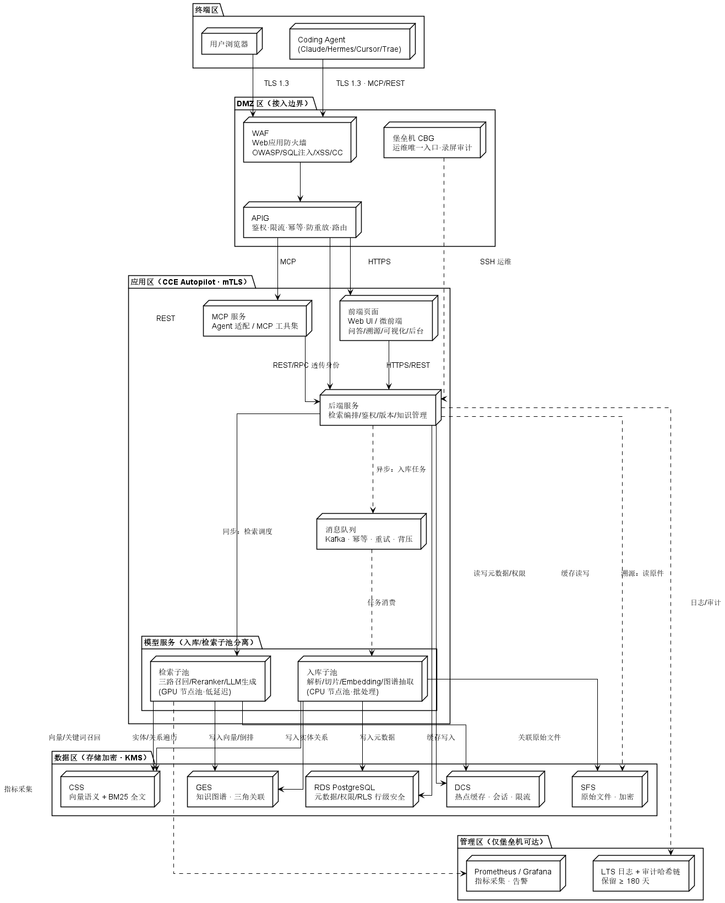

# Haisi RAG Server

基于 LangChain、LangGraph 和 FastAPI 构建的企业级知识增强生成系统，融合向量检索与知识图谱技术，采用"七层分层 + 五区安全"架构，支持知识库管理、多模型集成、混合检索与分布式部署。

## 项目简介

Haisi RAG Server 是一个面向海思芯片场景的知识库问答系统，提供了从文档处理、向量化、混合检索到生成的完整解决方案。系统采用模块化设计，融合传统 RAG 技术与知识图谱能力，通过 LangGraph 构建多步骤推理流程，并按五区安全模型规划生产部署。

完整架构设计参见：[海思知识库架构设计8.9版本.md](docs/海思知识库架构设计8.9版本.md)

### 核心特性

- **知识库管理**：支持知识库创建、文档上传、向量化、检索等全生命周期管理
- **混合检索架构**：
  - **向量检索**：基于 Milvus、Elasticsearch、PostgreSQL 的高性能向量检索
  - **知识图谱**：融合知识图谱的关联推理能力（基于图数据库设计思想）— TODO
  - **智能融合**：通过 LangGraph 协调多种检索策略，RRF 融合 + Reranker 精排
- **五区安全架构**：终端区 → DMZ 区 → 应用区 → 数据区 → 管理区，边界防护 + 存储加密 + 审计合规
- **七层分层设计**：消费端 → 集成接口 → 检索生成 → 知识模型 → 接入解析 → 数据存储 → 基础设施
- **固定的技术栈**：
  - 向量数据库：Milvus（主）、Elasticsearch（检索）、PostgreSQL（元数据）
  - Embedding 模型：Qwen3-Embedding API（2560 维）
  - Reranker 模型：Coreb-Code-Reranker API
  - LLM 模型：Doubao 系列（VLM、ChatLLM）、GLM-5（CodeLLM）
- **Worker 注册机制**：优雅的插件化架构，支持自定义模型服务
- **Web UI 界面**：Streamlit 构建的交互式管理界面（模型端测试 UI，非正式 UI）
- **RESTful API**：完整的 API 接口，支持 Swagger UI 文档展示
- **分布式部署**：支持 Docker 容器化部署和微服务架构

### 技术栈说明

**架构分层**：
- **Web Layer**：Streamlit 提供用户交互界面
- **API Layer**：FastAPI 提供 RESTful API 服务
- **Business Logic Layer**：核心业务逻辑和 LangGraph 工作流
- **Model Service Layer**：模型服务抽象和调用（入库子池 / 检索子池分离设计）
- **Data Storage Layer**：五库协同——Milvus / ES / PostgreSQL / 文件存储 / Redis 缓存

**向量数据库（固定）**：
- **Milvus**：高性能分布式向量数据库，用于大规模向量存储和 ANN 检索（对应架构文档"CSS 向量语义检索"）
- **Elasticsearch**：全文检索 + 向量检索结合，支持混合查询（对应架构文档"CSS BM25 全文检索"）
- **PostgreSQL**：关系型数据库，存储元数据、权限策略，支持 RLS 行级安全

**模型服务（固定）**：
- **Qwen3-Embedding API**：文本向量化服务，支持 2560 维向量
- **Coreb-Code-Reranker API**：代码相关性的重排序模型，支持多种任务类型
- **LLM 模型（暂时选型）**：Doubao 系列（VLM、ChatLLM）、GLM-5（CodeLLM）

**核心框架**：
- **LangChain**：应用开发框架
- **LangGraph**：多步骤推理和知识图谱融合（规划中）
- **FastAPI**：高性能 API 框架
- **Streamlit**：Web UI 界面

**外部服务**：
- **Redis**：消息队列，用于知识库信息同步与热点缓存（对应架构文档"DCS"）
- **MemMachine**：长期记忆服务，增强对话上下文
- **MemPalace**：文档检索服务，提供多路召回能力

## 系统架构

系统采用"七层分层 + 五区安全"架构，数据自下而上流动，能力自上而下暴露。



### 五区安全模型

| 分区 | 组件 | 说明 | 当前实现状态 |
| --- | --- | --- | --- |
| 终端区 | 用户浏览器 / Coding Agent | TLS 1.3 接入；Agent 持 Token/APIKey | ✅ Web UI + API |
| DMZ 区 | WAF / APIG / 堡垒机 CBG | 边界防护、鉴权限流幂等、运维录屏审计 | 🟡 生产部署接入，开发环境简化 |
| 应用区 | 前端、后端、MCP、模型服务（入库/检索子池）、消息队列 | CCE/Docker 部署，私有子网，mTLS | ✅ 后端 + 模型服务 + 消息队列 |
| 数据区 | Milvus / ES / PostgreSQL / 文件存储 / Redis | 五库协同，存储加密 + KMS 托管密钥 | ✅ Milvus+ES+PG+Redis |
| 管理区 | Prometheus/Grafana、LTS 日志+审计 | 监控告警、审计哈希链 ≥180 天 | 🟡 规划接入 |

> 标注说明：✅ 已实现 / 🟡 规划或生产部署时接入

### 七层分层架构

| 层 | 名称 | 核心职责 | 对应模块 |
| --- | --- | --- | --- |
| ① | 消费端 | 多端用户访问、多 Agent 生态集成 | Streamlit Web UI / REST API |
| ② | 集成接口层 | FastAPI REST、MCP 协议（规划）、鉴权透传 | `server/api.py` |
| ③ | 检索生成层 | 混合检索（向量+BM25+图谱规划）、RRF 融合、Reranker、LLM 生成 | `server/chat/`、`reranker_workers/`、`model_workers/` |
| ④ | 知识模型层 | Chunk 标准化、元数据、三角关联（规划） | `server/knowledge_base/` |
| ⑤ | 接入解析层 | 多格式解析（PDF/Word/Excel/代码）、AST 切片 | `document_loaders/`、`text_splitter/` |
| ⑥ | 数据存储层 | 五库协同（Milvus/ES/PG/文件/缓存） | `kb_service/` |
| ⑦ | 基础设施层 | Docker/CCE、监控、审计 | `release/`、`docker/` |

### 关键链路

**用户检索**（同步）：
前端 → APIG → 后端 → 检索子池 →（Milvus 向量召回 + ES 关键词召回）→ Reranker 精排 → LLM 生成 → SSE 流式返回

**知识入库**（异步，Outbox 模式）：
前端 → APIG → 后端 → 存原始文件 → 消息队列 → 入库子池（解析 → 切片 → Embedding → 图谱抽取）→ 写入 Milvus/ES/PG

**Agent（MCP）调用**（规划）：
Agent → APIG → MCP 服务 → 后端（身份透传）→ 检索子池 → 结构化结果 + 溯源

## 快速开始

### 环境要求

- Python 3.8+
- Redis（用于会话管理与消息同步）
- Milvus（向量数据库）
- Elasticsearch（全文检索）
- PostgreSQL（元数据存储）

### 安装步骤

1. **克隆项目**
   ```bash
   git clone <repository-url>
   cd haisi_rag_server
   ```

2. **安装依赖**
   ```bash
   pip install -r requirements.txt
   ```

3. **配置文件**
   
   编辑 `params/` 目录下的配置文件：
   - `basic_config.yaml` - 基础配置（日志、临时文件等）
   - `model_config.yaml` - 模型配置（LLM、Embedding、Reranker）
   - `kb_config.yaml` - 知识库配置（向量库、分词器等）
   - `server_config.yaml` - 服务器配置

4. **初始化数据库**
   ```bash
   python init_database.py
   ```

5. **启动服务**
   ```bash
   # 启动 API 服务
   python startup.py --mode api
   
   # 或启动 Web UI
   python startup.py --mode webui
   
   # 或同时启动
   python startup.py --mode all
   ```

### 访问服务

- **Web UI**: http://localhost:8501
- **API 文档**: http://localhost:7861/kw/docs
- **Swagger UI**: http://localhost:7861/kw/docs

## 项目结构

```
haisi_rag_server/
├── configs/                   # 配置加载模块
│   ├── basic_loader.py       # 基础配置加载
│   ├── model_loader.py       # 模型配置加载
│   ├── kb_loader.py          # 知识库配置加载
│   ├── prompt_loader.py      # 提示词配置加载
│   └── server_loader.py      # 服务器配置加载
├── params/                    # 配置文件目录
│   ├── basic_config.yaml     # 基础配置
│   ├── model_config.yaml     # 模型配置
│   ├── kb_config.yaml        # 知识库配置
│   ├── prompt_templates.yaml # 提示词模板
│   └── server_config.yaml    # 服务器配置
├── server/                    # 核心服务模块
│   ├── api.py                # FastAPI主应用
│   ├── chat/                 # 对话相关模块
│   ├── knowledge_base/       # 知识库管理
│   │   ├── kb_api.py        # 知识库API
│   │   ├── kb_service/      # 知识库服务实现
│   │   │   ├── milvus_kb_service.py
│   │   │   ├── es_kb_service.py
│   │   │   └── pg_kb_service.py
│   │   └── kb_cache/        # 知识库缓存
│   ├── embedding_workers/    # Embedding Worker注册
│   │   ├── __init__.py      # Worker注册表
│   │   ├── base.py          # HttpEmbeddings基类
│   │   └── qwen3_embedding.py
│   ├── reranker_workers/     # Reranker Worker注册
│   │   ├── __init__.py      # Worker注册表
│   │   ├── base.py          # HttpReranker基类
│   │   └── coreb_reranker.py
│   ├── model_workers/        # LLM Worker实现
│   ├── llm_api.py           # LLM管理API
│   └── embeddings_api.py    # Embedding API
├── document_loaders/          # 文档加载器
│   ├── mypdfloader.py       # PDF文档加载（支持 OCR）
│   ├── mydocloader.py       # Word文档加载
│   ├── myexcelloader.py     # Excel文档加载
│   └── myimgloader.py       # 图片OCR加载
├── text_splitter/            # 文本分词器
│   ├── chinese_text_splitter.py
│   ├── ali_text_splitter.py
│   └── code_splitter.py
├── webui_pages/              # Web UI页面
│   ├── dialogue/             # 对话页面
│   ├── knowledge_base/       # 知识库管理页面
│   └── model_config/         # 模型配置页面
├── tests/                    # 测试用例
│   ├── api/                 # API测试
│   ├── kb_vector_db/        # 向量库测试
│   └── document_loader/     # 文档加载器测试
├── release/                   # 部署相关
│   ├── docker/              # Docker部署文档
│   └── test/                # 部署测试脚本
├── docker/                   # Docker相关文件
│   ├── Dockerfile
│   └── requirements.txt
├── startup.py                # 启动脚本
├── webui.py                  # Web UI入口
└── init_database.py          # 数据库初始化
```

## 配置说明

### 1. 基础配置 (`params/basic_config.yaml`)

```yaml
# 环境模式
ENV:
  MODE: "prod"

# 日志配置
LOG:
  PATH: "/var/log/kw"
  LEVEL: "INFO"

# 用户认证
QA_TOKEN_SECRET: "your-secret-key"
QA_ADMIN_USER: "admin"
QA_ADMIN_PASSWORD: "admin123"
```

### 2. 模型配置 (`params/model_config.yaml`)

#### Embedding 配置

```yaml
# 本地 Embedding 模型
MODEL_PATH:
  embed_model:
    bge-large-zh: "BAAI/bge-large-zh"
    bge-m3: "BAAI/bge-m3"

# HTTP API Embedding 模型
EMBEDDING_API_CONFIG:
  qwen3-embedding-api:
    api_base_url: "http://192.168.80.250:16604"
    embedding_dim: 2560
    timeout: 60
```

#### Reranker 配置

```yaml
# HTTP API Reranker 模型（固定）
RERANKER_API_CONFIG:
  coreb-code-reranker-api:
    api_base_url: "http://192.168.80.250:16603"
    default_task_type: "TEXT_TO_CODE"
    timeout: 60
```

#### LLM 配置

```yaml
# 在线 LLM 模型（固定）
ONLINE_LLM_MODEL:
  # VLM 多模态模型 - 用于文档解析和图像理解
  doubao-seed-2.0-lite:
    model_id: "doubao-seed-2.0-lite"
    api_base_url: "https://api.doubao.com/v1"
    api_key: "${DOUBAO_API_KEY}"
    provider: "DoubaoWorker"
    langchain_model: false
    online_api: true
    
  # ChatLLM 模型 - 用于 RAG 对话问答
  doubao-1.5-pro-32k:
    model_id: "doubao-1.5-pro-32k"
    api_base_url: "https://api.doubao.com/v1"
    api_key: "${DOUBAO_API_KEY}"
    provider: "DoubaoWorker"
    langchain_model: false
    online_api: true
    
  # CodeLLM 模型 - 用于在线代码生成
  glm-5:
    model_id: "glm-5"
    api_base_url: "https://open.bigmodel.cn/api/paas/v4"
    api_key: "${GLM_API_KEY}"
    provider: "ZhipuWorker"
    langchain_model: false
    online_api: true
```

### 3. 知识库配置 (`params/kb_config.yaml`)

```yaml
# 向量数据库配置（固定）
DEFAULT_VS_TYPE: "milvus"

# Milvus 配置
MILVUS:
  host: "localhost"
  port: 19530
  
# Elasticsearch 配置
ES:
  host: "localhost"
  port: 9200

# PostgreSQL 配置
POSTGRESQL:
  host: "localhost"
  port: 5432
  database: "knowledge_base"
```

## Worker 注册机制

系统采用优雅的 Worker 注册机制来管理模型服务，支持插件化扩展。对应架构设计第 7.2 节"扩展性设计"——新增一个模型/Agent 仅需实现适配器接口，≤1 人周。

### Embedding Worker 注册

```python
from server.embedding_workers import register_embedding_worker
from server.embedding_workers.base import HttpEmbeddings

@register_embedding_worker("my-embedding-model")
class MyEmbeddings(HttpEmbeddings):
    def embed_query(self, text: str) -> List[float]:
        # 自定义实现
        return super().embed_query(text)
```

### Reranker Worker 注册

```python
from server.reranker_workers import register_reranker_worker
from server.reranker_workers.base import HttpReranker

@register_reranker_worker("my-reranker-model")
class MyReranker(HttpReranker):
    def score(self, query: str, document: str) -> float:
        # 自定义实现
        return super().score(query, document)
```

### 使用已注册的 Worker

```python
from server.embedding_workers import get_embedding_worker
from server.reranker_workers import get_reranker_worker

# 获取 Embedding Worker
worker_class = get_embedding_worker("qwen3-embedding-api")
embeddings = worker_class(api_base_url="...", embedding_dim=2560)

# 获取 Reranker Worker
worker_class = get_reranker_worker("coreb-code-reranker-api")
reranker = worker_class(api_base_url="...", default_task_type="TEXT_TO_CODE")
```

## Docker部署(模型端API服务部署)

### 使用 Docker Compose

```bash
# 构建镜像
docker build -t haisi-rag-server -f docker/Dockerfile .

# 启动服务
docker-compose up -d
```

### 部署依赖服务

项目提供了完整的部署文档：

- [Elasticsearch 部署](release/images/es/Elasticsearch部署文档.md)
- [Milvus 部署](release/images/milvus/Milvus部署文档.md)
- [PostgreSQL 部署](release/images/postgresql/PostgreSQL数据库部署文档.md)
- [Redis 部署](release/images/redis/Redis部署文档.md)
- [Qwen3-Embedding 部署](release/images/embedding/Qwen3-Embedding%20模型部署文档.md)
- [Coreb-Code-Reranker 部署](release/images/reranker/Coreb-Code-Reranker模型部署文档.md)

## API 文档

### 核心 API 端点

#### 对话相关
- `POST /kw/chat/chat` - 与 LLM 模型对话
- `POST /kw/chat/feedback` - 提交对话反馈
- `POST /kw/chat/next_question` - 生成追问问题

#### 知识库管理
- `POST /kw/kb/create` - 创建知识库
- `POST /kw/kb/delete` - 删除知识库
- `GET /kw/kb/list` - 列出所有知识库
- `POST /kw/kb/upload_docs` - 上传文档到知识库
- `POST /kw/kb/delete_docs` - 删除知识库文档
- `GET /kw/kb/search_docs` - 搜索知识库文档

#### 模型管理(模型端内部功能非公开，仅用于测试)
- `GET /kw/llm_model/list_running_models` - 列出运行中的 LLM 模型
- `GET /kw/llm_model/list_config_models` - 列出配置的 LLM 模型
- `POST /kw/llm_model/change` - 切换 LLM 模型
- `POST /kw/embed_texts` - 文本向量化

详细 API 文档请访问：http://localhost:7861/kw/docs

## 测试

项目提供了完善的测试用例：

```bash
# API 测试
python tests/api/test_kb_api.py
python tests/api/test_llm_api.py

# 向量数据库测试
python tests/kb_vector_db/test_milvus_db.py

# 文档加载器测试
python tests/document_loader/test_pdfloader.py
```

## 技术栈总结

### 向量数据库（对应架构文档"数据区"）
- **Milvus** - 高性能、分布式、支持多种索引，适用于大规模生产环境（对应 CSS 向量语义检索）
- **Elasticsearch** - 全文检索+向量检索，支持混合查询场景（对应 CSS BM25 全文检索）
- **PostgreSQL** - 关系型数据库+向量扩展，用于元数据管理、权限策略、RLS 行级安全

### 模型服务（对应架构文档"应用区·模型服务"）
- **Qwen3-Embedding API** - 2560 维文本向量，支持中英文（入库子池·向量化）
- **Coreb-Code-Reranker API** - 代码相关性重排序，支持多任务类型（检索子池·精排）
- **Doubao-Seed-2.0-lite** - VLM 多模态模型，用于文档解析和图像理解（入库子池）
- **Doubao-1.5-pro-32k** - ChatLLM 模型，用于 RAG 对话问答（检索子池·生成）
- **GLM-5** - CodeLLM 模型，用于在线代码生成（检索子池·生成）

### 核心框架
- **LangChain** - 应用开发框架
- **RAG Workflow** - 多步骤推理和知识图谱融合
- **FastAPI** - 高性能 API 框架
- **Streamlit** - Web UI 界面

## 开发指南

### 项目特点

1. **框架化设计**：当前代码是基础框架，后续会融合知识图谱能力
2. **固定技术栈**：使用指定的向量数据库和模型服务，确保系统稳定性
3. **五区安全**：按终端/DMZ/应用/数据/管理五区规划，生产部署接入 WAF/APIG/堡垒机
4. **可扩展性**：通过 Worker 注册机制支持未来功能扩展

### 添加新功能

1. **扩展 RAG Workflow**
   - 在 `server/chat/` 添加新的对话流程
   - 集成知识图谱推理能力
   - 实现多步骤问答逻辑

2. **优化检索策略**
   - 改进向量检索算法
   - 融合知识图谱信息
   - 优化 Reranker 策略

3. **完善 Worker 功能**
   - 扩展现有 Worker 的功能
   - 添加监控和日志
   - 优化性能和稳定性

## 注意事项

1. **环境配置**：确保 Milvus、Elasticsearch、PostgreSQL 正确部署和配置
2. **模型服务**：Qwen3-Embedding 和 Coreb-Code-Reranker API 需要确保网络可达
3. **资源管理**：Embedding 和 Reranker 模型会占用较多网络资源，建议合理规划
4. **安全性**：生产环境请修改默认密码和密钥，并接入 WAF/APIG/堡垒机
5. **知识图谱**：后续版本会集成知识图谱功能，当前架构已预留扩展接口

## License

本项目仅供内部使用。

## 贡献指南

欢迎提交 Issue 和 Pull Request。

## 联系方式

如有问题，请联系开发团队。
