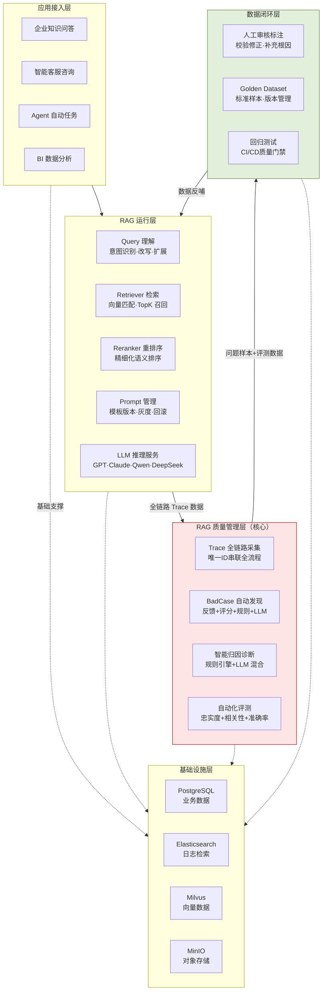
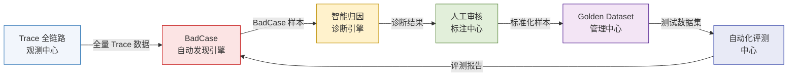
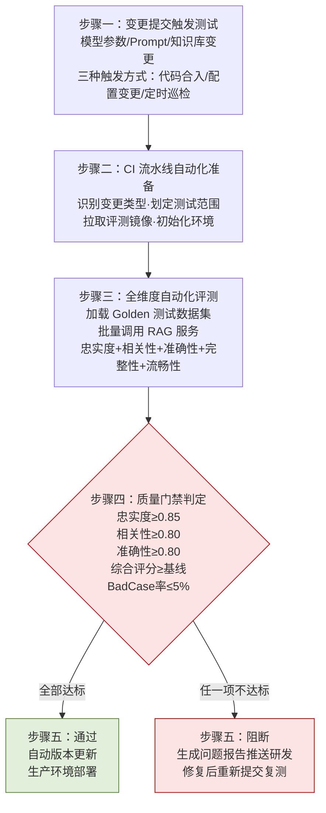
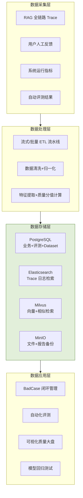
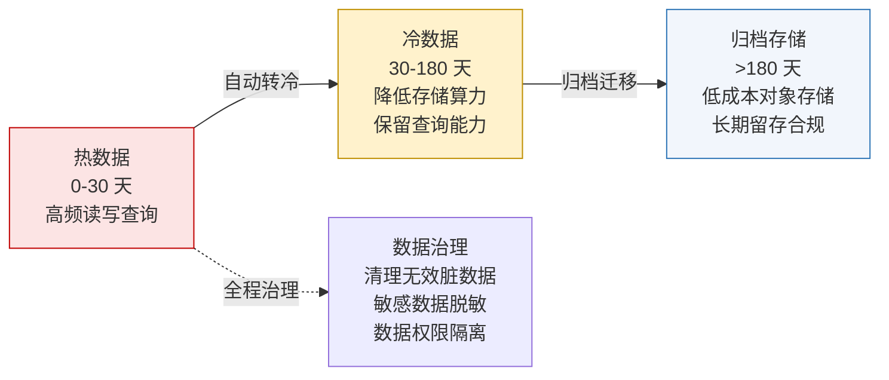
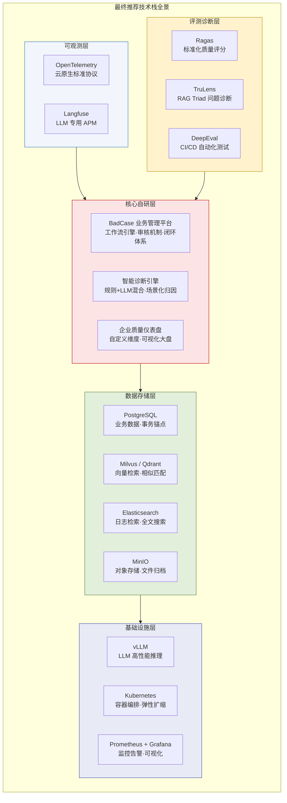

| 产品名称             | 密级     |
| ---------------- | ------ |
| RAG BadCase 管理平台 | 内部资料   |
| 产品版本             | 共 XX 页 |
| V1.0（8.9 版本）     |        |

RAG BadCase 管理技术架构设计说明书

| Prepared by<br>拟制 | 架构组 | Date<br>日期 | 2026-08-09 |
| ----------------- | --- | ---------- | ---------- |
| Reviewed by<br>审核 |     | Date<br>日期 |            |
| Approved by<br>批准 |     | Date<br>日期 |            |

Huawei Technologies Co., Ltd.

华为技术有限公司

All rights reserved

版权所有  侵权必究

Revision record 修订记录

| Date<br>日期 | Revision Version<br>修订版本 | Change Description<br>修改描述  | Author<br>作者 |
| ---------- | ------------------------ | --------------------------- | ------------ |
| 2026-07-24 | V1.0                     | 初稿完成                        | 贺涛           |
| 2026-08-09 | V1.1                     | 按软件设计说明书模板重组，新增 Mermaid 架构图 | 架构组          |

Keywords 关键词：RAG、BadCase 管理、质量闭环、LLMOps、Trace 全链路追踪、智能归因诊断、RAG Triad、Golden Dataset、自动化评测、CI/CD 质量门禁

Abstract 摘要：本文档是 RAG BadCase 管理平台的技术架构设计说明书，构建企业级 RAG Quality Engineering（RAG 质量工程）体系，打通"问题发现→根因诊断→人工修复→数据沉淀→回归验证→持续优化"全闭环。覆盖五层架构设计（应用接入层/RAG 运行层/质量管理层/数据闭环层/基础设施层）、六大核心模块（Trace 观测/BadCase 发现/智能诊断/人工审核/Golden Dataset/自动化评测）、十类 BadCase 标准化分类体系、RAG Triad 三维诊断模型、完整数据架构（五类数据+四层架构）、全维度 API 设计与 Kubernetes 私有化部署方案。

List of abbreviations 缩略语清单：

| 缩略语    | 英文全名                           | 中文解释    |
| ------ | ------------------------------ | ------- |
| RAG    | Retrieval-Augmented Generation | 检索增强生成  |
| LLM    | Large Language Model           | 大语言模型   |
| LLMOps | LLM Operations                 | 大模型运维体系 |
| Span   | —                              | 分段追踪单元  |
| DLQ    | Dead Letter Queue              | 死信队列    |
| K8S    | Kubernetes                     | 容器编排平台  |
| GPU    | Graphics Processing Unit       | 图形处理器   |

# 1 概述

## 1.1 背景

大语言模型在企业知识问答场景规模化落地，RAG 已成为企业落地大模型应用的主流技术架构。RAG 通过接入企业私有知识库，弥补大模型参数知识滞后、领域适配性弱的短板。标准 RAG 业务全链路流程：用户问题 → Query 理解 → 知识检索 → 文档召回 → 排序优化 → Prompt 组装 → LLM 生成 → 最终回答。

企业 RAG 应用场景持续扩容、链路复杂度不断提升，典型质量问题可归纳为八大类：

| 问题类型      | 问题描述                         |
| --------- | ---------------------------- |
| 检索失败      | 未匹配、未召回用户问题对应的正确知识文档         |
| 召回污染      | 检索返回大量无关文档，干扰上下文生成           |
| 排序错误      | 有效知识文档未进入 Top-K 候选列表，优质内容被淹没 |
| 上下文不足     | 检索信息缺失、截断，导致模型生成答案不完整        |
| 模型幻觉      | 模型生成知识库中不存在的虚假事实、错误结论        |
| Prompt 失效 | 提示词规则无法有效约束模型输出，出现越界、违规应答    |
| 知识过期      | 知识库数据版本滞后、内容老旧               |
| 性能异常      | 请求延迟过高、Token 消耗超标            |

RAG 系统质量问题具备极强的特殊性：多阶段长链路耦合导致问题溯源链路长、节点多；质量问题难以量化界定（"应答质量差"属软性问题）。企业亟需搭建专业化 RAG 质量管理与 BadCase 闭环平台。

## 1.2 建设目标

构建企业级 RAG Quality Engineering（RAG 质量工程）体系，打通"问题发现→根因诊断→人工修复→数据沉淀→回归验证→持续优化"全闭环，四大核心目标：

1. **全链路可观测**：基于唯一 Trace ID 串联单次 RAG 请求全流程数据，支撑链路复盘、问题复现与质量溯源
2. **智能化 BadCase 自动发现**：整合用户负向反馈、自动化评分、规则检测、LLM Judge 智能评审四大能力，精准筛选低质量样本
3. **精细化智能归因**：自动区分检索失败、排序异常、模型幻觉、Prompt 失效等各类问题根因
4. **全流程质量闭环**：构建"线上问题→BadCase 沉淀→智能分析→人工修复→Golden Dataset→回归测试→版本上线"的数据飞轮

## 1.3 设计原则

| 原则    | 内涵                                         |
| ----- | ------------------------------------------ |
| 全链路覆盖 | 覆盖用户输入→语义理解→知识检索→上下文增强→模型生成→质量评价→迭代优化全流程   |
| 数据驱动  | 所有质量分析依托真实 Trace 链路数据、自动化评测数据、Golden 标准数据集 |
| 自动化优先 | 最大化问题发现、归因分析、效果评测的自动化能力，减少人工介入             |
| 平台化通用 | 支持多业务应用、多知识库、多大模型、多租户隔离适配                  |

## 1.4 适用读者

- 架构师/技术负责人：评审平台架构完整性、技术选型合理性
- 算法工程师：理解 RAG 质量诊断与评测体系
- 后端开发：理解数据模型、API 接口与微服务设计
- 运维/SRE：理解 Kubernetes 部署、高可用、监控运维

# 2 模块简介（架构设计）

## 2.1 模块概述

本平台是企业级大模型质量工程基础设施，核心围绕 **观测（Observe）→ 评估（Evaluate）→ 诊断（Diagnose）→ 优化（Optimize）→ 回归（Regression）** 五大能力构建，实现 RAG 质量的全生命周期治理。

## 2.2 总体结构——五层技术架构



图 2-1 平台五层技术架构

### 各层职责

| 层   | 名称        | 核心职责                                       |
| --- | --------- | ------------------------------------------ |
| L1  | 应用接入层     | 用户请求接入、身份认证鉴权、会话管理、流量收敛与路由分发               |
| L2  | RAG 运行层   | Query 理解→检索→重排→Prompt→LLM 推理，承载 RAG 核心业务逻辑 |
| L3  | 质量管理层（核心） | Trace 采集、BadCase 发现、智能诊断、自动评测，实现质量管控全流程    |
| L4  | 数据闭环层     | 人工标注、数据清洗、Golden Dataset 沉淀、回归验证           |
| L5  | 基础设施层     | PG/ES/Milvus/MinIO 提供底层存储、计算、检索支撑          |

## 2.3 平台核心数据流

```mermaid
graph LR
    User["用户请求"] --> RAG["RAG 运行层<br/>Query→检索→重排→生成"]

    RAG -->|"Trace 实时采集"| TraceDB["Trace 存储<br/>PG + ES"]

    TraceDB -->|"全量 Trace"| Discovery["BadCase 自动发现<br/>反馈触发·评分触发<br/>规则检测·LLM Judge"]

    Discovery -->|"BadCase 样本"| Diag["智能归因诊断<br/>规则引擎+LLM混合<br/>RAG Triad 三维诊断"]

    Diag -->|"根因+证据+建议"| Review["人工审核标注<br/>校验修正·补充标准答案"]

    Review -->|"标准化样本"| Golden["Golden Dataset<br/>回归测试集·基准评测集<br/>安全测试集·领域数据集"]

    Golden -->|"自动评测"| Regression["CI/CD 质量门禁<br/>忠实度·相关性·准确性<br/>完整性·流畅性"]

    Regression -->|"门禁通过"| Deploy["版本发布"]
    Regression -->|"门禁失败"| Fix["阻断发布·修复重测"]

    Fix -.-> RAG

    style Discovery fill:#FCE4E4,stroke:#C00000
    style Diag fill:#FFF2CC,stroke:#BF8F00
    style Golden fill:#E2EFDA,stroke:#548235
    style Regression fill:#F3E5F5,stroke:#4A148C
```



图 2-2 平台核心数据流——业务链路与质量链路双向联动

## 2.4 设计约束

- 部署形态：Kubernetes 私有化部署，适配企业内网
- 编程语言：后端 Python/Go，前端 React/TypeScript
- 数据库：PostgreSQL（业务数据）、Elasticsearch（日志检索）、Milvus（向量）、MinIO（对象存储）
- LLM Judge 模型：Qwen-Plus（主）/ vLLM 自托管

# 3 模块需求分析

## 3.1 核心功能需求

| 需求编号  | 功能模块              | 核心能力                                            |
| ----- | ----------------- | ----------------------------------------------- |
| BC-01 | Trace 全链路观测       | Trace ID 串联全流程，记录 Query/检索/排序/Prompt/生成/评测全维度数据 |
| BC-02 | BadCase 自动发现      | 用户反馈+自动评分+规则检测+LLM Judge 四大策略，自动筛选低质量样本         |
| BC-03 | 智能归因诊断            | RAG Triad 三维诊断（上下文相关性/事实忠实度/答案相关性），自动输出根因+证据+建议 |
| BC-04 | 人工审核标注            | 人机协同校验修正，沉淀标准答案                                 |
| BC-05 | Golden Dataset 管理 | 回归测试/基准评测/安全测试/领域数据集 四类标准化管理                    |
| BC-06 | 自动化评测             | CI/CD 集成质量门禁，五维度评测（忠实度/相关性/准确性/完整性/流畅性）         |

## 3.2 关键场景分析

| 场景编号 | 场景描述                                              | 涉及模块                 |
| ---- | ------------------------------------------------- | -------------------- |
| 1    | 用户点击"不满意"→自动生成 BadCase→触发诊断→归因"检索失败"→优化 Embedding | Trace + BadCase + 诊断 |
| 2    | Prompt 模板修改→CI 触发回归测试→评测不通过→阻断发布→修复重测             | Golden + 评测 + CI/CD  |
| 3    | 每周自动巡检→发现幻觉率上升→LLM Judge 评审→定位模型版本问题→回滚           | BadCase + 诊断 + 评测    |
| 4    | 知识库新增文档→评测集更新→A/B 对比→质量提升确认→合入生产                  | Dataset + 评测 + 回归    |

# 4 模块概要设计

## 4.1 核心模块联动关系



图 4-1 核心模块联动关系——完整质量闭环

## 4.2 Trace 全链路观测中心（概要）

**模块定位**：平台核心数据入口，基于唯一 Trace ID 串联单次 RAG 请求全流程。

**Trace 结构**：一次完整 RAG 请求对应一条 Trace，包含多个 Span：Query 请求解析 → Retrieval 知识库检索 → Rerank 结果重排 → Prompt 提示词组装 → Generation 答案生成 → Evaluation 质量评测。每个 Span 独立记录耗时、输入、输出、元数据。

**三种采集模式**：SDK 埋点采集（生产推荐，精度高）、中间件拦截采集（无侵入，适配存量系统）、OpenTelemetry 标准化采集（企业云原生推荐，跨语言通用）。

## 4.3 BadCase 自动发现引擎（概要）

四大发现策略，多维度全覆盖：

| 策略             | 触发方式                             | 覆盖问题类型 |
| -------------- | -------------------------------- | ------ |
| 用户负向反馈         | 用户点击"不满意/无帮助"→自动关联 Trace         | 主观体验类  |
| 自动化指标评分        | 忠实度<0.6 / 相关性<0.6 / 召回率<0.5 自动判定 | 量化指标类  |
| LLM Judge 智能评审 | 专用评测大模型语义级评审                     | 隐性质量问题 |
| 业务规则检测         | "无法回答/不知道"等固定无效应答+上下文有效→检索失败     | 检索链路类  |

## 4.4 智能归因诊断引擎（概要）

**RAG Triad 三维核心诊断模型**：

| 诊断维度                      | 定义                    | 指标偏低定位                       |
| ------------------------- | --------------------- | ---------------------------- |
| Context Relevance（上下文相关性） | 检索召回文档与用户问题的语义匹配程度    | 检索链路：Embedding/Chunk 切片/检索策略 |
| Groundedness（事实忠实度）       | 模型生成答案是否完全依托检索上下文，无虚构 | 模型幻觉/Prompt 约束不足             |
| Answer Relevance（答案相关性）   | 最终应答是否精准解答用户核心问题      | 生成逻辑/Prompt 设计/模型能力          |

**混合诊断架构**：规则引擎兜底（标准化、高频问题快速判定）+ LLM Judge 精准补充（复杂、隐性、个性化问题深度归因）→ 融合模型输出统一诊断结果。

## 4.5 人工审核标注中心（概要）

自动化诊断无法完全覆盖复杂业务语义，搭建人机协同审核中心。标注流程：BadCase 分配 → 人工校验自动诊断结果 → 修正问题类型与根因 → 补充标准最优答案 → 审核确认 → 入 Golden Dataset。

## 4.6 Golden Dataset 管理中心（概要）

四类标准化数据集：回归测试数据集（版本迭代后回归）、基准评测数据集（常态化能力评测）、安全测试数据集（安全风险校验）、行业领域数据集（垂直业务专属）。

## 4.7 自动化评测中心（概要）

CI/CD 质量门禁五步流程：



图 4-2 CI/CD 自动化质量门禁流程

# 5 模块详细设计

## 5.1 BadCase 标准化分类体系

十类企业级统一 BadCase 分类标准：

| 类别        | 故障表现           | 优化方向                             |
| --------- | -------------- | -------------------------------- |
| 检索失败      | 未召回正确文档、召回无关内容 | 优化 Embedding、调整 TopK、新增 Reranker |
| 知识缺失      | 知识库无对应业务知识     | 补充、更新企业知识库文档                     |
| 切片故障      | 语义被拆分破坏、关键信息截断 | 语义切片、父子文档检索                      |
| 重排序故障     | 优质内容未进入最终上下文   | 优化重排模型、调整排序权重                    |
| 模型幻觉      | 编造虚假信息、错误结论    | Prompt 约束、模型升级、事实校验              |
| Prompt 失效 | 提示词无法规范模型输出    | 迭代 Prompt、增加拒答/溯源规则              |
| 模型能力不足    | 复杂推理无法精准解析     | 升级模型、Agent 拆解复杂任务                |
| 上下文溢出     | 关键信息被截断        | 上下文压缩、动态窗口适配                     |
| 安全违规      | 输出敏感信息、越权数据    | 安全护栏、权限过滤、内容检测                   |
| 性能异常      | 延迟过高、Token 超标  | 资源扩容、缓存优化                        |

## 5.2 RAG Triad 诊断模型详细设计

### 5.2.1 上下文相关性（Context Relevance）

定义：衡量检索召回文档与用户原始问题的语义匹配程度，评分 0-1。故障表现：召回大量无关文档、核心知识未召回、有效内容排序靠后。根因与优化：Embedding 模型适配不足→更换领域专属模型；Chunk 切片不合理→调整语义切片策略；Query 模糊→新增查询改写能力。

### 5.2.2 事实忠实度（Groundedness）

定义：衡量模型生成答案是否完全依托检索上下文，无虚构、无编造。故障表现：模型生成知识库不存在的虚假事实。根因与优化：Prompt 约束不足→增加事实校验、拒答策略；模型能力不足→升级高精度模型；模型温度过高→调低 temperature 参数。

### 5.2.3 答案相关性（Answer Relevance）

定义：衡量最终应答是否精准匹配用户核心诉求。故障表现：上下文信息充足，但模型输出内容偏离用户问题。根因与优化：生成逻辑问题→优化 Prompt 指令；模型缺乏领域理解→领域微调。

## 5.3 自动归因算法

**多阶段诊断流水线**：BadCase 输入 → 规则引擎快速筛查（标准化高频问题）→ LLM Judge 深度诊断（复杂隐性语义问题）→ 融合模型输出统一诊断结果 → 标准化诊断输出（root_cause + confidence + evidence + suggestions）。

**标准化诊断输出格式**：

```json
{
  "case_id": "BC001",
  "root_cause": "Retrieval Failure",
  "confidence": 0.93,
  "evidence": ["Context relevance=0.21", "TopK documents unrelated"],
  "suggestion": ["increase top_k", "optimize embedding"]
}
```

## 5.4 LLM Judge 评测体系

传统 BLEU/ROUGE 仅能字面相似度评测，无法识别语义准确性、推理逻辑性、业务合规性。引入 LLM Judge 实现语义级、业务级精准评测。

**标准化评测 Prompt 模板**：你是一名专业的 RAG 质量评估专家。评测问题：{question}，参考上下文：{context}，模型应答：{answer}。评测标准：1.答案是否完全基于上下文事实无幻觉；2.是否精准解答用户核心问题；3.内容是否完整合规无冗余。输出 JSON：faithfulness / relevance / reason。

## 5.5 数据模型设计

### 5.5.1 五类核心数据

| 数据类型          | 描述                    | 存储方案                       |
| ------------- | --------------------- | -------------------------- |
| Trace 数据      | RAG 全流程调用轨迹，问题溯源核心依据  | PostgreSQL + Elasticsearch |
| BadCase 数据    | 幻觉、检索失败、答案错误等缺陷样本     | PostgreSQL                 |
| Evaluation 数据 | 人工/自动化评测产生的质量评分       | PostgreSQL                 |
| Dataset 数据    | Golden Dataset 标准基准样本 | PostgreSQL + MinIO         |
| Embedding 数据  | 语义向量，用于相似问题聚类与检索      | Milvus 向量数据库               |

### 5.5.2 数据架构四层设计



图 5-1 数据架构四层设计

### 5.5.3 Trace 核心数据表

**主 Trace 表（rag_trace）**：

```sql
CREATE TABLE rag_trace (
    trace_id VARCHAR(64) PRIMARY KEY,
    app_id VARCHAR(64),
    user_id VARCHAR(64),
    session_id VARCHAR(64),
    query TEXT,
    answer TEXT,
    model_name VARCHAR(128),
    latency_ms INT,
    token_input INT,
    token_output INT,
    status VARCHAR(32),
    created_time TIMESTAMP
);
```

**分段 Span 表（rag_trace_span）**：

```sql
CREATE TABLE rag_trace_span (
    span_id VARCHAR(64) PRIMARY KEY,
    trace_id VARCHAR(64),
    span_type VARCHAR(64),       -- query/retrieval/rerank/prompt/generation/evaluation
    input_data JSONB,
    output_data JSONB,
    duration_ms INT,
    created_time TIMESTAMP
);
```

### 5.5.4 BadCase 生命周期与数据表

**状态流转**：NEW（新增）→ ANALYZING（分析中）→ CONFIRMED（确认）→ FIXING（修复中）→ REGRESSION（回归测试）→ CLOSED（关闭）

```sql
CREATE TABLE bad_case (
    case_id VARCHAR(64) PRIMARY KEY,
    trace_id VARCHAR(64),
    question TEXT,
    answer TEXT,
    category VARCHAR(64),
    severity VARCHAR(16),
    status VARCHAR(32),
    root_cause TEXT,
    created_time TIMESTAMP
);
```

### 5.5.5 Evaluation 评测数据表

```sql
CREATE TABLE rag_evaluation (
    evaluation_id VARCHAR(64) PRIMARY KEY,
    trace_id VARCHAR(64),
    context_relevance FLOAT,
    faithfulness FLOAT,
    answer_relevance FLOAT,
    overall_score FLOAT,
    evaluator_type VARCHAR(32),
    created_time TIMESTAMP
);
```

### 5.5.6 Golden Dataset 数据表

```sql
CREATE TABLE golden_dataset (
    dataset_id VARCHAR(64) PRIMARY KEY,
    name VARCHAR(128),
    version VARCHAR(32),
    description TEXT,
    created_time TIMESTAMP
);
```

**标准样本格式**：

```json
{
  "id": "QA001",
  "question": "员工芯片资料权限如何申请?",
  "context": "员工需要提交OA申请...",
  "expected_answer": "通过OA系统提交申请...",
  "category": "TECH"
}
```

## 5.6 数据生命周期管理



图 5-2 数据生命周期管理——冷热分层

## 5.7 平台接口设计

| 接口类别       | 核心接口                         | 方法       | 用途               |
| ---------- | ---------------------------- | -------- | ---------------- |
| Trace 管理   | /api/v1/traces               | POST     | 上报全链路追踪基础信息      |
| Trace 管理   | /api/v1/traces/{id}/spans    | POST     | 上报细分执行环节数据       |
| Trace 管理   | /api/v1/traces/{id}          | GET      | 查询全链路执行详情        |
| BadCase 管理 | /api/v1/badcases             | POST/GET | 录入/查询问题案例        |
| BadCase 管理 | /api/v1/badcases/{id}/status | PUT      | 状态流转（NEW→CLOSED） |
| 自动诊断       | /api/v1/diagnosis/run        | POST     | 触发自动化根因诊断        |
| 评测管理       | /api/v1/evaluation/run       | POST     | 发起自动化评测任务        |
| 评测管理       | /api/v1/evaluation/{id}      | GET      | 查询评测详细得分         |
| Dataset    | /api/v1/datasets             | POST     | 创建测试数据集          |
| Dataset    | /api/v1/datasets/{id}/items  | POST     | 添加问答测试样本         |
| 回归测试       | /api/v1/regression/jobs      | POST     | 创建批量回归测试任务       |

接口规范：RESTful + OpenAPI 3.0、HTTPS 传输、JSON 格式、/api/v1/ 前缀版本化、OAuth2 + JWT 统一认证、统一返回格式 {code, message, data}。

# 6 非功能设计

## 6.1 部署架构

### 6.1.1 Kubernetes 微服务拆分

```
rag-quality-platform
├── trace-service           # 链路追踪服务
├── badcase-service         # 问题案例管理服务
├── evaluation-service      # 质量评估服务
├── diagnosis-service       # 智能诊断分析服务
├── dataset-service         # 测试数据集管理服务
├── regression-service      # 回归测试服务
├── notification-service    # 消息通知服务
└── gateway-service         # 网关路由服务
```

### 6.1.2 部署规模参考

| 规模          | K8S 节点 | GPU    | 数据库   | Vector DB |
| ----------- | ------ | ------ | ----- | --------- |
| 小型（月<100万次） | 3-5 节点 | 1-2 卡  | 主备架构  | 单集群       |
| 中大型（月千万级）   | 10+ 节点 | 4-20 卡 | 分布式集群 | 分布式集群     |

### 6.1.3 服务高可用

所有核心服务多副本部署（replicas: 3）+ RollingUpdate 滚动更新策略。PostgreSQL 主从复制+Patroni 自动故障切换。Elasticsearch 3 主节点+3 数据节点集群容错。

## 6.2 安全设计

- **身份认证**：LDAP / OAuth2 / SSO 单点登录
- **权限模型**：RBAC 角色权限 + ABAC 属性权限混合模型
- **审计日志**：全操作可追溯（登录/数据查看/Prompt 修改/模型发布/数据删除）
- **数据隔离**：Tenant→Application→Dataset→BadCase 四级数据权限隔离
- **网络隔离**：零信任+多层网络分区（DMZ/业务区/AI 算力区/数据区）

## 6.3 监控运维

- **指标监控（Metrics）**：Prometheus 采集 CPU/内存/GPU/QPS/延迟
- **日志采集（Logs）**：Loki/Elasticsearch 归集服务日志+Trace 日志+错误日志
- **可视化大盘（Dashboard）**：Grafana 展示 BadCase 率/模型幻觉率/平均得分/延迟/Token 成本

## 6.4 CI/CD 部署流程

代码提交 → CI 自动构建 → 自动化测试 → 镜像打包 → Kubernetes 集群部署

## 6.5 技术选型总结

| 技术层级  | 推荐组件                                        |
| ----- | ------------------------------------------- |
| 可观测协议 | OpenTelemetry（标准协议）+ Langfuse（LLM 专用 APM）   |
| 评估框架  | Ragas（量化评分）+ TruLens（问题诊断）+ DeepEval（自动化测试） |
| 业务数据库 | PostgreSQL                                  |
| 日志检索  | Elasticsearch                               |
| 向量数据库 | Milvus（大型）/ Qdrant（中小型）                     |
| 对象存储  | MinIO                                       |
| 模型推理  | vLLM（LLM 推理）/ NVIDIA Triton（多模型）            |
| 容器编排  | Kubernetes                                  |
| 监控运维  | Prometheus + Grafana + Loki                 |

## 6.6 最终推荐技术组合与优势分析

### 6.6.1 最终推荐组合

基于成熟度、企业可维护性、私有化部署能力、生态兼容性四维度综合评估，推荐以下分层技术组合：



图 6-1 最终推荐技术组合全景

### 6.6.2 分层优势分析——每个组件为什么选它

**可观测层：OpenTelemetry + Langfuse**

| 组件 | 为什么选 | 为什么不用替代方案 |
| --- | --- | --- |
| OpenTelemetry | CNCF 官方可观测标准，跨语言跨服务统一协议，架构稳定无技术绑定风险 | 自研采集 SDK 工作量巨大且缺乏社区生态；专有协议（如 SkyWalking）生态窄、LLM 场景覆盖弱 |
| Langfuse | LLM 专用 APM，开箱即用 Trace 追踪、Prompt 版本管理、用户反馈收集、评测 Dataset 管理、私有化部署支持 | 自建 LLM 观测平台开发成本高；LangSmith 闭源付费且数据出境；Phoenix 侧重模型调试而非业务观测 |

两者形成**"底层标准 + 上层应用"双层可观测体系**：OpenTelemetry 保障数据采集标准化（任何人可接入），Langfuse 补全 LLM 专属能力（Prompt 版本、反馈闭环、Dataset 管理）。不选单一方案的原因是——纯 OpenTelemetry 缺少 LLM 专用 UI 和 Prompt 管理，纯 Langfuse 锁死在其数据模型上不利于未来迁移。

**评测诊断层：Ragas + TruLens + DeepEval 三件套**

| 组件 | 为什么选 | 为什么不用替代方案 |
| --- | --- | --- |
| Ragas | RAG 专属指标体系最完整（Faithfulness/Relevance/Precision/Recall），学术认可度高、指标权威性强，部署简单 | 仅聚焦量化评分，无问题诊断和自动化测试能力，单独使用只能"打分"不能"归因" |
| TruLens | RAG Triad 三维诊断模型（上下文相关性+事实忠实度+答案相关性），精准定位检索/生成/匹配各环节根因 | 开源社区规模小于 Ragas，问题解决方案沉淀较少，单独使用缺少 CI/CD 集成 |
| DeepEval | pytest 风格 API 完美适配 CI/CD 流水线，50+ 内置指标、G-Eval 自定义、批量测试自动化 | 不属于 RAG 专用框架，内置指标偏通用 LLM 评估，缺少 RAG 特有的链路级诊断 |

三件套的**互补逻辑**：Ragas 回答"回答质量多少分"（量化评分）→ TruLens 回答"为什么是这个分数"（根因诊断）→ DeepEval 回答"新版本能否上线"（自动门禁）。不选单一框架的原因是 RAG 质量管控需要"评分+诊断+卡点"三个环节，任何一个单独框架都只能覆盖其中 1-2 个。

**核心自研层：BadCase 平台 + 智能诊断 + 质量仪表盘**

| 组件 | 为什么自研 | 为什么不开源直接复用 |
| --- | --- | --- |
| BadCase 业务管理平台 | 问题生命周期（NEW→ANALYZING→CONFIRMED→FIXING→REGRESSION→CLOSED）需与企业管理流程深度耦合，工作流引擎、审核机制、工单闭环需定制 | 开源 Bug 追踪系统（Jira/Redmine）不是为 RAG 质量场景设计的，缺少 BadCase 特有的诊断-修复-回归联动 |
| 智能诊断引擎 | 需结合企业专属知识库、历史 BadCase 案例库、行业专家经验进行场景化归因，通用开源方案只能判大类、无法给业务级建议 | Ragas/TruLens 提供的诊断是通用维度（检索/生成/幻觉），无法结合海思芯片场景的领域知识 |
| 企业质量仪表盘 | 需适配企业自有业务指标体系（BadCase 率、幻觉率、Top-5 命中率、P95 延迟、Token 成本），与内部 BI 系统打通 | Grafana 通用大盘可以展示指标，但缺少 RAG 质量领域的预置分析维度（按芯片型号/文档类型/问题类别/难度切片） |

自研投入约 3-4 人月（平台 2 人月 + 诊断引擎 1 人月 + 仪表盘 1 人月），相比全部自研（12+ 人月）大幅节省，且聚焦核心差异化。

**数据存储层：PG + Milvus + ES + MinIO 四件套**

| 组件 | 为什么选 | 为什么不用替代方案 |
| --- | --- | --- |
| PostgreSQL | 企业普及率最高，运维体系成熟；原生 JSONB 适配半结构化 BadCase/Evaluation 数据；ACID 事务保障 Outbox 一致性；RLS 行级安全 | MySQL JSON 支持弱、无原生 RLS；MongoDB 缺 ACID 事务保障一致性 |
| Milvus | 分布式向量检索性能业界第一（HNSW/IVF 索引、GPU 加速）；国产生态完善适配国内企业；CNCF 孵化项目长期稳定；支持按 chip_model 物理分区 | Qdrant 轻量但分布式能力弱于 Milvus，大规模场景受限；Weaviate 国内企业案例少、中文支持不足；Pinecone 闭源付费、数据出境 |
| Elasticsearch | 全文检索+日志分析双重能力合二为一；ik_max_word 中文分词成熟；集群高可用运维方案完善 | Solr 社区活跃度持续下降；Loki 仅日志查询无法做全文检索；自建 Lucene 开发成本高 |
| MinIO | 完全兼容 S3 API，业界标准；轻量化部署（单二进制）；私有化零依赖；开源免费 | Ceph 运维复杂度极高不适合中小集群；云厂商对象存储（OBS/S3）依赖外部网络、数据出境风险 |

四库之间的**职责无重叠**：PG 管结构化业务数据，Milvus 管向量相似检索，ES 管全文搜索+日志，MinIO 管大文件存储。每类数据匹配最优引擎，不存在"PG 也能存向量"的妥协设计。

**基础设施层：vLLM + K8S + Prometheus/Grafana**

| 组件 | 为什么选 | 为什么不用替代方案 |
| --- | --- | --- |
| vLLM | 独创 PagedAttention 分页注意力机制，LLM 推理吞吐是 HuggingFace Transformers 的 24 倍；原生兼容 OpenAI API 零改造；支持 Continuous Batching 动态调度 | ollama 适合本地开发轻量场景不适合生产高并发；TGI 功能完整但社区活跃度不如 vLLM；NVIDIA Triton 通用推理服务器对 LLM 优化不如 vLLM 深入 |
| Kubernetes | 云原生编排事实标准；GPU Device Plugin 支持 GPU 资源精细化调度；HPA 水平弹性扩缩适配突发流量；滚动更新零中断部署 | Docker Compose 缺弹性扩缩和自愈能力；Nomad 生态远小于 K8S；自研调度平台投入巨大 |
| Prometheus+Grafana | 监控运维事实标准组合；Prometheus 指标采集+告警，Grafana 可视化+仪表盘；社区生态最完善 | Datadog/NewRelic 闭源付费且数据出境；Zabbix 对容器化支持弱 |

### 6.6.3 组合的核心优势

| 优势维度 | 说明 |
| --- | --- |
| **全链路覆盖** | 从 Trace 采集→BadCase 发现→智能诊断→人工标注→Golden Dataset→回归评测→CI/CD 门禁，无链路断点 |
| **开源成熟度** | 所有底层组件均经大规模企业验证（CNCF/CNCF 生态），非小众实验性项目 |
| **私有化零依赖** | 全部组件支持离线部署，适配企业内网与专有云，无外部 API 强依赖 |
| **诊断精准度** | 规则引擎兜底（低延迟高可靠）+ LLM Judge 深诊（复杂语义），混合架构兼得效率与精度 |
| **质量数据飞轮** | 每一次 BadCase → 标准化样本 → Golden Dataset → 回归测试 → 质量提升，错误样本转化为优化资产 |
| **自研边界清晰** | 开源占 70%（基础设施+通用评测），自研占 30%（业务平台+诊断引擎+仪表盘），投入产出比最优 |
| **渐进式演进** | 先落观测+评测基础能力（1-2 月），再上诊断+闭环（3-4 月），最后自动优化 Agent（远期），可分阶段交付价值 |

### 6.6.4 开源与自研边界

开源搭底座（70%）：Trace 追踪、RAG 评测、向量存储、对象存储、容器编排、监控运维——复用业界最佳实践，降低自研成本与维护负担。

自研造价值（30%）：BadCase 业务管理平台（工作流+审核+闭环）、智能诊断引擎（场景化归因+历史案例复用）、企业质量仪表盘（自定义指标+可视化大屏）、自动优化 Agent（远期）——聚焦企业差异化能力，打造核心竞争壁垒。

# 7 List of reference 参考文献清单

1. 海思芯片知识库架构设计——总体架构设计文档
2. RAGAS 评估框架——https://github.com/explodinggradients/ragas
3. DeepEval 评测框架——https://github.com/confident-ai/deepeval
4. TruLens 诊断框架——https://github.com/truera/trulens
5. Langfuse LLM 可观测——https://github.com/langfuse/langfuse
6. OpenTelemetry 标准——https://opentelemetry.io/
7. Milvus 向量数据库——https://milvus.io/
8. vLLM 推理框架——https://github.com/vllm-project/vllm
