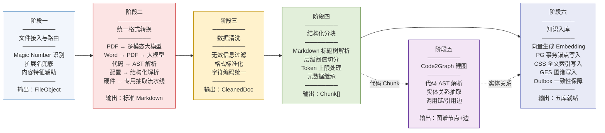
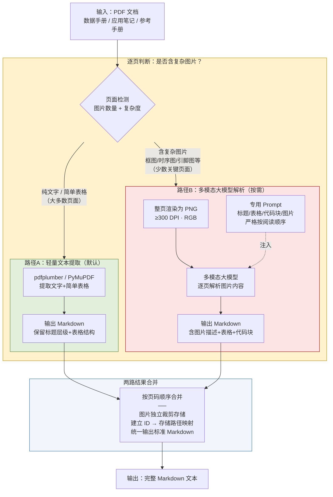
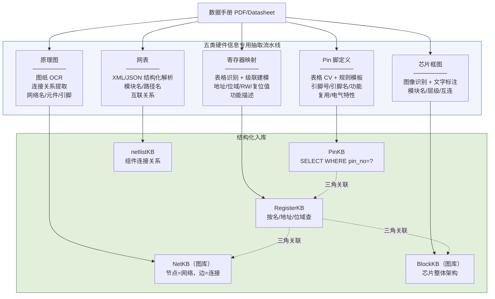
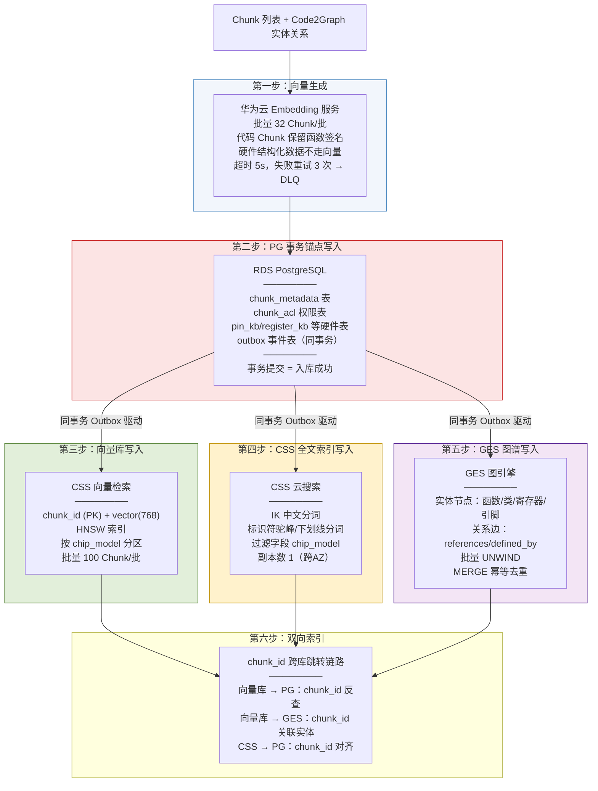
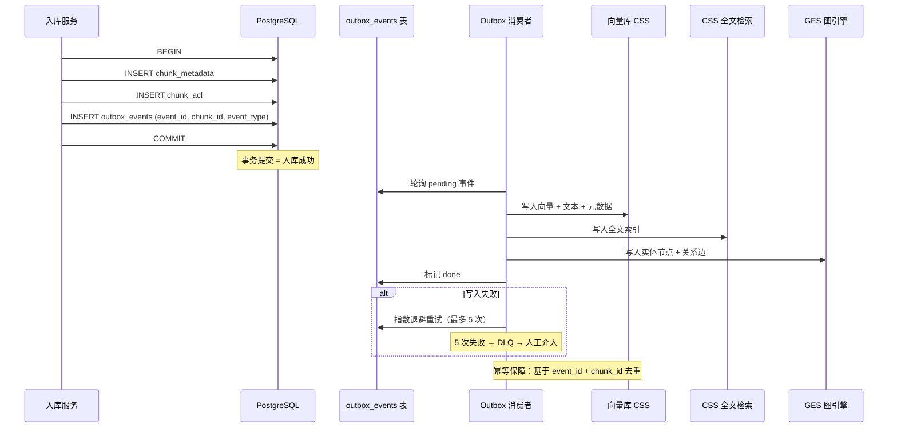

| 产品名称                   | 密级     |
| ---------------------- | ------ |
| 海思芯片知识库——文档解析、分块与向量化接入 | 内部资料   |
| 产品版本                   | 共 XX 页 |
| V1.0（8.9 版本）           |        |

海思知识库 文档解析、分块与向量化接入设计说明书

| Prepared by<br>拟制 | 架构组 | Date<br>日期 | 2026-08-09 |
| ----------------- | --- | ---------- | ---------- |
| Reviewed by<br>审核 |     | Date<br>日期 |            |
| Approved by<br>批准 |     | Date<br>日期 |            |

Huawei Technologies Co., Ltd.

华为技术有限公司

All rights reserved

版权所有  侵权必究

Revision record 修订记录

| Date<br>日期 | Revision Version<br>修订版本 | Revision<br>Chapter<br>修订章节 | Change Description<br>修改描述   | Author<br>作者 |
| ---------- | ------------------------ | --------------------------- | ---------------------------- | ------------ |
| 2026-08-09 | V1.0                     | 全部                          | 初稿，按软件设计说明书模板组织，定义标准化数据接入流水线 | 架构组          |

Keywords 关键词：文档解析、分块、向量化、Markdown 转换、AST 切片、硬件信息抽取、数据清洗、语义分块、知识入库、Outbox 一致性

Abstract 摘要：本文档定义了一套标准化的数据处理流水线，用于将海思内部各类文档、代码、配置文件以及网页数据，统一处理为可供大模型和检索系统理解的标准化 Chunk，并最终接入五库协同存储体系。流水线按"接入→转换→清洗→分块→建图→入库"六阶段设计，各模块独立实现、独立部署，通过标准接口通信。

List of abbreviations 缩略语清单：

| 缩略语    | 英文全名                               | 中文解释         |
| ------ | ---------------------------------- | ------------ |
| AST    | Abstract Syntax Tree               | 抽象语法树        |
| DPI    | Dots Per Inch                      | 每英寸点数        |
| RAG    | Retrieval-Augmented Generation     | 检索增强生成       |
| DLQ    | Dead Letter Queue                  | 死信队列         |
| HNSW   | Hierarchical Navigable Small World | 分层可导航小世界图索引  |
| CSS    | Cloud Search Service               | 云搜索服务        |
| GES    | Graph Engine Service               | 图引擎服务        |
| Outbox | Outbox Pattern                     | 发件箱模式（分布式事务） |

# 1 概述

## 1.1 目的

本文档定义了一套标准化的数据处理流水线，用于将海思内部各类文档、代码、配置文件以及网页数据，统一处理为可供大模型和检索系统理解的标准化格式，并最终接入知识库。文档覆盖从"原始文件"到"可检索 Chunk"的完整链路，回答以下工程问题：

- 不同格式的文件（PDF/Word/Excel/代码/配置/网页）如何统一处理？
- 分块策略如何保证语义完整性？
- 硬件专有信息（Pin 脚、寄存器）如何结构化抽取？
- 原始数据经过哪些处理步骤最终变成可检索的知识？
- 入库流程如何保障五库之间的数据一致性？

## 1.2 范围

本文档覆盖数据接入流水线的六个阶段：

- 文件接入与路由：格式识别、路由分发
- 统一格式转换：PDF/Word/Excel/HTML/代码/配置 → 标准 Markdown
- 数据清洗：去重、噪音过滤、格式标准化
- 结构化分块：Markdown 标题层级语义切分
- 知识入库：向量生成 → 五库协同写入 → Outbox 一致性保障

## 1.3 核心设计理念

- **一切皆 Markdown**：所有非结构化及半结构化数据最终统一转换为标准 Markdown 格式，将"理解复杂布局"的问题转化为"理解纯文本层级结构"的问题
- **模块化流水线**：按"接入→转换→清洗→分块→建图→入库"的标准流程设计，各模块独立实现、独立部署，通过标准接口通信
- **以多模态大模型为核心解析引擎**：对于 PDF 等复杂格式，直接整页转为图片，使用多模态大模型解析为 Markdown
- **按层级分块**：所有内容统一为 Markdown 后，严格按照标题层级进行语义切分，保证每个 Chunk 的语义完整性

## 1.4 整体处理流程

整个流水线由六个独立模块串联而成，各模块通过标准化的数据接口进行通信，上游模块的输出即为下游模块的输入，任一模块可独立升级或替换。

| 序号  | 模块名称          | 核心职责                    |
| --- | ------------- | ----------------------- |
| 1   | 文件接入与路由       | 识别文件类型，分发到对应的转换器        |
| 2   | 统一格式转换        | 各类文件统一转换为标准 Markdown    |
| 3   | 数据清洗          | 去重、去除噪音、格式标准化           |
| 4   | 结构化分块         | 基于 Markdown 标题层级进行语义切分  |
| 5   | Code2Graph 建图 | 代码 AST 解析，实体关系抽取，构建知识图谱 |
| 6   | 知识入库          | Chunk 写入五库，Outbox 保障一致性 |

# 2 模块简介（架构设计）

## 2.1 模块概述

### 2.1.1 概述

本模块为海思知识库的数据接入与处理层，负责将多源异构的原始数据（文档、代码、配置、网页、硬件资料）转化为标准化 Chunk，并写入五库协同存储体系。模块采用"六阶段流水线"架构，每个阶段独立实现，通过标准化数据对象（FileObject → MarkdownDoc → CleanedDoc → Chunk[] → 五库）传递。

### 2.1.2 模块上下文定义

- **上游**：文件上传接口（REST API）、Git 仓库 Webhook、网页爬虫、对象存储
- **下游**：五库存储（PG/Milvus/ES/Neo4j/MinIO）、检索子系统、知识管理后台
- **协同模块**：Code2Graph 代码建图模块（与入库流程并行）、权限过滤模块

## 2.2 总体结构——六阶段流水线



图 2-1 六阶段数据接入流水线总览

## 2.3 设计约束

### 2.3.1 技术限制

- 向量模型：Jina-Code-Embeddings-0.5B / bge-m3 / 华为云 Embedding 服务
- 多模态大模型：用于 PDF 解析（图片 → Markdown）
- 批量处理：Embedding 批量 32 个 Chunk/批，CSS 批量 100 个/批，GES 批量 200 节点/500 边

### 2.3.2 性能规格

| 指标                | 目标值             |
| ----------------- | --------------- |
| 单文件入库延迟（10 页 PDF） | < 30 秒          |
| 批量入库吞吐            | 1000 Chunk / 分钟 |
| 向量库查询 P95 延迟      | < 50 ms         |
| 跨库一致性达成时间         | < 5 秒（99% 分位）   |
| Outbox 积压告警阈值     | > 1000 条未消费     |

# 3 模块需求分析

## 3.1 软件功能描述

本模块需实现以下核心功能：

1. **多格式文件识别**：通过 Magic Number + 扩展名 + 内容特征三重策略识别文件真实格式
2. **统一格式转换**：将 PDF/Word/Excel/HTML/代码/配置文件统一转换为标准 Markdown
3. **代码 AST 语义提取**：基于 tree-sitter 等工具提取代码逻辑结构（函数/类/宏等），渲染为描述性 Markdown
4. **硬件信息结构化抽取**：从数据手册中识别 Pin 脚定义、寄存器映射、原理图、芯片框图、网表五类硬件信息
5. **数据清洗**：移除页眉页脚、版权声明、水印等噪音，统一字符编码与格式
6. **语义分块**：基于 Markdown 标题层级进行语义切分，继承标题路径作为上下文
7. **五库协同入库**：向量生成 → PG 事务锚点 → 向量库/全文检索/图谱并行写入 → Outbox 一致性保障

## 3.2 关键场景分析

| 场景编号 | 场景描述                      | 涉及模块                          |
| ---- | ------------------------- | ----------------------------- |
| 1    | 上传一份 PDF 数据手册（含表格+代码块+图片） | 文件路由 + PDF 转换 + 清洗 + 分块 + 入库  |
| 2    | Git 仓库 Webhook 触发代码增量索引   | 代码转换（AST 切片）+ Code2Graph + 入库 |
| 3    | 批量导入硬件寄存器定义表（Excel）       | Excel 转换 + 硬件抽取 + 结构化入库       |
| 4    | 网页爬取内容接入                  | HTML 转换 + 清洗 + 分块 + 入库        |
| 5    | 嵌入模型切换触发全量索引重建            | 向量生成 + 五库全量重写 + 蓝绿切换          |

# 4 模块概要设计

## 4.1 文件接入与路由（概要）

文件接入模块接收来自多源的文件，通过三重识别策略判定真实格式，按路由表分发到对应转换器。

**三重格式识别**（按优先级）：

| 优先级 | 策略              | 说明                                                           |
| --- | --------------- | ------------------------------------------------------------ |
| 第一重 | Magic Number 识别 | 读取文件头部字节与魔数库匹配：PDF=%PDF, DOCX=PK\x03\x04, DOC=D0\xCF\x11\xE0 |
| 第二重 | 扩展名兜底           | Magic Number 无法识别时回退：.pdf→PDF, .docx→Word, .py→Python, .c→C  |
| 第三重 | 内容特征辅助          | 无扩展名文本文件：正则匹配 HTML 标签、代码关键字等                                 |

**路由规则**：

| 文件类型                             | 路由目标转换器                              |
| -------------------------------- | ------------------------------------ |
| PDF                              | PDF 转换器（双路径：轻量文本提取为主，复杂图片按需触发多模态大模型） |
| Word (DOC/DOCX)                  | Word 转换器（→PDF→同 PDF 双路径）             |
| Excel (XLS/XLSX)                 | Excel 转换器（合并单元格拆分+逐行渲染）              |
| Markdown / 纯文本                   | 直接送入清洗模块（含复杂图片则单独送入多模态大模型生成描述）       |
| C/C++/Python/TS/ArkTS/Java       | 代码转换器（AST 解析+Markdown 渲染）            |
| INI/DTSI/XML/Shell/Makefile/YAML | 配置文件转换器（结构化解析+路径元数据）                 |
| HTML / 网页爬取内容                    | HTML 转换器                             |

## 4.2 统一格式转换（概要）

### 4.2.1 PDF 转换器

PDF 转换器采用**"轻量文本提取为主 + 多模态大模型按需介入"**的双路径设计。绝大多数 PDF 页面为纯文字或简单表格，通过 pdfplumber/PyMuPDF 等工具即可高效提取；仅当页面检测到复杂图片（芯片框图、时序图、引脚分布图等）时，才将该页送入多模态大模型解析。这样既保证了处理效率与成本可控，又不丢失图片中的关键信息。



图 4-1 PDF 转换器双路径处理流程——轻量文本提取为默认路径，多模态大模型仅按需介入含复杂图片的页面

**关键设计决策**：

| 决策点        | 选择                          | 理由                                                  |
| ---------- | --------------------------- | --------------------------------------------------- |
| 默认路径       | pdfplumber/PyMuPDF 轻量文本提取   | 绝大多数 PDF 页面为纯文字或简单表格，轻量工具即可高效处理，无需消耗昂贵的多模态大模型 Token |
| 多模态大模型介入条件 | 仅页面检测到复杂图片时触发               | 芯片框图、时序图、引脚分布图等图形信息无法通过文本提取获取，必须借助视觉理解能力            |
| 图片复杂度判断    | 图片数量 + 尺寸 + 位置（非边缘非水印）      | 避免将页眉页脚 logo、小图标等误判为"复杂图片"而触发大模型                    |
| 渲染分辨率（路径B） | ≥300 DPI                    | 寄存器位域、引脚标注等精细文字需要高分辨率才能保证大模型识别准确率                   |
| 两路结果合并     | 按原页码顺序拼接                    | 保证文档阅读顺序不被打乱，图片页的 Markdown 输出与前后文本页无缝衔接             |
| 图片存储       | 独立裁剪 + 对象存储 + Markdown 占位引用 | 图片经大模型生成文字描述后，原始图裁剪为独立文件，Markdown 仅保留引用链接           |

**效率收益**：以一份 200 页的典型数据手册为例，通常仅 15-25 页包含复杂图片（占比 < 15%）。双路径设计将多模态大模型调用量降低 85% 以上，整体处理时间从全量大模型方案的 ~10 分钟压缩到 ~2 分钟。

### 4.2.2 Word 转换器

Word 转换器沿用与 PDF 相同的双路径策略。先将 .docx 转为 PDF（LibreOffice --headless --convert-to pdf 或 Aspose.Words），再送入 PDF 转换器的双路径流程处理——大部分页面走轻量文本提取，仅含复杂图片的页面触发多模态大模型。

### 4.2.3 Markdown / 纯文本

Markdown 和纯文本文件不经过格式转换，直接送入数据清洗模块。但若 Markdown 中包含复杂图片引用（如芯片框图、时序图），则将该图片单独送入多模态大模型生成文字描述，追加到 Markdown 对应位置，不阻塞纯文本部分的快速流转。

### 4.2.4 Excel 转换器

遍历每个 Sheet → 读取表头为字段名 → 检测并拆分合并单元格 → 按行转键值对 JSON → 每行渲染为一个独立 Markdown 块（# Sheet名-行号, - 字段: 值），元数据记录 Sheet 名和行号。

### 4.2.4 代码转换器

不直接当纯文本处理，通过 AST 解析器提取逻辑结构，每个逻辑单元渲染为描述性 Markdown：

| 语言            | AST 工具                 | 提取节点                         |
| ------------- | ---------------------- | ---------------------------- |
| C/C++         | libclang / Tree-sitter | 函数定义、结构体、宏定义、枚举              |
| Python        | 内置 ast 模块              | 函数、类、异步函数                    |
| TypeScript/JS | Tree-sitter            | 函数声明、类声明、接口、箭头函数             |
| ArkTS         | Tree-sitter + 鸿蒙 SDK   | @Component 组件、@Entry 页面、普通函数 |
| Java          | JavaParser             | 类、方法、接口                      |

每个 AST 节点的 Markdown 渲染格式：标题为函数/类名，元数据含文件路径+行号+签名+依赖列表+文档字符串，代码实现用 ``` 包裹。

### 4.2.5 配置文件转换器

| 配置类型     | 解析方式                     | 输出粒度                             |
| -------- | ------------------------ | -------------------------------- |
| INI      | Section + Key-Value 解析   | 每个 Key-Value 一个块，元数据记 Section 路径 |
| DTSI 设备树 | 节点树结构解析                  | 每个节点一个块，元数据记录完整节点路径              |
| XML      | DOM 树解析                  | 每个叶子节点一个块，元数据记 XPath             |
| Shell 脚本 | 函数定义+全局变量解析              | 每个函数一个块                          |
| Makefile | Target 规则解析              | 每个 Target 一个块，元数据记录依赖关系          |
| YAML     | AST 节点树解析（映射/序列/标量/锚点别名） | 每个叶子节点一个块，元数据记录完整 JSON Path      |

### 4.2.6 硬件信息抽取

硬件资料的结构化抽取是海思知识库区别于通用 RAG 的关键差异化能力。



图 4-1 硬件信息抽取流水线——五类硬件信息从数据手册到结构化库

| 硬件类型    | 识别方法            | 抽取字段               | 入库形态                        |
| ------- | --------------- | ------------------ | --------------------------- |
| Pin 脚定义 | 表格 CV + 规则模板    | 引脚号、引脚名、功能、复用、电气特性 | PinKB：结构化，支持 WHERE pin_no=? |
| 寄存器映射   | 表格识别 + 级联关系建模   | 地址、位域、RW、复位值、功能描述  | RegisterKB：支持按名/地址/位域查      |
| 原理图     | 图纸 OCR + 连接关系提取 | 网络名、元件、引脚连接        | NetKB（图库）：节点=网络，边=连接        |
| 芯片框图    | 图像识别 + 文字标注     | 模块名、层级、模块间互连       | BlockKB（图库）：反映芯片整体架构        |
| 网表      | XML/JSON 结构化解析  | 模块名、路径名、互联关系       | netlistKB：组件之间连接描述          |

## 4.3 数据清洗（概要）

| 过滤目标       | 检测方式                     | 处理动作        |
| ---------- | ------------------------ | ----------- |
| 页眉页脚       | 位置特征 + 重复模式识别            | 整段移除        |
| 版权声明模板     | 关键词匹配（"版权所有""Copyright"） | 移除正文，保留单条摘要 |
| 许可证头文本     | 正则匹配 License 模板          | 折叠为一行摘要     |
| 水印文字       | 位置特征 + 低对比度特征            | 移除          |
| 空白页面       | 文本为空且无有效图片               | 整页移除        |
| IDE 自动生成注释 | 正则匹配（@author 等模板）        | 移除或折叠       |
| 连续空白行      | 多个空行相邻                   | 压缩为单个空行     |

**格式标准化**：统一 UTF-8 编码、LF 换行符、移除不可见控制字符、统一 Markdown 标题/列表语法、保留代码块原始缩进。

## 4.4 结构化分块（概要）

### 4.4.1 分块算法

Markdown 的标题层级天然定义了文档的章节结构，以标题层级作为分块边界能最大程度保证语义完整性。

**四步分块算法**：

1. **解析标题树**：将 Markdown 解析为标题树，每个节点为一个标题+内容块，层级对应 # 号数量
2. **设定分块层级阈值**：默认以三级标题（###）为阈值，可根据文档类型动态调整
3. **生成 Chunk**：节点层级 ≤ 阈值 → 独立 Chunk（含所有子节点）；节点层级 > 阈值 → 向上归并到最近不超过阈值的父级
4. **特殊情况处理**：无标题文档 → 整文档一个 Chunk；章节极短（<50 token）→ 与相邻章节合并

### 4.4.2 Token 上限处理

上限 1024 Token 为防守性约束而非分块目标：≤1024 Token 完整保留；超过则检查内部是否有更低级标题（如 ####），有则进一步按更低级拆分；无更低标题则完整保留，不做切割。

### 4.4.3 元数据继承

每个 Chunk 继承其标题路径作为上下文信息：

| 元数据字段           | 说明          | 示例                      |
| --------------- | ----------- | ----------------------- |
| chunk_id        | 全局唯一标识符     | UUID v7                 |
| hierarchy_path  | 完整标题路径      | "CV610芯片 > 电源管理 > 上电时序" |
| level           | 当前节点标题层级    | 2                       |
| parent_chunk_id | 父级 Chunk ID | UUID                    |
| source_file     | 来源文件名       | "cv610datasheet.pdf"    |
| source_type     | 来源文件类型      | "pdf"                   |
| image_ids       | 包含的图片 ID 列表 | ["img01","img02"]       |
| start_page      | 起始页码        | 42                      |
| file_dir        | 文件所在目录      | /芯片/CV610/code/XXX      |

## 4.5 知识入库（概要）

### 4.5.1 存储架构

| 存储组件                   | 存储内容                       | 用途             |
| ---------------------- | -------------------------- | -------------- |
| 向量数据库（CSS 向量检索）        | Chunk Embedding + 文本 + 元数据 | 语义相似度检索        |
| 对象存储（SFS）              | 原始文件                       | 文件存取与溯源        |
| 关系型数据库（RDS PostgreSQL） | 文件清单、Chunk 清单、入库记录、Outbox  | 事务锚点、数据管理、审计追溯 |
| 图数据库（GES）              | 文档知识图谱、代码知识图谱、三角关联         | 图检索            |
| CSS 云搜索（全文检索）          | 处理后的全文文本 + 倒排索引            | BM25 全文检索      |

# 5 模块详细设计

## 5.1 入库流程详细设计

### 5.1.1 流程总览



图 5-1 入库流程总览（六步）

### 5.1.2 详细步骤说明

**第一步：向量生成**。为每个 Chunk 调用华为云 Embedding 服务生成文本向量（768 或 1024 维）。代码 Chunk 保留函数签名和导出符号，按代码语义编码；图片描述 Chunk 复用同一 Embedding 服务（描述已是文本）；硬件结构化数据（PinKB/RegisterKB 等）不走向量生成，直接入 PG。

**第二步：元数据写入（PG 事务锚点）**。PostgreSQL 是整个入库流程的事务锚点。写入 chunk_metadata、chunk_acl、硬件结构化表和 outbox 事件表（同一事务内）。事务提交即视为"入库成功"，后续向量/全文/图谱的异步同步由 Outbox 保障最终一致。

**第三步：向量库写入**。chunk_id + vector(768) + text + hierarchy_path + chip_model（分区键）+ chunk_type，HNSW 索引（M=16, efConstruction=200），按 chip_model 分区，查询时强制带 chip_model 过滤杜绝跨芯片污染。

**第四步：CSS 全文索引写入**。IK 中文分词 + 标识符驼峰/下划线分词，过滤字段 chip_model，副本数 1（跨 AZ）。

**第五步：GES 图谱写入**。实体节点（函数/类/模块/寄存器/引脚/章节/配置项）+ 关系边（references/defined_by/implements/calls/describes/documents）。批量 Cypher UNWIND 写入，MERGE 替代 CREATE 保证幂等，(entity_name, chip_model, source_file) 联合键去重。

**第六步：建立双向索引**。五库之间通过 chunk_id 建立跳转链路：向量库→PG 反查元数据、向量库→GES 关联实体节点、CSS→PG 文档 ID 对齐。

### 5.1.3 Outbox 跨库一致性



图 5-2 Outbox 跨库一致性数据流

**保障机制**：至少一次投递、幂等去重（event_id+chunk_id）、失败指数退避重试最多 5 次、彻底失败进 DLQ 死信队列人工介入。

### 5.1.4 异常处理

| 异常场景            | 处理策略                     |
| --------------- | ------------------------ |
| Embedding 调用失败  | 重试 3 次 → DLQ，不阻塞其他 Chunk |
| PostgreSQL 事务失败 | 整事务回滚，不入 Outbox，源头重试     |
| 向量库写入超时         | 整批回滚重试；连续失败触发 Outbox 重投  |
| CSS / GES 写入失败  | Outbox 重投；MERGE 保证幂等     |
| 网络抖动            | 客户端重试 + 服务端幂等兜底          |

# 6 非功能设计

## 6.1 性能与运维指标

| 指标                | 目标值             |
| ----------------- | --------------- |
| 单文件入库延迟（10 页 PDF） | < 30 秒          |
| 批量入库吞吐            | 1000 Chunk / 分钟 |
| 向量库查询 P95 延迟      | < 50 ms         |
| 跨库一致性达成时间         | < 5 秒（99% 分位）   |
| Outbox 积压告警阈值     | > 1000 条未消费     |

## 6.2 可靠性设计

1. **批量幂等**：每一步写入操作基于 chunk_id 幂等（upsert/MERGE），重复执行不产生副作用
2. **失败隔离**：单个 Chunk 处理失败不影响同批次其他 Chunk，失败 Chunk 进入 DLQ 独立重试
3. **事务锚点**：PG 事务提交是唯一"成功"判定点，其他四库通过 Outbox 异步追平
4. **DLQ 死信队列**：多次重试失败的事件入 DLQ，触发告警，人工介入排查

## 6.3 可扩展性设计

- 新增文件格式：实现 IConverter 接口 + 注册到路由表，≤ 1 人周
- 新增清洗规则：配置化正则/关键词规则，无需改代码
- 调整分块策略：分块层级阈值和 Token 上限均为配置项，可按文档类型动态覆盖
- 切换 Embedding 模型：更新 Embedding 服务配置，触发全量索引重建（蓝绿切换）

# 7 List of reference 参考文献清单

1. 海思芯片知识库架构设计——总体架构设计文档（第 4 章接入与解析层）
2. 海思知识库数据库设计文档——五库 DDL 与 Outbox 一致性详细机制
3. 海思知识库文件检索设计——下游检索子系统
4. 海思知识库关键技术选型设计——Embedding 模型选型依据
5. 海思知识库架构设计 - 部署与运维设计——CCE 工作负载与监控
