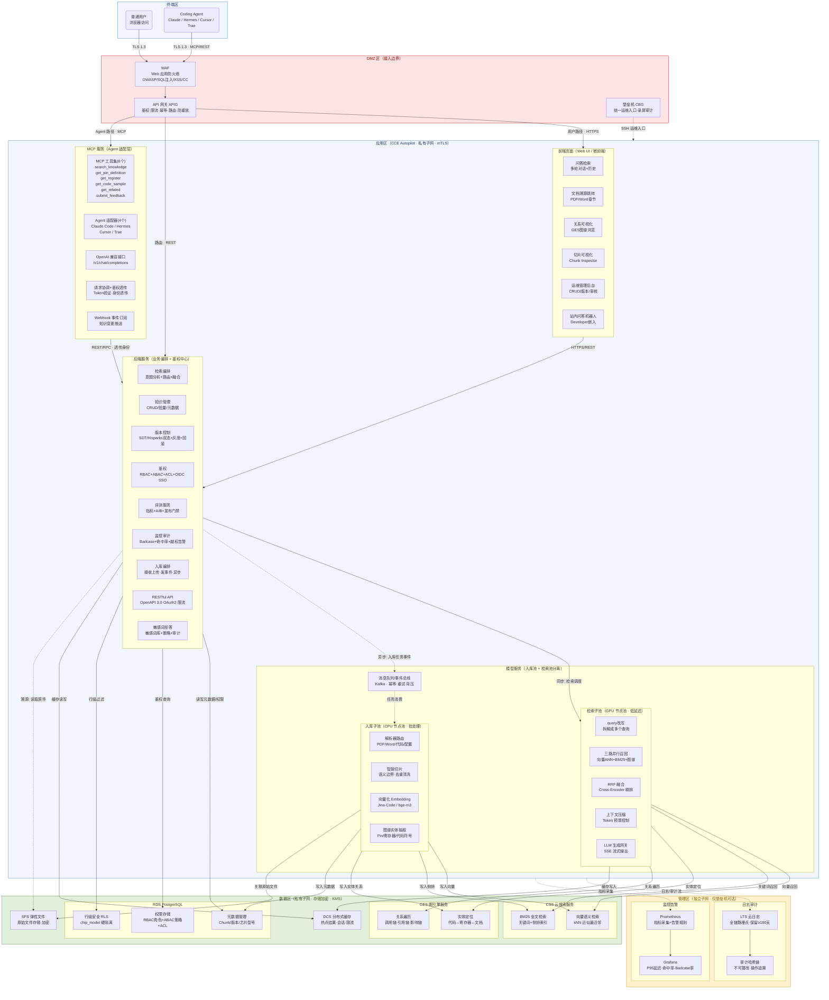
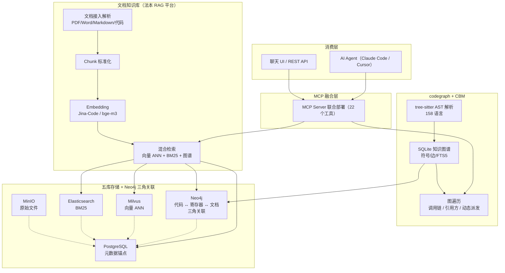
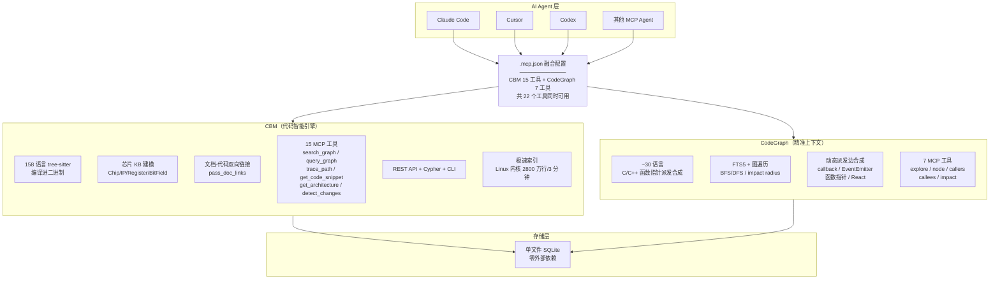
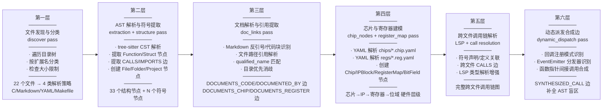
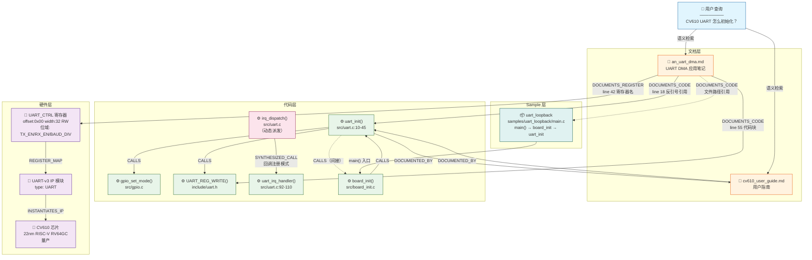

| 产品名称     | 密级     |
| -------- | ------ |
| 海思芯片知识库  | 机密     |
| 产品版本     | 共 XX 页 |
| V100R001 |        |

海思知识库 关键技术选型设计说明书

| Prepared by<br>拟制 | 周明振 | Date<br>日期 | 2026-08-09 |
| ----------------- | --- | ---------- | ---------- |
| Reviewed by<br>审核 |     | Date<br>日期 |            |
| Approved by<br>批准 |     | Date<br>日期 |            |

Huawei Technologies Co., Ltd.

华为技术有限公司

All rights reserved

版权所有  侵权必究

Revision record 修订记录

| Date<br>日期 | Revision Version<br>修订版本 | Revision<br>Chapter<br>修订章节 | Change Description<br>修改描述 | Author<br>作者 |
| ---------- | ------------------------ | --------------------------- | -------------------------- | ------------ |
| 2026-08-09 | V1.0                     | 全部                          | 初稿，完成代码问答知识库关键技术选型设计       | 周明振          |

<!-- 目录由 Markdown 渲染器根据标题自动生成 -->

海思知识库 关键技术选型设计说明书

Keywords 关键词：代码知识库、技术选型、CBM、codegraph、CodeGraphContext、CodeWiki、芯片知识图谱、MCP、AST 解析、RAG

Abstract 摘要：本文档对 codebase-memory-mcp (CBM)、codegraph、CodeGraphContext (CGC)、CodeWiki 四款候选技术方案进行系统性评估，面向芯片应用开发者的代码问答知识库场景，从多语言覆盖、C/C++ 深度支持、文档索引、代码↔文档关系建模、检索精准度、可溯源性、部署灵活性、扩展性、成熟度等维度展开对比，推荐选择 CBM + codegraph 联合部署作为技术底座，并给出关键缺口分析与分阶段扩展路线图。

List of abbreviations 缩略语清单：

| 缩略语  | 英文全名                           | 中文解释          |
| ---- | ------------------------------ | ------------- |
| CBM  | Codebase Memory MCP            | 代码库记忆 MCP 服务  |
| CGC  | CodeGraphContext               | 代码图谱上下文工具     |
| AST  | Abstract Syntax Tree           | 抽象语法树         |
| MCP  | Model Context Protocol         | 模型上下文协议       |
| RAG  | Retrieval-Augmented Generation | 检索增强生成        |
| FTS5 | Full-Text Search 5             | SQLite 全文搜索引擎 |
| LSP  | Language Server Protocol       | 语言服务器协议       |
| BM25 | Best Matching 25               | 文本检索排序算法      |
| ANN  | Approximate Nearest Neighbor   | 近似最近邻搜索       |

# 1 概述

## 1.1 目的

本文档旨在为海思芯片应用开发者的代码问答知识库选择技术底座，在 codebase-memory-mcp (CBM)、codegraph、CodeGraphContext (CGC)、CodeWiki 四个候选方案中进行系统性评估与选型决策。

面向场景：**芯片应用开发者**的代码问答知识库——内容包含公开的 SDK 代码、应用笔记、示例工程、公开数据手册及其之间的引用关系，需精准定位开发者关心的代码/场景，并给出准确的代码与建议。

用途：技术架构师选型依据，含完整技术对比、关键缺口分析与扩展路线图。所有内容均为可对外公开的技术信息，不涉及芯片内部设计资料。

## 1.2 范围

本文档覆盖以下选型评估内容：

- 四个候选项目（CBM、codegraph、CodeGraphContext、CodeWiki）的技术画像与能力对比
- 面向芯片应用开发场景的多维度评估（语言覆盖、C/C++ 深度、文档索引、关系建模、检索精准度、部署灵活性、扩展性、成熟度等）
- 推荐方案的详细论证
- 关键缺口识别与分阶段扩展路线图
- 实施风险与对策

本文档不涉及：芯片内部架构选型、商业采购决策、定价分析。

设计的利益相关人及各自关注点如下：

表 1-1 利益相关人列表

| 利益相关人 | 需求分类  | 关注点及需求                   |
| ----- | ----- | ------------------------ |
| 技术架构师 | 技术选型  | 候选方案能力对比、推荐结论的技术论证、扩展路线图 |
| 软件开发  | 功能实现  | 代码检索精准度、多语言支持、API 接口形态   |
| 算法    | 检索效果  | 检索命中率、召回精度、调用链完整性        |
| 运维    | 部署灵活性 | 部署复杂度、外部依赖、云端/本地部署支持     |
| 测试    | 质量验证  | 选型验证方法、端到端测试场景           |
| 产品    | 产品规划  | 分阶段落地计划、里程碑价值            |

# 2 模块简介（架构设计）

## 2.1 模块概述

### 2.1.1 概述

本模块为海思知识库的代码检索与问答引擎，负责将代码仓库（SDK 源码、Sample 工程、构建脚本）和文档（应用笔记、用户指南、数据手册）索引为可查询的知识图谱，通过 MCP 工具、REST API 和 Cypher 图查询接口暴露给 AI Agent 和应用程序。

选型本质是选择最值得作为底座去扩展的技术组合。四个候选方案各有侧重：

- **CBM**：纯 C 静态二进制（158 语言、极速索引），已原生支持芯片 KB 建模
- **codegraph**：TypeScript/Node.js（30 语言、精准上下文），FTS5+图遍历为核心检索能力
- **CGC**：Python 图数据库方案，分析工具丰富但处于 Alpha 阶段
- **CodeWiki**：文档生成器，非知识库/问答系统

### 2.1.2 模块上下文定义

本模块与外部实体的关系如下：

- **上游**：Git 代码仓库（SDK 源码、Sample 工程）、文档管理系统（应用笔记、数据手册）
- **下游**：AI Agent（Claude Code / Cursor 等）、RAG 检索服务、聊天 UI
- **协同模块**：文档知识库（法本 RAG 平台）— 提供文档语义检索、硬件结构化抽取、版本管理与权限控制
- **外部依赖**：商用 LLM API（通义千问/Claude/GPT）用于答案生成，或本地 vLLM 自托管开源模型

## 2.2 总体结构

### 2.2.1 本模块在总体架构中的位置和关系

本模块（属于模型服务）在海思知识库总体架构中横跨**接入与解析层**和**检索与生成层**，是连接"代码/文档原料"与"开发者问答服务"的核心枢纽。

海思知识库总体架构如下图所示：



图 2-1 海思知识库总体架构图

本模块的位置与关系如下：

| 架构层次   | 本模块承担的职责                                                                                      | 与上下层的关系                                        |
| ------ | --------------------------------------------------------------------------------------------- | ---------------------------------------------- |
| 消费端    | 不直接承担（由文档知识库负责聊天 UI、API 网关）                                                                   | 本模块通过 MCP 工具向消费端 Agent 暴露代码检索能力                |
| 集成接口层  | MCP Server 联合部署（CBM 15 工具 + CodeGraph 7 工具）、REST API、Cypher 查询接口                              | 为上层 Agent 和应用程序提供统一的代码检索入口                     |
| 检索与生成层 | 精确符号检索（FTS5 + 图遍历）、调用链追踪、动态派发合成、混合检索路由                                                        | 接收查询请求，协调文档语义检索（文档知识库）与代码精确检索（本模块）             |
| 知识模型层  | 代码知识图谱建模（Function/Struct/File 节点 + CALLS/IMPORTS 边）、芯片硬件模型（Chip/IPBlock/RegisterMap/BitField） | 通过 Neo4j 与文档 Chunk 节点、寄存器节点建立三角关联              |
| 接入与解析层 | tree-sitter AST 解析（158 语言）、文档引用提取、芯片 YAML 配置解析、PDF 硬件结构化抽取                                    | 上游接收 Git 仓库、文档库、YAML 配置；下游输出结构化符号与关系边          |
| 数据存储层  | SQLite（符号/边/FTS5）、Neo4j（三角关联图）、PostgreSQL（元数据锚点）                                              | 单文件 SQLite 为代码检索主存储，Neo4j 为跨库关联存储              |
| 基础设施层  | Huawei Cloud CCE / 本地服务器 / 开发者本地机器                                                            | 纯 C 静态二进制 + Node.js 运行时，零外部依赖，适配云/本地/嵌入式三种部署形态 |

本模块与总体架构中其他模块的交互关系：

- **与文档知识库（法本 RAG 平台）**：文档知识库提供文档语义检索（向量 ANN + BM25 + 图谱）、硬件结构化抽取、版本管理与双态发布；本模块提供代码精确符号检索。两者通过 Neo4j "代码 ↔ 寄存器 ↔ 文档"三角关联打通。
- **与权限安全模块**：本模块的 MCP 工具和 REST API 的访问鉴权委托给权限安全模块（RBAC + ABAC + ACL），不自行实现认证逻辑。
- **与质量治理模块**：本模块的检索命中率、调用链完整性等指标接入 Badcase 质量闭环，支持 LLM-as-Judge 自动分析与回归测试集更新。
- **与部署运维模块**：本模块的云端/本地/嵌入式三种部署形态依赖基础设施层的容器编排与监控体系。

### 2.2.2 CBM + codegraph 联合部署

文档知识库与 codegraph 的协同架构总览如下图所示：



图 2-2 文档知识库与 codegraph 协同架构总览



图 2-3 CBM + CodeGraph 融合架构总览

两者的关系不是替代，而是互补：

- **codegraph** 是「代码的精确索引引擎」—— AST 级符号提取、调用链追溯、精确符号查询
- **文档知识库**是「知识的语义组织平台」—— 混合检索（向量+BM25+图谱）、硬件结构化抽取、Token 预算控制、双态发布
- 两者通过 **Neo4j 知识图谱**打通，形成「代码 ↔ 硬件信息 ↔ 文档」三角关联

## 2.3 设计约束

### 2.3.1 技术限制

- 编程语言：候选方案涉及 C（CBM）、TypeScript（codegraph）、Python（CGC、CodeWiki）
- 部署环境：需同时支持云端 SaaS（服务广大开发者社区）和企业内网私有部署
- LLM 依赖：问答层需外部 LLM 服务，需考虑多 Provider 路由和本地 vLLM 兜底

### 2.3.2 应用开发场景约束

知识库服务对象为使用海思芯片做产品开发的工程师（智能相机、机顶盒、嵌入式设备、Android 终端），场景具有以下特征：

1. **语言多元，以嵌入式与应用层为主**：C/C++（裸机/RTOS 固件、Linux 驱动、SDK 头文件），Python（测试脚本、自动化工具、数据分析），Java/Kotlin（Android 多媒体应用），ArkTS（OpenHarmony 应用），Go/Rust（服务端工具），Shell/Makefile（构建脚本）。

2. **内容是"代码 + 文档 + 关系"三位一体**：不仅有 SDK 源码与 Sample 工程，还有公开发布的应用笔记、用户指南、数据手册（Pin 脚定义、寄存器映射、电气特性）、FAQ、迁移指南，且必须能表达"文档 ↔ 代码"的追溯关系（如 Sample 调用了哪个 SDK API、API 在哪个章节被定义）。

3. **回答必须精准、准确、可溯源**：芯片应用场景对错误答案零容忍（错误的寄存器配置可能导致硬件异常），答案需锚定到真实 AST 符号（如 hi_gpio_write、HDMI_REG_X），而非 LLM 臆测。

4. **内容可公开，部署形态灵活**：知识库内容为对外发布的 SDK 与文档，默认可云部署以服务广大开发者社区；同时支持本地化部署给企业内网用户。

## 2.4 模块规格

### 2.4.1 功能规格

选型评估维度（应用开发场景 → 评估维度）：

| #   | 维度             | 应用开发场景诉求                                |
| --- | -------------- | --------------------------------------- |
| C1  | 多语言覆盖          | C/C++、Python、Java/Kotlin、ArkTS、Go、Shell |
| C2  | C/C++ 深度支持     | 函数指针派发、include 解析、跨文件调用链（驱动/固件核心需求）     |
| C3  | 文档/Sample 索引   | 公开数据手册、应用笔记、README、FAQ、Sample 工程说明      |
| C4  | 代码↔文档关系建模      | 文档锚点 ↔ 代码符号 / 寄存器地址                     |
| C5  | 检索精准度          | 用符号名/路径精确定位，而非模糊语义                      |
| C6  | 可溯源/确定性        | 答案锚定真实 AST，可复现                          |
| C7  | 部署灵活性          | 本地/服务器/云端均支持，单文件可移植                     |
| C8  | 扩展性            | 可补文档索引、Sample 工程解析、领域节点                 |
| C9  | 成熟度            | 生产可用、稳定                                 |
| C10 | Q&A 能力         | 能否回答自然语言问题（自带 LLM 或可挂载）                 |
| C13 | 硬件结构化抽取（芯片 KB） | 芯片型号/IP 块/寄存器/步进/板卡/构建配置的结构化建模与关联查询     |
| C14 | 文档-代码-硬件三角关联   | 文档提及的寄存器名能关联到代码中对该寄存器的访问位置，形成闭环         |

### 2.4.2 性能规格

- CBM 索引性能：Linux 内核（2800 万行、7.5 万文件）完整索引 ≤ 3 分钟
- 文档知识库检索性能：混合检索 P95 ≤ 300ms
- 跨库查询延迟增量 ≤ 50ms（文档检索后再做 codegraph 符号查询）

## 2.5 设计思路

### 2.5.1 设计原则

判断标准不只是"哪个功能多"，而是：**谁是最适合作为底座、并能被可信地扩展到芯片应用开发域的产品**。

选型核心原则：

1. **精准优先于覆盖**：代码问答场景的检索精准度优先级高于语义模糊检索，确定性 AST 提取优于 LLM 总结
2. **简单优于复杂**：单文件 SQLite 部署优于外部图数据库集群，零依赖优于多依赖
3. **可扩展优于完备**：选型选的是"最值得扩展的底座"，而非"开箱即用满足全部需求"
4. **芯片领域纵深**：硬件结构化抽取、文档-代码-寄存器三角关联是差异化能力，底座必须原生支持或易于扩展

### 2.5.2 推荐方案

推荐选择 **CBM + codegraph 联合部署**作为代码问答知识库的技术底座。

四者都不开箱即用满足完整场景——但 CBM+codegraph 联合部署的组合最接近：CBM 已原生支持 Document 节点、文档-代码双向链接、芯片/IP/寄存器建模（pass_chip_nodes + pass_doc_links + pass_register_map），codegraph 的精准上下文能力可作为查询增强。两者都不需要外部图数据库（均为单文件 SQLite），部署复杂度远低于 CGC。

| 维度            | 为什么是 CBM + codegraph                                                                        |
| ------------- | ------------------------------------------------------------------------------------------- |
| 检索精准度（"精准定位"） | 全产品围绕"让答案足够完整以停止 agent 乱读"设计：FTS5 + 图遍历 + 动态派发边合成，explore-flow 用符号袋精确串起调用路径                 |
| 答案准确性（"准确"）   | 确定性 AST 提取（非 LLM 总结），结果可复现、可溯源                                                              |
| 部署灵活性         | 纯本地 SQLite（node:sqlite + WAL + FTS5），零外部依赖；单机/服务器/容器均可，适配云部署与企业内网                           |
| 扩展性（补文档/关系）   | 有文档化的 add-lang 流程 + 脚手架脚本；类型化 NodeKind/EdgeKind schema 干净，加 document 节点 + references 边是自然扩展 |
| 成熟度           | 生产级、确定性、多 agent 安装器（Claude Code/Cursor/Codex/opencode）                                      |

CBM 是唯一已原生支持芯片 KB 建模 + 文档链接的底座（158 语言 / 15 工具 / Cypher / REST API），且与 codegraph 已有 MCP 融合部署方案（.mcp.json 配置 22 个工具同时可用）。CodeGraphContext 需外部图数据库、处于 Alpha、且有未修的正确性 bug；CodeWiki 是文档生成器，类别不符。

# 3 模块需求分析

## 3.1 软件功能描述

本模块需实现以下核心功能：

1. **多语言代码解析与索引**：支持 C/C++、Python、Java/Kotlin、ArkTS、Go、Shell 等语言的 AST 解析，提取函数、类、变量等符号，建立跨文件调用链
2. **文档解析与引用提取**：解析 Markdown、RST、TXT 等文档格式，从文档中提取代码符号引用（反引号符号、代码块标识符、文件路径），建立文档→代码双向链接
3. **芯片知识图谱建模**：支持芯片型号、IP 块、寄存器、位域、板卡、构建配置的结构化建模与关联查询
4. **多通道检索接口**：提供 MCP 工具、Cypher 图查询、REST API 三种接口形态，支持全文搜索、图遍历、调用链追踪
5. **与文档知识库协同**：通过 Neo4j 建立代码↔寄存器↔文档三角关联，实现跨库联合检索
6. **LLM 问答编排**：可挂载 AI Agent 或独立 RAG 服务，支持自然语言问答

## 3.2 关键场景分析

| 场景编号 | 场景描述                             | 场景对应的 SR/AR |
| ---- | -------------------------------- | ----------- |
| 1    | 开发者用自然语言查询"CV610 I2C 初始化代码示例"    | F-023 代码检索  |
| 2    | 开发者指定寄存器名查询"HDMI_REG_X 在哪些地方被使用" | F-024 寄存器溯源 |
| 3    | 开发者查询代码版本间差异                     | F-025 版本对比  |

### 3.2.1 场景 1：自然语言代码查询

**介绍**：开发者用自然语言描述需求（如"CV610 UART 怎么初始化"），系统返回精确到代码行级别的答案，包含示例代码、文档引用、寄存器定义。

**输入**：自然语言查询语句 + 芯片型号过滤条件

**输出**：代码片段（含文件路径和行号）+ 关联文档章节 + 寄存器定义 + Sample 工程入口

**处理**：

1. 文档知识库语义检索：Query 进入混合检索 Pipeline → 向量 ANN + BM25 并行召回 → RRF 融合 → Cross-Encoder 重排 → Top-5 结果
2. codegraph 精确符号查询：从检索结果中提取关键符号 → FTS5 + 图遍历 → 返回符号定义位置 + 调用链 + 所有引用方
3. Neo4j 三角关联：从文档 Chunk 沿边遍历找到关联寄存器节点和代码 Chunk
4. LLM 合成：Agent 将多源信息组装为上下文 → LLM 生成最终回答

### 3.2.2 场景 2：寄存器精确溯源

**介绍**：开发者指定寄存器名称（如 HDMI_REG_X），查询该寄存器在代码中的所有引用位置及调用链影响分析。

**输入**：寄存器名称 + 芯片型号

**输出**：寄存器定义（地址、位域、RW 权限、复位值）+ 关联文档章节 + 所有引用该寄存器的代码位置 + 调用影响链

**处理**：

1. 文档知识库硬件结构化查询：RegisterKB 精确匹配 → 返回寄存器定义 + 关联文档章节
2. codegraph 符号引用查询：FTS5 搜索所有引用位置 → 返回文件路径 + 函数名 + 行号 + 上下文代码
3. Neo4j 扩展：从寄存器节点沿 references 边反向找到代码 Chunk → 沿 calls 边找到上层调用函数 → 形成完整影响链

### 3.2.3 场景 3：版本差异查询

**介绍**：开发者查询不同版本 SDK 中某个函数或模块的变更。

**输入**：函数名/模块名 + 版本号（v1.0 / v2.0）

**输出**：版本间 diff + 变更摘要 + 新增/删除的寄存器引用 + 影响的调用方

**处理**：

1. 文档知识库版本链查询：PG 中 prev_chunk_id 字段串联版本演化链
2. codegraph 跨版本 AST 对比：对两个版本的同一个函数分别做 AST 解析 → 对比函数签名、调用链、寄存器引用变化
3. Neo4j 演化链：EVOLVED_TO 边串联中间版本 → 返回每个版本的变更摘要

# 4 模块概要设计

## 4.1 模块总体描述

本模块以 CBM + codegraph 联合部署为核心，包含四个子模块：

1. **代码解析引擎**：tree-sitter AST 提取 + LSP 类型解析 + 动态派发合成
2. **文档索引引擎**：Markdown/YAML 解析 + 文档引用提取 + 文档-代码双向链接
3. **芯片知识图谱**：Chip/IP/Register/BitField 节点建模 + YAML 配置驱动
4. **检索与接口层**：MCP 工具 + Cypher 图查询 + REST API

## 4.2 模块分解描述

### 4.2.1 codebase-memory-mcp (CBM)

**标识**：CBM

**类型**：纯 C 静态二进制代码智能引擎

**目的**：把代码仓库索引为 SQLite 知识图谱，通过 15 个 MCP 工具 + REST API + Cypher 图查询 + 3D 可视化 UI 暴露给 AI Agent 和应用程序。

**功能列表**：

- 158 种语言覆盖（vendored C tree-sitter grammar，编译进二进制）
- Hybrid LSP 类型解析（Python/TS/JS/PHP/C#/Go/C/C++/Java/Kotlin/Rust/Perl）
- 极速索引：Linux 内核（2800 万行、7.5 万文件）完整索引仅需 3 分钟
- 15 个 MCP 工具：search_graph（BM25 全文 + 语义向量）、query_graph（Cypher 图查询）、trace_path（调用链/数据流/跨服务追踪）、get_code_snippet（源码）、get_architecture（架构概览 + Leiden 社区检测）、detect_changes（git diff → 爆炸半径）、check_index_coverage、dead_code 检测、manage_adr、ingest_traces、vector_search 等
- REST API（/api/v1/projects/*）提供标准 HTTP 接口
- 芯片知识库建模：专为芯片场景设计的节点标签和边类型——Chip/ChipFamily/ChipRevision/IPBlock/IPInstance（含基地址+IRQ）/RegisterMap/BitField/Board/BuildConfig/FirmwareImage/Document/Version/Peripheral/Capability/Schematic 等，边类型含 BELONGS_TO_FAMILY/INSTANTIATES_IP/CHIP_REVISION/REGISTER_MAP/ACCESSES_REGISTER/DOCUMENTS_CHIP/DOCUMENTS_CODE 等 35+ 种
- 文档索引：Document 节点 + source_files 表（LZ4 压缩），pass_doc_links 实现文档-代码双向边
- 芯片/寄存器配置：YAML 驱动（chips/*.chip.yaml + regs/*.reg.yaml），索引时自动建图

**处理**：pipeline 架构（11 个 pre-dump pass），新增能力以独立 pass_*.c 文件加入，不侵入核心。

**存储/部署**：纯 C 静态二进制（~280MB，含 158 grammar + SQLite + mimalloc），真正零依赖——无需 Docker、无需运行时、无需 npm/Node.js。单文件二进制 + SQLite 数据库即可运行，可云部署（容器/云主机）、本地部署（单机/内网）、嵌入式部署。

**成熟度**：生产级（v0.9.1-rc.1），4768+ commits，活跃维护。43 种 Agent 表面自动检测+配置。SLSA Level 3 供应链安全认证。

### 4.2.2 codegraph

**标识**：codegraph

**类型**：TypeScript/Node.js 代码智能库 + CLI + MCP server

**目的**：本地优先的代码智能库，tree-sitter 解析 → SQLite（FTS5）存符号/边/文件 → 经 MCP 暴露知识图谱给 AI agent。

**功能列表**：

- 约 30 种语言支持。C/C++ 完整支持（共用 c-cpp.ts，43KB），含 include 路径解析与函数指针派发合成器（c-fnptr-synthesizer.ts，重建 p->fn(...) 间接调用）
- Python/Go/Rust/Java 等齐全
- 检索：FTS5 全文 + 图遍历（BFS/DFS、impact radius、callers/callees）+ 动态派发边合成（callback、EventEmitter、React setState→render、JSX child、C 函数指针、Go 回调等）
- 7 个 MCP 工具：explore/node/callers/callees/impact
- 核心理念：让一次检索的输出"足够完整"使 agent 不再回退 Read/Grep

**限制**：

- 文档索引：无。仅扫描 EXTENSION_MAP 内扩展名，.md/.rst/.pdf/.docx 不被索引。无 document/spec NodeKind，无文档→代码边
- 芯片建模：当前不原生支持

**处理**：add-lang 有完整流程（.claude/skills/add-lang/SKILL.md + 脚手架脚本），改 4-5 个文件即可加一门语言。

**存储/部署**：node:sqlite（真 SQLite + WAL + FTS5），零外部依赖、零原生编译、零 wasm fallback。单文件 SQLite 即知识库，可随镜像分发、可在容器/云主机/本地灵活部署。

**成熟度**：生产级、确定性、活跃；多 agent 安装器。

### 4.2.3 CodeGraphContext (CGC)

**标识**：CGC

**类型**：Python MCP server + CLI 工具集

**目的**：把代码索引进图数据库供 AI/开发者查询。

**功能列表**：

- 23 种语言。C/C++ 完整（可用 scip-clang，但需 compile_commands.json）。Python/Go/Rust/Java 等
- ~25 个工具（dead code、复杂度、原生 Cypher、报告）
- 分析工具更丰富，静态分析维度强于 codegraph

**限制**：

- 文档索引：极弱。.md/.txt/.json 仅作为空壳 File 节点入库，不解析内容；无 RST/PDF/应用笔记/数据手册
- 关系建模：仅代码符号图（Repository/File/Module/Class/Function + Spring/DB 等框架节点），无 Document/Spec 节点，无文档→代码边
- 存储/部署：可插拔图数据库（FalkorDB Lite / Kuzu / Ladybug / Neo4j / Nornic）——运维更重，云端部署需额外运维图数据库集群
- 成熟度：活跃（1528 commits），但 Alpha，存在未修正确性 bug

### 4.2.4 CodeWiki

**标识**：CodeWiki（开源项目，FSoft-AI4Code）

**类型**：仓库级文档生成器

**目的**：tree-sitter 解析 + networkx 图 + 层次聚类 + 递归 agentic LLM 综合 → 产出 markdown/Mermaid/HTML。

**限制**：

- 语言：9 种（Python/Java/JS/TS/C/C++/C#/Kotlin/PHP）
- 检索/问答：完全没有。MCP 工具只有 generate_docs、get_module_tree，无 search/query/retrieval
- 类别不符：是文档生成工具，不是知识库/问答系统
- 结论：可作为后续"自动生成 Sample 工程文档"的辅助工具，但不作为知识库底座

## 4.3 并发进程处理分解

### 4.3.1 索引进程

CBM pipeline 架构的 11 个 pre-dump pass 按顺序执行：discover → extraction → structure → doc_links → chip_nodes → register_map → dynamic_dispatch → call_resolution → LSP_type → source_files → index。每个 pass 独立，新增能力以独立 pass_*.c 文件加入，不侵入核心。

### 4.3.2 查询进程

查询时两路并行：文档知识库语义检索路径（向量 ANN + BM25 + 图谱）与 codegraph 精确符号检索路径（FTS5 + 图遍历）同时执行，结果在 Neo4j 知识图谱层汇合。

## 4.4 数据实体描述

**标识**：代码知识图谱节点类型

**类型及组成结构**：

- Function 节点：函数名、qualified_name、文件路径、行号范围、签名
- Struct/Class 节点：类型名、成员列表、方法列表
- File 节点：文件路径、大小、修改时间
- Document 节点：文件路径、标题、章节锚点、引用符号列表
- Chip 节点：芯片名、家族、架构、工艺节点、生命周期
- IPBlock 节点：IP 名称、类型
- IPInstance 节点：基地址、IRQ 号
- RegisterMap 节点：寄存器名、偏移地址、位宽、访问权限、复位值
- BitField 节点：位域名、位范围、描述

**边类型**：CALLS、IMPORTS、DOCUMENTS_CODE、DOCUMENTED_BY、BELONGS_TO_FAMILY、INSTANTIATES_IP、REGISTER_MAP、HAS_BITFIELD、SYNTHESIZED_CALL、ACCESSES_REGISTER 等 35+ 种。

## 4.5 依赖性描述

### 4.5.1 运行设计

完整查询流程分为两路并行，最终在 Neo4j 汇合：

**文档知识库侧——语义检索路径**：文档上传（PDF/Word/Markdown/代码文件）→ 接入解析层（AST 切片/硬件抽取）→ Chunk 标准化 → Embedding（bge-m3/Jina-Code）→ 五库写入（PG/Milvus/ES/Neo4j/MinIO）→ 混合检索（向量+BM25+图谱）→ 结果返回

**codegraph 侧——精确符号检索路径**：代码仓库（Git）→ tree-sitter AST 解析 → SQLite（符号/边/FTS5）→ 图遍历（调用链/引用方/动态派发）→ 精确符号查询结果

**汇合——Neo4j 三角关联**：codegraph 提取的 AST 符号 → 写入 Neo4j 作为代码 Chunk 节点 → 通过 references/defined_by/implements 边连接到文档 Chunk 节点和寄存器 Chunk 节点 → Agent 发起查询时，文档知识库返回语义相关的文档 Chunk，同时通过 Neo4j 图遍历返回关联的代码符号、调用链、寄存器定义

### 4.5.2 数据依赖关系

- CBM SQLite 数据库 ↔ codegraph SQLite 数据库：通过 CbmStoreAdapter 读取 CBM 数据库
- codegraph AST 符号 → Neo4j 代码 Chunk 节点
- Neo4j 代码 Chunk ← references/defined_by → Neo4j 文档 Chunk
- Neo4j 寄存器 Chunk ← REGISTER_MAP → Neo4j 代码 Chunk

## 4.6 接口描述

### 4.6.1 对外接口描述

| 接口                     | 描述                                                                                     | 交互对象          | 扇入  |
| ---------------------- | -------------------------------------------------------------------------------------- | ------------- | --- |
| CBM MCP 工具集（15 个）      | search_graph、query_graph、trace_path、get_code_snippet、get_architecture、detect_changes 等 | AI Agent      | 1   |
| codegraph MCP 工具集（7 个） | explore、node、callers、callees、impact 等                                                  | AI Agent      | 1   |
| CBM REST API           | /api/v1/projects/* 标准 HTTP 接口                                                          | 应用程序          | N   |
| CBM Cypher 查询          | 图查询语言，支持复杂关系遍历                                                                         | 应用程序/AI Agent | N   |
| CBM CLI                | 命令行索引与管理工具                                                                             | 运维            | 1   |

### 4.6.2 内部接口描述

| 接口              | 描述                                      | 类别   | 扇入  |
| --------------- | --------------------------------------- | ---- | --- |
| CbmStoreAdapter | codegraph 读取 CBM 数据库的适配器                | 内部模块 | 1   |
| Neo4j 写入接口      | codegraph AST 符号写入 Neo4j 代码 Chunk       | 内部模块 | 1   |
| ES ↔ FTS5 互查    | ES 搜文档 → 提取符号 → codegraph FTS5 查代码；反向亦然 | 内部模块 | 1   |

## 4.7 能力互补矩阵

文档知识库与 codegraph 在各项能力上的分工与协同：

| 能力域            | 负责方       | 说明                                                                                                          |
| -------------- | --------- | ----------------------------------------------------------------------------------------------------------- |
| 代码 AST 解析与符号提取 | codegraph | tree-sitter AST → 函数/类/变量符号 → SQLite FTS5 索引，覆盖约 30 种语言，含 C/C++ 函数指针派发合成                                    |
| 代码调用链追溯        | codegraph | 图遍历（BFS/DFS、impact radius、callers/callees），动态派发边合成（callback、函数指针、EventEmitter 等）                            |
| 代码精确符号查询       | codegraph | 用符号名/路径精确定位，FTS5 全文 + 图遍历，"一次检索就给够"避免 Agent 回退 Read/Grep                                                    |
| 文档语义检索         | 文档知识库     | 向量 ANN（Milvus）+ BM25（ES）+ 结构化过滤（PG）。混合检索 + RRF 融合 + Cross-Encoder 重排                                        |
| 硬件结构化抽取        | 文档知识库     | Pin 脚定义 / 寄存器映射 / 原理图 / 芯片框图 / 网表五类硬件信息从 PDF/Datasheet 中抽取并结构化入库                                            |
| 代码 ↔ 文档关系建模    | 两者协同      | 文档知识库提供 references/defined_by/implements 关系边定义与 Neo4j 存储；codegraph 提供 AST 符号提取 + 代码调用链作为关系来源                |
| 跨库查询路由         | 文档知识库     | PG 元数据锚点 + Milvus 向量 + ES BM25 + Neo4j 图遍历 + MinIO 文件，KnowledgeDAO 统一抽象                                     |
| 版本管理与发布        | 文档知识库     | SDT/Hisparks 双态分离 + 语义化版本 + 灰度晋升 10%→30%→100% + 5 分钟回滚                                                      |
| 权限与安全          | 文档知识库     | RBAC + ABAC + ACL 三级，行级安全（RLS），JWT + mTLS，审计日志                                                              |
| Badcase 治理闭环   | 文档知识库     | LLM-as-Judge 自动分析 → 人工审批 → 回归测试集更新 → 模型/策略迭代                                                                |
| MCP Tool 集成    | 两者均提供     | codegraph MCP 提供代码符号查询工具；文档知识库 MCP 提供 search_knowledge/get_pin/get_register 等 6 个工具；Agent 同时挂载两个 MCP Server |

## 4.8 错误处理

### 4.8.1 系统错误

- 索引进程崩溃：CBM pipeline 各 pass 独立运行，单个 pass 失败不影响已完成的索引结果；支持增量重建
- 图数据库连接失败：Neo4j 不可用时，文档知识库降级为纯向量+BM25 检索（无图遍历增强）

### 4.8.2 接口错误

- MCP 工具超时：设置合理超时（复杂 Cypher 查询 10s，简单符号查询 2s），超时返回部分结果 + 提示
- REST API 错误码：标准 HTTP 状态码 + JSON 错误体（error_code + message + detail）

### 4.8.3 数据错误

- PDF 表格解析失败：记录 Badcase → 人工标注 → 持续优化解析模板
- 文档引用解析误匹配：超过 12 个同名符号时放弃链接（避免误连），模糊匹配降权

# 5 模块详细设计

## 5.1 能力对比矩阵——候选方案全维度对比

| 维度           | codegraph                     | CBM                                       | CodeGraphContext                          | CodeWiki      |
| ------------ | ----------------------------- | ----------------------------------------- | ----------------------------------------- | ------------- |
| 多语言覆盖        | ✅ ~30 种，含 ArkTS 等小众语言         | ✅✅ ~158 种，全语言覆盖，C 编译进二进制                  | ✅ 23 种                                    | ⚠️ 9 种        |
| C/C++ 深度     | ✅✅ 完整 + 函数指针派发合成 + include 解析 | ✅✅✅ 完整 + Hybrid LSP 类型解析 + 动态派发合成         | ✅ 完整（+scip-clang，需 compile_commands.json） | ❌ 基础          |
| 文档/Sample 索引 | ❌ 无                           | ✅ 已建 Document 节点 + 双向链接 + 芯片 KB 建模        | ❌ 仅空壳文件节点                                 | ❌ 无           |
| 代码↔文档关系      | ❌ 无（schema 易扩展）               | ✅ 已建 DOCUMENTS_CODE/DOCUMENTED_BY + 芯片文档边 | ❌ 无                                       | ❌ 无           |
| 检索精准度        | ✅✅ FTS5+图+动态派发合成，专为"够用即停"调优   | ✅✅✅ FTS5+Cypher+图+语义向量+动态派发，芯片建模就绪        | ✅ Cypher+图+关键词                            | ❌ 无检索能力       |
| 可溯源/确定性      | ✅✅ 纯 AST、确定性、可复现              | ✅✅✅ 纯 AST + LSP + 确定性                     | ✅ AST                                     | ❌ LLM 生成、不可复现 |
| 部署灵活性        | ✅✅ 单文件 SQLite，本地/容器/云端任意切换    | ✅✅✅ 单文件静态二进制，真正零依赖，云/本地/嵌入式通吃             | ⚠️ 多需外部图数据库，云端运维重                         | ⚠️ 依赖外部 LLM   |
| 扩展性          | ✅✅ 文档化 add-lang + 脚手架         | ✅✅✅ pipeline 架构 11 pass，独立 pass_*.c 扩展    | ⚠️ 需懂其图模型                                 | ❌ 无扩展机制       |
| 成熟度          | ✅✅ 生产级                        | ✅✅ 生产级 v0.9.1+，SLSA L3，43 Agent 表面        | ⚠️ Alpha、有未修 bug                          | ✅ 可用          |
| Q&A 能力       | 🔶 检索/工具后端，挂 agent 即可问答       | 🔶 检索/工具/API 三层后端，挂 agent + REST 即可问答     | 🔶 同左                                     | ❌ 无 Q&A       |
| 软件类目         | 代码图谱 + 检索后端                   | 代码智能引擎（芯片 KB 就绪）                          | 代码图谱 + 分析工具集                              | 文档生成器         |

## 5.2 完整入库流程设计——从目录结构到芯片知识图谱

本章以 cv610-sdk 仓库为实例，展示 CBM 融合框架如何完成"识别文件类型 → 提取符号和文档引用 → 建立代码/文档/芯片/寄存器之间的多维关系"的完整入库过程。

### 5.2.1 第一层：文件发现与分类（discover pass）

**输入**：仓库根路径 /home/repos/cv610-sdk/，目录结构如下：

```
cv610-sdk/
├── Makefile                          # 顶层构建文件
├── README.md                         # 仓库说明文档
├── chips/
│   └── cv610.chip.yaml               # 芯片规格配置
├── regs/
│   ├── uart-v3.reg.yaml              # UART 寄存器定义
│   └── i2c-v2.reg.yaml               # I2C 寄存器定义
├── include/
│   ├── cv610_sdk.h                   # SDK 主头文件
│   ├── uart.h                        # UART 驱动接口
│   ├── i2c.h                         # I2C 驱动接口
│   └── gpio.h                        # GPIO 驱动接口
├── src/
│   ├── uart.c                        # UART 驱动实现
│   ├── i2c.c                         # I2C 驱动实现
│   ├── gpio.c                        # GPIO 驱动实现
│   └── board_init.c                  # 板级初始化
├── samples/
│   ├── uart_loopback/
│   │   ├── Makefile
│   │   ├── main.c
│   │   └── README.md
│   └── hdmi_display/
│       ├── Makefile
│       ├── main.c
│       └── README.md
└── docs/
    ├── cv610_user_guide.md           # 用户指南
    ├── cv610_datasheet.pdf           # 数据手册（不解析文本）
    └── application_notes/
        └── an_uart_dma.md            # UART DMA 应用笔记
```

**处理过程**：discover 阶段遍历整个目录树，对每个文件执行三步分类决策：

1. **决策 1——是否被忽略？** 检查 .gitignore 和 .cbmignore 规则，排除构建产物目录（build/、dist/）。本例中所有 22 个文件均未被忽略。
2. **决策 2——属于什么语言？** 根据文件扩展名查 language_specs 表。CBM 内置了 158 种语言的扩展名映射（编译在二进制中）：.c → C（6 个）、.h → C（4 个）、.md → Markdown（5 个）、.yaml → YAML（3 个）、.pdf → 无匹配（跳过）、Makefile → Makefile（3 个）。
3. **决策 3——是否超过大小限制？** 每个文件检查大小（默认上限 5MB）。本例所有文件均远小于上限，全部进入解析队列。

**输出**：22 个文件被分类为 4 种解析策略——C tree-sitter 解析（11 个）、Markdown 解析（5 个）、YAML 解析（3 个）、跳过/Makefile 解析（3 个）。PDF 文件被跳过（其二进制内容不在 tree-sitter 能力范围内，留待后续硬件结构化抽取 pipeline 处理）。

### 5.2.2 第二层：逐文件解析与符号提取（extraction + structure pass）



图 5-1 Pipeline 六层处理流程

**C 源码文件——tree-sitter AST 提取**

以 src/uart.c 为例，CBM 用编译进二进制的 tree-sitter C grammar 将其解析为具体语法树（CST），然后提取：

- **definitions**：uart_init(uint8_t port, uint32_t baud) → int (lines 10-45)、uart_send(uint8_t port, const uint8_t *data, size_t len) → int (lines 47-65)、uart_recv(uint8_t port, uint8_t *buf, size_t len) → int (lines 67-90)、uart_irq_handler(void) (lines 92-110)
- **imports**：#include "cv610_sdk.h"、#include "uart.h"
- **calls**：uart_init 调用 gpio_set_mode (line 18)、uart_init 调用 UART_REG_WRITE (line 25)、uart_send 调用 UART_REG_READ (line 52)
- **type_refs**：UART_Type（在 uart.h 中定义的 struct）、UART_BASE_ADDR（宏）

同理，include/uart.h 被解析后提取出：UART_Type (struct)、UART_REG_WRITE(addr, val) (宏)、UART_REG_READ(addr) (宏)、UART_BASE_ADDR (宏)。

src/board_init.c 被解析后提取出：board_init(void) 函数，calls 包含 board_init → uart_init(UART0, 115200)、board_init → gpio_set_mode(GPIO_A0, OUTPUT)、board_init → i2c_init(I2C0, I2C_STANDARD)。

samples/uart_loopback/main.c 被解析后提取出：main(void) 函数，calls 包含 main → board_init()、main → uart_send(UART0, "loopback test", 13)、main → uart_recv(UART0, buf, 13)。

**结构节点（structure pass）**：提取完成的同时，structure pass 创建文件系统级节点——Project 节点: cv610-sdk；Folder 节点: src/, include/, chips/, regs/, docs/, docs/application_notes/, samples/, samples/uart_loopback/, samples/hdmi_display/；File 节点: 22 个文件（每个含路径/大小/mtime）。此时图谱中已有 33 个结构节点。

### 5.2.3 第三层：文档解析与引用提取（doc_links pass）

**输入**：上一步提取的所有 Function/Struct/File 节点（作为引用候选目标），以及 5 个 Markdown 文件的完整正文。

**处理过程**：以 docs/application_notes/an_uart_dma.md 为例，CBM 读取全文，按行遍历，识别引用候选：

- L1: "# CV610 UART DMA 应用笔记" → 标题含 "CV610" 和 "UART DMA"，候选: [CV610, UART]
- L18: "调用 `uart_init` 初始化 UART 控制器，配置 DMA 通道" → 反引号内 uart_init → 候选: [uart_init]，正文 "DMA 通道" → 候选: [DMA]
- L25: "参考 `src/uart.c` 中的实现" → 文件路径引用 src/uart.c → 候选: [src/uart.c]
- L42: "寄存器 `UART_CTRL` 的 TX_EN 位需要置 1" → 反引号 UART_CTRL → 候选: [UART_CTRL]（寄存器名）
- L55-70: 代码块内 `UART_REG_WRITE(UART_BASE_ADDR + UART_CTRL, val | TX_EN);` → 代码块标识符: UART_REG_WRITE, UART_BASE_ADDR, UART_CTRL, TX_EN
- L78: "中断处理函数 uart_irq_handler" → 正文标识符: uart_irq_handler → 候选: [uart_irq_handler]

**候选解析策略**（按优先级）：

1. 精确 qualified_name 匹配：候选 "uart_init" → cbm_gbuf_find_by_qn 查 "uart_init" → 未命中（QN 是 "src.uart.uart_init"）
2. 名称匹配：cbm_gbuf_find_by_name 查 "uart_init" → 命中 Function 节点 (src/uart.c, lines 10-45)
3. 目录优先消歧：如果多个文件有同名函数，选择与文档同目录或最近目录的匹配
4. 模糊上限：超过 12 个同名匹配 → 放弃（避免误连）

**输出**：为 an_uart_dma.md 创建的边：

- DOCUMENTS_CODE: an_uart_dma.md → uart_init（line 18 反引号引用）
- DOCUMENTS_CODE: an_uart_dma.md → UART_REG_WRITE（line 55 代码块）
- DOCUMENTS_CODE: an_uart_dma.md → UART_BASE_ADDR（line 55 代码块）
- DOCUMENTS_CODE: an_uart_dma.md → uart_irq_handler（line 78 正文）
- DOCUMENTS_CODE: an_uart_dma.md → src/uart.c（line 25 文件路径）
- DOCUMENTS_IP: an_uart_dma.md → UART-v3（命名规则: UART 类型关键词）
- DOCUMENTS_REGISTER: an_uart_dma.md → UART_CTRL（line 42 寄存器名）
- 以及对应的反向 DOCUMENTED_BY 边

所有引用均标记 provenance:doc-link。同理处理其他 Markdown 文档——README.md 提取出 board_init 等入口函数引用；cv610_user_guide.md 提取出大量的函数和寄存器引用；Sample 的 README.md 提取出对应 main.c 中的函数调用链引用。

### 5.2.4 第四层：芯片与寄存器结构化建模（chip_nodes + register_map pass）

**chips/cv610.chip.yaml 解析**

YAML 文件内容：chip.name: "CV610"、chip.family: "CV181X"、chip.architecture: "RISC-V RV64GC + AI"、chip.process_node: "22nm"、chip.lifecycle: "production"、chip.ip_blocks: [{name: UART-v3, type: UART, instances: [{UART0, 0x40010000, irq:32}, ...]}, {name: I2C-v2, type: I2C, instances: [{I2C0, 0x40020000, irq:40}, ...]}]

解析后创建的节点：

- Chip (1): CV610 {family:"CV181X", arch:"RISC-V RV64GC + AI", node:"22nm", lifecycle:"production"}
- ChipFamily (1): CV181X {arch, node}
- IPBlock (2): UART-v3 {type:UART}, I2C-v2 {type:I2C}
- IPInstance (2): UART0 {addr:0x40010000, irq:32}, I2C0 {addr:0x40020000, irq:40}
- BuildConfig (1): CV610-release {compiler, cflags}
- Document (3): cv610_datasheet.pdf, cv610_user_guide.md, an_uart_dma.md

解析后创建的边：BELONGS_TO_FAMILY: CV610 → CV181X、INSTANTIATES_IP: CV610 → UART-v3, CV610 → I2C-v2、HAS_INSTANCE: UART-v3 → UART0, I2C-v2 → I2C0、DOCUMENTS_CHIP: datasheet → CV610, user_guide → CV610, an_uart_dma → CV610、BUILDS_FOR: CV610-release → CV610

**regs/uart-v3.reg.yaml 解析**

以 UART_CTRL 寄存器为例，YAML 中的定义为：

```yaml
registers:
  - name: UART_CTRL
    offset: "0x00"
    width: 32
    access: RW
    reset: "0x00000000"
    bitfields:
      - name: TX_EN, bits: "0", desc: "发送使能"
      - name: RX_EN, bits: "1", desc: "接收使能"
      - name: BAUD_DIV, bits: "23:16", desc: "波特率分频"
```

解析后创建的节点：

- RegisterMap (1): UART_CTRL {offset:0x00, width:32, access:RW, reset:0x00000000}
- BitField (3): TX_EN {bits:0}, RX_EN {bits:1}, BAUD_DIV {bits:23:16}
- 边: REGISTER_MAP: UART-v3 → UART_CTRL、HAS_BITFIELD: UART_CTRL → TX_EN, UART_CTRL → RX_EN, UART_CTRL → BAUD_DIV

此时图谱中已有了"芯片 → IP → 寄存器 → 位域"的完整硬件层级。

### 5.2.5 第五层：跨文件调用链解析（LSP + call resolution）

前一步已有 per-file 的 CALLS 候选边，现在做跨文件回调解析：

解析 board_init.c 中的调用：board_init → uart_init(UART0, 115200)，系统查到 uart_init 在 include/uart.h 中声明、在 src/uart.c 中定义 → 建立 CALLS 边: board_init → src.uart.uart_init。

解析 uart.c 中的调用：uart_init → gpio_set_mode(GPIO_A0, UART_TX) → CALLS 边: src.uart.uart_init → src.gpio.gpio_set_mode；uart_init → UART_REG_WRITE(UART_BASE_ADDR + UART_CTRL, val | TX_EN) → CALLS 边: src.uart.uart_init → include.uart.UART_REG_WRITE（宏视为函数）。

经过跨文件解析后的完整调用链：

```
board_init (src/board_init.c)
├── uart_init (src/uart.c)
│   ├── gpio_set_mode (src/gpio.c)      # GPIO 引脚复用
│   └── UART_REG_WRITE (include/uart.h) # 寄存器写入
├── gpio_set_mode (src/gpio.c)
└── i2c_init (src/i2c.c)

main (samples/uart_loopback/main.c)
├── board_init → ...（间接覆盖所有驱动初始化）
├── uart_send
└── uart_recv
```

### 5.2.6 第六层：动态派发合成边（dynamic_dispatch pass）

静态 tree-sitter 只提取直接函数调用。但驱动代码中还有大量间接调用模式，dynamic_dispatch pass 负责补全：

在 src/uart.c 中发现以下模式：

```c
void uart_irq_enable(void) {
    irq_register(UART0_IRQ, uart_irq_handler);  // ← 回调注册
}
void irq_dispatch(int irq_num) {                // ← 分发器
    for (...) callback_list[irq_num]();
}
```

推理过程：

1. irq_register 符合 registrar 命名模式（register, on, subscribe...）
2. irq_dispatch 符合 dispatcher 命名模式（dispatch, emit, trigger, fire...）
3. 两者在同一个文件 src/uart.c 中
4. irq_register 的第二个参数 uart_irq_handler 是注册的回调函数

→ 合成边：irq_dispatch → uart_irq_handler（SYNTHESIZED_CALL, provenance:heuristic, synthesizedBy:observer-callback）

同样在 src/gpio.c 中发现：gpio_add_event_listener(GPIO_A0, gpio_irq_handler) → 合成边：gpio_event_dispatcher → gpio_irq_handler。

这些合成边使得调用链跨越了回调注册/分发这个原本的 AST 盲区。Agent 查询"谁调用了 gpio_irq_handler"时，答案不仅包含 gpio_add_event_listener（静态调用），也包含 gpio_event_dispatcher（动态合成），调用链图更加完整。

### 5.2.7 入库完成：多维关系图谱全景



图 5-2 查询路径遍历图——"CV610 UART 怎么初始化？"

**图谱查询过程**：用户提问后，系统从文档层（an_uart_dma.md、cv610_user_guide.md）出发，通过 DOCUMENTS_CODE 边定位到代码层的 uart_init 函数，通过 DOCUMENTS_REGISTER 边定位到硬件层的 UART_CTRL 寄存器；再从 uart_init 沿 CALLS 边展开调用链，沿 SYNTHESIZED_CALL 边补全动态派发路径；最终沿 INSTANTIATES_IP 边追溯到芯片型号 CV610，同时关联到 Sample 工程入口。

至此，原本 22 个"孤立的文件"已经被转换为一个多维关系的知识图谱。查询路径（从用户意图到精准答案的图遍历）：

```
User: "CV610 UART 怎么初始化?"
  ↓
[docs/application_notes/an_uart_dma.md]
  DOCUMENTS_CODE → Function: uart_init (src/uart.c:10-45)
  DOCUMENTS_REGISTER → RegisterMap: UART_CTRL (地址 0x00, 位域 TX_EN/RX_EN/BAUD_DIV)
  ↓
[UART_CTRL 寄存器]
  REGISTER_MAP → IPBlock: UART-v3
  INSTANTIATES_IP → Chip: CV610 (22nm, RISC-V, 量产)
  ↓
[uart_init 函数]
  CALLS → gpio_set_mode, UART_REG_WRITE (跨文件)
  SYNTHESIZED_CALL → uart_irq_handler (动态派发)
  DOCUMENTED_BY → an_uart_dma.md (line 18 反引号引用)
  DOCUMENTED_BY → cv610_user_guide.md (UART 章节)
  ↓
[Sample 工程]
  samples/uart_loopback/main.c 中 main() 调用了 board_init → uart_init
  → 开发者可以直接参照 sample 工程的 Makefile 编译运行
```

**最终图谱数据统计**：22 个文件 → 120 个节点（File/Folder/Function/Struct/IPBlock/RegisterMap/BitField/Document...），11 种边类型共 280+ 条边，覆盖代码调用/文档引用/芯片关联/寄存器定义/动态派发。

### 5.2.8 查询验证（用 Cypher 确认关系完整性）

入库完成后，可以用 Cypher 逐层验证每一条关系链路。以下查询全部可直接拷贝执行：

**验证 1——文档链路**："an_uart_dma.md 连接了哪些代码符号？"

```cypher
MATCH (d:Document)-[:DOCUMENTS_CODE]->(f:Function)
WHERE d.file_path =~ ".*an_uart_dma.md"
RETURN d.file_path AS doc, f.qualified_name AS func, f.file_path AS source_file
```

预期：返回 uart_init, UART_REG_WRITE, uart_irq_handler 等

**验证 2——芯片链路**："CV610 有哪些 IP 模块和对应寄存器？"

```cypher
MATCH (c:Chip)-[:INSTANTIATES_IP]->(ip:IPBlock)-[:REGISTER_MAP]->(r:RegisterMap)
WHERE c.name = "CV610"
RETURN ip.name AS ip, ip.properties, collect(r.name) AS registers
```

预期：UART-v3 → [UART_CTRL, UART_DATA], I2C-v2 → [...]

**验证 3——反向追溯**："谁调用了 gpio_set_mode？"

```cypher
MATCH (caller:Function)-[:CALLS]->(gpio_set_mode:Function)
WHERE gpio_set_mode.name = "gpio_set_mode"
RETURN caller.qualified_name AS caller, caller.file_path
```

预期：board_init (board_init.c), uart_init (uart.c)

**验证 4——动态派发补全**："uart_irq_handler 的全部调用者？"

```cypher
MATCH (caller)-[:CALLS|SYNTHESIZED_CALL]->(handler:Function)
WHERE handler.name = "uart_irq_handler"
RETURN caller.name, caller.file_path
```

预期：irq_dispatch (SYNTHESIZED_CALL) + irq_register 中的函数指针注册 (CALLS)

### 5.2.9 入库流程小结

本章从原始目录树出发，完整展示了 CBM 融合框架处理一个芯片 SDK 仓库的 6 层解析过程：

1. 文件发现与分类——22 个文件按扩展名分为 C/Markdown/YAML/Makefile 4 类
2. tree-sitter AST 提取——C 文件产出 Function/Struct 节点 + CALLS/IMPORTS 边
3. 文档引用提取——Markdown 解析出反引号/代码块/文件路径引用，匹配到图谱节点
4. 芯片/寄存器建模——YAML 驱动创建 Chip/IPBlock/RegisterMap/BitField 硬件层级
5. 跨文件调用解析——LSP + registry 将 per-file 的候选调用解析为跨文件 CALLS 边
6. 动态派发合成——回调注册/EventEmitter 模式补全 AST 盲区的间接调用边

最终输出的是一个可在 MCP / REST / CLI / Cypher 四通道查询的多维关系图谱，代码/文档/芯片/寄存器之间的每条边都可追溯、可验证、可审计。

# 6 模块 Story 设计

## 6.1 Story/AR 001 关键缺口与扩展路线图

### 6.1.1 需求描述

要把 CBM + codegraph 从"优秀的代码图谱"升级为"应用开发者代码+文档+Sample 问答知识库"，需补齐 3 块能力。以下给路线图与粗估工作量（按 1 名熟悉 tree-sitter 的工程师、含测试与真实仓库基准）。

### 6.1.2 业务流设计

**Gap 1：文档索引 + 代码↔文档关系——场景核心**

步骤：

1. 在 src/types.ts 增加 document/spec/sample NodeKind
2. 文档提取器——摄入 .md/.rst/.txt（标题→锚点，代码块/行内符号作 references 候选），PDF 应用笔记与公开数据手册（需 PDF 解析器，推荐 pandoc/pdfplumber）
3. 公开数据手册寄存器表结构化——从公开 PDF 表格中提取（寄存器名、地址、位域、读写权限、复位值、描述），结构化为 register 节点
4. 文档→代码边（复用 references EdgeKind 或新增），按"SDK API 函数名 / 寄存器名 / 公开常量名"建立链接
5. 把文档纳入 FTS5，与代码同库可搜
6. 在 explore-flow/node trail 中回显文档锚点

关键文件：src/types.ts（NodeKind/EdgeKind）、src/extraction/grammars.ts（扩展名）、src/extraction/*-extractor.ts（新）、src/resolution/（文档↔符号链接）、src/db/schema.sql（FTS 覆盖）。

**Gap 2：Sample 工程与应用笔记结构化（可选，Phase 2）**

步骤：

1. 识别 Sample 工程目录结构（如 sample_hdmi/、sample_i2c/），每个 Sample 作为 sample 节点
2. 解析 Sample 的 Makefile/README，提取依赖的 SDK API、运行的芯片型号、演示场景
3. 建立 sample → calls → sdk_api 与 sample → demonstrates → scenario 边
4. 应用笔记（如"HDMI 认证指南"）按章节拆分，章节锚点关联到对应 Sample

**Gap 3：问答层（"问答"那一半，三者都缺）**

CBM+codegraph 是检索/工具后端，非问答系统。要成为完整"问答知识库"需补 LLM 编排层：

1. 直接复用 MCP 工具，挂现有 agent（零自研即可启动，推荐 MVP）
2. 或建独立 RAG 服务（图 + FTS + 文档召回 → LLM 合成）+ 聊天 UI

云端部署时，LLM 可用商用 API（通义千问/Claude/GPT）按场景路由；本地部署时可用 vLLM 自托管开源模型。

### 6.1.3 路线图汇总

| 阶段  | 内容                                        | 累计工作量   | 里程碑价值                          |
| --- | ----------------------------------------- | ------- | ------------------------------ |
| P0  | C/C++/Python/Java 已就绪 + 挂 agent 跑通问答（MVP） | ~0 人周   | 立即可用（SDK 代码 / Sample 工程问答）     |
| P1  | Gap 1 文档索引 + 代码↔文档关系（Markdown/README 部分）  | +2–4 人周 | "代码 + 文档 + 关系"三位一体（软件侧）        |
| P2  | Gap 1 公开数据手册 PDF 解析 + 寄存器表结构化             | +2–3 人周 | 寄存器/Pin 脚精准查询（如 地址=0x40001000） |
| P3  | Gap 2 Sample 工程 + 应用笔记结构化                 | +2–3 人周 | 场景化问答（"如何实现 X"直达 Sample）       |
| P4  | Gap 3 独立 RAG / 聊天 UI（按需）                  | +2–4 人周 | 独立问答产品形态                       |

总盘子约 3-8 人周（因 CBM 已覆盖文档索引、芯片建模、双向链接等 Gap 1+2 的大部分工作，剩余主要集中在 PDF 解析和硬件结构化抽取）。CGC 补齐同等缺口工作量相当，但叠加外部图库运维 + Alpha 风险，综合成本更高；CodeWiki 不适用。

### 6.1.4 协同分阶段落地

基于路线图（P0–P4），文档知识库与 CBM+codegraph 的协同分阶段落地：

**P0——立即可用（0 人周）**：两个 MCP Server 同时挂载到 Agent（Claude Code）——codegraph MCP 提供代码符号查询，文档知识库 MCP 提供文档语义检索。Agent 在回答问题时自由选择调用哪个 MCP Tool。

**P1——基础协同（+2-4 人周）**：文档知识库将 CBM 的 AST 符号提取结果写入 Neo4j 的代码 Chunk 节点。建立第一层三角关联：代码 Chunk → references → 寄存器 Chunk → defined_by → 文档 Chunk。Agent 查询文档时自动附带关联的代码符号链接。

**P2——深度协同（+2-3 人周）**：公开数据手册的寄存器表结构化入库 → RegisterKB。CBM 的 FTS5 索引与文档知识库的 ES 索引双向互查（ES 搜文档 → 提取符号 → FTS5 查代码；CodeGraph 搜符号 → 提取 chunk_id → ES 查文档）。调用链影响分析：改动一个函数 → 文档知识库 + CBM 联合展示影响的文档章节和上层调用方。

**P3——全场景覆盖（+2-4 人周）**：Sample 工程结构化入库 + 应用笔记章节关联。codegraph 的 explore-flow 在输出中加入文档锚点和硬件节点引用。独立的 RAG + 聊天 UI（按需）。

### 6.1.5 协同关键指标

- 代码符号到文档的关联覆盖率 ≥ 90%（一个寄存器的代码引用，必须能被文档检索链路找到对应章节）
- 跨库查询延迟增量 ≤ 50ms（文档检索后再做 codegraph 符号查询，总延迟增量控制在 50ms 内）
- 三角关联召回率 ≥ 85%（Agent 查询时，能通过 Neo4j 自动关联出代码+文档+寄存器三者的比例）
- MCP Tool 调用合并率 ≥ 60%（Agent 在一次查询中同时使用文档知识库 MCP 和 codegraph MCP 的比例）

### 6.1.6 测试设计

选型验证方式（实施后如何确认选型成立）：

1. 在 CBM+codegraph 现状下，用一个真实 C/C++ SDK 仓库（如公开的 Sample 工程）跑 explore/node 工具，验证调用链/函数指针派发检索命中（Read/Grep≈0）。
2. P1 完成后：建一个含 .md 应用笔记 + 代码的小仓，验证"文档锚点 ↔ 代码符号"边可被 explore 串起。
3. P2 完成后：在一个真实公开数据手册（如某型号 Pinout 表）上验证寄存器/Pin 脚结构化查询准确率 ≥ 90%。
4. P3 完成后：用一组真实开发者高频问题（来自 FAQ 或社区）做端到端测试，验证 Sample 工程直达能力。
5. 全程 A/B 对照（with/without CBM+codegraph），记录工具调用数 / Read / Grep / 耗时，确认无检索回退。

# 7 非功能设计

## 7.1 DFX 设计

### 7.1.1 可靠性设计

1. 需识别代码索引引擎所有可能遇到的错误，包括自身的错误（tree-sitter 解析失败、内存不足）、底层的错误（文件系统不可读、SQLite 锁冲突）。定义出完整的错误码集合。
2. 索引进程异常退出后，必须最短时间内重新恢复索引服务。CBM pipeline 支持增量索引，中断后从上次 checkpoint 继续。
3. 必须有明确的服务质量（最大文件大小 5MB、最大仓库文件数、最大索引时间）。当收到超出承诺的服务质量请求时，必须对请求端做出的恰当回应（拒绝并提示原因）。
4. 必须能识别非法的文件数据和格式，做出记录并恰当反应，不因单个文件解析失败而中断整个索引流程。

### 7.1.2 可配置性设计

- 索引配置：文件扩展名映射（language_specs）、忽略规则（.cbmignore）、文件大小上限、索引线程数
- 芯片配置：YAML 驱动（chips/*.chip.yaml + regs/*.reg.yaml），无需改代码
- LLM 配置：多 Provider 路由（通义千问/Claude/GPT），可按场景切换
- 部署配置：MCP server（stdio JSON-RPC 2.0）、REST API（HTTP/JSON）、CLI 三种接口可独立开关

### 7.1.3 可扩展性设计

- CBM pipeline 架构：11 个 pre-dump pass，新增能力以独立 pass_*.c 文件加入，不侵入核心
- codegraph add-lang 流程：文档化 skill + 脚手架脚本，改 4–5 个文件即可加一门语言
- 新增芯片型号：SQL INSERT 字典表（chips/*.chip.yaml），无需改代码
- 切换 Embedding/LLM：Provider 抽象层配置切换

### 7.1.4 兼容性设计

- 保证整个设计不破坏业界标准协议：MCP 协议（JSON-RPC 2.0）、Cypher 图查询语言（openCypher 兼容）
- 版本间前后兼容：SQLite schema 版本化，升级时自动迁移
- 知识库版本与 SDK 版本同步：引入双时态模型（valid_from / valid_to），按用户指定的 SDK 版本过滤

## 7.2 性能设计

- CBM 索引性能：Linux 内核（2800 万行、7.5 万文件）完整索引 ≤ 3 分钟
- codegraph 检索性能：单次 explore 调用 FTS5 + 图遍历 P95 ≤ 500ms
- 文档知识库检索性能：混合检索 P95 ≤ 300ms
- 跨库查询延迟增量 ≤ 50ms
- 并行索引：多文件并发 tree-sitter 解析，充分利用多核 CPU

## 7.3 资源占用设计

### 7.3.1 磁盘占用

- CBM 二进制：~280MB（含 158 grammar + SQLite + mimalloc，编译后）
- SQLite 知识库：约为源代码总大小的 30%-50%（含 FTS5 索引 + 图数据 + LZ4 压缩源码）
- 示例：Linux 内核（2800 万行、7.5 万文件）→ 索引后 SQLite 约 2-3GB

### 7.3.2 内存占用

- CBM 索引过程峰值内存：~2GB（Linux 内核级别），常规仓库 < 500MB
- codegraph Node.js 运行时：~200MB 基线 + 索引缓存

## 7.4 安全/隐私/韧性设计

### 7.4.1 安全设计

- CBM 供应链安全：SLSA Level 3 认证，每 release 签名+校验和+70+ 杀毒引擎扫描
- 文档知识库权限：RBAC + ABAC + ACL 三级，行级安全（RLS），JWT + mTLS
- 审计日志：所有查询和索引操作可追溯到用户
- 云端 LLM 出口：敏感代码片段需脱敏后再发往外部 LLM 服务

### 7.4.2 风险与对策

| 风险                                  | 影响                | 对策                                                             |
| ----------------------------------- | ----------------- | -------------------------------------------------------------- |
| 公开数据手册 PDF 表格解析准确率不足                | 寄存器/Pin 表错漏       | 多引擎融合（pdfplumber + CV 表格识别 + 规则模板），人工抽检 + 持续优化；建立 Badcase 反馈闭环 |
| 文档↔代码链接噪声（同义符号、重载）                  | 召回不准              | 链接以"确切函数签名 / 寄存器地址 / 限定名"为强信号，弱匹配降权；FTS 排序                     |
| 回归检索精准度                             | 改动拖累现有 explore 行为 | 每个新提取器/合成器在小/中/大真实仓库 + ≥3 flow 做 A/B，监控 Read/Grep 回退           |
| 多语言 Sample 工程混合（C + Python + Shell） | 跨语言调用链断裂          | 优先打通 C 主链路；Python/Sh 调用 C 的边界用约定（subprocess/ctypes）建边          |
| 云端部署的 LLM 出口策略                      | 延迟、依赖外部服务         | 提供多 Provider 路由（通义千问/Claude/GPT）；高频查询结果缓存；本地 vLLM 兜底           |
| 知识库版本与 SDK 版本错位                     | 返回过期 API          | 引入双时态模型（valid_from / valid_to），按用户指定的 SDK 版本过滤                 |

# 8 List of reference 参考文献清单

1. 海思知识库架构设计 V1.3——海思知识库总体架构设计文档
2. Dify 的优劣势分析及法本方案对比——法本知识库竞品分析参考
3. 法本架构核心优势总结——法本架构差异化优势提炼
4. codebase-memory-mcp (CBM)——代码智能引擎，https://github.com/anthropics/codebase-memory-mcp
5. codegraph——代码图谱 MCP 服务，https://github.com/anthropics/codegraph
6. CodeGraphContext——Python 代码图谱工具集
7. CodeWiki——仓库级文档生成器，FSoft-AI4Code
