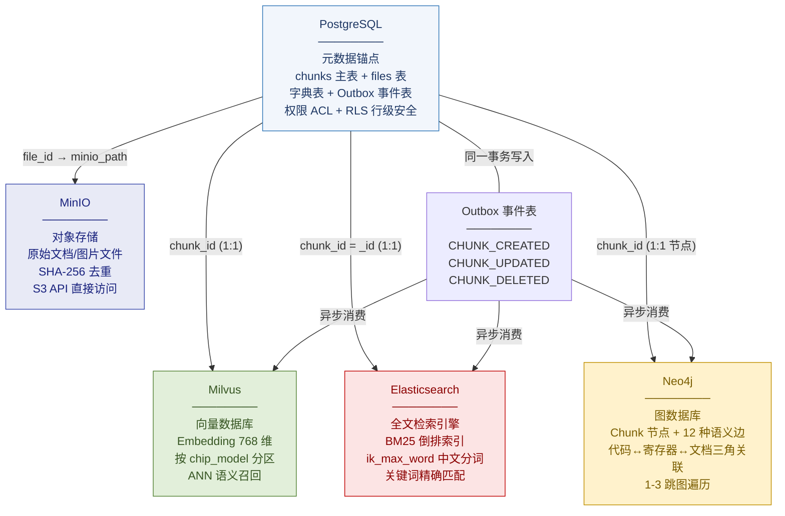
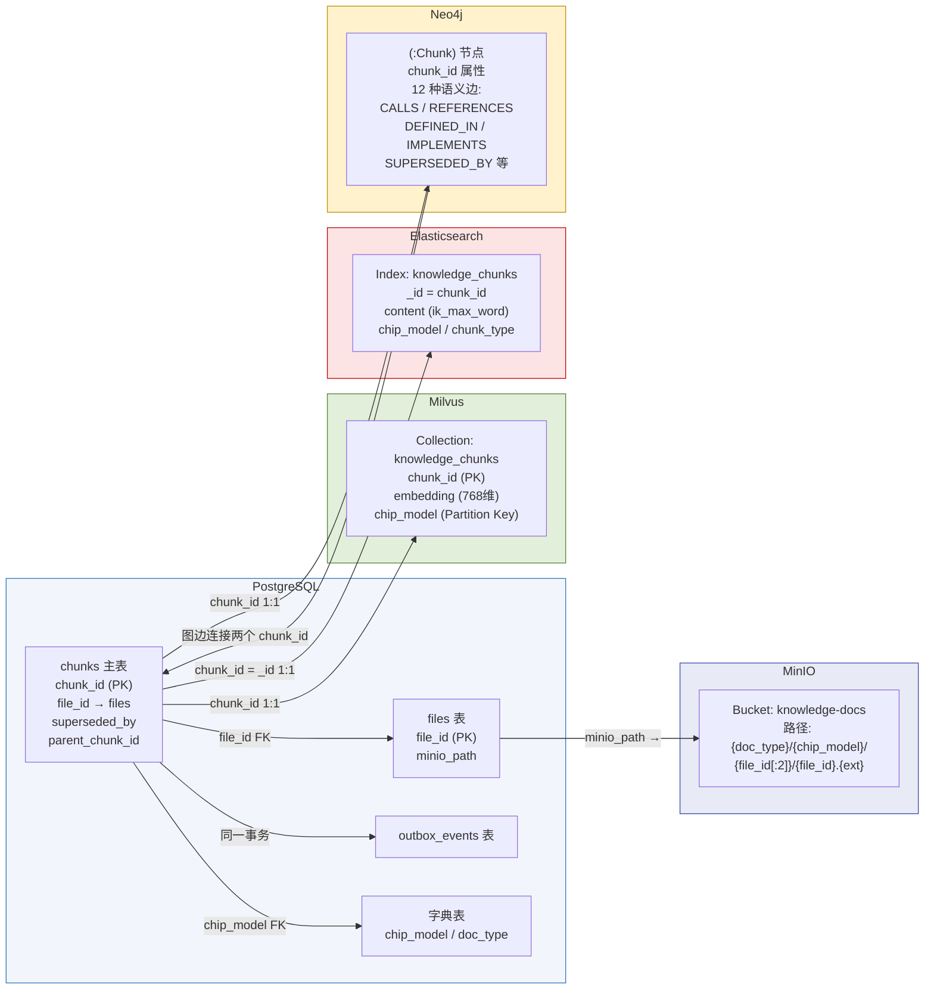
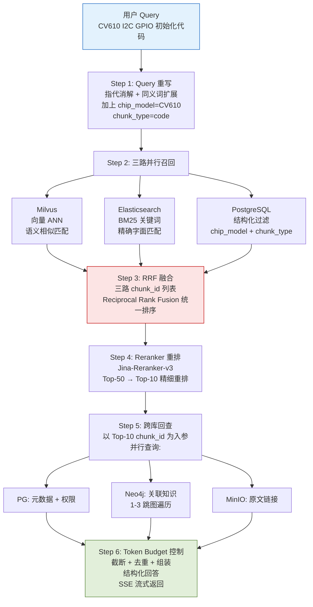
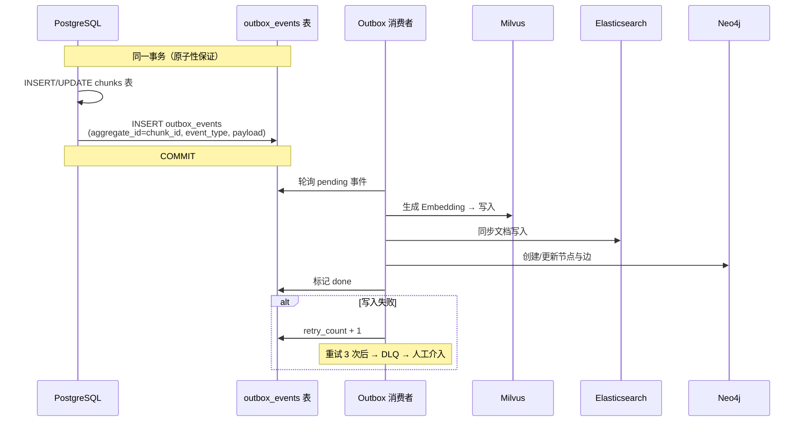

| 产品名称 | 密级 |
| --- | --- |
| 海思芯片知识库——数据库设计 | 内部资料 |
| 产品版本 | 共 XX 页 |
| V1.0（8.9 版本） |   |

海思知识库 数据库设计说明书

| Prepared by<br>拟制 | 架构组 | Date<br>日期 | 2026-08-09 |
| --- | --- | --- | --- |
| Reviewed by<br>审核 |   | Date<br>日期 |   |
| Approved by<br>批准 |   | Date<br>日期 |   |

Huawei Technologies Co., Ltd.

华为技术有限公司

All rights reserved

版权所有  侵权必究

Revision record 修订记录

| Date<br>日期 | Revision Version<br>修订版本 | Revision<br>Chapter<br>修订章节 | Change Description<br>修改描述 | Author<br>作者 |
| --- | --- | --- | --- | --- |
| 2026-07-17 | V1.0 | 全部 | 初稿，完成五库协同数据库设计 | 架构组 |
| 2026-08-09 | V1.1 | 全部 | 按软件设计说明书模板重组，图片改用 Mermaid 重绘 | 架构组 |

Keywords 关键词：数据库设计、五库协同、PostgreSQL、Milvus、Elasticsearch、Neo4j、MinIO、Chunk Schema、chunk_id、Outbox、跨库一致性

Abstract 摘要：本文档是《海思芯片知识库架构设计》的配套数据库设计文档，聚焦于五库（PostgreSQL、Milvus、Elasticsearch、Neo4j、MinIO）如何通过 chunk_id 建立关联关系，实现跨库数据一致检索。涵盖各库 DDL 设计、跨库关联关系、Outbox 一致性策略、检索路径路由、缓存层设计、性能扩展与备份灾备。

List of abbreviations 缩略语清单：

| 缩略语 | 英文全名 | 中文解释 |
| --- | --- | --- |
| PG | PostgreSQL | 关系型数据库 |
| ES | Elasticsearch | 全文检索引擎 |
| ANN | Approximate Nearest Neighbor | 近似最近邻搜索 |
| BM25 | Best Matching 25 | 文本检索排序算法 |
| RRF | Reciprocal Rank Fusion | 倒数排名融合 |
| RLS | Row-Level Security | 行级安全 |
| TDE | Transparent Data Encryption | 透明数据加密 |
| S3 | Simple Storage Service | 对象存储协议 |
| DLQ | Dead Letter Queue | 死信队列 |
| RPO | Recovery Point Objective | 恢复点目标 |
| RTO | Recovery Time Objective | 恢复时间目标 |

# 1 概述

## 1.1 目的

本文档是《海思芯片知识库架构设计》的配套数据库设计文档，聚焦于多异构数据库之间如何通过 chunk_id 建立关联关系，实现跨库数据一致检索。文档核心回答以下问题：

- 五库（PostgreSQL、Milvus、Elasticsearch、Neo4j、MinIO）各自存储什么数据？
- 各库之间通过什么字段建立关联？
- 一次跨库检索请求如何协调多个数据库？
- 如何保证异构数据库间的数据一致性？

## 1.2 范围

本文档覆盖海思知识库全部五类数据库的设计：

- PostgreSQL：元数据锚点、字典表、权限表、Outbox 事件表
- Milvus：向量数据库，存储 Chunk Embedding 向量
- Elasticsearch：全文检索引擎，存储倒排索引与原始文本
- Neo4j：图数据库，存储 Chunk 节点与语义关系边
- MinIO：对象存储，存储原始文档/图片文件
- Redis：缓存层，高频查询与热点 Chunk 缓存

## 1.3 适用读者

- 后端开发工程师：理解数据模型与 API 实现
- DBA / SRE：部署、监控与灾备
- 架构师：评审数据流与一致性方案

## 1.4 术语定义

| 术语 | 说明 |
| --- | --- |
| Chunk | 知识的最小存储单元，一段文本/代码/结构化数据的切片 |
| chunk_id | 全局唯一的 Chunk 标识符（UUID v7），跨库关联的主键 |
| file_id | 原始文件的唯一标识（SHA-256 哈希），关联 MinIO 对象 |
| embedding | Chunk 文本的向量表示，存储在 Milvus 中 |
| Outbox | 一种分布式事务模式，通过 outbox 表保证跨库最终一致性 |
| RRF | Reciprocal Rank Fusion，多路召回结果的融合算法 |

# 2 模块简介（架构设计）

## 2.1 模块概述

### 2.1.1 概述

本模块为海思知识库的数据存储层，采用五库协同架构：以 PostgreSQL 为"元数据锚点"，Milvus、Elasticsearch、Neo4j、MinIO 各自围绕 chunk_id 组织特定类型的数据。写入时通过 Outbox 模式保证五库最终一致性，查询时由统一 KnowledgeDAO 抽象层协调跨库访问。

### 2.1.2 模块上下文定义

本模块与外部实体的关系：

- **上游**：模型服务（入库子池）通过 Outbox 事件触发各库写入；检索子池通过 KnowledgeDAO 查询各库
- **下游**：AI Agent / 聊天 UI 通过后端服务的检索编排获取数据
- **外部依赖**：Kafka 消息队列（批量重建场景）、KMS 密钥管理（存储加密）

## 2.2 总体结构——五库协同星型拓扑

五库以 chunk_id 为纽带形成星型拓扑：PostgreSQL 作为中心锚点，其他四库各自围绕 chunk_id 组织数据。



图 2-1 五库协同星型拓扑架构——PostgreSQL 为元数据锚点，chunk_id 贯穿全库

**数据库职责速查表**：

| 数据库 | 存储内容 | 主键/关联键 | 查询方式 | 定位 |
| --- | --- | --- | --- | --- |
| PostgreSQL | Chunk 元数据、字典表、权限表、Outbox | chunk_id (UUID v7) | SQL | 元数据锚点 |
| Milvus | Chunk 文本的 Embedding 向量 | chunk_id → vector | 向量 ANN | 语义召回 |
| Elasticsearch | Chunk 文本的倒排索引 + 原始文本 | chunk_id (_id) | BM25 + DSL | 关键词召回 |
| Neo4j | Chunk 节点 + 语义关系边 | chunk_id (节点属性) | Cypher | 关联遍历 |
| MinIO | 原始文档/图片文件 | file_id = SHA-256(file) | S3 API | 原文回溯 |

## 2.3 设计约束

### 2.3.1 技术限制

- 操作系统：华为云 CCE Autopilot（容器化部署）
- 编程语言：后端服务 Python/Go，DAO 抽象层 Python
- 数据库版本：PostgreSQL 15+、Milvus 2.4+、Elasticsearch 8.x、Neo4j 5.x、MinIO RELEASE.2024+

### 2.3.2 遵循标准

- UUID v7（时间有序 UUID，RFC 9562）
- S3 API 兼容（MinIO 对象存储接口）
- openCypher（Neo4j 图查询语言）
- 华为云 KMS 密钥管理规范

## 2.4 设计目标

- **单一标识符贯通全库**：以 chunk_id 作为全局主键，实现五库之间的精确关联
- **语义 + 关键词 + 结构化 + 关联 + 原文** 五项检索需求各由专用数据库承载
- **最终一致性**：写入链路通过 Outbox 模式保证跨库数据一致，异常可重试可追溯
- **读写分离**：检索路径读多写少，Redis 缓存削减跨库压力

# 3 模块需求分析

## 3.1 为什么需要五库？

单一数据库无法同时满足以下五项检索需求，因此采用五库协同架构：

| 检索需求 | 承载数据库 | 为什么专用 |
| --- | --- | --- |
| 语义召回（相似语义匹配） | Milvus | 向量相似度计算是向量数据库的核心能力，关系库和全文库无法高效完成 |
| 关键词精确匹配（寄存器名、引脚号） | Elasticsearch | BM25 倒排索引在字面匹配场景远优于向量检索 |
| 关联关系查询（代码调用链、文档引用） | Neo4j | 图遍历（多跳查询）在图数据库中为 O(1)，关系库需多次 JOIN |
| 元数据过滤与权限校验 | PostgreSQL | 结构化数据、ACID 事务、RLS 行级安全是关系库的成熟能力 |
| 原始文档回溯（PDF/Word 原文查看） | MinIO | 大文件存储与 HTTP 直接访问，数据库存 blob 成本高效率低 |

## 3.2 关键场景分析

| 场景编号 | 场景描述 | 场景对应的需求 |
| --- | --- | --- |
| 1 | 语义相似查询："I2C 初始化代码怎么写" | IR-105 知识检索 |
| 2 | 硬件寄存器精确查询："UART_CTRL 寄存器地址" | IR-110 精确检索 |
| 3 | 代码调用链查询："uart_init 被哪些函数调用" | IR-105 关联检索 |
| 4 | 混合检索："CV610 GPIO 中断处理" | IR-105 默认检索模式 |
| 5 | "查看原文"跳转到 PDF 对应章节 | IR-105 文档溯源 |

# 4 模块概要设计

## 4.1 模块总体描述——统一 Chunk Schema

Chunk Schema 是知识库中所有数据的统一抽象模型。无论原始格式是 PDF、代码、配置文件还是硬件数据手册，入库后都遵循此 Schema。chunk_id 是贯穿所有数据库的唯一关联键。

### 4.1.1 Chunk 完整字段定义

| 字段名 | 类型 | 说明 | 关联至 |
| --- | --- | --- | --- |
| chunk_id ★ | UUID v7 | 全局唯一标识，跨库关联主键 | Milvus / ES / Neo4j |
| file_id | VARCHAR(64) | 原始文件 SHA-256 哈希 | PG.files → MinIO |
| content | TEXT | Chunk 文本内容 | ES 全文索引 |
| content_hash | VARCHAR(64) | 内容 SHA-256，用于去重 | （内部） |
| chunk_type | ENUM | text / code / table / image_desc / hw_pin / hw_register / hw_block / hw_net / hw_spec | ES / Milvus 过滤 |
| knowledge_type | ENUM | 事实型 / 过程型 / 契约型 / 决策型 / 实体型 | PG 检索权重 |
| chip_model | VARCHAR(32) | 芯片型号，多芯片隔离核心字段 | ES + Milvus 分区 |
| chip_family | VARCHAR(32) | 芯片系列：CV, ST, Hi 等 | PG 过滤 |
| doc_type | VARCHAR(32) | 文档类型 | ES 过滤 |
| software_version | VARCHAR(32) | SDK/软件版本号 | PG 过滤 |
| confidence | FLOAT 0-1 | 置信度评分 | PG 排序 |
| sensitivity | ENUM | 公开 / 内部 / 机密 / 绝密 | PG + ES 权限过滤 |
| organization | VARCHAR(64) | 所属组织/租户 | PG 多租户隔离 |
| acl | JSONB | 访问控制列表 | PG 行级安全 |
| valid_from / valid_to | TIMESTAMP | 双时态：知识有效时间范围 | PG 时间感知检索 |
| observed_at | TIMESTAMP | 双时态：入库/发现时间 | PG |
| superseded_by ★ | UUID | 指向替代版本的新 chunk_id | PG 自引用 + Neo4j 边 |
| parent_chunk_id ★ | UUID | 父 Chunk（层级关系） | PG 自引用 + Neo4j 边 |

注：★ 标注的字段为跨库关联键。

### 4.1.2 跨库关联关系全景图



图 4-1 Chunk Schema 跨库关联关系全景——chunk_id 在各库中的角色与映射关系

### 4.1.3 chunk_id 生成规则

使用 UUID v7（时间有序 UUID），前 48 位为毫秒级时间戳，保证 B+Tree 索引性能和 Milvus 向量插入顺序。

## 4.2 模块分解描述

### 4.2.1 PostgreSQL——元数据锚点

**标识**：PostgreSQL（RDS for PostgreSQL）

**类型**：关系型数据库

**目的**：存储所有 Chunk 的业务属性、字典表、权限信息、Outbox 事件表，作为五库的"元数据锚点"。

**功能列表**：
- chunks 主表：存储 Chunk 完整元数据
- files 表：原始文件信息
- 字典表：芯片型号、文档类型等枚举值管理
- Outbox 事件表：跨库一致性事件
- RLS 行级安全策略
- ACL 权限存储与判定

### 4.2.2 Milvus——向量数据库

**标识**：Milvus / CSS（云搜索服务向量检索）

**类型**：向量数据库

**目的**：存储 Chunk 文本的 Embedding 向量，提供语义相似度 ANN 检索。

**功能列表**：
- Collection: knowledge_chunks
- 向量维度：768（Jina-Code-Embeddings-0.5B）
- 索引类型：IVF_FLAT / HNSW
- 相似度度量：COSINE
- 分区策略：按 chip_model 创建 Partition

### 4.2.3 Elasticsearch——全文检索引擎

**标识**：Elasticsearch / CSS（云搜索服务全文检索）

**类型**：全文检索引擎

**目的**：存储 Chunk 文本的倒排索引与原始文本，提供 BM25 关键词精确匹配。

**功能列表**：
- Index: knowledge_chunks
- _id 使用 chunk_id
- 分词器：ik_max_word（中文）
- 标量过滤：chip_model / chunk_type / sensitivity / organization

### 4.2.4 Neo4j——图数据库

**标识**：Neo4j / GES（图引擎服务）

**类型**：图数据库

**目的**：存储 Chunk 节点与语义关系边，提供图遍历查询能力。不同于 Milvus/ES 的"一对一 chunk_id 映射"，Neo4j 存储跨 chunk_id 的语义关系。

**功能列表**：
- 唯一节点类型：(:Chunk)
- 12 种语义边：CALLS / IMPLEMENTS / IMPORTS / USES_TYPE / REFERENCES / DEFINED_IN / BELONGS_TO / SIMILAR_TO / SUPERSEDED_BY / CONFLICT_WITH / ASSOCIATED_WITH / TAGGED_WITH
- 代码↔寄存器↔文档三角关联

### 4.2.5 MinIO——对象存储

**标识**：MinIO / SFS（弹性文件服务）

**类型**：对象存储

**目的**：存储原始文档/图片文件，提供原文回溯能力。不直接存储 chunk_id，通过 file_id 间接关联。

**功能列表**：
- Bucket: knowledge-docs
- 路径规则：{doc_type}/{chip_model}/{file_id[:2]}/{file_id}.{ext}
- SHA-256 文件去重
- S3 API 直接访问（预签名 URL）

## 4.3 依赖性描述

### 4.3.1 数据依赖关系

| 序号 | 源库.字段 | 目标库.字段 | 关联类型 | 使用场景 |
| --- | --- | --- | --- | --- |
| 1 | PG.chunks.chunk_id | Milvus.chunk_id | 1:1 主键映射 | 向量检索返回 chunk_id → PG 获取完整元数据 |
| 2 | PG.chunks.chunk_id | ES._id (chunk_id) | 1:1 主键映射 | 关键词检索返回 chunk_id → PG 获取完整元数据 |
| 3 | PG.chunks.chunk_id | Neo4j Chunk.chunk_id | N:N 图关系 | 以 chunk_id 为起点做 1-3 跳图遍历 |
| 4 | PG.chunks.file_id | PG.files.file_id | N:1 外键 | 一个文件产生多个 Chunk，通过 file_id 找原始文件 |
| 5 | PG.files.minio_path | MinIO Object Path | 1:1 路径映射 | "查看原文"链接直接访问 MinIO |
| 6 | PG.chunks.superseded_by | PG.chunks.chunk_id | 自引用 1:1 | 版本演进链 |
| 7 | PG.chunks.parent_chunk_id | PG.chunks.chunk_id | 自引用 1:N | 文档章节层级 |
| 8 | Neo4j 图边 → 两行 PG | PG c1.chunk_id 和 c2.chunk_id | 图边 → 两行 PG | 图遍历 → chunk_id 列表 → 批量查 PG |
| 9 | PG.dict_chip_model.code | PG.chunks.chip_model | 字典 FK | 芯片型号字典 |
| 10 | PG.dict_doc_type.code | PG.chunks.doc_type | 字典 FK | 文档类型字典 |

## 4.4 接口描述——KnowledgeDAO 抽象层

统一存储抽象层（DAO）封装五库的跨库读写，对上层暴露统一接口：

| 接口 | 描述 | 交互对象 | 扇入 |
| --- | --- | --- | --- |
| search_by_vector(query_vec, filters) → [chunk_id] | 向量语义召回 | Milvus | 1 |
| search_by_keyword(query_str, filters) → [chunk_id] | BM25 关键词召回 | ES | 1 |
| get_metadata(chunk_ids) → [ChunkMeta] | 批量获取 Chunk 元数据 | PG | N |
| get_graph_neighbors(chunk_id, depth, edges) | 图遍历关联查询 | Neo4j | 1 |
| get_original_file_url(file_id) → str | 原始文件预签名 URL | PG + MinIO | 1 |

# 5 模块详细设计

## 5.1 PostgreSQL 详细设计

### 5.1.1 chunks 主表 DDL

```sql
CREATE TABLE chunks (
    chunk_id UUID PRIMARY KEY,                -- 全局唯一，UUID v7
    file_id VARCHAR(64) NOT NULL,             -- SHA-256，关联 MinIO
    content TEXT NOT NULL,                    -- Chunk 文本全文
    content_hash VARCHAR(64) NOT NULL,
    chunk_type VARCHAR(32) NOT NULL,          -- text/code/table/image_desc/hw_*
    knowledge_type VARCHAR(32),               -- 事实型/过程型/契约型/决策型/实体型
    chip_model VARCHAR(32) NOT NULL,          -- ★ 多芯片隔离核心字段
    chip_family VARCHAR(32),                  -- CV, ST, Hi 等系列
    doc_type VARCHAR(32),
    software_version VARCHAR(32),
    confidence FLOAT DEFAULT 0.5,
    review_status VARCHAR(16) DEFAULT '未审核',
    sensitivity VARCHAR(16) DEFAULT '内部',   -- 公开/内部/机密/绝密
    organization VARCHAR(64),                 -- 租户标识
    acl JSONB DEFAULT '{}',                   -- 行级权限控制
    valid_from TIMESTAMPTZ,                   -- 双时态：生效时间
    valid_to TIMESTAMPTZ,                     -- 双时态：失效时间
    observed_at TIMESTAMPTZ DEFAULT NOW(),
    superseded_by UUID REFERENCES chunks(chunk_id),
    parent_chunk_id UUID REFERENCES chunks(chunk_id),
    version INT DEFAULT 1,                    -- 乐观锁
    created_at TIMESTAMPTZ DEFAULT NOW(),
    updated_at TIMESTAMPTZ DEFAULT NOW()
);

-- 关键索引
CREATE INDEX idx_chunks_chip_model ON chunks(chip_model);
CREATE INDEX idx_chunks_valid_to ON chunks(valid_to) WHERE valid_to IS NULL;
CREATE INDEX idx_chunks_org ON chunks(organization);
```

### 5.1.2 files 文件表 DDL

```sql
CREATE TABLE files (
    file_id VARCHAR(64) PRIMARY KEY,          -- SHA-256
    original_name VARCHAR(512) NOT NULL,
    file_size BIGINT,
    minio_path VARCHAR(512) NOT NULL,         -- MinIO 对象路径
    uploaded_at TIMESTAMPTZ DEFAULT NOW(),
    status VARCHAR(16) DEFAULT 'active'
);
```

关联关系：chunks.file_id → files.file_id → files.minio_path → MinIO 对象，实现"检索结果 → 原始文件"的完整回溯链。

### 5.1.3 字典表 DDL

所有枚举值通过字典表管理，支持热更新。新增一个芯片型号只需 INSERT INTO dict_chip_model，配置中心推送后所有服务立即生效。

```sql
CREATE TABLE dict_chip_model (
    code VARCHAR(32) PRIMARY KEY,             -- e.g. CV610, CV620
    name VARCHAR(64) NOT NULL,
    family VARCHAR(32),
    status VARCHAR(16) DEFAULT 'active'
);
```

### 5.1.4 Outbox 事件表 DDL

```sql
CREATE TABLE outbox_events (
    id BIGSERIAL PRIMARY KEY,
    aggregate_id UUID NOT NULL,               -- chunk_id
    event_type VARCHAR(64) NOT NULL,          -- CHUNK_CREATED/UPDATED/DELETED
    payload JSONB NOT NULL,
    status VARCHAR(16) DEFAULT 'pending',
    retry_count INT DEFAULT 0,
    created_at TIMESTAMPTZ DEFAULT NOW()
);
```

## 5.2 Milvus 详细设计

Milvus 通过 chunk_id 与 PostgreSQL 建立一对一关联。

**Collection 定义**：

| 参数 | 值 |
| --- | --- |
| Collection 名 | knowledge_chunks |
| 主键 | chunk_id (VarChar) |
| 向量字段 | embedding (FloatVector, 768 维) |
| 分区键 | chip_model (Partition Key) |
| 索引类型 | IVF_FLAT / HNSW |
| 相似度度量 | COSINE |
| 分区 | 按 chip_model 创建 Partition（CV610, CV620, ...） |

**写入流程**：PostgreSQL 写入 Chunk 后由 Outbox 触发 Embedding 生成 → 以 chunk_id 为主键写入 Milvus。

**检索流程**：Milvus ANN 检索返回 Top-K 个 chunk_id → 回查 PostgreSQL 获取完整元数据。

## 5.3 Elasticsearch 详细设计

ES 索引文档 _id 使用 chunk_id，与 PostgreSQL 建立一对一关联。

**Index 定义**：

| 参数 | 值 |
| --- | --- |
| Index 名 | knowledge_chunks |
| _id | chunk_id（关联键） |
| 分词器 | ik_max_word（中文） |
| 标量过滤字段 | chip_model / chunk_type / sensitivity / organization / doc_type |

**查询模式**：ES 返回 chunk_id 列表 → 回查 PostgreSQL 获取完整信息。

## 5.4 Neo4j 详细设计

Neo4j 不同于 Milvus/ES 的"一对一 chunk_id 映射"，它存储 Chunk 之间的语义关系——即跨 chunk_id 的关联。

**节点约束**：

```cypher
CREATE CONSTRAINT chunk_id_unique FOR (c:Chunk) REQUIRE c.chunk_id IS UNIQUE;
```

**12 种核心边类型**：

| 边类型 | 含义 | 示例 |
| --- | --- | --- |
| CALLS | 函数调用关系 | uart_init → gpio_set_mode |
| IMPLEMENTS | 接口实现 | I2C_Interface → i2c_v2_driver |
| IMPORTS | 模块导入 | main.c → uart.h |
| USES_TYPE | 类型使用 | uart_init → UART_Type |
| REFERENCES | 一般引用 | 应用笔记 → SDK API |
| DEFINED_IN | 寄存器在文档中的定义 | UART_CTRL → 数据手册第 3 章 |
| BELONGS_TO | 归属关系 | Chunk → Sample 工程 |
| SIMILAR_TO | 语义相似 | FAQ: "I2C 超时" → 论坛: "I2C 无响应" |
| SUPERSEDED_BY | 版本替代 | v1.0 Chunk → v2.0 Chunk |
| CONFLICT_WITH | 内容冲突 | 文档 A → 文档 B（同一主题矛盾） |
| ASSOCIATED_WITH | 一般关联 | 原理图 Pin → 数据手册 Pin 定义 |
| TAGGED_WITH | 标签关联 | Chunk → 标签节点 |

**代码-寄存器-文档三角关联**（核心模式）：

```cypher
// 代码 Chunk 引用寄存器 → 寄存器在文档中有定义
(c:Chunk {chunk_type: 'code'}) -[:REFERENCES]-> (r:Chunk {chunk_type: 'hw_register'})
(r) -[:DEFINED_IN]-> (d:Chunk {chunk_type: 'text'})
// 形成三角闭环：检索代码时自动反查手册章节，检索手册时自动关联实现代码
```

## 5.5 MinIO 详细设计

MinIO 不直接存储 chunk_id。关联路径为：chunk_id → PG.chunks.file_id → PG.files.minio_path → MinIO Object。

**Bucket 配置**：

| 参数 | 值 |
| --- | --- |
| Bucket 名 | knowledge-docs |
| 路径规则 | {doc_type}/{chip_model}/{file_id[:2]}/{file_id}.{ext} |
| 去重策略 | SHA-256 哈希，相同文件只存一次 |
| 访问方式 | S3 API 预签名 URL（有效期 1 小时） |

一个文件可能产生多个 Chunk，但原始文件通过 SHA-256 去重只存一次。

## 5.6 跨库查询完整流程

以"在 CV610 项目中开发 I2C 驱动，查询 GPIO 初始化代码"为例：



图 5-1 跨库查询完整流程——从 Query 输入到结构化回答的 6 步流水线

**流程分步说明**：

| 步骤 | 操作 | 输入 | 输出 |
| --- | --- | --- | --- |
| Step 1 | Query 重写 | 用户原始查询 | 改写后的查询 + chip_model 过滤 |
| Step 2 | 三路并行召回 | 改写查询 | 三路 chunk_id 列表 |
| Step 3 | RRF 融合 | 三路 chunk_id 列表 | 统一排序后的 chunk_id 列表 |
| Step 4 | Reranker 重排 | Top-50 chunk_id | Top-10 chunk_id |
| Step 5 | 跨库回查 | Top-10 chunk_id | 完整元数据 + 关联知识 + 原文链接 |
| Step 6 | Token Budget 组装 | 全部上下文 | 结构化回答（SSE 流式返回） |

## 5.7 查询路由策略

| 查询场景 | 涉及数据库 | 路由策略 |
| --- | --- | --- |
| 语义相似查询 | Milvus → PG | 向量检索 → chunk_id → PG 元数据 |
| 关键词精确查询 | ES → PG | BM25 检索 → chunk_id → PG 元数据 |
| 硬件引脚/寄存器查询 | ES → PG → Neo4j | 精确匹配 → 元数据 → 图遍历关联代码/文档 |
| 代码调用链查询 | Neo4j → PG | 图遍历 → chunk_id 列表 → PG 获取源码和文档 |
| 混合检索（默认） | Milvus + ES → PG → Neo4j | 三路并行 → RRF → Reranker → PG → Neo4j |
| "查看原文" | PG → MinIO | chunk_id → file_id → minio_path → presigned URL |
| 元数据过滤查询 | PG only | 纯结构化查询 |
| 冲突检测 | Neo4j → PG | 主题聚类 → 语义对比 → CONFLICT_WITH 边 → PG 更新 |

## 5.8 跨库数据一致性——Outbox 模式

五库是独立的数据库系统，不支持跨库 ACID 事务。通过 Outbox 模式 + Kafka 事件驱动实现最终一致性。

**单条 Chunk 写入流程**：



图 5-2 Outbox 模式单条 Chunk 写入流程

**批量重建（如嵌入模型切换）**：通过 Kafka 解耦。Producer 发送 chunk_id 列表到 Topic，Consumer Group 并行消费，chunk_id 作为主键保证幂等写入（重复写入为 upsert）。

**数据同步延迟**：
- PG 写入成功后立即对检索请求可见（基础元数据已存在）
- Milvus/ES/Neo4j 通过 Outbox 异步同步，延迟通常 < 500ms
- Redis 缓存高频查询（TTL 5 分钟），紧急勘误场景提供 sync=true 同步写入

## 5.9 缓存层设计（Redis）

| 缓存 Key | 内容 | TTL | 说明 |
| --- | --- | --- | --- |
| embedding:{query_hash} | Query Embedding 向量 | 1h | 避免重复 Embedding 计算 |
| search:{query_hash}:{chip} | 检索结果 chunk_id 列表 | 5min | 高频检索缓存 |
| chunk_meta:{chunk_id} | Chunk 完整元数据 JSON | 30min | 减少 PG 查询压力 |
| dict:{table_name} | 字典表全量数据 | 10min | 字典变更频率极低 |

# 6 非功能设计

## 6.1 性能与扩展性

| 数据库 | 扩展策略 | 瓶颈 | 应对 |
| --- | --- | --- | --- |
| PostgreSQL | 读写分离 + PgBouncer | 高频元数据查询 | Redis 缓存热点 Chunk |
| Milvus | Sharding + 按 chip_model 分区 | 向量检索延迟 | HNSW 索引 + GPU 加速 |
| Elasticsearch | 水平扩展节点 | 索引写入吞吐 | Bulk API 批量写入 |
| Neo4j | 只读副本集群 | 多跳遍历深度 > 3 | 限制深度 ≤ 3 + 热点子图缓存 |
| MinIO | 水平扩展 + Bucket 复制 | 大文件下载带宽 | CDN + 预签名 URL |
| Redis | Cluster 模式 | 内存容量 | LRU + TTL 控制 |

## 6.2 备份与灾备策略

核心原则：向量和图关系均可从 PostgreSQL + 原始文件重建。PG 备份优先级最高（RPO ≤ 1h），MinIO 次之。Milvus Embedding 向量重建成本最高，需在模型版本切换时保留快照。

| 数据库 | 备份方式 | RPO | RTO |
| --- | --- | --- | --- |
| PostgreSQL | 每日全量 + WAL 归档 + 异地冷备 | ≤ 1h | ≤ 4h |
| Milvus | 集合周期性快照 (S3)，可从 PG+原文重建 | ≤ 4h | ≤ 8h |
| Elasticsearch | Snapshot 到 MinIO/S3 | ≤ 4h | ≤ 4h |
| Neo4j | 全量 Cypher 导出 + 增量日志 | ≤ 4h | ≤ 4h |
| MinIO | 跨区域 Bucket 复制 | ≤ 1h | ≤ 1h |

## 6.3 可靠性设计

1. **故障检测**：各库健康检查端点独立监控；Outbox 消费者心跳检测；Kafka Consumer Group 滞后监控
2. **故障恢复**：Outbox 事件重试 3 次 → DLQ → 人工介入；Kafka 消费位点保留 7 天，支持重置回放
3. **降级策略**：Neo4j 不可用时跳过图遍历，仅用向量+关键词检索；MinIO 不可用时检索结果不返回原文链接
4. **幂等保证**：chunk_id 作为各库主键，重复写入为 upsert；Kafka 消费按 chunk_id 去重

## 6.4 安全设计

- **传输加密**：各库连接均启用 TLS
- **存储加密**：PG TDE 透明加密、MinIO 服务端加密、KMS 托管密钥
- **访问控制**：PG RLS 行级安全 + ACL JSONB 字段级权限
- **审计**：Outbox 事件表天然记录了所有写入操作，可作为审计轨迹
- **敏感数据**：sensitivity 字段标记，检索时按用户 clearance 过滤

# 7 附录

## 7.1 chunk_id 在各库中的数据结构速查

**PostgreSQL**：
```
chunks.chunk_id = "0192a8e1-7b3c-7000-8000-123456789abc" (UUID v7, PRIMARY KEY)
```

**Milvus**：
```json
{ "chunk_id": "0192a8e1-...", "embedding": [0.12, -0.34, ...768维...] }
```

**Elasticsearch**：
```json
{ "_id": "0192a8e1-...", "_source": { "content": "...芯片手册内容...", "chip_model": "CV610" } }
```

**Neo4j**：
```cypher
(:Chunk {chunk_id: "0192a8e1-..."}) -[:REFERENCES]-> (:Chunk {chunk_id: "0192a8e1-..."})
```

**MinIO**：
```
s3://knowledge-docs/datasheet/CV610/a3/f2a3b1c9...pdf  (通过 file_id 间接关联)
```

# 8 List of reference 参考文献清单

1. 海思芯片知识库架构设计——总体架构设计文档
2. 海思知识库关键技术选型设计——CBM + codegraph 选型论证
3. PostgreSQL 15 官方文档——https://www.postgresql.org/docs/15/
4. Milvus 2.4 向量数据库文档——https://milvus.io/docs/
5. Elasticsearch 8.x 参考手册——https://www.elastic.co/guide/en/elasticsearch/reference/
6. Neo4j 5.x Cypher 手册——https://neo4j.com/docs/cypher-manual/
7. MinIO 对象存储文档——https://min.io/docs/
8. UUID v7 RFC 9562——https://www.rfc-editor.org/rfc/rfc9562
