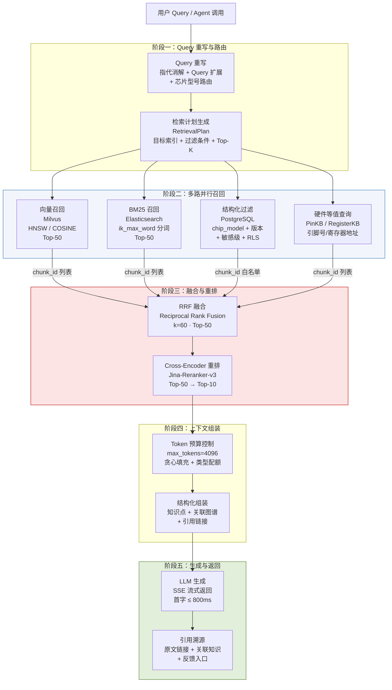
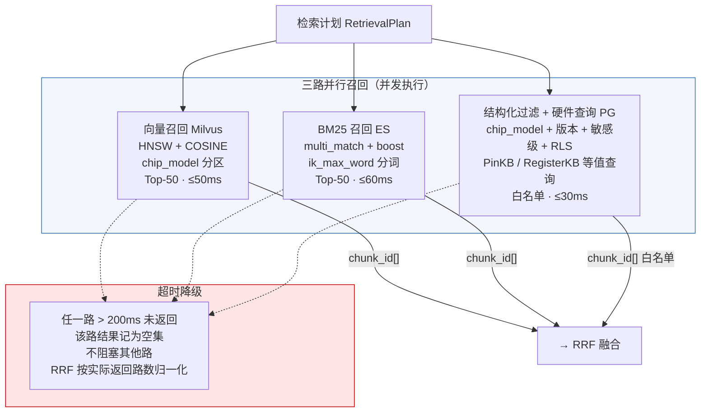
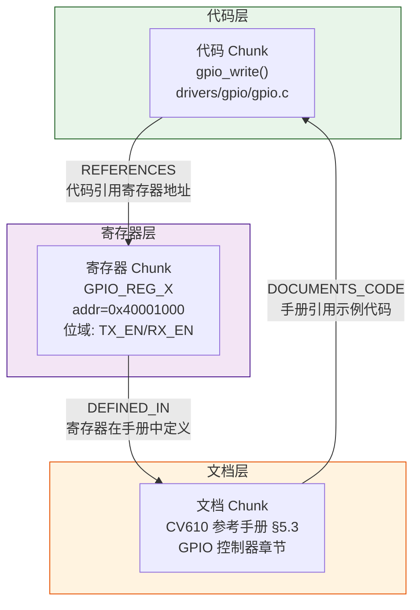
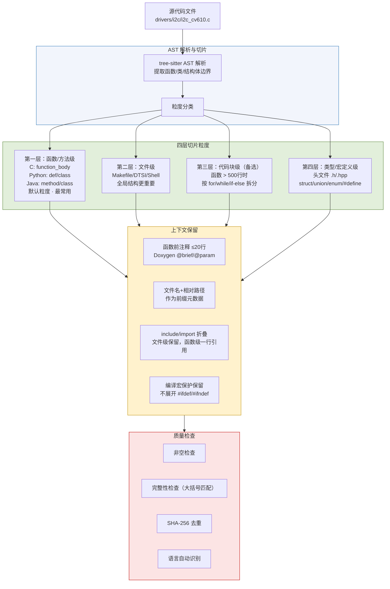
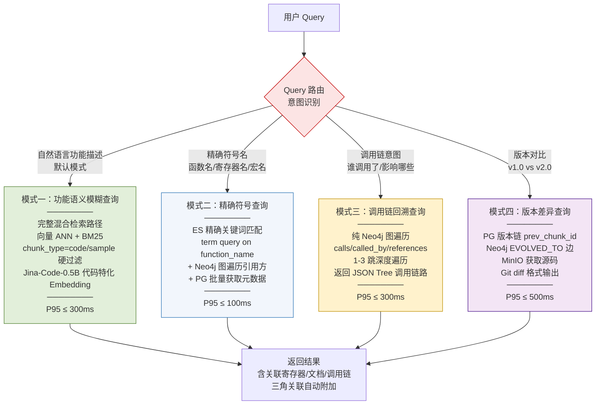

| 产品名称            | 密级     |
| --------------- | ------ |
| 海思芯片知识库——文件检索设计 | 内部资料   |
| 产品版本            | 共 XX 页 |
| V1.0（8.9 版本）    |        |

海思知识库 文件检索设计说明书

| Prepared by 拟制 | 架构组 | Date 日期 | 2026-08-09 |
| ----------------- | --- | ---------- | ---------- |
| Reviewed by 审核 |     | Date 日期 |            |
| Approved by 批准 |     | Date 日期 |            |

Huawei Technologies Co., Ltd.

华为技术有限公司

All rights reserved

版权所有  侵权必究

Revision record 修订记录

| Date 日期 | Revision Version 修订版本 | Revision Chapter 修订章节 | Change Description 修改描述        | Author 作者 |
| ---------- | ------------------------ | --------------------------- | --------------------------------- | ------------ |
| 2026-07-23 | V0.1                     | 全部                          | 初稿，从架构设计 V1.1 第 6/16 章抽取并扩展检索相关内容 | 架构组          |
| 2026-08-09 | V1.0                     | 全部                          | 按软件设计说明书模板重组，图片改用 Mermaid 重绘      | 架构组          |

Keywords 关键词：混合检索、多路召回、RRF 融合、Cross-Encoder 重排、Token 预算控制、Query 重写、代码检索、知识图谱关联、子知识库、多芯片隔离

Abstract 摘要：本文档是海思芯片知识库的检索子系统设计说明书，聚焦于"如何把对的 Chunk 在对的时间以对的形态返回给调用方"这一核心问题。覆盖 Query 重写、多路并行召回（向量+BM25+结构化+硬件等值）、RRF 融合与 Cross-Encoder 重排、Token 预算控制、SSE 流式生成、代码检索四种模式、知识图谱三角关联、多芯片硬隔离与子知识库、缓存策略与性能监控等完整检索链路设计。

List of abbreviations 缩略语清单：

| 缩略语        | 英文全名                               | 中文解释        |
| ---------- | ---------------------------------- | ----------- |
| RRF        | Reciprocal Rank Fusion             | 倒数排名融合      |
| HNSW       | Hierarchical Navigable Small World | 分层可导航小世界图索引 |
| IVF        | Inverted File Index                | 倒排文件索引      |
| BM25       | Okapi Best Matching 25             | 全文检索经典排序算法  |
| SSE        | Server-Sent Events                 | 服务端推送事件     |
| PinKB      | Pin Knowledge Base                 | 引脚结构化知识库    |
| RegisterKB | Register Knowledge Base            | 寄存器结构化知识库   |

# 1 概述

## 1.1 目的

本文档是《海思芯片知识库架构设计》的配套检索设计文档，聚焦于知识库检索子系统"如何把对的 Chunk 在对的时间以对的形态返回给调用方"这一核心问题。文档在架构设计第 6 章（检索与生成层）、第 16 章（模型选型）、第 5 章（存储与知识模型）以及《数据库设计文档》跨库查询部分的基础上系统化整合并扩展，回答以下工程问题：

- 一次 Query 从输入到结构化回答的完整流水线如何串联？
- 多路召回（向量、BM25、结构化、图遍历）如何并行、融合、重排？
- 如何在 Token 预算约束下最大化信息完整性？
- 多芯片共存、多租户、多敏感级场景下检索如何隔离？
- 检索路径如何跨 PostgreSQL / Milvus / Elasticsearch / Neo4j / MinIO 五库协同？
- 缓存层、监控告警、性能基线如何设计与运营？

## 1.2 范围

本文档覆盖检索子系统的全链路设计：

- Query 重写与上下文感知（指代消解、Query 扩展、Query 路由）
- 多路并行召回（向量 ANN、BM25 关键词、结构化过滤、硬件等值查询）
- 结果融合（RRF）与 Cross-Encoder 重排
- Token 预算控制与上下文组装
- SSE 流式生成与引用溯源
- 知识图谱关联检索（三角关联、图遍历）
- 代码检索（AST 切片、四种查询模式）
- 多芯片硬隔离与子知识库
- 缓存策略、性能监控、跨库查询路由

## 1.3 适用读者

- 后端开发工程师：理解检索流水线实现、接口对接、性能调优
- 算法工程师：理解 Embedding/Reranker 选型依据与评测体系
- 架构师：评审检索路径、跨库一致性、扩展性设计
- DBA / SRE：部署、监控、容量评估、告警配置

## 1.4 与其他文档的关系

| 文档                       | 关系            |
| ------------------------ | ------------- |
| 《海思知识库架构设计》第 6 章         | 本文档的主要来源      |
| 《海思知识库架构设计》第 16 章        | 模型选型实证        |
| 《海思知识库数据库设计文档》第 12 章     | 跨库查询路由        |
| 《海思知识库——文档解析、分块与向量化接入方案》 | 上游：Chunk 如何产生 |
| 《海思知识库架构设计 - 权限与安全设计》    | 检索路径的权限过滤     |

## 1.5 术语定义

| 术语         | 说明                             |
| ---------- | ------------------------------ |
| Chunk      | 知识的最小存储与检索单元                   |
| chunk_id   | Chunk 的全局唯一标识（UUID v7），贯穿五库的主键 |
| 召回（Recall） | 多路检索从库中取出候选 Chunk 的过程          |
| 重排（Rerank） | 对召回结果用更精确但更慢的模型二次排序            |
| Token 预算   | 单次查询注入 LLM 上下文的最大 Token 数      |
| 子知识库       | 根据上下文动态圈定的检索边界                 |

# 2 模块简介（架构设计）

## 2.1 模块概述

### 2.1.1 概述

检索层在系统架构中是⑤号层，向下消费存储层提供的五库能力（Milvus、Elasticsearch、PostgreSQL、Neo4j、MinIO），向上为服务层提供检索原语。检索层本身不持有状态，是"无状态编排器"。

### 2.1.2 模块上下文定义

- **上游**：服务层（REST API、MCP Server、Web UI）发起检索请求
- **下游**：存储层五库（PG/Milvus/ES/Neo4j/MinIO）提供数据
- **协同模块**：Query 重写模块（LLM/规则引擎）、权限过滤模块（RBAC+ABAC+ACL）

## 2.2 总体结构——混合检索流水线

单一向量检索在专业术语、缩写、寄存器地址等"字面匹配更重要"的场景表现不佳；单一 BM25 又无法理解语义。本架构采用"Query 重写 → 多路并行召回 → RRF 融合 → Cross-Encoder 重排 → Token 预算控制 → 上下文组装 → SSE 流式生成"的混合检索流水线。

### 2.2.1 核心数据流

图 2-1 检索核心数据流——从 Query 输入到结构化回答的完整流水线

**关键设计点**：

1. **多路并行而非串行**：三路召回并发执行，延迟由最慢一路决定，整体延迟可控
2. **chunk_id 作为唯一通行证**：召回阶段只返回 chunk_id 列表，元数据与原文在最后回查阶段统一获取
3. **重排早于 Token 控制**：先让 Reranker 选出真正相关的 Top-N，再做预算截断
4. **关联知识与主召回解耦**：Neo4j 图遍历在主召回完成后并行执行，不阻塞主路径

### 2.2.2 流水线阶段总览

| 阶段       | 方法                 | 说明                            |
| -------- | ------------------ | ----------------------------- |
| Query 重写 | LLM / 规则           | 指代消解、Query 扩展、按芯片型号路由到不同索引    |
| 向量召回     | HNSW / IVF         | 语义相似度 Top-K（默认 K=50）          |
| BM25 召回  | Elasticsearch      | 关键词匹配 Top-K，擅长缩写、地址、寄存器名      |
| 结构化过滤    | PostgreSQL         | 按芯片型号/版本/类型/敏感级硬过滤            |
| 硬件等值查询   | PinKB / RegisterKB | 引脚号、寄存器名/地址精准匹配               |
| 融合       | RRF                | Reciprocal Rank Fusion，平衡多路排名 |
| 重排       | Cross-Encoder      | 对融合后 Top-N（默认 N=50）精排至 Top-10 |
| Token 控制 | 预算控制器              | 贪心填充 + 类型配额，max_tokens=4096   |
| 上下文组装    | Composer           | 结构化输出，附引用链接与元数据               |
| 生成       | LLM                | SSE 流式返回，支持多轮对话               |

## 2.3 设计约束

### 2.3.1 技术限制

- 编程语言：检索编排 Python/Go，DAO 抽象层 Python
- 向量模型：Jina-Code-Embeddings-0.5B（896 维）/ bge-m3
- Reranker：Jina-Reranker-v3（GPU 部署）
- LLM：通义千问（主）/ Claude（代码）/ GPT（推理）多 Provider 路由

### 2.3.2 性能规格

| 指标            | 目标值      |
| ------------- | -------- |
| 检索 P95 延迟     | ≤ 300 ms |
| 首字延迟（SSE）     | ≤ 800 ms |
| Top-5 命中率     | ≥ 90%    |
| 单次查询上下文 Token | ≤ 4096   |
| 检索服务 SLA      | ≥ 99.9%  |

# 3 模块需求分析

## 3.1 关键技术挑战

| 挑战            | 难点                                     | 本文档应对            |
| ------------- | -------------------------------------- | ---------------- |
| 代码-文本高度混合     | 文本/命令行/表格参数交错，单一向量检索在缩写、地址、寄存器名字面匹配上失准 | §4 混合检索、§10 模型选型 |
| 硬件专有结构精准查询    | Pin 脚号、寄存器地址需等值/范围查询                   | §4.4 硬件等值查询      |
| 多芯片共存         | CV610/CV620 知识必须硬隔离                    | §4.3 多芯片硬隔离      |
| 代码-寄存器-文档三角关联 | 同一问题可能要从任一顶点反查其他两顶点                    | §5.5 知识关联检索      |
| Token 成本控制    | 在保证信息完整前提下压缩上下文                        | §4.7 Token 预算控制  |
| 检索结果可解释       | 开发者需要引用来源、原文链接                         | §4.8 引用与溯源       |

## 3.2 关键场景分析

| 场景编号 | 场景描述                                | 查询模式                |
| ---- | ----------------------------------- | ------------------- |
| 1    | 功能语义模糊查询："CV610 I2C 初始化代码"          | 默认混合检索              |
| 2    | 精确符号查询："i2c_init 在哪些代码中引用了"         | ES 精确匹配 + Neo4j 图遍历 |
| 3    | 调用链回溯查询："gpio_write 被哪些函数调用"        | 纯 Neo4j 图遍历         |
| 4    | 硬件寄存器查询："0x40001000 寄存器功能"          | RegisterKB 结构化查询    |
| 5    | 版本差异查询："i2c_init v1.0 vs v2.0 改了什么" | PG 版本链 + diff       |

# 4 模块概要设计

## 4.1 模块总体描述

检索子系统按功能分解为以下子模块：

1. **Query 重写器**：指代消解、Query 扩展、查询路由
2. **多路召回编排器**：并行调度向量/BM25/结构化/硬件四路召回
3. **融合重排器**：RRF 融合 + Cross-Encoder 重排
4. **Token 预算控制器**：贪心填充 + 类型配额
5. **上下文组装器**：结构化输出模板
6. **流式生成器**：SSE 事件管理
7. **图关系检索器**：Neo4j 三角关联 + 图遍历
8. **缓存管理器**：多层 Redis 缓存

## 4.2 Query 重写与上下文感知（概要）

Query 重写是检索流水线的第一站，负责将用户的自然语言输入转化为更适合检索的形式。

**指代消解**：会话上下文回填（最近 5 轮）→ 编辑器上下文回填（Agent 场景）→ LLM 辅助消解。例如"它的最大电压是多少？" → 结合上文"GPIO1 的寄存器定义" → 重写为"GPIO1 的最大电压是多少？"

**Query 扩展**：

| 扩展类型    | 示例                                   |
| ------- | ------------------------------------ |
| 缩写展开    | I2C → IIC / Inter-Integrated Circuit |
| 同义词追加   | "引脚" → "pin / pinout / 引脚号"          |
| 中英文互译   | "通用输入输出口" → "GPIO"                   |
| 单位归一    | "3.3V" → "3.3 volt / 3300mV"         |
| 寄存器名规范化 | REG_GPIO_CTRL → GPIO_CTRL_REG        |

**Query 路由**：按芯片型号、查询类型（LLM 分类：事实型/过程型/实体型）、模块/外设、敏感级四个维度分流，输出"检索计划"（RetrievalPlan）。

## 4.3 多路并行召回（概要）

图 4-1 多路召回的并行执行与超时降级

### 各召回通道详细说明

**向量召回（Milvus）**：HNSW 索引（M=16, efConstruction=200），COSINE 距离度量，按 chip_model 物理分区隔离，检索只扫描目标分区。

**BM25 召回（Elasticsearch）**：ik_max_word 中文分词 + ngram 标识符子串，multi_match 多字段不同权重（content^3, title^5, code_block^2）。强项：寄存器名 REG_GPIO_CTRL 精确匹配、引脚号 GPIO1 精确匹配、命令行参数值精确区分。

**结构化过滤（PostgreSQL）**：硬过滤条件源（chip_model/版本/类型/敏感级/组织）+ 元数据回查。

**硬件结构化查询（PinKB/RegisterKB）**：

| 结构化库       | 承载数据               | 典型查询                                                   |
| ---------- | ------------------ | ------------------------------------------------------ |
| PinKB      | 引脚号、引脚名、功能、复用、电气特性 | `SELECT * FROM pin_kb WHERE chip='CV610' AND pin_no=1` |
| RegisterKB | 地址、位域、读写权限、复位值     | `SELECT * FROM register_kb WHERE addr=0x40001000`      |
| NetKB      | 原理图网络、元件、引脚连接      | 图遍历查询网络连接关系                                            |
| BlockKB    | 芯片框图模块、层级、互连       | 图遍历查询模块间数据流                                            |

## 4.4 RRF 融合与 Cross-Encoder 重排（概要）

**RRF 融合**：score(chunk_id) = Σ(1/(k + rank_road(chunk_id)))，k=60。优势：无需分数归一化（不同召回路分数尺度差异大）、抗分数倾斜、实现简单无需训练。

**Cross-Encoder 重排**：Jina-Reranker-v3 对 Top-50 精排至 Top-10。Bi-Encoder（召回粗筛）vs Cross-Encoder（重排精排）：召回候选百万级、延迟 <50ms；重排候选 50 个、延迟 ~300ms、精度高。

## 4.5 代码-寄存器-文档三角关联（概要）

图 4-2 代码-寄存器-文档三角关联

**反查能力**：代码入口 → 寄存器定义 + 手册章节；寄存器入口 → 使用该寄存器的代码 + 定义文档；文档入口 → 关联寄存器 + 示例代码。三角关联通过 Neo4j 1-3 跳遍历实现，单次查询延迟 < 50ms。

## 4.6 多芯片硬隔离与子知识库（概要）

**多芯片硬隔离**：Milvus 按 chip_model 物理分区；ES 按 chip_model 路由分片；PG 字典表管理合法型号。通用知识打 chip_model=common 标签，芯片兼容关系通过 Neo4j COMPATIBLE_WITH 边建模。

**子知识库机制**：上下文信号（芯片型号/软件版本/模块/用户角色/敏感级/会话历史）→ 虚拟子库（检索时元数据硬过滤，默认）或物化子库（高频稳定组合预计算独立索引）。子库优先检索 → 低于阈值自动回填 → 回填命中反馈给子库定义器。

## 4.7 Token 预算控制（概要）

| 参数             | 含义            | 默认值  |
| -------------- | ------------- | ---- |
| max_tokens     | 上下文总 Token 上限 | 4096 |
| min_score      | 最小相关度阈值       | 0.6  |
| top_k          | 最大保留 Chunk 数  | 10   |
| per_type_quota | 单类型 Token 上限  | 1500 |

控制算法：分数过滤 → 按类型配额预分组 → 贪心填充（Chunk 已按重排分数降序，贪心近似最优）→ 超预算硬截断。

## 4.8 上下文组装与流式生成（概要）

**结构化输出模板**：问题摘要 → 检索到的知识点（含来源、置信度）→ 关联知识图谱 → 引用与原文链接。

**SSE 事件类型**：start → retrieval_done → token（逐字）→ related（关联知识）→ citations（引用元数据）→ end（Token 统计）→ error。

**引用溯源**：每个返回 Chunk 附带 source_file、source_range（页码/行号）、minio_url（预签名 URL，有效期 1h）、chunk_id。

## 4.9 依赖性描述——跨库查询路由

| 查询场景       | 涉及数据库                         | 路由策略                                            |
| ---------- | ----------------------------- | ----------------------------------------------- |
| 语义相似查询     | Milvus → PG                   | 向量检索 → chunk_id → PG 元数据                        |
| 关键词精确查询    | ES → PG                       | BM25 检索 → chunk_id → PG 元数据                     |
| 硬件引脚/寄存器查询 | PinKB/RegisterKB → PG → Neo4j | 精确匹配 → 元数据 → 图遍历关联                              |
| 代码调用链查询    | Neo4j → PG                    | 图遍历 → chunk_id 列表 → PG 获取源码                     |
| 混合检索（默认）   | Milvus + ES + PG → Neo4j      | 三路并行 → RRF → Reranker → PG → Neo4j              |
| "查看原文"     | PG → MinIO                    | chunk_id → file_id → minio_path → presigned URL |

# 5 模块详细设计

## 5.1 代码检索——AST 感知语义切片

代码切片不同于文档的滑动窗口切片，必须基于 AST 进行语义感知的边界切分。

图 5-1 AST 感知的代码语义切片流程

## 5.2 代码检索——四种查询模式

图 5-2 代码检索的四种查询模式路由

**代码检索的 Token 预算策略**：

| 查询模式   | Token 策略                             |
| ------ | ------------------------------------ |
| 功能语义查询 | top_k 返回，单 Chunk ≤1000 Token，优先保留函数体 |
| 精确符号查询 | 定义优先 + Top-5 引用方                     |
| 调用链查询  | 广度优先截断，3 跳深度 × 每跳 ≤5 节点，超出折叠为摘要      |
| 版本差异查询 | 预算按版本数平均分配，每个版本 diff ≤1000 Token     |

## 5.3 图遍历查询（Neo4j）详细设计

**核心边类型**：

| 边类型           | 含义          | 示例                          |
| ------------- | ----------- | --------------------------- |
| CALLS         | 函数 A 调用函数 B | gpio_write → bus_write      |
| REFERENCES    | 代码引用接口/寄存器  | sample.c → GPIO_REG_X       |
| DEFINED_IN    | 接口/寄存器由文档定义 | GPIO_REG_X → ref_manual     |
| IMPLEMENTS    | 代码实现规范      | driver/i2c.c → i2c_spec_doc |
| USES_TYPE     | 代码使用类型/结构体  | driver.c → PinConfig        |
| SIMILAR_TO    | 语义相似实现      | i2c_init_v1 ↔ i2c_init_v2   |
| SUPERSEDED_BY | 版本演进        | 旧 Chunk → 新 Chunk           |
| CONFLICT_WITH | 知识矛盾        | chunk_A ↔ chunk_B           |
| BELONGS_TO    | 父子层级        | 子章节 → 父章节                   |

**跨域关系查询能力**：

| 典型查询                    | 实现方式                       |
| ----------------------- | -------------------------- |
| "gpio_write 的所有调用方"     | 沿 CALLS 边反向遍历，秒级返回跨仓库调用清单  |
| "修改 PinConfig 结构体的影响范围" | 沿 USES_TYPE 边传播，爆炸半径分析     |
| "找 I2C 初始化的相似实现"        | 向量相似度 + SIMILAR_TO 边，跨仓库去重 |
| "这个 API 是哪个版本引入的"       | 沿 SUPERSEDED_BY 边追溯版本演化链   |

## 5.4 SSE 流式返回详细设计

| 事件             | 时机          | 负载                             |
| -------------- | ----------- | ------------------------------ |
| start          | 流开始         | session_id, query_rewritten    |
| retrieval_done | 检索完成        | chunks（Top-K 摘要列表）             |
| token          | 每生成一个 Token | {token: "..."}                 |
| related        | 关联知识查到      | related_chunks                 |
| citations      | 引用元数据       | [{chunk_id, source, url}, ...] |
| end            | 流结束         | usage（Token 统计）                |
| error          | 异常          | {code, message}                |

首字延迟优化：上下文组装完成后立即开始生成，不等关联知识图遍历完成；心跳每 5 秒保活；多轮对话保留最近 5 轮上下文自动回填。

## 5.5 完整查询示例（端到端——CV610 I2C GPIO 初始化）

| 步骤     | 操作                                                                                        | 耗时          |
| ------ | ----------------------------------------------------------------------------------------- | ----------- |
| Step 1 | Query 重写："GPIO 怎么初始化？" → "CV610 GPIO 初始化代码 sample"，附加过滤 chip_model=CV610, chunk_type=code | 50ms        |
| Step 2 | 三路并行召回（Milvus 50ms + ES 60ms + PG 30ms，并行取 max）                                           | 80ms        |
| Step 3 | RRF 融合：三路 chunk_id 按公式融合，取 Top-50（PG 路作为白名单不参与评分）                                         | 5ms         |
| Step 4 | Reranker 重排：Top-50 → Top-10（Jina-Reranker-v3, GPU）                                        | 300ms       |
| Step 5 | 跨库回查：PG 批量获取 10 条元数据 + Neo4j 图遍历关联 + MinIO 原文链接（并行）                                       | 50ms        |
| Step 6 | Token 预算控制 + 结构化组装                                                                        | 20ms        |
| Step 7 | LLM SSE 流式生成                                                                              | 首字 ≤800ms   |
| **总计** | **端到端首字延迟**                                                                               | **≤ 800ms** |

## 5.6 MCP 工具与 REST 接口

| MCP 工具             | 参数                                   | 返回           |
| ------------------ | ------------------------------------ | ------------ |
| search_knowledge   | query, chip_model, top_k, max_tokens | 结构化检索结果 + 引用 |
| get_pin_definition | chip_model, pin_no_or_name           | Pin 脚定义结构化数据 |
| get_register       | chip_model, reg_name_or_addr         | 寄存器字段定义      |
| get_code_sample    | chip_model, scenario                 | 推荐 Sample 代码 |
| get_related        | chunk_id, relation_type              | 关联知识列表       |
| submit_feedback    | query, result_id, feedback_type      | 反馈受理状态       |

| REST 接口 | 路径                                         | 说明                       |
| ------- | ------------------------------------------ | ------------------------ |
| 自然语言问答  | POST /api/v1/qa                            | SSE 流式返回                 |
| 关键词检索   | GET /api/v1/search?q=...&chip=...          | 同步返回结构化结果                |
| 硬件查询    | GET /api/v1/hardware/pin/{chip}/{pin}      | 引脚定义                     |
| 硬件查询    | GET /api/v1/hardware/register/{chip}/{reg} | 寄存器定义                    |
| 关联查询    | GET /api/v1/related/{chunk_id}?depth=2     | 图遍历查询                    |
| 原文跳转    | GET /api/v1/original/{chunk_id}            | 重定向到 MinIO presigned URL |

# 6 非功能设计

## 6.1 缓存策略

多层 Redis 缓存，TTL 遵循"变更频率反比"原则：

| 缓存 Key                               | 内容                  | TTL   | 说明                |
| ------------------------------------ | ------------------- | ----- | ----------------- |
| embedding:{query_hash}               | Query Embedding 向量  | 1h    | 避免重复 Embedding 计算 |
| search:{query_hash}:{chip}           | 检索结果 chunk_id 列表    | 5min  | 高频检索缓存            |
| rerank:{query_hash}:{chunk_ids_hash} | Reranker 重排结果       | 5min  | 避免重复 Reranker 推理  |
| chunk_meta:{chunk_id}                | Chunk 完整元数据 JSON    | 30min | 减少 PG 查询压力        |
| dict:{table_name}                    | 字典表全量数据             | 10min | 字典变更频率极低          |
| original_url:{file_id}               | MinIO presigned URL | 50min | 提前 10min 刷新       |

**主动失效**：知识发布/更新/删除时主动删除相关缓存；权限变更立即清空该用户所有缓存；紧急勘误提供 sync=true 同步写入参数。

## 6.2 性能监控

| 监控类别 | 关键指标                  | 告警阈值       |
| ---- | --------------------- | ---------- |
| 检索质量 | Top-5 命中率             | 日均值 < 85%  |
| 检索质量 | Badcase 率             | 日均值 > 5%   |
| 检索质量 | 缓存命中率                 | < 40%      |
| 性能   | 检索 P95 延迟             | > 500ms    |
| 性能   | 首字延迟                  | > 1500ms   |
| 性能   | Reranker 排队长度         | > 50       |
| 成本   | 日均 LLM Token          | 环比上涨 > 30% |
| 可用性  | 服务健康检查                | 失败率 > 1%   |
| 容量   | 向量库利用率                | > 80%      |
| 业务   | Unanswered Queries 增长 | 周环比 > 20%  |

**盲区分析**：对未命中或低分查询做语义聚类，发现高频未覆盖主题；聚类结果作为知识库扩充方向输入；代表性查询进入评测集作为回归基线。

## 6.3 可靠性设计

- **超时降级**：任一路召回 >200ms 未返回，该路记为空集，RRF 按实际路数归一化
- **GPU 不可用降级**：Reranker 不可用时跳过重排，直接用 RRF 融合结果送入 Token 控制
- **Neo4j 不可用降级**：跳过图遍历与关联知识，仅返回向量+BM25 检索结果
- **LLM 不可用降级**：返回检索到的 Chunk 列表与摘要，走"关键词检索+摘要"模式

## 6.4 扩展性设计

- 新增召回通道：实现 IRecallAdapter 接口 + 注册到编排器，≤1 人周
- 新增查询模式：在 Query 路由中新增意图分类规则 + 对应检索策略配置
- 切换 Embedding/Reranker：Provider 抽象层配置切换，蓝绿索引切换零中断

# 附录 A：术语与缩写速查

| 缩写         | 全称                                 | 中文释义        |
| ---------- | ---------------------------------- | ----------- |
| RAG        | Retrieval-Augmented Generation     | 检索增强生成      |
| MCP        | Model Context Protocol             | 模型上下文协议     |
| ANN        | Approximate Nearest Neighbor       | 近似最近邻       |
| HNSW       | Hierarchical Navigable Small World | 分层可导航小世界图索引 |
| BM25       | Okapi Best Matching 25             | 全文检索经典排序算法  |
| RRF        | Reciprocal Rank Fusion             | 倒数排名融合      |
| SSE        | Server-Sent Events                 | 服务端推送事件     |
| PinKB      | Pin Knowledge Base                 | 引脚结构化知识库    |
| RegisterKB | Register Knowledge Base            | 寄存器结构化知识库   |

# 7 List of reference 参考文献清单

1. 海思芯片知识库架构设计——总体架构设计文档（第 6 章检索与生成层、第 16 章模型选型）
2. 海思知识库数据库设计文档——五库 DDL 与跨库查询路由
3. 海思知识库——文档解析、分块与向量化接入方案——上游 Chunk 生产
4. 海思知识库架构设计 - 权限与安全设计——检索权限过滤
5. 文本与代码混合检索模型选型报告——Embedding/Reranker 选型实证
6. 海思知识库关键技术选型设计——CBM + codegraph 选型
