# 后端架构设计

## 功能设计说明书

海思知识库架构设计 - 后端架构设计

### 产品版本 & 密级

| 产品版本 Product Version | 密级 Security Level |
|------------------------|-------------------|
| 1.0                    | 保密              |

### 拟制信息

| 角色 | 姓名 | 日期 |
|------|------|------|
| 拟制 Prepared by | 李天国 | 2026-07-24 |
| 评审 Reviewed by | | |
| 批准 Approved by | | |

### 修订记录

| 日期 | 修订版本 | 修改描述 | 作者 |
|------|---------|---------|------|
| 2026-07-24 | 1.0 | 初稿完成 | 李天国 |
| 2026-08-04 | 1.1 | 增加时序图和总体功能说明 | 李天国 |

### Keywords 关键词

> 

### Abstract 摘要

> 

### List of abbreviations 缩略语清单

| Abbreviations 缩略语 | Full spelling 英文全名 | Chinese explanation 中文解释 |
|---------------------|----------------------|----------------------------|
| ABAC | Attribute-Based Access Control | 基于属性的访问控制 |
| RBAC | Role-Based Access Control | 基于角色的访问控制 |
| ACL | Access Control List | 访问控制列表 |
| DDD | Domain-Driven Design | 领域驱动设计 |
| OIDC | OpenID Connect | 开放身份连接 |
| SSE | Server-Sent Events | 服务器推送事件 |
| SFS | Scalable File Service | 弹性文件服务 |
| RDS | Relational Database Service | 关系型数据库服务 |
| LTS | Log Tank Service | 日志服务 |
| DCS | Distributed Cache Service | 分布式缓存服务 |
| AST | Abstract Syntax Tree | 抽象语法树 |
| JPA | Jakarta Persistence API | Jakarta持久化API |

---

## 0 总体架构总览

### 0.1 总体功能说明图

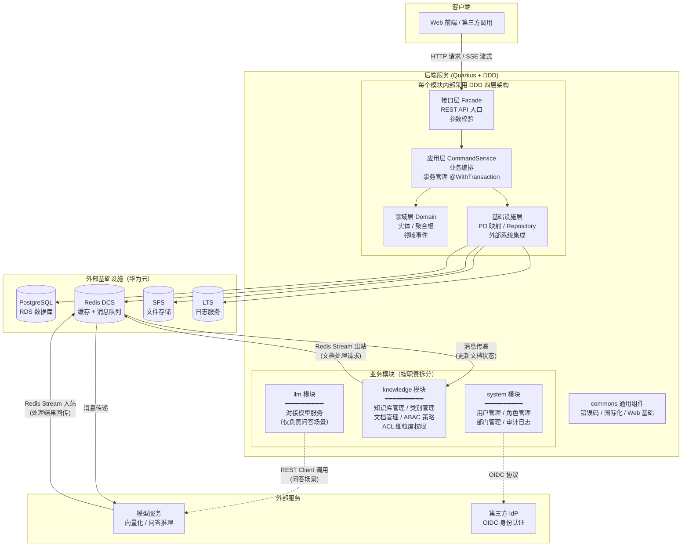

### 0.2 模块职责速查

| 模块 | 一句话职责 | 你关注什么 |
|------|-----------|-----------|
| **system** | 管理用户、角色、部门，处理登录认证与审计日志 | 谁可以用系统？有什么权限？做了什么操作？ |
| **knowledge** | 管理知识库、类别目录、文档生命周期，以及 ABAC/ACL 权限策略 | 知识库怎么建？文档怎么上传、审核？谁能看什么？ |
| **llm** | 对接模型服务，负责智能问答（SSE 流式返回） | 用户提问后怎么得到答案？ |
| **commons** | 提供错误码、国际化、Web 基础组件，被以上三个模块共同引用 | （不直接面向业务，是底层支撑） |

### 0.3 关键调用链路速览

| 场景 | 经过的模块/组件 | 说明 |
|------|---------------|------|
| **文档上传/知识库变更** | knowledge → Redis Stream → 模型服务(向量化/切片) → Redis Stream → knowledge(更新状态) | 知识库创建/删除、文档上传/审核通过/版本管理时，通过 Redis Stream 通知外部模型服务处理；模型服务完成向量化和切片后回传结果，knowledge 更新文档状态 |
| **用户登录** | system → PG → Redis → 返回 JWT | 校验账号密码，缓存令牌 |
| **权限判定** | knowledge → Redis(ACL缓存) → Redis(ABAC缓存) → 审计日志 | 三层判定：RBAC → ACL → ABAC |
| **模型问答** | llm → 模型服务 → SSE 流式返回 | 用户提问，llm 通过 REST Client 调用模型服务，结果实时推送 |
| **其它模型服务** | llm → 模型服务 → 非流式返回 | 问答以外的功能，切片查看等 |

### 0.4 后端模块间调用关系

> 下图聚焦**后端内部的模块间调用关系**，说明 system、knowledge、llm 三个业务模块之间如何协作，以及它们与外部模型服务的交互方式。

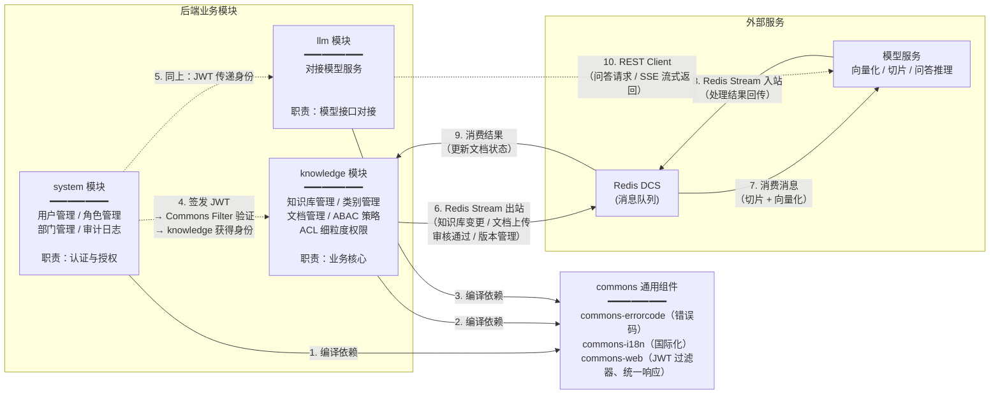

**调用关系说明**：

| 编号 | 关系 | 类型 | 说明 |
|------|------|------|------|
| 1-3 | 所有业务模块 → commons | 编译时强依赖 | system、knowledge、llm 均通过 Gradle 依赖 commons，共享错误码、国际化消息、JWT 过滤器 |
| 4-5 | system → knowledge / llm | 运行时间接协作 | system 签发 JWT；knowledge 和 llm 通过 commons-web 的 JWT Filter 验证 Token、提取用户身份。**不直接调用** |
| 6-9 | knowledge ↔ Redis Stream ↔ 模型服务 | 运行时异步双向 | **这是唯一的跨系统业务链路**。knowledge 在以下时机通过 Redis Stream 发送消息：创建/删除知识库、上传文档、审核通过、版本管理。外部模型服务消费后进行向量化和切片，完成后通过另一条 Redis Stream 回传结果，knowledge 消费结果并更新文档状态 |
| 10 | llm → 模型服务 | 运行时同步调用 | llm 仅负责通过 REST Client 调用模型服务。**llm 不参与文档处理链路** |

> **关键结论**：
> 1. 三个业务模块之间**没有直接的同步 RPC 调用**，通过共享 commons 组件（JWT Filter）传递身份
> 2. **文档处理链路**完全在 knowledge 模块和外部模型服务之间，通过 Redis Stream 双向异步通信，llm 模块不参与
> 4. 哪些操作触发 Redis Stream 消息：**创建知识库、删除知识库、上传文档、文档审核通过、版本管理**（一切影响问答效果的操作）。类别（子目录）的增删改不触发

---

## 1 功能域概述

后端模块向上提供接口给前端，向下调用模型服务或MCP服务。

### 1.1 接口描述

- **流式接口**：采用 SSE（Server-Sent Events）方式
- **非流式接口**：JSON 对象返回

**返回体结构：**

| 键 | 说明 | 示例值 |
|----|------|--------|
| code | 错误码，"0"：正常，其他：出错 | `"0"`, `"A0103"` |
| data | 返回数据，可为空 | `{ "pageNumber": 1, "pageSize": 20, "totalPage": 1, "totalRow": 1, "records": [] }` |
| message | 消息内容 | `"操作成功"`, `"登录失败，用户名与密码不匹配"` |

### 1.2 权限控制

除登录外，其余操作都需要登录后才能操作。

### 1.3 令牌超时

用户登录成功后会返回两个令牌：**访问令牌**和**刷新令牌**。为方便用户获取新的令牌对，提供刷新令牌对的接口。

| 令牌类型 | 时效 |
|---------|------|
| accessToken（访问令牌） | 1 小时 |
| refreshToken（刷新令牌） | 2 小时 |

### 1.4 国际化

需支持简体中文和英文（通过请求头 `Accept-Language` 切换）。知识库问答时不做语言切换，以模型输出为准。

---

## 2 功能域总体方案

### 2.1 技术选型

| 维度 | 选型 |
|------|------|
| 编程语言 | Java |
| 核心框架 | Quarkus |
| 设计方法 | DDD（领域驱动设计） |
| 文件存储 | 华为云弹性文件服务 SFS |
| 数据库 | 华为云 RDS for PostgreSQL |
| 日志存储 | 华为云日志服务 LTS |
| 缓存 | 分布式缓存服务 DCS（Redis） |

### 2.2 编码规范

- **包结构**：以 `com.hisilicon.knowledge.platform` 开头
- **配置文件**：采用 YAML 格式，密码等涉密信息采用加密形式配置
- **其他**：符合《阿里巴巴 Java 开发手册》规范

### 2.3 模块设计

| 模块 | 说明 |
|------|------|
| `commons` | 通用组件模块（commons-errorcode, commons-i18n, commons-web） |
| `system` | 系统模块：用户管理、角色管理、权限配置 |
| `knowledge` | 知识库模块：管理知识库相关操作 |
| `llm` | 模型模块：负责与模型服务交互（通过 REST Client） |
| `hisilicon-knowledge-platform-service` | 系统启动模块，引入其他业务模块，自身不处理业务逻辑 |

### 2.4 分层和包结构

| 层次 | 包路径 | 职责 |
|------|--------|------|
| **接口层** | `com.hisilicon.knowledge.platform.*.facade.*.class` | 提供对外 REST 接口 |
| **应用层** | `com.hisilicon.knowledge.platform.*.command.*CommandService.class` | 上接接口层，下调用领域层或基础设施层 |
| **领域层** | `com.hisilicon.knowledge.platform.*.domain.entity` | 领域实体、聚合根 |
| | `com.hisilicon.knowledge.platform.*.domain.event` | 领域事件 |
| | `com.hisilicon.knowledge.platform.*.domain.service` | 领域服务 |
| **基础设施层** | `com.hisilicon.knowledge.platform.*.infrastructure.repository.*` | 仓储层 |
| | `com.hisilicon.knowledge.platform.*.infrastructure.po.*` | 数据库表定义（PO） |
| **参数定义** | `com.hisilicon.knowledge.platform.*.command.*Command` | Command 参数对象 |
| **查询业务** | `com.hisilicon.knowledge.platform.*.query` | 查询业务（CQRS 查询侧） |

---

## 3 功能实现设计

### 3.1 功能编号：获取公钥

#### 3.1.1 功能概述

获取 RSA 公钥，用于前端加密敏感信息（如密码）。

#### 3.1.2 实现设计

返回系统公钥内容。

#### 3.1.3 用户接口设计

```
GET /publicKey
```

- **请求方式**：GET
- **参数**：无
- **返回值**：公钥内容（字符串）

---

### 3.2 功能编号：登录

#### 3.2.1 功能概述

支持用户名+密码登录，也可对接第三方 IdP 登录。关于第三方 IdP，先引入通用 OIDC 组件，待确认实际的 IdP 时再进行调试。

#### 3.2.2 实现设计

**参数校验**：
- 用户名和密码不能为空
- 用户名和密码能正常解密（RSA）

**处理逻辑**：

1. 根据用户名查询用户信息，若未查询到用户信息则提示"账号与密码不匹配"并返回
2. 使用 BCrypt 校验密码，未通过则提示"账号与密码不匹配"并返回
3. 创建令牌对（accessToken + refreshToken）
4. 删除旧令牌（使之前的令牌失效）
5. 缓存并返回令牌对

#### 3.2.2.1 登录时序图

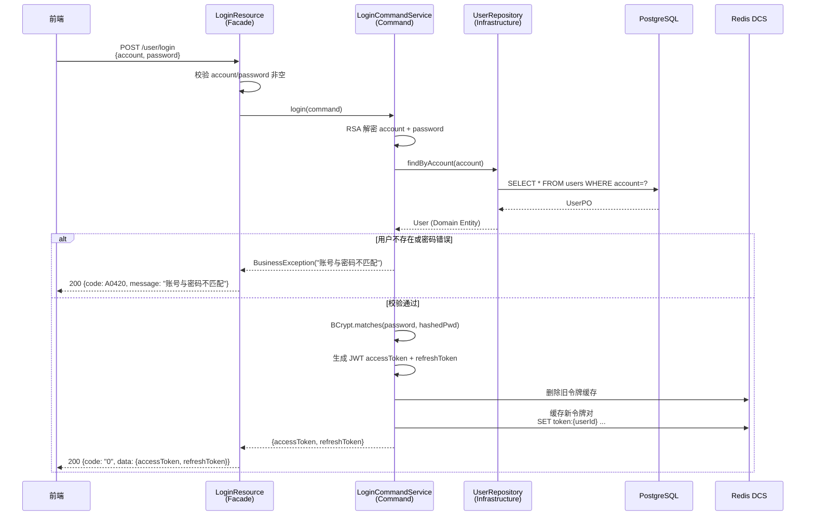

#### 3.2.3 用户接口设计

```
POST /user/login
```

**请求参数**：

| 参数名 | 必需 | 类型 | 说明 |
|--------|------|------|------|
| account | 是 | string | 账号，RSA 加密 |
| password | 是 | string | 密码，RSA 加密 |

**返回值**：

| 键 | 类型 | 说明 |
|----|------|------|
| accessToken | string | 访问令牌，时效 1 小时 |
| refreshToken | string | 刷新令牌，时效 2 小时 |

---

### 3.3 功能编号：刷新令牌对

#### 3.3.1 功能概述

获取新的令牌对。刷新令牌只能用一次。

#### 3.3.2 实现设计

**参数校验**：
- 访问令牌和刷新令牌不能为空

**处理逻辑**：

1. 检查 refreshToken 是否有效，若无效则提示消息并返回
2. 检查令牌对是否匹配，不匹配则提示消息并返回
3. 创建新令牌对
4. 删除旧令牌
5. 缓存并返回新令牌对

#### 3.3.3 用户接口设计

```
POST /user/refreshToken
```

**请求参数**：

| 参数名 | 必需 | 类型 | 说明 |
|--------|------|------|------|
| Authorization | 是 | string | 访问令牌，请求头，`Bearer {{token}}` |
| Refresh-Token | 是 | string | 刷新令牌，请求头，`{{refreshToken}}` |

**返回值**：

| 键 | 类型 | 说明 |
|----|------|------|
| accessToken | string | 访问令牌，时效 1 小时 |
| refreshToken | string | 刷新令牌，时效 2 小时 |

---

### 3.4 功能编号：用户管理

#### 3.4.1 功能概述

用户管理提供系统用户的创建、查询、编辑、删除、角色分配及 ABAC 属性管理功能。用户是权限系统的主体，通过关联角色获得 RBAC 权限，通过用户属性参与 ABAC 策略判定。用户支持本地创建和 OIDC 外部身份关联两种来源。

#### 3.4.2 SR 设计

| 需求编号 | 需求描述 |
|---------|---------|
| F-097 | **RBAC**：用户通过角色获得操作权限，支持多角色组合 |
| F-098 | **ABAC**：用户属性（部门、地域、雇佣类型、安全级别）参与 ABAC 策略条件判定 |
| F-099 | **细粒度**：用户可作为 ACL 条目的主体，被授予或拒绝特定资源的访问权限 |

#### 3.4.3 实现设计

1. **用户创建**：校验用户名唯一性 → 使用 BCrypt 加密初始密码 → 绑定角色 → 持久化用户记录
2. **用户查询**：支持按用户名、部门、状态分页查询。列表不返回密码字段
3. **用户编辑**：修改基本信息和 ABAC 属性（部门、地域、雇佣类型、安全级别）。来源为 OIDC 的用户，其关键身份字段（用户名、邮箱）标记为只读，仅允许修改 ABAC 属性
4. **用户删除**：采用软删除（`status=0`），不物理删除记录以保留审计追溯。删除前检查是否存在关联资源（创建的文档、知识库），提示管理员确认
5. **角色分配**：调用 `addUserRoles` / `removeUserRoles` 接口，维护 `user_roles` 关联表。变更后触发缓存失效事件
6. **外部身份关联**：OIDC 登录时自动创建 `external_identities` 记录，`source` 字段标记为 `"oidc"`。支持同一用户关联多个外部身份（多 IdP 登录同一账号）

#### 3.4.3.1 创建用户时序图

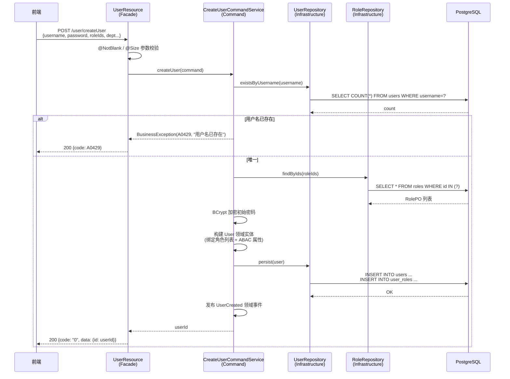

#### 3.4.4 用户接口设计

| 方法 | 路径 | 说明 |
|------|------|------|
| GET | `/user/pageUsers` | 分页查询用户列表（支持按用户名、部门、状态筛选） |
| GET | `/user/users/{id}` | 查询用户详情（含角色列表和 ABAC 属性） |
| POST | `/user/createUser` | 创建用户 |
| POST | `/user/editUser` | 编辑用户信息和 ABAC 属性 |
| DELETE | `/user/deleteUser/{id}` | 软删除用户 |
| POST | `/user/bindRole` | 为用户分配角色 |
| DELETE | `/user/unbindRole` | 移除用户角色 |

---

### 3.5 功能编号：角色管理

#### 3.5.1 功能概述

角色管理维护系统的 RBAC 角色体系。预设角色（系统管理员、知识库管理员、审核员、编辑者、开发者）在系统初始化时创建且不可删除。管理员可基于预设角色创建自定义角色，从权限码池中勾选权限组合。

#### 3.5.2 SR 设计

| 需求编号 | 需求描述 |
|---------|---------|
| F-097 | **RBAC**：角色的核心载体，角色→权限码的映射构成 RBAC 的基础 |

#### 3.5.3 实现设计

1. **角色创建**：校验角色 key 唯一性 → 校验所选权限码均在允许范围内 → 持久化角色记录及 `role_permissions` 关联
2. **权限码约束**：自定义角色不可授予 `sys:role` 和 `sys:user` 权限（防止权限扩散）。此约束在后端硬编码校验
3. **角色编辑**：更新角色名称、描述及权限码集合。采用先删后增策略维护 `role_permissions` 表。变更后发送 `RolePermissionsChanged` 领域事件，触发缓存刷新
4. **角色删除**：预设角色（`is_preset=1`）不可删除。删除自定义角色前检查是否有用户仅依赖此角色，给出警告并强制解绑
5. **角色复制**：基于现有角色创建副本，继承其权限码集合，管理员可进一步调整
6. **权限码定义**以枚举类 `PermissionCode` 管理，系统启动时加载全部码值，角色配置页面从该枚举动态渲染可选项

#### 3.5.3.1 创建角色时序图

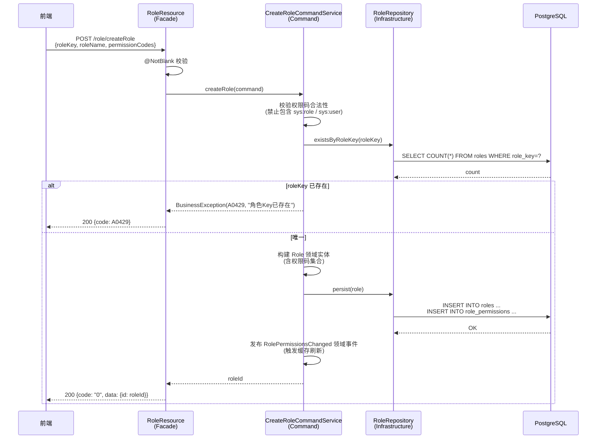

#### 3.5.4 用户接口设计

| 方法 | 路径 | 说明 |
|------|------|------|
| GET | `/role/pageRoles` | 角色列表 |
| GET | `/role/roles/{id}` | 角色详情（含权限码列表） |
| POST | `/role/createRole` | 创建自定义角色 |
| POST | `/role/editRole` | 编辑角色 |
| DELETE | `/role/deleteRole/{id}` | 删除角色（仅自定义角色） |
| POST | `/role/copyRole` | 复制角色 |
| GET | `/role/permissions` | 获取全部可用权限码列表 |

---

### 3.6 功能编号：部门管理

#### 3.6.1 功能概述

部门管理维护组织架构信息。部门是 ABAC 策略中的重要属性维度，用于实现跨部门隔离和部门级资源共享。部门支持树形层级结构。

#### 3.6.2 实现设计

1. **部门树**：以 `parent_id` 字段实现树形结构，提供递归查询接口返回完整部门树
2. **部门创建**：校验同级名称唯一性 → 持久化记录
3. **部门编辑**：修改名称、父部门（支持移动部门到其他父节点，需校验不会形成循环引用）
4. **部门删除**：检查是否存在子部门及关联用户，级联处理或提示警告

#### 3.6.2.1 创建部门时序图

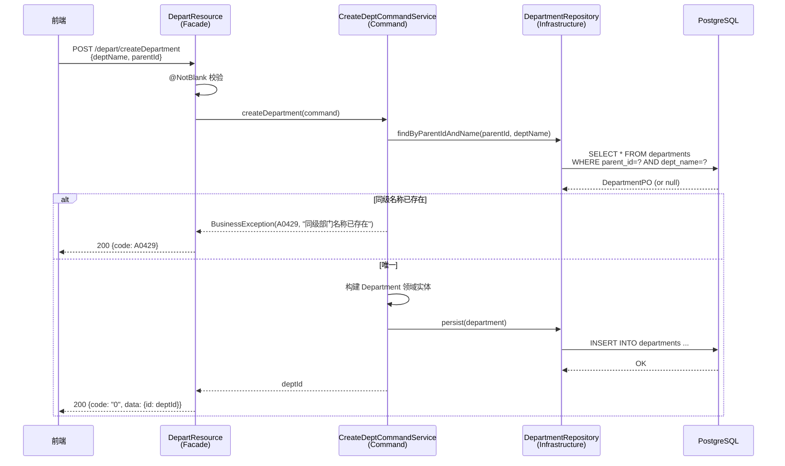

#### 3.6.3 用户接口设计

| 方法 | 路径 | 说明 |
|------|------|------|
| GET | `/depart/departments` | 部门树 |
| POST | `/depart/createDepartment` | 创建部门 |
| POST | `/depart/editDepartment` | 编辑部门 |
| DELETE | `/depart/deleteDepartment/{id}` | 删除部门 |

---

### 3.7 功能编号：审计日志

#### 3.7.1 功能概述

审计日志记录系统中所有敏感操作，包括：用户登录/登出、权限变更（角色分配/移除）、知识库操作（创建/删除）、文档操作（上传/编辑/删除/审核）、策略变更（创建/编辑/删除）、ACL 变更。

审计日志**不可删除、不可修改**，用于安全审计和合规追溯。

#### 3.7.2 实现设计

1. **日志记录**采用 AOP 切面实现：在 Facade 层或 CommandService 层通过注解标记需记录的操作，切面统一拦截并写入华为云 LTS
2. **日志字段**：操作人 ID、操作时间、操作类型（枚举）、目标资源类型、目标资源 ID、操作详情（JSON，含请求参数摘要和判定结果）、客户端 IP
3. **日志查询**：支持按操作人、操作类型、资源类型、时间范围组合筛选，按时间倒序排列（具体需对接华为云 LTS 查询 API）

#### 3.7.3 用户接口设计

| 方法 | 路径 | 说明 |
|------|------|------|
| GET | `/log/audit-logs` | 分页查询审计日志（支持多条件筛选） |
| GET | `/log/audit-logs/{id}` | 查询审计日志详情 |

---

### 3.8 功能编号：知识库管理

#### 3.8.1 功能概述

知识库管理提供知识库的创建、查询、编辑、删除功能，以及知识库下类别（子目录）的树形管理。知识库是权限隔离的顶层容器——每个知识库独立绑定 ABAC 策略和 ACL 条目。

#### 3.8.2 SR 设计

| 需求编号 | 需求描述 |
|---------|---------|
| F-097 | **RBAC**：仅知识库管理员可执行创建/编辑/删除操作；开发者可查询有权限的知识库 |
| F-098 | **ABAC**：每个知识库可独立绑定 ABAC 策略，策略在知识库范围内生效 |
| F-099 | **细粒度**：知识库本身可作为 ACL 的目标资源，支持对知识库级别设置权限 |

#### 3.8.3 实现设计

1. **知识库创建**：校验名称唯一性 → 设置创建者 → 生成默认根类别 → 持久化。创建者自动获得该知识库的管理权限
2. **知识库查询**：返回用户有 `kb:list` 权限的知识库列表。列表不返回已软删除的知识库。开启 ABAC 时，还需经过知识库级别的 ABAC 策略过滤（例如仅返回用户所属部门的知识库）
3. **知识库编辑**：修改名称、描述、所属组织（影响 ABAC `res.org` 属性）、默认敏感等级。修改所属组织将影响该知识库下所有文档的 ABAC 判定
4. **知识库删除**：软删除，标记 `status=0`。删除前校验该知识库下是否存在未删除的文档，提示管理员确认级联处理

#### 3.8.4 类别管理

1. **类别树**：类别以 `parent_id` 字段组织为树形结构，每个类别属于一个知识库。提供递归查询接口返回完整类别树，供前端渲染树形选择器
2. **类别创建**：校验同级名称唯一性（同一父类别下不可重名）→ 持久化
3. **类别编辑**：修改名称、父类别（移动操作需校验不会形成循环引用）
4. **类别删除**：检查是否包含子类别或文档，级联软删除或提示警告

#### 3.8.4.1 创建知识库时序图

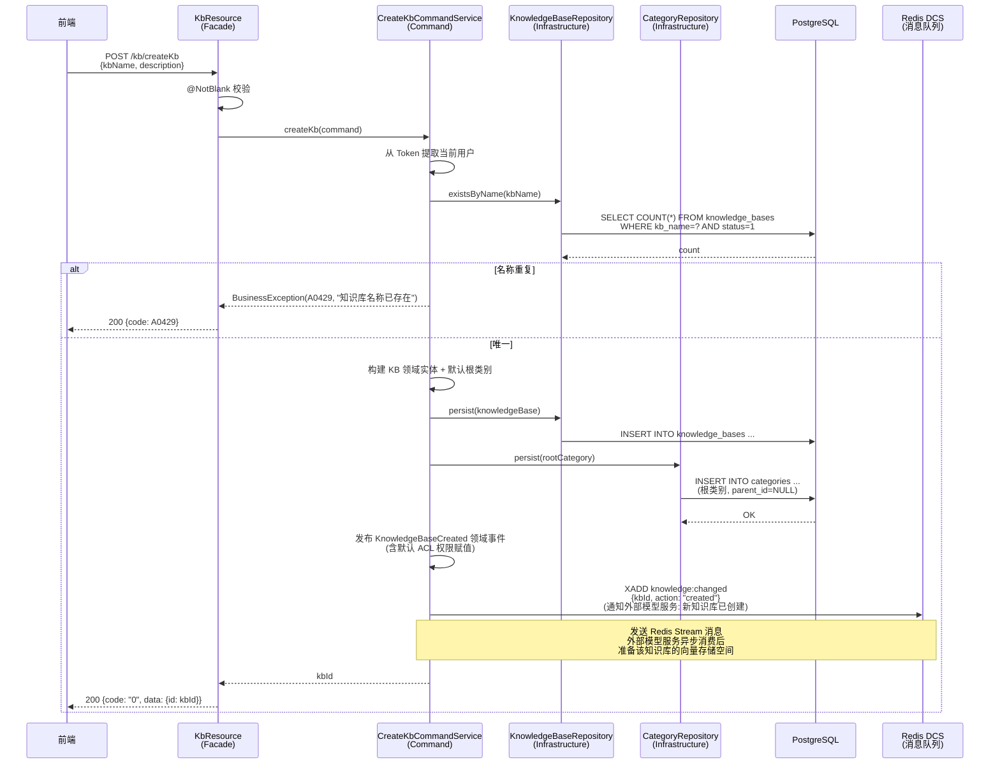

#### 3.8.5 用户接口设计

| 方法 | 路径 | 说明 |
|------|------|------|
| GET | `/kb/list` | 知识库列表（含权限过滤） |
| GET | `/kb/{kbId}` | 知识库详情 |
| POST | `/kb/createKb` | 创建知识库 |
| POST | `/kb/editKb` | 编辑知识库 |
| DELETE | `/kb/delete/{kbId}` | 删除知识库 |
| GET | `/kb/{kbId}/categories` | 获取知识库类别树 |
| POST | `/kb/{kbId}/createCategory` | 创建类别 |
| POST | `/kb/editCategory` | 编辑类别 |
| DELETE | `/kb/deleteCategory/{id}` | 删除类别 |

---

### 3.9 功能编号：文档管理

#### 3.9.1 功能概述

文档管理提供知识库下文档的全生命周期管理：上传、版本覆盖、查询、编辑、删除、审核、模型处理跟踪。文档是权限控制的最小粒度资源，每条文档可独立设置 ACL。文档携带 ABAC 资源属性（文档类型、敏感等级、数据地域、合规标签），参与 ABAC 策略判定。

文档的可用性由**两个正交的状态维度**共同决定：

- **生命周期状态（status）**：由人工操作驱动（编辑者上传/提交审核、审核员批准/驳回、管理员归档/废弃），描述文档的审核流转过程
- **模型处理状态（processStatus）**：由模型服务异步回调驱动，描述文档的切片与向量化进度

> **核心规则：文档真正可检索 = `status = PUBLISHED` 且 `processStatus = COMPLETED`。**
> 审核通过只是人为放行，只有模型服务完成切片+向量化，文档才真正进入知识库问答范围。

#### 3.9.2 SR 设计

| 需求编号 | 需求描述 |
|---------|---------|
| F-097 | **RBAC**：编辑者可上传/编辑文档；审核员可审核文档；开发者可查询/查看文档 |
| F-098 | **ABAC**：文档的 `doc_type`、`sensitivity`、`data_region`、`compliance` 属性参与策略条件判定 |
| F-099 | **细粒度**：每条文档可独立设置 ACL，控制读/写/删/审/管权限 |

#### 3.9.3 实现设计 —— 双重状态模型（核心设计）

##### 3.9.3.1 双重状态职责划分

| 状态维度 | 字段 | 驱动方 | 取值 | 语义 |
|---------|------|--------|------|------|
| 生命周期状态 | `status` | 人工操作 | `DRAFT` / `REVIEWING` / `PUBLISHED` / `ARCHIVED` / `DEPRECATED` | 文档审核流转 |
| 模型处理状态 | `processStatus` | 模型服务回调 | `PENDING` / `PROCESSING` / `COMPLETED` / `FAILED` | 切片+向量化进度 |

**为什么拆成两个状态而不是合并：**

1. **驱动方不同**：生命周期由人驱动（确定性、可审计），模型处理由外部服务驱动（异步、可能失败、可重试），两者是不同的主体、不同的节奏
2. **组合爆炸**：合并后 "已发布但没处理完" 的中间值无法表达；`PUBLISHED + FAILED` 也无法表达"内容已放行但向量化失败、需要重试"这一常见场景
3. **职责解耦**：模型服务重启/重试不影响审核流程；审核驳回也不影响已完成的向量化内容（可复用，无需重新处理）

##### 3.9.3.2 生命周期状态流转

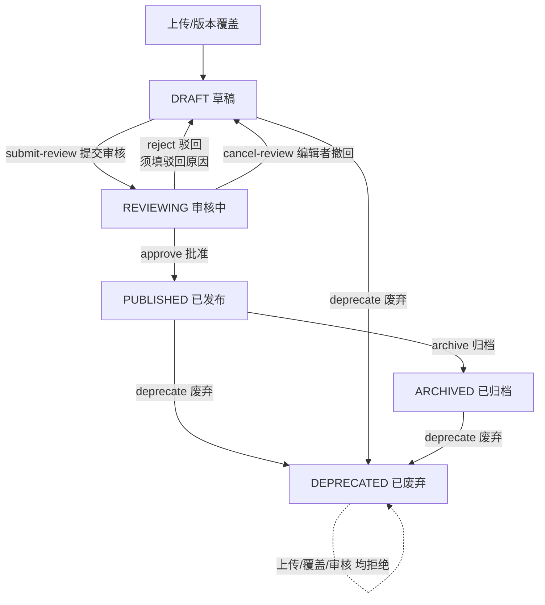

**状态变更操作一览：**

| 操作 | 触发方 | 前置状态 | 目标状态 | 权限 | 说明 |
|------|--------|---------|---------|------|------|
| 首次上传 | 编辑者 | — | `DRAFT` | kb:doc:upload | 初始状态，同时 processStatus → PENDING |
| 版本覆盖上传 | 编辑者 | `DRAFT` / `PUBLISHED` | `DRAFT` | kb:doc:edit | `REVIEWING` 禁止（见 3.9.3.5）；`PUBLISHED` 覆盖后旧版保持可检索 |
| submit-review | 编辑者 | `DRAFT` | `REVIEWING` | kb:doc:edit | 提交审核 |
| cancel-review | 编辑者 | `REVIEWING` | `DRAFT` | kb:doc:edit | **编辑者自己撤回**（无驳回原因），撤回后即可修改/覆盖 |
| approve | 审核员 | `REVIEWING` | `PUBLISHED` | kb:doc:review | 审核通过，记录审核人/审核时间 |
| reject | 审核员 | `REVIEWING` | `DRAFT` | kb:doc:review | 驳回，**必须填写驳回原因**（写入 review_comment） |
| archive | 管理员 | `PUBLISHED` | `ARCHIVED` | kb:doc:delete | 归档，停止对外提供 |
| deprecate | 管理员 | 任意非 `DEPRECATED` | `DEPRECATED` | kb:doc:delete | 废弃（软删除，保留审计记录） |

> **撤回（cancel-review）与驳回（reject）的区别**：撤回是编辑者主动撤销自己的提交，不需要原因；驳回是审核员否定内容，必须附原因。两者目标状态都是 `DRAFT`。

##### 3.9.3.3 模型处理状态流转

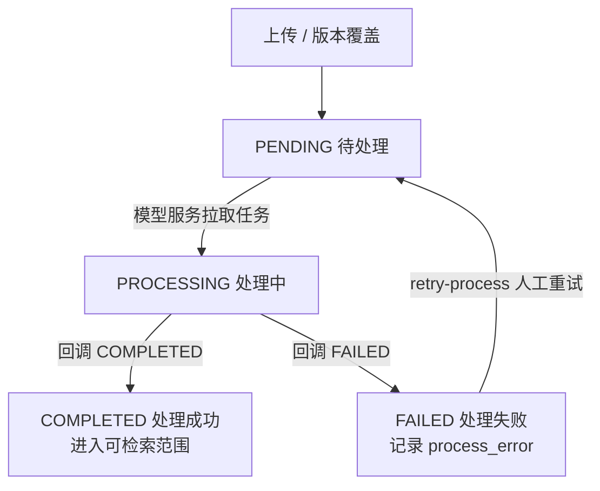

**规则：**

1. **上传 / 版本覆盖**时 processStatus 重置为 `PENDING`——新文件需要模型服务重新切片、向量化
2. 模型服务处理完成后通过**内部回调接口**上报结果（`COMPLETED` / `FAILED`），**只修改 processStatus，不动 status**
3. `FAILED` 记录失败原因到 `process_error` 字段；人工可触发 `retry-process` 重新进入处理队列
4. 生命周期状态变更（submit-review / approve / reject / archive / deprecate）**不修改** processStatus

##### 3.9.3.4 双状态组合矩阵

| status ＼ processStatus | PENDING | PROCESSING | COMPLETED | FAILED |
|------------------------|---------|------------|-----------|--------|
| **DRAFT** | 刚上传/刚覆盖版本 | — | — | — |
| **REVIEWING** | 审核中，模型未开始 | 审核中+处理中 | 审核中+已处理完（等批准） | 审核中+处理失败 |
| **PUBLISHED** | 已发布未处理（**暂不可检索**） | 处理中（**暂不可检索**） | ✅ **可检索** | 已发布处理失败（**不可检索，可重试**） |
| **ARCHIVED** | — | — | — | — |
| **DEPRECATED** | — | — | — | — |

**检索 / 列表过滤条件：**

```sql
WHERE (
    (status = 'PUBLISHED' AND process_status = 'COMPLETED')
    OR has_published_version = TRUE
)
AND kb_id = :kbId
```

> `has_published_version = TRUE` 表示该文档存在已发布的历史版本（见 3.9.3.5），即使当前工作版本处于 DRAFT 修订中，历史已发布内容仍可检索，保证服务不中断。

##### 3.9.3.5 版本管理与覆盖

文档版本管理有两种模式：**隐式覆盖**（DRAFT 阶段通过上传接口自动匹配同名文件覆盖）和**显式版本覆盖**（已发布文档通过专用接口上传新版）。

###### 3.9.3.5.1 隐式覆盖：上传时的同名匹配规则

`POST /kb/{kbId}/uploadDocument` 上传文件时，按 `kbId + categoryId + 文件名（去扩展名=title）` 查找已存在文档：

| 匹配到文档的 status | 行为 |
|-------------------|------|
| `DRAFT` | ✅ **自动覆盖**：替换文件内容，复用该 documentId，不改版本号，processStatus → PENDING |
| `REVIEWING` | ❌ **拒绝**："同名文档正在审核中，请先撤回审核后再上传" |
| `PUBLISHED` | ❌ **拒绝**："同名文档已发布，请使用版本覆盖接口（`POST /kb/{kbId}/documents/{docId}/versions`）" |
| `ARCHIVED` / `DEPRECATED` | ❌ **拒绝**："文档已归档/废弃，不可覆盖" |
| 未匹配到 | ✅ **新建文档**（DRAFT） |

> DRAFT 覆盖不产生版本记录——草稿阶段的反复迭代不需要追溯历史，`currentVersion` 维持 1 直到首次 approve。

###### 3.9.3.5.2 显式版本覆盖：`POST /kb/{kbId}/documents/{docId}/versions`

**仅允许 PUBLISHED 状态的文档**。编辑器上传新版本文件，形成新的版本链。

| 行为 | 说明 |
|------|------|
| 前置条件 | 文档 status = `PUBLISHED` |
| 旧版本处理 | 当前文件信息归档 `document_versions`，标记 `was_published=TRUE`（**旧版保持可检索**） |
| 新版本 | `currentVersion` +1，status → `DRAFT`（需重新审核），`has_published_version=TRUE` |
| 文件名 | ✅ 允许变化（如 `需求v1.xlsx` → `需求v2.xlsx`），title 同步更新 |
| 文件类型 | 不做强校验（让模型服务根据 MIME type 自行处理） |

**已发布文档修订流程（服务不中断）：**

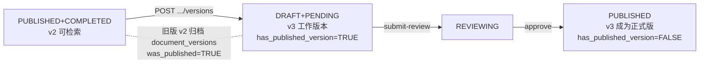

###### 3.9.3.5.3 文档编辑（改名）

`POST /kb/documents/edit` — body: `{documentId, title}`，仅修改 title，不涉及文件内容。

| 字段 | 校验 | 说明 |
|------|------|------|
| `documentId` | @NotBlank | 文档 ID |
| `title` | @NotBlank, @SizeWithName(min=1, max=200) | 新标题 |

**状态约束：**

| 当前 status | 是否允许改名 | 理由 |
|------------|------------|------|
| `DRAFT` | ✅ | 编辑中，随意改 |
| `REVIEWING` | ❌ | 审核中不允许（先撤回再改） |
| `PUBLISHED` | ✅ | 改名是轻量操作，不触发重新审核 |
| `ARCHIVED` / `DEPRECATED` | ❌ | 终态不可修改 |

###### 3.9.3.5.4 元数据编辑

`POST /kb/metadata/set` — 统一元数据编辑接口（entityType = KB / CATEGORY / DOCUMENT），key-value 全量替换。与改名分开，职责清晰。

| 字段 | 说明 |
|------|------|
| `entityType` | 实体类型：`KB` / `CATEGORY` / `DOCUMENT`（必填） |
| `entityId` | 实体 ID（知识库 ID / 类别 ID / 文档 ID，必填） |
| `metadata` | `Map<String, String>`，如 `{"chipModel":"CV620","sensitivity":"内部"}`（必填；空 Map `{}` = 清空全部） |

**全量替换语义**：传入的 Map 完全覆盖该实体的 metadata 记录（先删后插）。不传的 key 被清除。

**校验规则（防直接调用攻击）**：key 为字母开头的字母/数字/下划线且长度 ≤ 50（对齐 `meta_key varchar(50)`）；value trim 后长度 1~200（对齐 `meta_value varchar(200)`）且不含控制字符；条目数 ≤ 50（Bean Validation，超限 400）。校验失败统一 A0420（200 + 业务码）。

**状态约束**：KB/CATEGORY 仅活跃（status=1）可编辑，软删除视同不存在（A0430）；DOCUMENT 同改名（DRAFT/PUBLISHED 允许，REVIEWING 不许，终态不许，A0508）。编辑元数据**不发布任何消息事件**（不影响模型处理）。

**字典 key 白名单校验（方案 A，已实现）**：每个 key 必须存在于某个生效字典类型（`kb_dict_types.status=1`）的 `controlled_meta_keys` 并集中（逗号分隔 + trim + 去重）。白名单经 **commons-dict 模块**的 `DictMetaKeyCacheService` 获取（**Redis cache-aside**：key `dict:active-meta-keys`，TTL 24 小时；miss 回源 DB 并自动写入；缓存损坏按空集 fail-closed）。校验顺序：同步格式校验（key 正则/value 长度，失败短路不查字典）→ 字典白名单校验 → 实体存在性/状态校验 → replaceAll。key 不在白名单 → A0420 + `metadataKeyNotInDict`。**校验失败时任何写操作都不发生**（包括 replaceAll）。system 模块字典管理端（后续实现）在类型变更时调用 `DictMetaKeyCacheService.evictCache()` 删除缓存 key。

##### 3.9.3.6 文档上传时序图

> 上传仅将文件存入 SFS 并创建 DRAFT 状态的文档记录，**不通知模型服务**。模型处理在文档审核通过（approve）时才触发（见 3.9.3.7 审核时序图 + 3.9.3.8 消息通知设计）。

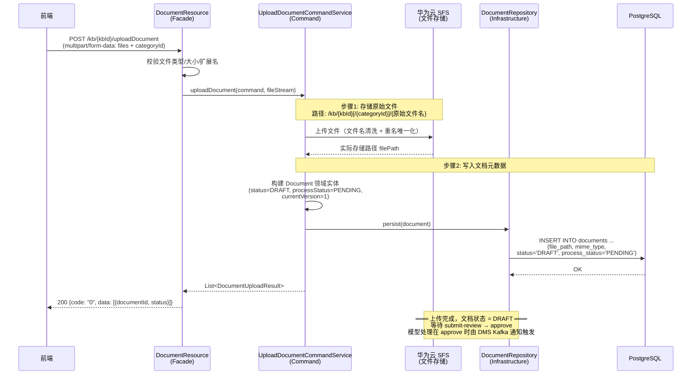

##### 3.9.3.7 文档审核/撤回时序图

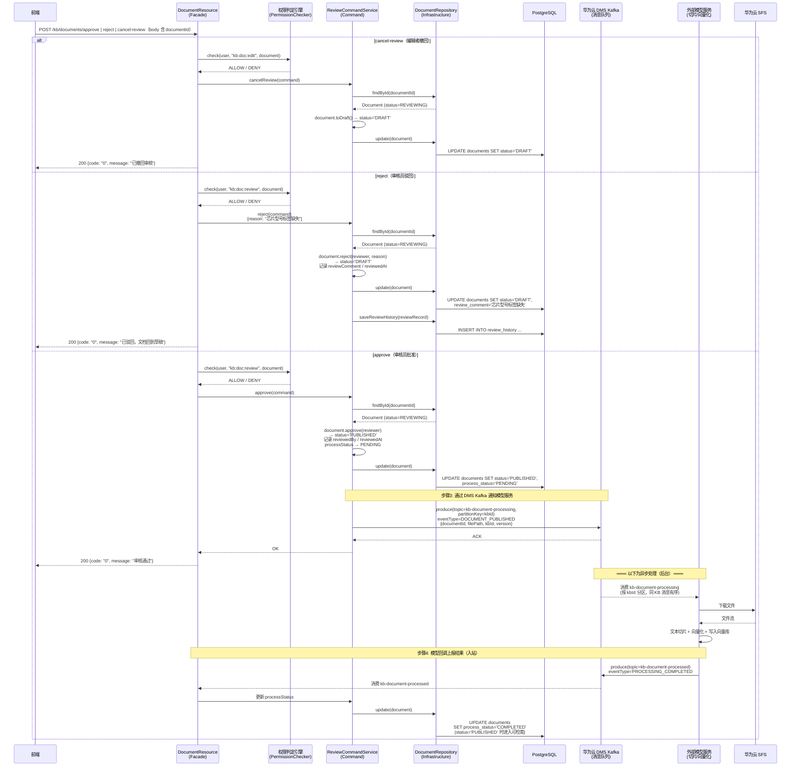

> **审核通过后才通知模型**（不是上传时通知），避免了模型处理草稿的浪费。processStatus 在 approve 时重置为 PENDING（确保新内容被模型重新处理）。

##### 3.9.3.8 消息通知设计（DMS Kafka）

###### 通知时机

> **核心原则：只有审核通过后才通知模型服务处理文档。** 上传仅创建 DRAFT，不触发任何模型处理。这避免了模型处理草稿/未通过审核内容的算力浪费。

| 生命周期动作 | 是否通知 | EventType | Topic | 说明 |
|------------|---------|-----------|-------|------|
| 首次上传 | ❌ | — | — | DRAFT，不处理 |
| 版本覆盖上传 | ❌ | — | — | DRAFT，不处理 |
| **approve（审核通过）** | ✅ | `DOCUMENT_PUBLISHED` | `kb-document-processing` | 切片+向量化 |
| **deprecate（废弃）** | ✅ | `DOCUMENT_DELETED` | `kb-document-processing` | 删除向量库所有切片 |
| **archive（归档）** | ✅ | `DOCUMENT_ARCHIVED` | `kb-document-processing` | 从活跃索引移除（保留向量） |
| **retry-process（重试）** | ✅ | `DOCUMENT_RETRY_PROCESS` | `kb-document-processing` | 重新切片+向量化 |
| submit-review / cancel-review / reject | ❌ | — | — | 纯状态流转 |

> 知识库级别事件（`KB_CREATED` / `KB_UPDATED` / `KB_DELETED`）保持原有通知逻辑不变，通过 DMS Kafka 替换 Redis Stream 投递。

###### DMS Kafka 架构

```
出站 Topic: kb-document-processing (Backend → Model)
  分区数: 16
  分区键: kbId (hash(kbId) % 16)
  保证: 同一 KB 的所有消息进入同一分区 → 分区内 FIFO 保序
        KB_CREATED 严格先于该 KB 下所有 DOCUMENT_PUBLISHED
        不同 KB → 不同分区 → 多 Pod 并行消费

入站 Topic: kb-document-processed (Model → Backend)
  分区数: 8
  分区键: documentId (无顺序依赖，各文档回调独立)
  消费者: DmsProcessCallbackConsumer → 更新 processStatus
```

消费者组并行模型（同一 KB 消息有序，不同 KB 并行）：

```
消费者组: model-service (M 个 Pod, M ≤ 分区数)
  ┌────────────────────────────────────────────────────┐
  │             kb-document-processing (16 分区)        │
  │  ┌──────┐ ┌──────┐ ┌──────┐        ┌──────┐       │
  │  │ P0   │ │ P1   │ │ P2   │  ...   │ P15  │       │
  │  │KB_A  │ │KB_B  │ │KB_C  │        │KB_Z  │       │
  │  └──┬───┘ └──┬───┘ └──┬───┘        └──┬───┘       │
  └──────┼────────┼────────┼──────────────┼───────────┘
         │        │        │              │
         ▼        ▼        ▼              ▼
      Pod 1    Pod 2    Pod 3    ...   Pod M
     (KB_A)   (KB_B)   (KB_C)        (KB_Z)
```

**关键保证**：
- 同一 KB 的消息**严格顺序消费**（分区 FIFO）
- 不同 KB 的消息**并行消费**（不同分区 → 不同 Pod）
- 分区数固定（16），不随 KB 数量变化——KB 通过哈希映射到分区，无限 KB 可承载
- 单个 KB 内文档按**版本号顺序**消费（v1 → v2 → v3）

###### 消息格式（JSON 信封）

**通用信封：**

```json
{
  "messageId": "a1b2c3d4-e5f6-7890-abcd-ef1234567890",
  "eventType": "DOCUMENT_PUBLISHED",
  "kbId": "ef6eeb8e-ab19-4c46-a2a1-4b017ec580a8",
  "documentId": "d8611acb-af2b-4537-b8e7-a81c910689ba",
  "timestamp": "2026-08-05T10:30:00.000Z",
  "payload": { ... }
}
```

**出站消息 Payload：**

① `DOCUMENT_PUBLISHED`

```json
"payload": {
  "title": "需求文档v3",
  "filePath": "kb/ef6eeb8e/cat-001/需求文档v3.xlsx",
  "fileSize": 2150000,
  "mimeType": "application/vnd.openxmlformats-officedocument.spreadsheetml.sheet",
  "version": 3,
  "categoryId": "cat-001",
  "isVersionUpdate": true,
  "previousVersion": 2
}
```

| 字段 | 说明 |
|------|------|
| `filePath` | SFS 相对路径（从挂载根目录起），模型用此路径直接读文件 |
| `fileSize` | 文件大小，模型据此预估处理时间 |
| `mimeType` | 文件类型，模型据此选择解析器 |
| `version` | 当前版本号（首次=1，覆盖后递增） |
| `isVersionUpdate` | `true` = 版本覆盖后的重新发布（旧版被替代）；`false` = 首次发布 |
| `previousVersion` | 被覆盖的上一版版本号（`isVersionUpdate=true` 时有值；首次发布=null），模型用于清理旧版向量 |

② `DOCUMENT_DELETED`

```json
"payload": { "reason": "DEPRECATED" }
```

③ `DOCUMENT_ARCHIVED`

```json
"payload": { "reason": "ARCHIVED" }
```

④ `DOCUMENT_RETRY_PROCESS`

```json
"payload": {
  "filePath": "kb/ef6eeb8e/cat-001/需求文档v2.xlsx",
  "version": 1,
  "previousError": "文件下载超时"
}
```

**入站消息 Payload（Model → Backend）：**

⑤ `PROCESSING_COMPLETED`

```json
"payload": {
  "processedAt": "2026-08-05T10:35:00.000Z",
  "chunkCount": 45
}
```

⑥ `PROCESSING_FAILED`

```json
"payload": {
  "failedAt": "2026-08-05T10:32:00.000Z",
  "errorCode": "DOWNLOAD_TIMEOUT",
  "error": "文件下载超时（超过30秒）"
}
```

###### 与现有代码的映射

| 组件 | 改动 |
|------|------|
| `KnowledgeEvent.EventType` | 移除 `DOCUMENT_UPLOADED`、`DOCUMENT_UPDATED`；新增 `DOCUMENT_PUBLISHED`、`DOCUMENT_RETRY_PROCESS`、`DOCUMENT_ARCHIVED`；保留 `DOCUMENT_DELETED` |
| `KnowledgeEvent` | 新增可选 `payload: Map<String,Object>` 字段 + `withPayload()` 工厂（`of()` 保持向后兼容，payload=null 时信封序列化为 `{}`） |
| `DocumentCommandService.uploadSingle()` | **去掉** `streamPublisher.publish()` 调用（上传时不再发消息） |
| `approve`（已实现） | 发布 `DOCUMENT_PUBLISHED`，payload 取 **approve 前**实体：`{title, filePath, fileSize, mimeType, version, categoryId?, isVersionUpdate, previousVersion?}`（approve 会把 publishedVersion 覆盖为 currentVersion、hasPublishedVersion 置 false，必须用前置实体才能拿到"上一版"信息） |
| `deprecate`（已实现） | 发布 `DOCUMENT_DELETED`，payload 空 `{}` |
| `archive`（已实现） | 发布 `DOCUMENT_ARCHIVED`，payload 空 `{}` |
| `retry-process`（已实现） | 发布 `DOCUMENT_RETRY_PROCESS`，payload `{filePath, version, previousError?}` |
| `KB_CREATED/UPDATED/DELETED` | 由 DMS Kafka 替换 Redis Stream 投递；KB_CREATED/KB_UPDATED payload `{kbName, description?}`（editKb 与 node 重命名两处发布点都带） |
| `StreamPublisher` 接口 | 保持不变 |
| `DmsStreamPublisher`（已实现） | `@IfBuildProperty(kb.messaging.kafka.enabled=true)` 门控；`MutinyEmitter<String>` + `@Channel("kb-document-processing-out")`，`OutgoingKafkaRecordMetadata.withKey(kbId)` 设分区键；JSON 信封 `{messageId, eventType, kbId, documentId, timestamp, payload}`；**发送失败向上传播**（outbox relay 收到失败 markRetry 保序重发；直接发布失败随事务回滚） |
| `NoopStreamPublisher` | 占位实现（publish 丢弃消息），`@UnlessBuildProperty(kb.messaging.kafka.enabled=true, enableIfMissing=true)`——未配置开关时生效 |
| `DmsProcessCallbackConsumer`（已实现） | `@IfBuildProperty(kb.messaging.kafka.enabled=true)` 门控 + `@Incoming("kb-document-processed-in")` 接线；成功 ACK / 失败 nack（默认 failure-strategy=fail，生产接华为云平台级 DLQ） |
| 配置 | `application.yml`：`kb.messaging.kafka.enabled`（开关，默认 false）；`mp.messaging.outgoing.kb-document-processing-out` + `mp.messaging.incoming.kb-document-processed-in`（`bootstrap.servers=${KAFKA_BOOTSTRAP_SERVERS:localhost:9092}`，华为云 SASL_SSL 认证注释预留）；`quarkus.kafka.devservices.enabled=false`（**mp.messaging 通道级 bootstrap.servers 不参与 devservices 判定，必须显式关**） |

> `StreamConsumer`（Redis Stream 消费接口）已删除：DMS 入站由 `DmsProcessCallbackConsumer` 直接消费 JSON 信封，不再经过 KnowledgeEvent 流。

###### SFS 路径约定

消息中 `filePath` 为 **SFS 挂载目录下的相对路径**，后端写文件和模型读文件均以此为基准拼接各自的 mount point：

```
消息:   "kb/ef6eeb8e/cat-001/需求文档v3.xlsx"
后端:   {sfs-mount}/kb/ef6eeb8e/cat-001/需求文档v3.xlsx
模型:   {sfs-mount}/kb/ef6eeb8e/cat-001/需求文档v3.xlsx
```


##### 3.9.3.9 文档删除（物理删除）与一致性设计

###### 软删除 vs 物理删除职责划分

| 操作 | 机制 | 数据保留 | 文件保留 | 通知模型 | 用途 |
|------|------|---------|---------|---------|------|
| deprecate（废弃） | 状态流转 → `DEPRECATED` | 保留（审计/可恢复） | 保留 | `DOCUMENT_DELETED`（清向量） | 下线内容但留痕 |
| **delete（物理删除）** | 删除 DB 记录 + SFS 文件 | 不保留 | 不保留 | `DOCUMENT_DELETED`（清向量） | 彻底清理，省存储成本 |

> 物理删除与废弃互不替代：废弃是生命周期的一环（保留审计记录），物理删除是资源清理（删除即无法恢复）。

###### 删除规则（状态矩阵）

| status | 是否可物理删除 | 通知模型 |
|--------|--------------|---------|
| DRAFT | ✅ | ❌（从未进入模型） |
| REVIEWING | ❌（须先 cancel-review 撤回） | — |
| PUBLISHED | ✅ | ✅ `DOCUMENT_DELETED` |
| ARCHIVED | ✅ | ✅ `DOCUMENT_DELETED` |
| DEPRECATED | ✅ | ✅ `DOCUMENT_DELETED` |

- `processStatus` 不参与删除判断（DRAFT+FAILED 等组合直接删）。
- 级联删除：`document_versions` + `document_metadata` 随文档一并删除。
- REVIEWING 拒绝原因：删除不可逆，审核中先撤回再删，避免审核员正在看的内容被操作者删除。

###### 事务一致性：业务事务 + Outbox + 两阶段文件删除

问题本质：DB 删除、SFS 文件删除、Kafka 消息发送三者无法构成分布式事务（Kafka 不支持 XA，对象存储删除不可回滚）。行业标准解法是 **Transactional Outbox**（业务提交与消息记录同事务）+ **文件两阶段删除**，达到最终一致、无失败窗口。

**① 业务事务（唯一需要原子的部分）**

```
@WithTransaction delete():
  1. DB 级联删除（documents + document_versions + document_metadata）
  2. 同事务插入 document_outbox 记录（eventType=DOCUMENT_DELETED, kbId, documentId, payload）
  → 提交。文件操作与消息发送都不在事务内。
```

**② 文件删除 — 两阶段（对象存储标准做法）**

```
事务提交后: fileStorageService.moveToTrash(filePath)  ← SFS rename 到 trash/ 目录（幂等、可重试）
定时任务:   清理 trash/ 中超过保留期（默认 7 天，可配）的文件，物理删除
```

- rename 失败 = 文件留在原地 = 无害（孤儿文件由对账/清理任务兜底）。
- 物理删除永远不阻塞业务——SFS 类存储删除不可回滚，先"移走"再"清掉"。

**③ 消息发送 — Outbox relay（多实例安全 + 同 KB 保序）**

```
定时任务（每实例都跑）:
  1. SELECT DISTINCT kb_id FROM document_outbox WHERE status='PENDING'   ← KB 分组
  2. 对每个 kb_id:
       SELECT pg_try_advisory_xact_lock(hashtext('outbox_kb:'||kb_id))   ← KB 级互斥
       成功 → 独占处理该 KB 全部 PENDING（ORDER BY created_at 顺序发送）
       失败 → 其他实例正在处理此 KB，跳过
      → 发送 DMS Kafka（当前 Noop 占位，DMS 接入后替换实现）
      → 同一事务更新 status=SENT
```

- **同 KB 保序核心**：PG 事务级 advisory lock（`pg_try_advisory_xact_lock`，PG 9.4+）——一个 KB 同一时刻只有一个实例获取锁成功，该 KB 内全部 PENDING 消息按 `created_at` 顺序由同一实例发出，**不会出现同一 KB 消息被不同 Pod 乱序处理**；不同 KB 由不同实例并行处理（负载分摊）。
- 锁为事务级：事务提交/回滚自动释放，实例崩溃后由 PG 回收 → 消息保持 PENDING 下次扫描重新处理 → **至少一次投递**，模型侧按 documentId 幂等消费兜底。
- 失败：保留 PENDING + 重试计数 + 滞留超时告警。
- 当前仅 `DOCUMENT_DELETED`（物理删除）经 outbox 投递，其余事件（approve/deprecate 等）仍直接同步发布；后续迁入 outbox 时本 relay 已天然保序，无需再改。

**④ 幂等消费 + 对账兜底**

- 模型服务对 `DOCUMENT_DELETED` 按 documentId 幂等处理（重复删向量无害）。
- trash 超时未清 → 清理任务物理删除；outbox 滞留超时 → 告警。

###### 多实例（CCE）部署说明

| 关注点 | 方案 |
|--------|------|
| relay 重复发送 / 同 KB 乱序 | `pg_try_advisory_xact_lock` KB 级锁互斥：同 KB 单实例独占顺序发送，不同 KB 并行 |
| 清理任务重复执行 | 物理删除 `deleteIfExists` 幂等，多实例并发无害 |
| 文件路径一致性 | 生产 CCE 多实例**共享挂载同一 SFS 卷**，相对路径（`kb/{kbId}/{categoryId}/{filename}`）在任何实例解析到同一文件 |
| 时间一致性 | trash 超时/outbox 排序均用 DB 时间（`created_at`/`now()`），不依赖实例时钟 |
| 存储实现 | 生产必须用 `SfsFileStorageService`（共享卷）；`LocalFileStorageService` 仅本地开发（单机文件系统，非共享） |

###### document_outbox 表

| 字段 | 类型 | 说明 |
|------|------|------|
| id | VARCHAR | 主键（UUID） |
| event_type | VARCHAR | `DOCUMENT_DELETED` 等 EventType |
| kb_id | VARCHAR | 知识库 ID |
| document_id | VARCHAR | 文档 ID |
| payload | TEXT | 消息体 JSON（预留） |
| status | VARCHAR | PENDING / SENT（FAILED 用重试计数表达） |
| retry_count | INT | 重试次数 |
| created_at | TIMESTAMP | 创建时间（DB 写入，relay 排序依据） |
| sent_at | TIMESTAMP | 发送成功时间 |

索引：`(status, created_at)` —— 多实例并发扫描的前提，无索引会全表锁竞争。

配置项：`kb.storage.trash-retention-days=7`（trash 保留期）；`kb.outbox.batch-size=100`；`kb.outbox.retry-interval`。

##### 3.9.3.10 文档下载

`POST /kb/documents/download`，body `{documentId, version?}`。

- **version 语义**：null/缺省 = 下载最新版（`documents.file_path`）；非空 = 下载 `document_versions` 历史版本（versionNumber 精确匹配）。
- **状态规则**：全部生命周期状态（DRAFT/REVIEWING/PUBLISHED/ARCHIVED/DEPRECATED）均可下载——下载是人工行为，与模型处理状态无关；DRAFT 供上传者预览、REVIEWING 供审核员查看。
- **校验**：文档不存在 A0430；version < 1 → 400；版本号不存在 A0430 + `documentVersionNotFound`；文件物理不存在 A0706 `fileCannotRead`。
- **响应**：HTTP 200 二进制流，Content-Type = 文档 MIME，Content-Disposition `attachment; filename*=UTF-8''{编码文件名}`（RFC 5987 支持中文）。异常仍走统一 JSON 包装（HTTP 200 + 非 0 code）。
- **文件读取**：`FileStorageService.read(path)`（相对路径，store 时已 sanitize 防穿越）；本地 `Files.readAllBytes`，SFS 接入时换 SDK 实现。第一版全量 byte[]（≤100MB），大文件后续可改流式。

#### 3.9.4 领域数据模型

**documents 表（含双重状态字段）：**

| 字段 | 类型 | 说明 |
|------|------|------|
| id | VARCHAR | 主键（UUID） |
| kb_id | VARCHAR | 所属知识库 ID |
| category_id | VARCHAR | 所属类别 ID（NULL=根目录） |
| title | VARCHAR | 文档标题（原始文件名去扩展名） |
| status | VARCHAR | **生命周期状态**：DRAFT / REVIEWING / PUBLISHED / ARCHIVED / DEPRECATED |
| process_status | VARCHAR | **模型处理状态**：PENDING / PROCESSING / COMPLETED / FAILED |
| process_error | VARCHAR | 模型处理失败原因（FAILED 时记录） |
| current_version | INT | 当前最新版本号，默认 1 |
| published_version | INT | 最近一次审核通过的版本号（用于追溯已发布内容，可空） |
| has_published_version | BOOLEAN | 是否存在已发布历史版本（修订中旧版保持可检索的依据） |
| file_path | VARCHAR | 最新版本存储路径 |
| file_size | BIGINT | 最新版本文件大小（bytes） |
| mime_type | VARCHAR | 最新版本 MIME 类型 |
| reviewed_by | VARCHAR | 审核人用户 ID（approve/reject 时记录） |
| review_comment | VARCHAR | 审核备注 / 驳回原因 |
| reviewed_at | TIMESTAMP | 审核时间 |
| created_by | VARCHAR | 创建者用户 ID |
| inherit_parent | BOOLEAN | 是否继承父级 ACL，默认 true |
| created_at / updated_at | TIMESTAMP | 创建/更新时间 |

**document_versions 表（版本历史）：**

| 字段 | 类型 | 说明 |
|------|------|------|
| document_id | VARCHAR | 文档 ID（联合主键） |
| version_number | INT | 版本号（联合主键） |
| file_path | VARCHAR | SFS 存储路径 |
| file_size | BIGINT | 文件大小（bytes） |
| mime_type | VARCHAR | MIME 类型 |
| change_summary | VARCHAR | 变更说明 |
| was_published | BOOLEAN | 该版本是否曾经审核发布过（可检索追溯依据） |
| created_by | VARCHAR | 上传人用户 ID |
| created_at | TIMESTAMP | 上传时间 |

**document_metadata 表（key-value 扩展）：** `document_id` + `meta_key` 唯一约束，存储 doc_type / sensitivity / data_region / compliance / chip_model / software_version / author / scenario 等 ABAC 属性。

**knowledge_base_metadata 表（key-value 扩展）：** `kb_id` + `meta_key` 唯一约束，存储知识库维度的 ABAC 属性及其他扩展属性（如所属组织 org、默认敏感等级 default_sensitivity 等）。

**category_metadata 表（key-value 扩展）：** `category_id` + `meta_key` 唯一约束，存储类别维度的扩展属性（当前无业务使用，后续用于权限控制）。

**document_outbox 表（事务发件箱，见 3.9.3.9）：** 业务事务内与文档删除原子写入的待发消息，relay 定时任务按 KB 分组扫描（`pg_try_advisory_xact_lock` 同 KB 保序、多实例互斥），按 `(status, created_at)` 索引排序发送。
 `document_id` + `meta_key` 唯一约束，存储 doc_type / sensitivity / data_region / compliance / chip_model / software_version / author / scenario 等 ABAC 属性。

#### 3.9.5 用户接口设计

| 方法 | 路径 | 说明 |
|------|------|------|
| GET | `/kb/{kbId}/documents` | 文档列表（分页+筛选+权限过滤，过滤条件见 3.9.3.4；`docType`/`status`/`processStatus` 均支持多选） |
| GET | `/kb/documents/{id}` | 文档详情（含文件下载 URL） |
| POST | `/kb/{kbId}/uploadDocument` | 上传文档（multipart/form-data，支持多文件） |
| POST | `/kb/{kbId}/documents/{docId}/versions` | 版本覆盖上传（行为见 3.9.3.5） |
| POST | `/kb/metadata/set` | 统一元数据编辑（body: `{entityType: KB\|CATEGORY\|DOCUMENT, entityId, metadata}`；key-value 全量替换，空 Map 清空；key/value 格式校验 + **字典 key 白名单校验**（见 3.9.3.5.4）；KB/CATEGORY 仅活跃、DOCUMENT 仅 DRAFT/PUBLISHED；不发消息事件） |
| POST | `/kb/documents/edit` | 文档改名（body: `{documentId, title}`，仅修改 title） |
| POST | `/kb/documents/submit-review` | 提交审核（body: `{documentId}`，DRAFT → REVIEWING） |
| POST | `/kb/documents/cancel-review` | 编辑者撤回审核（body: `{documentId}`，REVIEWING → DRAFT） |
| POST | `/kb/documents/approve` | 审核通过（body: `{documentId}`，REVIEWING → PUBLISHED） |
| POST | `/kb/documents/reject` | 审核驳回（body: `{documentId, reason}`，REVIEWING → DRAFT，须填原因） |
| POST | `/kb/documents/archive` | 归档（body: `{documentId}`，PUBLISHED → ARCHIVED） |
| POST | `/kb/documents/deprecate` | 废弃（body: `{documentId}`，→ DEPRECATED，软删除） |
| POST | `/kb/documents/delete` | 物理删除（body: `{documentId}`，级联删版本/元数据/SFS 文件，事务一致性见 3.9.3.9） |
| POST | `/kb/documents/download` | 下载文档文件（body: `{documentId, version?}`；version 空=最新版，非空=历史版本；全部生命周期状态可下载；返回二进制流 + Content-Disposition） |
| POST | `/kb/documents/retry-process` | 重试模型处理（body: `{documentId}`，FAILED → PENDING） |
| GET | `/kb/documents/pending-review` | 待审核文档列表（status=REVIEWING） |
| POST | `/kb/{kbId}/batch-import` | 批量导入（返回 jobId） |
| GET | `/kb/batch-import/{jobId}/progress` | 批量导入进度查询 |
| POST | `/kb/{kbId}/batch-update-metadata` | 按条件批量更新元数据 |
| POST | `/kb/{kbId}/batch-delete-documents` | 按条件批量删除（预览/执行两段式） |

---

### 3.10 功能编号：ABAC 策略管理

#### 3.10.1 功能概述

ABAC（基于属性的访问控制）策略管理是权限系统的核心模块。策略绑定在知识库级别，定义在何种属性条件下允许或拒绝某类操作。策略引擎根据用户属性、资源属性、环境属性动态评估策略条件，与 RBAC 角色权限和 ACL 细粒度权限协同工作，构成三层权限判定体系。

#### 3.10.2 SR 设计

| 需求编号 | 需求描述 |
|---------|---------|
| F-098 | **ABAC**：支持按文档类型、敏感等级、所属组织、地域四个维度定义策略。策略效果分为 ALLOW 和 DENY，DENY 优先于 ALLOW |

#### 3.10.3 实现思路

策略引擎设计采用**轻量级自研方案**，不引入外部规则引擎（如 Drools / OPA），理由如下：

1. 条件表达式的操作符和函数集有限且固定（`=`、`!=`、`>`、`>=`、`<`、`<=`、`IN`、`CONTAINS`、`AND`、`OR`），无需通用规则引擎的完整能力
2. 自研引擎可深度集成缓存机制，策略变更时精准失效对应知识库的缓存，避免全量刷新
3. 减少外部依赖，降低部署复杂度和运维成本

条件表达式存储为结构化字符串，解析后编译为可执行的表达式树（AST），评估时遍历 AST 得出布尔结果。

#### 3.10.4 领域数据模型

**ABAC 策略表 `abac_policies`：**

| 字段 | 类型 | 说明 |
|------|------|------|
| id | BIGINT | 主键 |
| kb_id | BIGINT | 绑定知识库 ID（外键，NOT NULL） |
| name | VARCHAR | 策略名称 |
| priority | INT | 优先级（数值越大越优先评估） |
| target_operation | VARCHAR | 目标操作，支持通配符 `"*"` |
| condition_expr | TEXT | 条件表达式（结构化字符串） |
| effect | VARCHAR | ALLOW \| DENY |
| is_enabled | BOOLEAN | 启用状态，默认 true |
| created_at | TIMESTAMP | 创建时间 |
| updated_at | TIMESTAMP | 更新时间 |

**条件表达式语法（类 SQL 的简易 DSL）：**

```
<attribute_path> <operator> <value>
```

**支持的属性路径：**

| 分类 | 属性路径 | 说明 |
|------|---------|------|
| 主体属性 | `user.dept` | 用户部门 |
| | `user.level` | 用户级别 |
| | `user.region` | 用户地域 |
| | `user.employment` | 雇佣类型 |
| | `user.clearance` | 安全级别 |
| 资源属性 | `res.doc_type` | 文档类型 |
| | `res.sensitivity` | 敏感等级 |
| | `res.org` | 所属组织 |
| | `res.data_region` | 数据地域 |
| | `res.compliance` | 合规标签 |
| 环境属性 | `env.network` | 网络类型 |
| | `env.time` | 请求时间 |

**支持的操作符：**

| 操作符 | 说明 | 适用类型 |
|--------|------|---------|
| `=` | 等于 | 所有 |
| `!=` | 不等于 | 所有 |
| `>` | 大于 | 数值型 |
| `>=` | 大于等于 | 数值型 |
| `<` | 小于 | 数值型 |
| `<=` | 小于等于 | 数值型 |
| `IN` | 包含于列表 | 数组型 |
| `CONTAINS` | 列表包含元素 | 数组型 |

**逻辑组合：**

- `AND`（与）、`OR`（或）—— 组合多个条件
- 支持括号 `()` 控制优先级

**示例表达式：**

```
res.doc_type = "代码" AND user.dept = "研发部"
res.sensitivity >= 3 AND user.employment = "正式员工"
res.data_region = "EU" AND user.region != "EU"
(res.doc_type IN ["代码","设计文档"]) AND user.clearance >= 3
env.network = "公网"
```

#### 3.10.5 实现设计 —— 策略 CRUD

1. **策略创建**：校验条件表达式语法合法性（调用 `ExpressionValidator` 解析，语法错误则拒绝创建）→ 持久化
2. **策略编辑**：同上校验 → 更新记录
3. **策略删除**：物理删除记录。删除后触发 `AbacPolicyChanged` 领域事件
4. **策略启用/禁用**：PATCH 接口修改 `is_enabled` 字段，禁用后策略不参与判定但保留配置
5. **策略查询**：返回知识库下所有策略，按 `priority` 降序排列（优先级高的在前）

#### 3.10.6 实现设计 —— 条件表达式解析器

`ExpressionParser` 负责将条件表达式字符串解析为表达式树（Expression AST），解析过程分为三个阶段：

**阶段一：词法分析（Lexer）**

输入：
```
res.doc_type = "代码" AND user.dept = "研发部"
```

输出 Token 流：
```
[ATTR:res.doc_type] [OP:=] [STRING:"代码"] [AND] [ATTR:user.dept] [OP:=] [STRING:"研发部"] [EOF]
```

Token 类型枚举：

| Token 类型 | 说明 |
|-----------|------|
| ATTR | 属性路径，如 `res.doc_type` |
| OP | 操作符，如 `=`, `!=`, `>` |
| STRING | 字符串字面量，如 `"代码"` |
| NUMBER | 数值字面量 |
| AND | 逻辑与 |
| OR | 逻辑或 |
| LPAREN | 左括号 `(` |
| RPAREN | 右括号 `)` |
| COMMA | 逗号 `,` |
| LBRACKET | 左中括号 `[` |
| RBRACKET | 右中括号 `]` |
| EOF | 输入结束 |

**阶段二：语法分析（Parser）—— 递归下降解析，生成 AST（抽象语法树）**

文法规则（EBNF）：
```
expression  := or_expr
or_expr     := and_expr (OR and_expr)*
and_expr    := primary (AND primary)*
primary     := condition | LPAREN expression RPAREN
condition   := ATTR OP value
value       := STRING | NUMBER | list
list        := LBRACKET value (COMMA value)* RBRACKET
```

AST 节点类型：

| 节点类型 | 结构 |
|---------|------|
| `ConditionNode` | `{ attrPath, operator, value }` |
| `AndNode` | `{ left: ExpressionNode, right: ExpressionNode }` |
| `OrNode` | `{ left: ExpressionNode, right: ExpressionNode }` |

#### 3.10.7 实现设计 —— 策略评估引擎

策略评估引擎 `PolicyEvaluator` 在权限判定时被调用。输入为当前请求上下文（用户属性、资源属性、环境属性），输出为评估结果。

**评估流程（伪代码）：**

```java
PolicyResult evaluate(Long kbId, String operation, EvalContext ctx) {
    // Step 1: 加载知识库的策略（优先从缓存读取）
    List<AbacPolicy> policies = policyCache.get(kbId);
    if (policies == null) {
        policies = policyRepository.findByKbIdAndEnabled(kbId);
        policyCache.put(kbId, policies);
    }

    // Step 2: 筛选匹配目标操作的策略
    policies = policies.stream()
        .filter(p -> p.targetOperation.equals("*")
                   || p.targetOperation.equals(operation))
        .sorted((a, b) -> Integer.compare(b.priority, a.priority)) // 降序
        .toList();

    // Step 3: 按优先级降序逐条评估
    for (AbacPolicy policy : policies) {
        ExpressionNode ast = policy.getCompiledAst(); // 编译后缓存的 AST
        boolean matched = ast.evaluate(ctx);

        if (matched) {
            return new PolicyResult(
                policy.effect,  // ALLOW or DENY
                policy.name,    // 命中的策略名（用于审计）
                policy.id
            );
        }
    }

    // Step 4: 无策略命中
    return PolicyResult.NOT_APPLICABLE;
}
```

**关键设计决策：**

- **"首命中即返回"模式**：按优先级降序评估，命中第一条即停止，不再评估低优先级策略。这与 DENY 优先原则一致——将 DENY 策略设为更高优先级即可确保其优先生效
- **AST 编译缓存**：策略加载时将 `condition_expr` 字符串编译为 AST 并缓存在内存，避免每次评估都重新解析
- **策略缓存**：以知识库 ID 为 key 缓存该知识库的策略列表（含编译后的 AST）。当策略变更（创建/编辑/删除/启禁）时，发送 `AbacPolicyChanged` 事件，监听器精准清除对应 `kbId` 的缓存条目

#### 3.10.8 实现设计 —— 条件节点评估

`ConditionNode` 的 `evaluate` 方法根据操作符类型执行具体比较逻辑：

```java
boolean evaluate(EvalContext ctx) {
    Object actualValue = ctx.resolve(attrPath);  // 从上下文提取属性值
    if (actualValue == null) return false;       // 属性不存在 → 条件不满足

    return switch (operator) {
        case EQ  -> actualValue.equals(expectedValue);
        case NEQ -> !actualValue.equals(expectedValue);
        case GT  -> ((Comparable) actualValue).compareTo(expectedValue) > 0;
        case GTE -> ((Comparable) actualValue).compareTo(expectedValue) >= 0;
        case LT  -> ((Comparable) actualValue).compareTo(expectedValue) < 0;
        case LTE -> ((Comparable) actualValue).compareTo(expectedValue) <= 0;
        case IN  -> ((List<?>) expectedValue).contains(actualValue);
        case CONTAINS -> ((List<?>) actualValue).contains(expectedValue);
    };
}
```

**`EvalContext.resolve(attrPath)` 实现：**

根据属性路径前缀定位数据源：

| 前缀 | 数据源 | 说明 |
|------|--------|------|
| `user.*` | `UserContext` | 当前登录用户信息，含 ABAC 属性字段 |
| `res.*` | `ResourceContext` | 目标资源信息，含文档类型/敏感等级等 |
| `env.*` | `EnvContext` | 请求环境信息，含 IP/网络类型/请求时间 |

#### 3.10.8.1 创建 ABAC 策略时序图

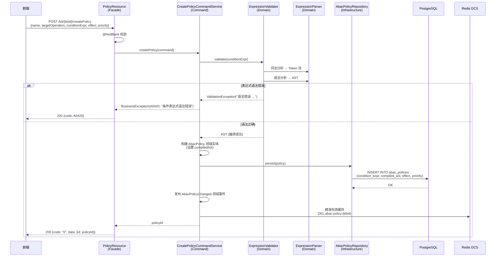

#### 3.10.9 用户接口设计

| 方法 | 路径 | 说明 |
|------|------|------|
| GET | `/kb/{kbId}/policies` | 获取知识库策略列表（按优先级降序） |
| GET | `/kb/{kbId}/policies/{id}` | 获取策略详情 |
| POST | `/kb/{kbId}/createPolicy` | 创建策略（请求体含条件表达式，后端校验语法） |
| POST | `/kb/editPolicy/{id}` | 编辑策略 |
| DELETE | `/kb/deletePolicy/{id}` | 删除策略 |
| POST | `/kb/policies/{id}/toggle` | 启用/禁用策略 |
| POST | `/kb/policies/validate-expr` | 校验条件表达式语法（前端实时校验用） |

---

### 3.11 功能编号：ACL 权限管理

#### 3.11.1 功能概述

ACL（访问控制列表）提供资源级别的细粒度权限控制。与 RBAC 的全局角色权限和 ABAC 的条件策略不同，ACL 直接绑定在具体资源上，精确控制"谁对这个资源能做什么"。ACL 支持对知识库、类别、文档三级资源分别设置权限，并通过继承机制实现上级权限向下传递。

#### 3.11.2 SR 设计

| 需求编号 | 需求描述 |
|---------|---------|
| F-099 | **细粒度**：权限粒度覆盖读（`doc:read`）、写（`doc:upload`/`doc:edit`）、删（`doc:delete`）、审（`doc:review`）、管（`kb:config`）。对每一条知识或每个知识集合均可独立设置权限，支持继承阻断 |

#### 3.11.3 领域数据模型

**ACL 条目表 `acl_entries`：**

| 字段 | 类型 | 说明 |
|------|------|------|
| id | BIGINT | 主键 |
| resource_type | VARCHAR | 资源类型：`KB` \| `CATEGORY` \| `DOCUMENT` |
| resource_id | BIGINT | 资源 ID |
| subject_type | VARCHAR | 主体类型：`USER` \| `ROLE` |
| subject_id | BIGINT | 主体 ID（用户 ID 或角色 ID） |
| permission | VARCHAR | 权限码，如 `doc:read` |
| effect | VARCHAR | `ALLOW` \| `DENY` |
| UNIQUE | (resource_type, resource_id, subject_type, subject_id, permission) | 唯一约束 |

**资源表需包含的 ACL 控制字段：**

| 表名 | 字段 | 说明 |
|------|------|------|
| `knowledge_bases` | `inherit_parent` | 知识库为顶层资源，该字段恒为 `false` |
| `categories` | `inherit_parent` | 默认 `true` |
| `documents` | `inherit_parent` | 默认 `true` |

#### 3.11.4 实现设计 —— ACL CRUD

1. **ACL 新增**：校验同一资源下不存在重复的 `(subject_type, subject_id, permission)` 组合 → 持久化
2. **ACL 编辑**：修改 `permission` 或 `effect` 字段
3. **ACL 删除**：物理删除条目。删除后该权限维度恢复为继承或默认行为
4. **继承控制**：通过 PATCH 接口修改资源的 `inherit_parent` 字段。阻断继承后需重新为资源定义 ACL，否则权限回退为 RBAC 默认

#### 3.11.5 实现设计 —— ACL 继承解析算法

ACL 继承解析是权限判定引擎中最复杂的子模块。核心目标：对于给定的 `(resourceType, resourceId)`，向上遍历资源树，收集所有未阻断继承的祖先节点的 ACL 条目，并与当前节点的 ACL 合并为有效的 ACL 集合。

**算法详细流程（伪代码）：**

```java
List<AclEntry> resolveEffectiveAcl(ResourceType type, Long resourceId) {
    String cacheKey = "acl:" + type + ":" + resourceId;
    List<AclEntry> cached = aclCache.get(cacheKey);
    if (cached != null) return cached;

    List<AclEntry> entries = new ArrayList<>();
    ResourceNode current = loadResource(type, resourceId);

    // === Phase 1: 沿资源树向上遍历，收集各层 ACL ===
    while (current != null) {
        // 加载当前节点的 ACL 条目
        List<AclEntry> nodeAcl = aclRepository.findByResource(
            current.type, current.id);

        // 合并规则：子节点的 ACL 覆盖父节点的同维度条目
        // 同维度 = 相同 (subjectType, subjectId, permission)
        entries = mergeWithOverride(entries, nodeAcl);

        // 检查是否阻断继承
        if (!current.inheritParent) {
            break;  // 阻断继承，停止向上遍历
        }

        // 向上移动到父资源
        current = current.getParent();
    }

    // === Phase 2: 写入缓存并返回 ===
    aclCache.put(cacheKey, entries);
    return entries;
}
```

**资源树向上遍历路径示例：**

```
文档 (id=42) → 类别 (id=5, inherit=true) → 类别 (id=2, inherit=false) → [停止]
最终有效 ACL = 合并(文档ACL, 类别5的ACL) + 阻断处停止，不包含类别2和知识库的ACL
```

**`mergeWithOverride` 合并规则：**

```java
for (AclEntry parentEntry : parentAcl) {
    // 检查子节点是否有同维度的覆盖条目
    boolean overridden = childAcl.stream()
        .anyMatch(e -> e.sameDimension(parentEntry));
    if (!overridden) {
        merged.add(parentEntry);  // 父节点条目未被覆盖，保留
    }
}
merged.addAll(childAcl);  // 子节点条目全部保留（优先）
```

#### 3.11.6 实现设计 —— ACL 冲突解决

ACL 条目之间可能存在冲突：同一 `(subjectType, subjectId, permission)` 组合在不同层级有不同 effect。解决规则：

- **规则 1（层级优先）**：子节点 ACL > 父节点 ACL。子节点显式定义的条目完全覆盖父节点的同维度条目
- **规则 2（显式 DENY 优先）**：同一层级的同维度条目，DENY 效果覆盖 ALLOW。此规则在 `mergeWithOverride` 之后，对同一资源节点的 ACL 做内部去重时应用
- **规则 3（用户主体优先于角色主体）**：当 `USER` 和 `ROLE` 类型的条目同时存在时，`USER` 类型的条目优先生效（因为用户级别的授权更精确、更有意图性）

**示例场景：**

```
知识库 ACL：[角色:开发者, doc:read, ALLOW]
文档 ACL：  [用户:张三,   doc:read, DENY]
结果：张三无法读取该文档（子节点 DENY 覆盖 父节点 ALLOW + 用户主体优先）
```

#### 3.11.7 实现设计 —— ACL 缓存策略

ACL 继承解析涉及多表联合查询和向上递归，需要合理缓存以避免性能问题。

**缓存方案：**

- 使用 Redis（DCS）作为分布式缓存，key 格式：`acl:{resourceType}:{resourceId}`
- 缓存值为序列化后的有效 ACL 条目列表（JSON）
- TTL 设为 30 分钟，防止内存膨胀

**缓存失效策略：**

- 当资源的 ACL 条目发生变更时，发送 `AclChanged` 领域事件
- 事件监听器不仅清除该资源自身的缓存，还会**级联清除所有子孙资源**的 ACL 缓存（因为子孙资源可能继承该资源的 ACL，变更后它们的有效 ACL 也变了）
- 级联清除范围：该资源及其所有子类别、子文档的缓存 key
- 为减少 Redis 的 DEL 操作次数，使用 Redis 的 `SCAN + DEL pattern` 批量清除

**缓存预热：**

- 知识库被访问时，后台异步预加载该知识库下所有文档的 ACL 缓存
- 避免首次访问时的冷启动延迟

#### 3.11.7.1 新增 ACL 条目时序图

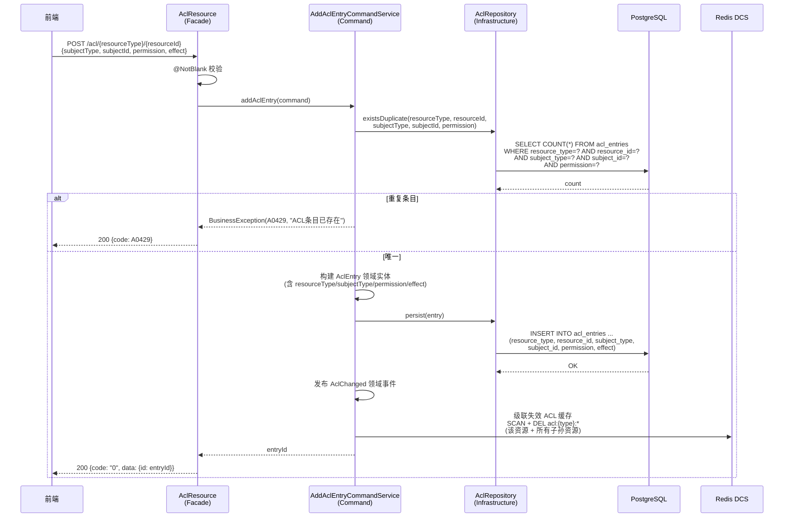

#### 3.11.8 用户接口设计

| 方法 | 路径 | 说明 |
|------|------|------|
| GET | `/acl/{resourceType}/{resourceId}` | 获取资源有效 ACL（含继承） |
| GET | `/acl/{resourceType}/{resourceId}/explicit` | 获取资源自身 ACL（不含继承） |
| POST | `/acl/{resourceType}/{resourceId}` | 新增 ACL 条目 |
| POST | `/acl/edit` | 编辑 ACL 条目 |
| DELETE | `/acl/{resourceType}/{resourceId}/{entryId}` | 删除 ACL 条目 |
| POST | `/acl/{resourceType}/{resourceId}/inherit` | 切换继承开关（请求体：`{"inheritParent": false}`） |

---

### 3.12 功能编号：权限判定引擎

#### 3.12.1 功能概述

权限判定引擎是系统授权的统一入口，整合 RBAC（角色权限）、ACL（资源级细粒度权限）、ABAC（属性策略）三层机制，对每一次资源访问请求做出 ALLOW 或 DENY 的判定。判定结果写入审计日志。

#### 3.12.2 SR 设计

| 需求编号 | 需求描述 |
|---------|---------|
| F-097 | **RBAC**：角色→权限码映射作为第一道门禁 |
| F-098 | **ABAC**：策略引擎基于属性条件进行二次过滤 |
| F-099 | **细粒度**：ACL 解析结果作为资源级权限覆盖 |

#### 3.12.3 实现设计 —— 判定流程

权限判定入口 `PermissionChecker.check(User user, String operation, Resource resource)`：

```java
public Decision check(User user, String operation, Resource resource) {

    // ===== Layer 1: RBAC 门禁 =====
    Set<String> permissions = rolePermissionCache.get(user.getId());
    if (permissions == null) {
        permissions = loadUserPermissions(user);
        rolePermissionCache.put(user.getId(), permissions);
    }
    if (!permissions.contains(operation)) {
        auditLog.deny(user, operation, resource, "RBAC: 角色无此权限");
        return Decision.DENY;
    }

    // ===== Layer 2: ACL 细粒度检查 =====
    List<AclEntry> effectiveAcl = aclService.resolveEffectiveAcl(
        resource.getType(), resource.getId());

    // 查找匹配当前用户和操作的 ACL（用户主体优先于角色主体）
    AclEntry userAcl = findAclMatch(effectiveAcl, USER, user.getId(), operation);
    if (userAcl != null) {
        if (userAcl.effect == DENY) {
            auditLog.deny(user, operation, resource, "ACL: 用户级显式拒绝");
            return Decision.DENY;
        }
        auditLog.allow(user, operation, resource, "ACL: 用户级显式允许");
        return Decision.ALLOW;
    }

    // 检查角色主体 ACL
    for (Role role : user.getRoles()) {
        AclEntry roleAcl = findAclMatch(effectiveAcl, ROLE, role.getId(), operation);
        if (roleAcl != null) {
            if (roleAcl.effect == DENY) {
                auditLog.deny(user, operation, resource, "ACL: 角色级显式拒绝");
                return Decision.DENY;
            }
            auditLog.allow(user, operation, resource, "ACL: 角色级显式允许");
            return Decision.ALLOW;
        }
    }

    // ===== Layer 3: ABAC 策略过滤 =====
    EvalContext ctx = buildEvalContext(user, resource);
    Long kbId = resource.getKnowledgeBaseId();
    PolicyResult pr = policyEvaluator.evaluate(kbId, operation, ctx);

    if (pr.effect == DENY) {
        auditLog.deny(user, operation, resource, "ABAC: " + pr.policyName);
        return Decision.DENY;
    }
    if (pr.effect == ALLOW) {
        auditLog.allow(user, operation, resource, "ABAC: " + pr.policyName);
        return Decision.ALLOW;
    }

    // ===== Default: RBAC 通过且无 DENY 策略, 放行 =====
    auditLog.allow(user, operation, resource, "默认: RBAC通过");
    return Decision.ALLOW;
}
```

#### 3.12.4 实现设计 —— 判定优先级总结

三层机制的判定优先级从高到低：

| 优先级 | 层级 | 说明 |
|--------|------|------|
| **1（最高）** | ACL 显式 DENY | 用户或角色在资源上被明确拒绝 |
| **2** | ACL 显式 ALLOW | 用户或角色在资源上被明确允许 |
| **3** | ABAC DENY | 策略引擎判定拒绝 |
| **4** | ABAC ALLOW | 策略引擎判定允许 |
| **5（默认）** | RBAC 默认 ALLOW | 角色权限已通过，无 DENY 拦截 |

**关键设计原则：**

- **DENY 覆盖 ALLOW**：任何层的 DENY 都能否决下层的 ALLOW
- **显式覆盖隐式**：ACL 是管理员/用户主动配置的显式授权，其权威性高于 ABAC 的自动策略
- **用户主体覆盖角色主体**：用户级别的 ACL > 角色级别的 ACL（更精确）
- **RBAC 是地板而非天花板**：RBAC 通过是必要条件，但不充分；ACL/ABAC 可在此基础上进一步收紧

#### 3.12.5 实现设计 —— 性能优化

1. **RBAC 角色权限缓存**：用户登录时加载角色→权限码映射，存入 Redis，key: `user:perm:{userId}`，TTL=30min。角色变更时通过事件失效
2. **ABAC 策略缓存**：知识库级别的策略列表含编译后的 AST，key: `abac:policy:{kbId}`，TTL=60min。策略变更时失效
3. **ACL 有效权限缓存**：解析后的有效 ACL 列表，key: `acl:{type}:{id}`，TTL=30min。ACL 变更或继承变更时级联失效
4. **判定短路优化**：RBAC 不通过 → 直接返回 DENY，跳过 ACL 和 ABAC 评估。ACL 显式命中 → 直接返回结果，跳过 ABAC 评估
5. **批量判定接口**：对于文档列表查询等场景，提供批量判定接口 `batchCheck(List<Resource>)`，合并加载 ACL 缓存和 ABAC 策略，减少 Redis 往返次数

#### 3.12.5.1 权限判定时序图（三层架构）

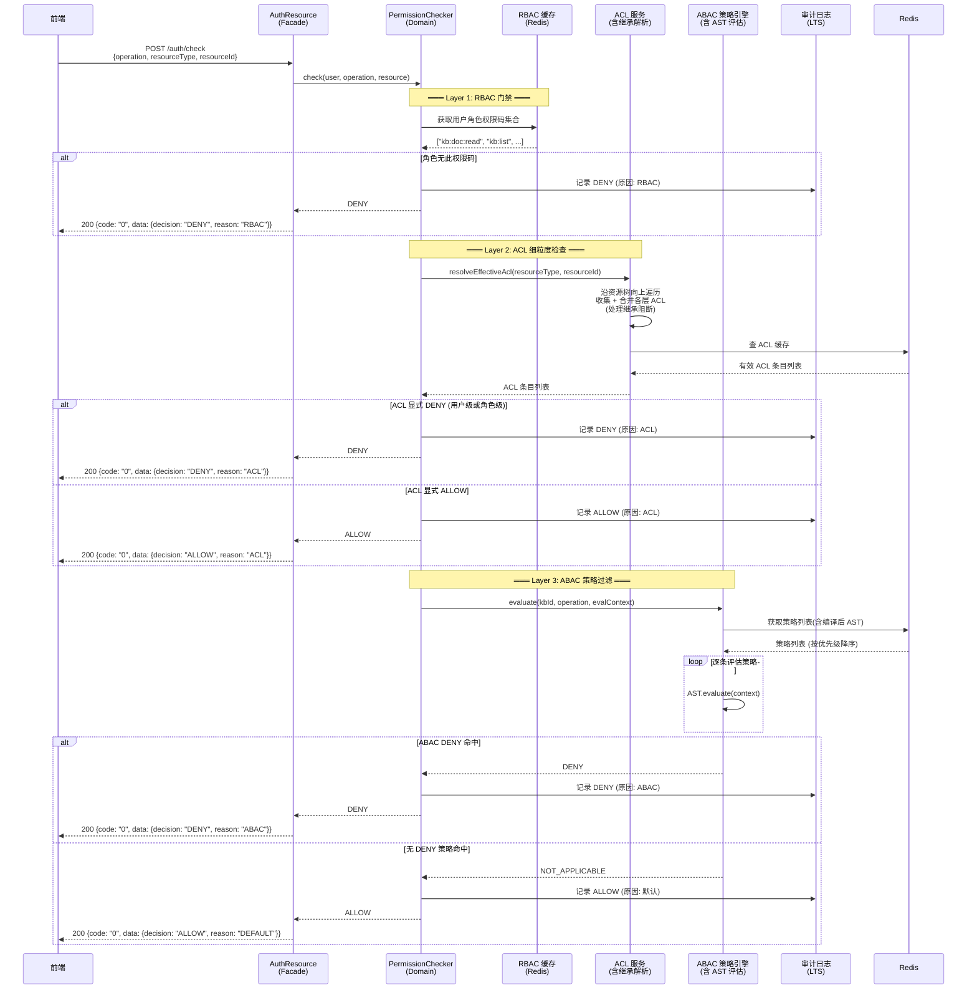

#### 3.12.6 用户接口设计

| 方法 | 路径 | 说明 |
|------|------|------|
| POST | `/auth/check` | 单次权限判定（请求体：`{ operation, resourceType, resourceId }`，返回 ALLOW/DENY + 命中规则） |
| POST | `/auth/batch-check` | 批量权限判定（请求体：`{ operation, resources: [{type, id}] }`，返回每个资源的判定结果） |
| POST | `/auth/preview` | 权限预览（管理员模拟：`{ userId, operation, resourceType, resourceId }`，返回判定过程详情） |

---

### 3.13 功能编号：系统字典管理

#### 3.13.1 功能概述

系统字典提供统一的受控词汇表管理，用于约束元数据（metadata）中关键属性的可选值范围。字典不替代现有的元数据表——元数据仍然是 key-value 存储（`document_metadata` 等表），字典仅负责校验和前端 UI 的可选值数据源。

**核心概念：**

- **字典类型（dict_type）**：定义一个属性类别（如"产品"、"文档类型"），并声明该类别管控哪些 metadata 键名
- **字典条目（dict_item）**：该类别下的合法取值（如产品下的 `Hi3516CV610`）

**主要使用场景：**

| 场景 | 说明 |
|------|------|
| 导入压缩包 | 用户在导入预览页通过下拉框为文件/目录选择产品、芯片型号等属性，下拉数据来源于字典条目。**导入时只能选择已有条目，不可新增/编辑/删除字典** |
| 文档元数据编辑 | 前端编辑文档的 `doc_type`、`sensitivity` 等受控属性时，提供规范的可选值列表 |
| ABAC 策略配置 | 管理员编写策略条件表达式时，前端提示合法的属性值选项（如 `res.doc_type` 的可选值） |

**与元数据表的关系（桥接模式）：**

```
字典表（数据源 + 校验规则）              元数据表（实际存储）
kb_dict_types                             document_metadata
  type_code: "product"                      document_id: "doc-001"
  controlled_meta_keys:                     meta_key: "product"
    "product,chip_model"                    meta_value: "Hi3516CV610"
                                              ↑
kb_dict_items（合法值集合）                   │ 写入时校验：值必须在字典中存在
  Hi3516CV608                                │ 运行时读取：ABAC 直接查元数据表
  Hi3516CV610                                │ 字典不参与运行时查询
```

> **关键结论**：字典的职责是"值是否可以选"，元数据的职责是"实体关联了什么值"。ABAC 策略引擎运行时只查元数据表，不 JOIN 字典表。

#### 3.13.2 SR 设计

| 需求编号 | 需求描述 |
|---------|---------|
| F-097 | **RBAC**：仅管理员可对字典类型和条目进行增删改操作；所有登录用户可查询字典 |
| F-100 | **字典类型管理**：支持创建、编辑、删除（软删）字典类型，可声明该类型管控的 meta_key |
| F-101 | **字典条目管理**：支持创建、编辑、删除（软删）字典条目。删除条目仅表示该值不再作为选项，不影响已引用该值的历史数据 |

#### 3.13.3 实现设计

1. **字典类型创建**：校验 type_code 唯一性（含已软删除的同名类型）→ 持久化
2. **字典条目创建**：校验同 type_code 下 value 唯一性 → 持久化
3. **删除字典条目**：软删除（`status=0`）。不检查是否有文档已引用该值——元数据写入后是历史事实，删字典条目仅影响"未来的可选选项"，不影响已有数据
4. **导入时的字典交互**：前端展示树形预览时，每个文件/目录可设置受控属性（下拉多选，如同时选多个产品标签）。下拉选项从字典查询接口获取。导入页面不提供字典增删改入口——用户如需新增字典值，需先到字典管理页面操作
5. **字典修改即时生效**：字典读频率低，不需要缓存层

#### 3.13.4 领域数据模型

**字典类型表 `kb_dict_types`：**

| 字段 | 类型 | 说明 |
|------|------|------|
| id | VARCHAR(36) | 主键 |
| type_code | VARCHAR(100) | 类型编码（UNIQUE），如 `product`、`doc_type`，命名规范：小写下划线 |
| type_name | VARCHAR(200) | 类型显示名，如"产品"、"文档类型" |
| controlled_meta_keys | VARCHAR(500) | 该字典管控的 metadata 键名，逗号分隔。如 `"product,chip_model"`。为空表示仅作展示用 |
| status | SMALLINT | 0=删除, 1=正常 |
| created_at | TIMESTAMP | |
| updated_at | TIMESTAMP | |

**字典条目表 `kb_dict_items`：**

| 字段 | 类型 | 说明 |
|------|------|------|
| id | VARCHAR(36) | 主键 |
| type_code | VARCHAR(100) | 关联 kb_dict_types.type_code |
| label | VARCHAR(200) | 显示名称 |
| value | VARCHAR(200) | 存储值（写入 metadata 的实际值） |
| sort_order | INT | 排序号 |
| status | SMALLINT | 0=删除, 1=正常 |
| created_at | TIMESTAMP | |
| updated_at | TIMESTAMP | |

**模块归属：** 字典表放在 **system 模块**。产品/芯片型号等词汇表是组织级别的公共数据，不绑定特定知识库。knowledge 模块的导入和文档编辑功能通过查询字典接口获取可选值列表。

#### 3.13.5 用户接口设计

> **前端约定（2026-08 确认）**：操作类端点统一 POST + JSON body，不用路径参数；查询类保留 GET + queryParam。

| 方法 | 路径 | 说明 | 权限 |
|------|------|------|------|
| `GET` | `/system/dict/types/search` | 字典类型列表（分页 page/pageSize/keyword/status） | 登录用户 |
| `POST` | `/system/dict/types/create` | 创建字典类型（body: `{typeCode, typeName, controlledMetaKeys?}`） | 管理员* |
| `POST` | `/system/dict/types/edit` | 编辑字典类型（body: `{id, typeCode, typeName, controlledMetaKeys?}`） | 管理员* |
| `POST` | `/system/dict/types/delete` | 删除字典类型（body: `{id}`，软删+级联软删条目） | 管理员* |
| `GET` | `/system/dict/items/search` | 条目列表（必传 typeCode，可按 status 筛选） | 登录用户 |
| `POST` | `/system/dict/items/create` | 新增条目（body: `{typeCode, label, value, sortOrder?}`） | 管理员* |
| `POST` | `/system/dict/items/edit` | 编辑条目（body: `{id, label, value, sortOrder?}`） | 管理员* |
| `POST` | `/system/dict/items/delete` | 删除条目（body: `{id}`，软删） | 管理员* |

> *当前实现先统一登录校验（`@Authenticated`），RBAC 管理员权限后续补充。

**核心业务规则（已实现）：**

1. **typeCode 可编辑**（2026-08 用户确认）：编辑类型时 typeCode 变更会级联更新所有条目的 type_code（避免输入错误无法校正）。命名规范：`^[a-z][a-z0-9_]{0,49}$`，非法 → A0420 + `dictTypeCodeInvalid`。
2. **类型删除级联软删条目**（2026-08 用户确认）：`kb_dict_items.status=0 WHERE type_code=?`，同时白名单缓存失效。
3. **条目 sortOrder 例外**（2026-08 用户确认）：编辑条目时 sortOrder 不传 = **保持原值**（不参与全量替换）；创建时不传 = 同级最大 + 1（首个从 1 开始）。
4. **修改 value 不影响历史元数据**：元数据写入后是历史事实，改/删字典值仅影响"未来的可选选项"；管理界面需提示用户。
5. **typeCode/条目 value 唯一性**：部分唯一索引 `WHERE status=1`（软删后可重建同名），详见 migration_005。
6. **缓存失效**：类型 create/edit/delete 后调用 `DictMetaKeyCacheService.evictCache()`；条目操作不触发（不影响 key 白名单）。
7. **级联改 code 的前提**：migration_005 已删除 `kb_dict_items.type_code` 物理外键（改为逻辑关联，与项目其他表一致）。

**请求/响应示例：**

```
# 查询字典类型列表
GET /system/dict/types/search?page=1&pageSize=20
→ { code: "0", data: { records: [
      { id:"..", typeCode:"product", typeName:"产品", controlledMetaKeys:"product,chip_model" },
      { id:"..", typeCode:"doc_type", typeName:"文档类型", controlledMetaKeys:"doc_type" }
    ], totalRow: 5 } }

# 创建字典类型
POST /system/dict/types/create
Body: { typeCode: "chip_model", typeName: "芯片型号", controlledMetaKeys: "chip_model" }

# 查询字典条目（用于前端下拉框）
GET /system/dict/items/search?typeCode=product&status=1
→ { code: "0", data: [
      { id:"..", label:"Hi3516CV610", value:"Hi3516CV610", sortOrder:1 },
      { id:"..", label:"Hi3516CV608", value:"Hi3516CV608", sortOrder:2 }
    ] }

# 新增条目
POST /system/dict/items/create
Body: { typeCode: "product", label: "Ascend910", value: "Ascend910", sortOrder: 3 }

# 编辑条目（sortOrder 省略 = 保持原值）
POST /system/dict/items/edit
Body: { id: "..", label: "Ascend910", value: "Ascend910" }
```

**错误码：**

| 场景 | 错误码 | 消息 |
|------|--------|------|
| typeCode 重复 | A0429 | dictTypeCodeAlreadyExists |
| 类型不存在/已删除 | A0430 | dictTypeNotFound |
| 条目 value 重复 | A0429 | dictItemValueAlreadyExists |
| 条目不存在/已删除 | A0430 | dictItemNotFound |
| typeCode 格式非法 | A0420 | dictTypeCodeInvalid |

**模块归属：** 字典表放在 **system 模块**。产品/芯片型号等词汇表是组织级别的公共数据，不绑定特定知识库。knowledge 模块的导入和文档编辑功能通过查询字典接口获取可选值列表。字典 PO 与白名单缓存服务在 commons-dict 共享模块。

---

## 4 词汇表

| 名称 | 描述 |
|------|------|
| ABAC | 基于属性的访问控制，通过用户、资源、环境属性动态判定权限 |
| RBAC | 基于角色的访问控制，通过角色→权限映射管理授权 |
| ACL | 访问控制列表，资源级别的细粒度权限条目 |
| DDD | 领域驱动设计，以领域模型为核心驱动软件设计 |
| OIDC | 基于 OAuth 2.0 的身份认证协议 |
| 聚合根 | DDD 中负责维护聚合内一致性的根实体 |
| 领域事件 | DDD 中用于领域对象间通信的事件机制 |

---

## 5 需求分解分配表

| 系统需求编号 | 系统需求 | 分配需求编号 | 分配需求描述 | 系统元素 |
|-------------|---------|-------------|-------------|---------|
| | | | | |

---

## 6 参考资料清单

| 资料名称 | 说明 |
|---------|------|
| 海思知识库架构设计 - 前端架构设计 | 前端架构设计文档 |
| 《阿里巴巴 Java 开发手册》 | 编码规范参考 |
| Quarkus 官方文档 | https://quarkus.io/guides/ |
| 华为云 SFS 产品文档 | 弹性文件服务 |
| 华为云 RDS for PostgreSQL 文档 | 数据库服务 |
| 华为云 LTS 产品文档 | 日志服务 |
| 华为云 DCS 产品文档 | 分布式缓存服务 |
