| 系统名称 System name | 密级 Security Level |
| ---------------- | ----------------- |
| 海思芯片知识库          | 内部资料              |
| 版本 Version       | 共 XX 页            |
| V1.5（8.9 交付版本）   |                   |

架构设计说明书

Architecture Design Specification

|                 |     |     |     |            |
| --------------- | --- | --- | --- | ---------- |
| 拟制 Prepared by: | 架构组 |     | 日期： | 2026-08-09 |
| 评审 Reviewed by: |     |     | 日期： |            |
| 批准 Approved by: |     |     | 日期： |            |

华为技术有限公司

Huawei Technologies Co., Ltd.

版权所有 侵权必究

All rights reserved

修订记录

| 日期         | 修订版本         | 修改描述                                 | 作者  |
| ---------- | ------------ | ------------------------------------ | --- |
| 2026-06-20 | V0.1         | 初稿，搭建文档骨架                            | 架构组 |
| 2026-06-30 | V0.2         | 根据需求 V0.2 补充检索与权限章节                  | 架构组 |
| 2026-07-09 | V1.0         | 根据需求 V0.3 完善硬件抽取、Agent 适配、自驱优化、扩展性专题 | 架构组 |
| 2026-07-15 | V1.1         | 修改架构图                                | 架构组 |
| 2026-07-20 | V1.2         | 增加不同场景下，模块之间的时序关系图                   | 架构组 |
| 2026-07-31 | V1.3         | 修复章节顺序、统一标题格式、补充各章节摘要、清理内部讨论笔记       | 架构组 |
| 2026-08-04 | V1.4（完善版）    | 补全安全分区设计、模块关联关系、模块内部功能拆解             | 架构组 |
| 2026-08-09 | V1.5（8.9 版本） | 按华为架构说明书模板重组，采用总分结构组织全文              | 架构组 |

Keywords 关键词：海思芯片知识库、RAG、MCP、架构设计、五库协同、七层分层架构、硬件结构化抽取、代码知识图谱、多芯片隔离、双态发布

Abstract 摘要：本文档是海思芯片知识库的架构设计说明书，基于《海思知识库需求说明 V0.3》70+ 条功能需求，采用总分结构组织：从总体架构图建立全局认知，到模块关联关系与内部功能逐层深入，再到安全、部署等横切面收尾。覆盖七层分层架构、五库协同存储、多源异构知识接入、混合检索与生成、代码-文档-硬件三角关联、多 Agent 集成、双态发布、质量自驱优化、企业级权限安全与华为云私有部署等全维度设计。

List of abbreviations 缩略语清单：

| 缩略语  | 英文全名                           | 中文解释         |
| ---- | ------------------------------ | ------------ |
| RAG  | Retrieval-Augmented Generation | 检索增强生成       |
| MCP  | Model Context Protocol         | 模型上下文协议      |
| AST  | Abstract Syntax Tree           | 抽象语法树        |
| BM25 | Best Matching 25               | 文本检索排序算法     |
| ANN  | Approximate Nearest Neighbor   | 近似最近邻搜索      |
| RRF  | Reciprocal Rank Fusion         | 倒数排名融合       |
| SSE  | Server-Sent Events             | 服务器推送事件      |
| RBAC | Role-Based Access Control      | 基于角色的访问控制    |
| ABAC | Attribute-Based Access Control | 基于属性的访问控制    |
| ACL  | Access Control List            | 访问控制列表       |
| RLS  | Row-Level Security             | 行级安全         |
| OIDC | OpenID Connect                 | 开放身份连接协议     |
| CCE  | Cloud Container Engine         | 云容器引擎        |
| CSS  | Cloud Search Service           | 云搜索服务        |
| GES  | Graph Engine Service           | 图引擎服务        |
| DCS  | Distributed Cache Service      | 分布式缓存服务      |
| SFS  | Scalable File Service          | 弹性文件服务       |
| LTS  | Log Tank Service               | 云日志服务        |
| CBM  | Codebase Memory MCP            | 代码库记忆 MCP 服务 |

---

# 1 文档说明

## 1.1 编写目的

本文档是海思芯片知识库（以下简称"知识库"）的系统架构设计说明书。在《海思知识库需求说明 V0.3》的基础上，从系统架构层面回答"怎么搭"的问题：将需求项 IR-100 ~ IR-135 中约 70+ 条功能点，落到具体的分层、模块、数据流、存储模型与开放接口上，形成可指导开发与采购的工程蓝图。

## 1.2 适用读者

- 架构师与技术负责人：用于架构评审、技术选型决策、模块划分
- 开发工程师：用于模块开发、接口对接、二次扩展
- 运维与 SRE：用于部署规划、监控告警、容量评估
- 产品经理与业务方：用于理解能力边界、规划迭代节奏

## 1.3 本文档定位

本文档（V1.5 / 8.9 交付版本）以《海思知识库架构设计 V1.3》为基线，整合了《海思知识库架构设计-完善版》对 V1.3 三处缺口的补全：

| 缺口           | V1.3 表现                      | 本文档补全                          |
| ------------ | ---------------------------- | ------------------------------ |
| ① 业务模块关联关系缺失 | 四核心模块只画了框，未画出调用方向、同步/异步、数据流向 | 第 4 章——模块关联图 + 依赖矩阵 + 三条关键链路时序 |
| ② 网络安全设计缺失   | 无安全分区、无 WAF、无边界与传输/存储加密      | 第 8 章——五区安全模型 + 传输/存储加密 + 审计合规 |
| ③ 业务模块内功能不清晰 | 每个模块仅一个标签，内部子功能与接口未拆解        | 第 5 章——四模块各自展开子功能与职责           |

同时补全原图缺失的两类核心存储：**向量库 CSS、图库 GES**。

## 1.4 文档结构

本文档采用"总→分→横切"的组织逻辑：

- **总**（第 3 章）：先给出细化版总体架构图，建立全局认知
- **分**（第 4-6 章）：模块间怎么关联 → 模块里面有什么 → 关键技术方案深化
- **横切**（第 7-9 章）：架构原则与扩展性、网络安全、部署运维等跨域设计
- **闭环**（第 10-11 章）：风险对策、差异说明

## 1.5 术语表

| 术语      | 英文/缩写            | 含义                                                         |
| ------- | ---------------- | ---------------------------------------------------------- |
| 检索增强生成  | RAG              | 在 LLM 生成前注入检索到的领域知识，提升专业性与时效性                              |
| 模型上下文协议 | MCP              | Anthropic 提出的 Agent 与外部工具/数据源通信的标准化协议                      |
| 知识片段    | Chunk            | 文档/代码被切分后的最小检索单元，chunk_id 为全局唯一主键                          |
| 三角关联    | Triangle Link    | 代码符号 ↔ 寄存器定义 ↔ 文档章节 通过 Neo4j/GES 图边建立的追溯关系                 |
| 混合检索    | Hybrid Retrieval | 向量 ANN + BM25 关键词 + 知识图谱三路并行召回，RRF 融合后 Cross-Encoder 重排    |
| 五库协同    | Five-DB          | PostgreSQL + CSS(向量+全文) + GES(图谱) + SFS(文件) + DCS(缓存) 协同工作 |
| 双态发布    | SDT/Hisparks     | SDT 为内部开发验证环境，Hisparks 为对外生产发布环境                           |
| Badcase | Badcase          | 检索/生成中用户反馈不满意的结果，进入治理闭环                                    |

---

# 2 需求概览与架构目标

## 2.1 需求六大模块概览

需求说明 V0.3 共划分六大模块，约 70+ 条功能项：

| 需求编号       | 模块名称      | 关键能力概述                                          | 功能条数                |
| ---------- | --------- | ----------------------------------------------- | ------------------- |
| IR-100     | 多源异构知识接入  | PDF/Word/Excel/Markdown/HTML/代码/配置/硬件资料/图片/网页爬虫 | 35 条（F-001 ~ F-035） |
| IR-105/110 | 知识库多维检索   | Coding Agent 集成（MCP/REST）、智能检索、Web UI 问答与站内机器人  | 13 条（F-036 ~ F-048） |
| IR-115     | 版本管理与运维维护 | 增删改查、版本对比、状态流转、批量操作、多芯片共存、灰度发布                  | 17 条（F-051 ~ F-067） |
| IR-120     | 知识库自驱优化   | Badcase 管理、冲突检测、置信度评分、共建审核、Agent 自动更新           | 10 条（F-068 ~ F-077） |
| IR-135     | 权限管理与信息安全 | RBAC + ABAC、细粒度权限                               | 3 条（F-097 ~ F-099）  |
| （横切）       | 运维监控与可观测性 | 切片可视化、命中率仪表盘、索引重建                               | 贯穿上述模块              |

## 2.2 关键技术挑战

从需求出发，识别出以下七项关键技术挑战：

| 挑战                | 难点                                          | 架构应对                   |
| ----------------- | ------------------------------------------- | ---------------------- |
| 多源异构解析            | PDF 表格保真、代码 AST 切分、配置层级保留、不同格式信息密度差异大       | 第 6.1 节：解析器插件架构        |
| 硬件专有结构抽取          | Pin 脚/寄存器表格无统一规范，原理图为图形而非文本，级联寄存器关系复杂       | 第 6.2 节：硬件抽取流水线        |
| 代码-文档双向映射         | 代码与手册分布在独立体系，需建立"代码↔寄存器↔章节"三角关联             | 第 6.3 节：知识图模型          |
| 多 Coding Agent 兼容 | Claude Code/Hermes/Cursor/Trae 协议、鉴权、调用方式各异 | 第 6.5 节：Agent 适配器      |
| 多芯片共存             | CV610/CV620 等多系列知识需绝对隔离，避免检索串扰              | 第 6.3 节：chip_model 硬隔离 |
| 质量自驱闭环            | Badcase 到自动修复需无人工干预，同时保证不引入新问题              | 第 6.6 节：质量治理           |
| 安全合规              | 机密文档、跨境合规、组织隔离、行级权限                         | 第 8 章：权限与安全            |

## 2.3 架构目标（量化指标）

| 指标类别     | 指标项                    | 目标值                 |
| -------- | ---------------------- | ------------------- |
| 功能覆盖度    | 需求 V0.3 功能项覆盖          | ≥ 95%（少量低优先项延后）     |
| 检索精度     | Top-5 命中率（开发者评测集）      | ≥ 90%               |
| 检索精度     | Badcase 月度下降率          | ≥ 30%               |
| 性能       | 检索 P95 延迟              | ≤ 300 ms            |
| 性能       | 首字延迟（SSE）              | ≤ 800 ms            |
| Token 效率 | 单次查询平均上下文 Token        | ≤ 4096              |
| 可用性      | 检索服务 SLA               | ≥ 99.9%             |
| 扩展性      | 新增一种文档格式平均成本           | ≤ 1 人周（仅实现 IParser） |
| 扩展性      | 新增一个 Coding Agent 平均成本 | ≤ 1 人周（仅实现适配器）      |

## 2.4 假设和约束

**技术约束**：

- 部署底座为华为云（CCE Autopilot、RDS、CSS、GES、DCS、SFS、LTS），纯私有云部署，无公网暴露
- 编程语言：后端服务 Python/Go，模型服务 Python，前端 TypeScript/React，代码检索引擎 C/TypeScript（CBM+codegraph）
- LLM 依赖外部商用 API（通义千问/Claude/GPT）或本地 vLLM 自托管开源模型

**业务约束**：

- 知识库内容为对外发布的 SDK 与公开文档，默认可云部署；企业内网用户支持本地化部署
- 芯片型号（CV610/CV620/CV630 等）之间知识绝对隔离
- 敏感芯片资料可物理隔离部署（Air-gapped）

---

# 3 总体架构

## 3.1 完善后总体架构图

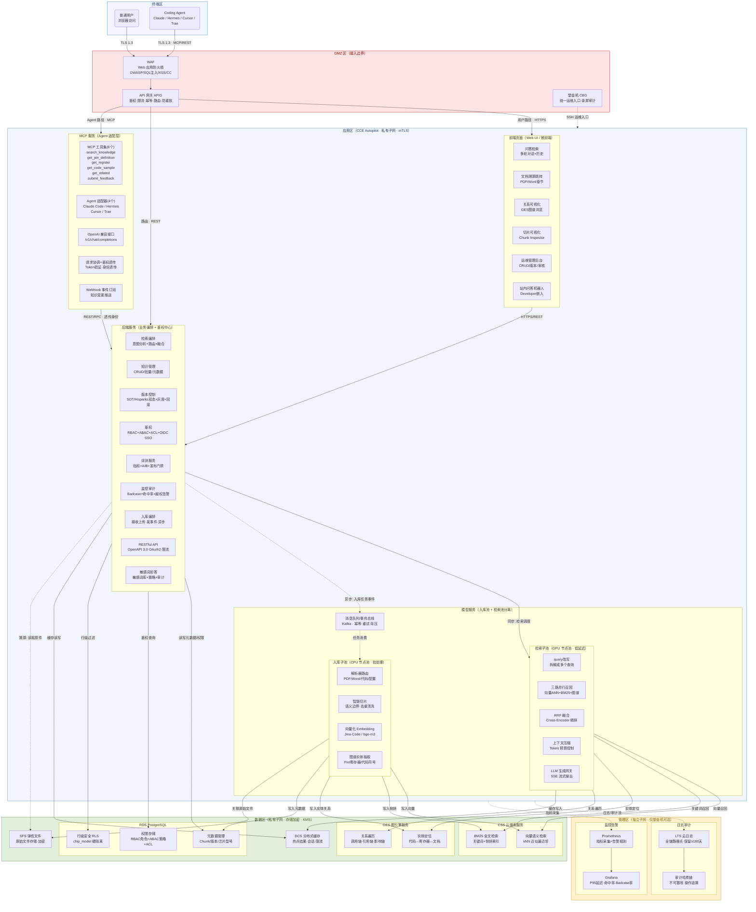

图 3-1 海思芯片知识库总体架构图

## 3.2 与原 V1.3 架构图对照

| 元素                    | V1.3 原图 | 完善版                                                 |
| --------------------- | ------- | --------------------------------------------------- |
| 接入层                   | APIG    | WAF → APIG（补 WAF）                                   |
| 前端页面                  | ✓（单一框）  | ✓（展开 6 个子功能：问答检索/文档溯源/关系可视化/切片可视化/运维后台/站内机器人）       |
| 后端服务                  | ✓（单一框）  | ✓（展开 9 个子功能：检索编排/知识管理/版本控制/鉴权/评测/监控审计/入库编排/API/拒答）  |
| 模型服务                  | ✓（单一框）  | ✓（入库子池 + 检索子池分离 + 消息队列，入库/检索各展开 4-5 个组件）            |
| MCP 服务                | ✓（单一框）  | ✓（展开 5 个子功能：工具集 6 个/适配器 4 个/OpenAI 接口/鉴权透传/Webhook） |
| SFS / RDS / DCS / LTS | ✓       | ✓                                                   |
| 向量库                   | 缺       | **补 CSS**（向量语义 + BM25 全文检索）                         |
| 图库                    | 缺       | **补 GES**（实体定位 + 关系遍历）                              |
| 安全分区                  | 缺       | **补 DMZ/应用区/数据区/管理区/终端区** 五区                        |
| 模块间调用关系               | 缺       | **补全**（同步实线 + 异步虚线，标注协议与数据方向）                       |

## 3.3 七层分层架构

知识库采用"七层分层 + 横向贯穿"的架构风格，数据自下而上流动，能力自上而下暴露。横向三条贯穿能力（配置中心、统一鉴权、日志审计）为各层提供基础设施服务。

| 层   | 名称    | 核心职责                                                                          |
| --- | ----- | ----------------------------------------------------------------------------- |
| ①   | 消费端   | 多端用户访问、多 Agent 生态集成（Claude Code / Cursor / Hermes / Trae）                     |
| ②   | 集成接口层 | MCP 协议集成、REST API 标准化（OpenAPI 3.0）、Agent 适配器、请求路由与鉴权透传                        |
| ③   | 检索生成层 | 混合检索（向量 ANN + BM25 + 图谱）、RRF 融合 + Cross-Encoder 重排、LLM 多 Provider 路由、SSE 流式生成 |
| ④   | 知识模型层 | Chunk 标准化、元数据抽取、知识图谱构建（Chip/IPBlock/RegisterMap/BitField）、代码↔寄存器↔文档三角关联       |
| ⑤   | 接入解析层 | 多源文档解析（PDF/Word/代码/配置，插件架构）、代码 AST 语义切片、硬件信息抽取流水线                             |
| ⑥   | 数据存储层 | 五库协同（PG/CSS/GES/SFS/DCS）、Outbox 最终一致性、chip_model 行级硬隔离                        |
| ⑦   | 基础设施层 | 华为云 CCE Autopilot、五区安全隔离、Prometheus/Grafana 监控、LTS 审计                         |

## 3.4 部署基线

| 类别        | 选型                                          |
| --------- | ------------------------------------------- |
| 应用承载      | 华为云 CCE Autopilot（全托管容器集群）                  |
| 入口网关      | API 网关 APIG                                 |
| 向量 + 全文检索 | 云搜索服务 CSS（Elasticsearch，kNN 向量检索）           |
| 图数据库      | 图引擎服务 GES                                   |
| 关系数据库     | RDS for PostgreSQL                          |
| 文件存储      | 弹性文件服务 SFS                                  |
| 缓存        | 分布式缓存服务 DCS                                 |
| 日志 / 审计   | 云日志服务 LTS                                   |
| 消息队列      | Kafka / 华为消息队列                              |
| 部署形态      | **纯私有云**（华为云私有区 / Huawei Cloud Stack），无公网暴露 |

---

# 4 业务模块关联关系

## 4.1 模块关联图（调用方向 + 协议 + 同步/异步）

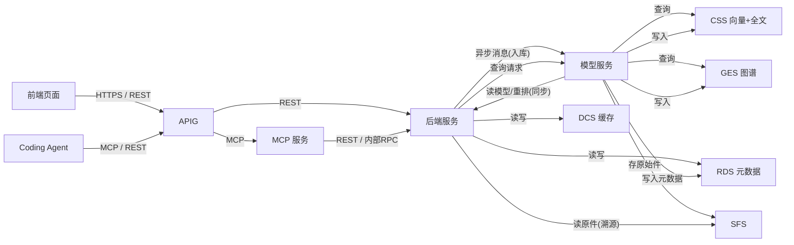

图 4-1 模块关联图（实线=同步调用，虚线/异步消息=解耦）

> 说明：APIG 负责边界层请求的认证/鉴权/限流/防重放，后端服务负责业务身份、权限判定、行级安全和身份透传。后端服务对 CSS/GES 的检索请求由模型服务同步处理，对 RDS/DCS 则直接访问；模型服务对 CSS/GES/RDS/SFS 是异步写入（经事件总线 Outbox 模式）。

## 4.2 模块依赖矩阵

| 调用方 ↓ \ 被调方 → | 前端页面 | 后端服务       | 模型服务         | MCP 服务 | CSS        | GES        | RDS  | SFS   | DCS |
| ------------- | ---- | ---------- | ------------ | ------ | ---------- | ---------- | ---- | ----- | --- |
| 前端页面          | —    | REST/HTTPS | —            | —      | —          | —          | —    | —     | —   |
| 后端服务          | —    | —          | 异步触发 / 同步读模型 | —      | 通过模型服务同步调度 | 通过模型服务同步调度 | 同步读写 | 读(溯源) | 读写  |
| MCP 服务        | —    | REST/RPC   | —            | —      | —          | —          | —    | —     | —   |
| 模型服务          | —    | 回调通知       | —            | —      | 异步写        | 异步写        | 异步写  | 异步写   | —   |
| APIG          | 直达   | 路由         | —            | 路由     | —          | —          | —    | —     | —   |

## 4.3 关键链路一：用户检索（时序）

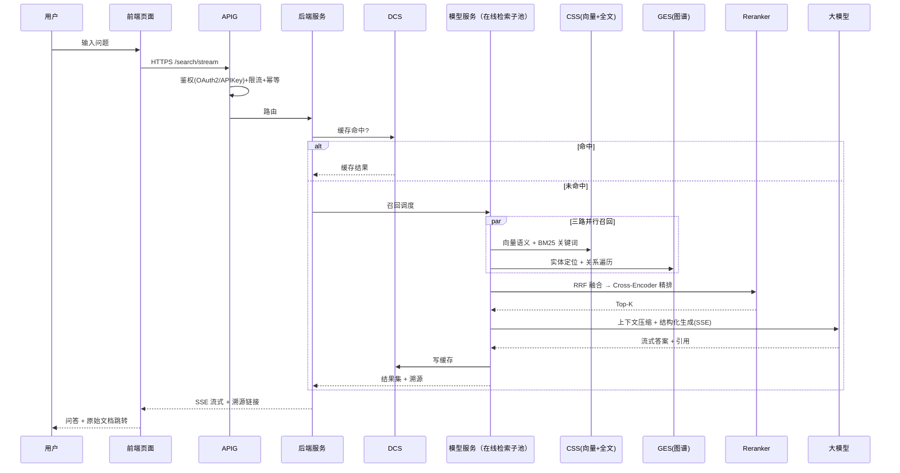

图 4-2 用户检索时序图

**关键阶段说明**：

| 阶段       | 核心模块           | 关键动作                              |
| -------- | -------------- | --------------------------------- |
| ① 安全认证   | APIG + 后端鉴权    | RBAC/ABAC 鉴权 → TLS 1.3 → 限流/幂等    |
| ② 缓存检查   | DCS            | Cache-Aside 模式，命中即快速返回            |
| ③ 查询改写   | 检索编排           | 指代消解、同义词扩展、芯片术语路由                 |
| ④ 三路并行召回 | CSS + GES      | BM25 关键词 + 向量语义 + 知识图谱关联          |
| ⑤ 融合重排   | RRF + Reranker | 倒数排名融合 → Cross-Encoder 精排         |
| ⑥ 预算控制   | Token 控制器      | Top-K 裁剪、阈值过滤、成本控制                |
| ⑦ 模型生成   | LLM 网关         | Provider 抽象 → SSE 流式返回（首字 <800ms） |
| ⑧ 反馈闭环   | 审计日志 + 监控      | 反馈写入、全链路追踪、Prometheus 指标采集        |

## 4.4 关键链路二：知识入库（时序）

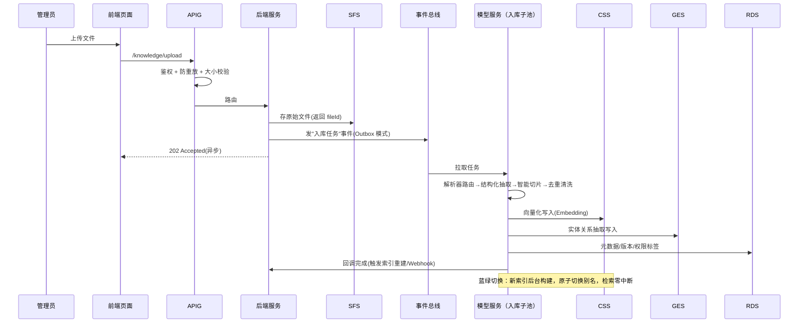

图 4-3 知识入库时序图

**入库生命周期阶段**：

| 阶段        | 核心组件                  | 关键动作与机制                               |
| --------- | --------------------- | ------------------------------------- |
| ① 接入与安全   | APIG + 后端鉴权           | RBAC/ABAC 鉴权 → 文件校验 → 原始文件存储至 SFS     |
| ② 异步解耦    | 事件总线                  | Outbox 模式，避免用户阻塞，保障高可用                |
| ③ 多源异构解析  | 解析器注册中心、AST 切片器、硬件抽取器 | 不同格式分发至对应解析器；代码按函数/类切片；硬件抽取 Pin 脚/寄存器 |
| ④ 清洗与标准化  | 清洗去重、切片检查器            | SHA-256/MinHash 去重，统一转化为标准 Chunk 模型   |
| ⑤ 元数据增强   | 元数据字典、多芯片隔离器          | 动态提取 chip_model 标签实现硬隔离               |
| ⑥ 图谱映射    | 代码文档图谱映射、GES          | 建立"代码↔寄存器↔文档"三角关联                     |
| ⑦ 五库协同写入  | PG/CSS/GES/DCS        | 并行写入，最终一致性，读写分离                       |
| ⑧ 索引重建与通知 | Webhook、蓝绿切换          | 批量重建，Webhook 推送变更，零停机索引切换             |

## 4.5 关键链路三：Agent（MCP）调用（时序）

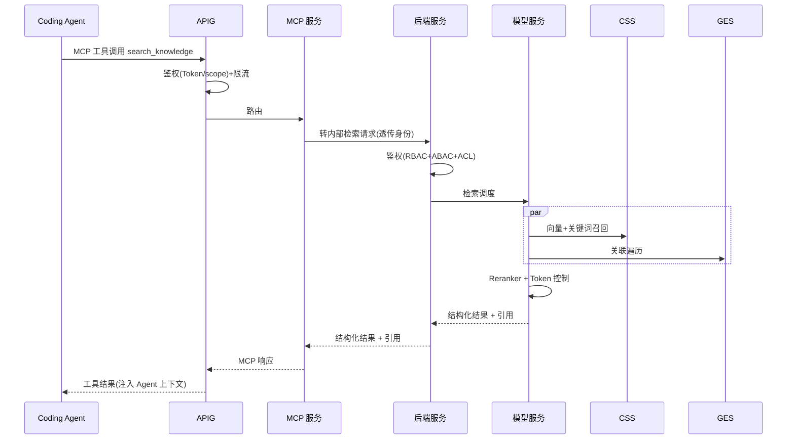

图 4-4 Agent（MCP）调用时序图

> 说明：Agent 登录/认证首先由 APIG 进行边界层 Token/Scope 校验；MCP 作为 Agent 适配器，不做最终业务授权判定，而是将经过身份透传的请求转给后端。后端再基于 RBAC/ABAC/ACL 进行业务级权限判定，由模型服务（在线检索子池）实际执行向量召回、图谱遍历、精排和生成。

---

# 5 业务模块内部功能

## 5.1 前端页面

| 子功能     | 职责                       | 对接                  |
| ------- | ------------------------ | ------------------- |
| 问答检索    | 自然语言问答、多轮上下文、历史/收藏       | 后端 SSE              |
| 文档溯源    | 结果附原始文档链接，跳转到章节          | SFS + 后端            |
| 关联关系可视化 | 代码↔寄存器↔文档三角关系图谱浏览        | GES                 |
| 切片可视化   | 查看任意文件的 Chunk 边界/向量/命中次数 | 后端（Chunk Inspector） |
| 运维后台    | 知识 CRUD、版本对比、审核工作流       | 后端                  |
| 多语言     | 中英文切换                    | i18n                |
| 微前端嵌入   | 以微前端形态嵌入海思 Developer 网站  | qiankun 等           |
| 站内机器人   | Developer 站内对话式检索        | 后端                  |

## 5.2 后端服务

| 子功能         | 职责                                                                                     | 对接       |
| ----------- | -------------------------------------------------------------------------------------- | -------- |
| 检索编排        | 意图分析 → 选 Vector/Graph/Hybrid → 路由到模型服务 → RRF 融合 → Reranker → Token 控制                  | 路由至模型服务  |
| 知识管理        | 知识增删改查、批量导入、元数据编辑                                                                      | RDS/SFS  |
| 版本控制        | SDT 开发态与 Hisparks 发布态双态分离；vMAJOR.MINOR.PATCH 语义版本；10%→30%→100% 灰度；≤5 分钟回滚              | RDS      |
| 鉴权          | RBAC（角色）+ ABAC（属性条件）+ ACL（资源级）三层；OIDC 多 IdP SSO；行级安全 RLS；统一登录与权限管理，确保所有查询和入库操作经过后端认证授权 | RDS/IdP  |
| 评测服务        | 准确率/召回/延迟/Token 指标，A/B 实验，不达标阻止发布                                                      | RDS      |
| 监控审计        | Badcase 采集、命中率看板、越权尝试告警、全链路审计                                                          | LTS/DCS  |
| Agent 入库编排  | 接收上传，存原件，发事件触发异步流水线                                                                    | SFS/事件总线 |
| RESTful API | /api/v1/... 版本化、OAuth2/APIKey、限流、幂等键、统一错误码                                             | APIG     |
| 敏感词拒答       | 敏感词库 + 拒答策略，命中即拒答并审计                                                                   | RDS/LTS  |

## 5.3 模型服务

模型服务按工作负载特性拆分为入库子池与在线检索子池：

### 5.3.1 设计原则与分层策略

- **逻辑分层**：将模型服务拆成"入库子池"和"在线检索子池"，按工作负载与资源特性分离
- **入库子池**：处理文件解析、智能切片、清洗去重、Embedding 向量化、图谱实体抽取、元数据写入。属于批处理与异步任务，适合 CPU + 异步队列调度
- **在线检索子池**：处理向量/图谱召回、Reranker 精排、上下文压缩、LLM 生成。属于低延迟在线服务，适合 GPU/推理池与快速服务扩缩
- **队列总线**：使用 Kafka/华为消息队列作为入库任务调度核心，支持任务重试、幂等、失败降级、背压控制
- **资源隔离**：入库与检索分别部署在不同节点池，避免入库批量任务影响在线检索稳定性

### 5.3.2 入库子池详细设计

- **任务来源**：后端服务发起"入库任务"事件，或 Agent/前端上传后通过 Outbox 模式写入消息队列
- **任务拆解**：支持文件级、文档分片级、代码块级多粒度拆解，推荐使用"解析→切片→清洗→Embedding→图谱抽取"流水线
- **幂等与重试**：任务携带唯一 taskId、fileId、版本号；每一步幂等执行，支持"至少一次"投递+去重"仅一次"写入
- **数据质量**：增加"去重/空白过滤/合法性校验/敏感词检测"节点，确保入库语料质量并降低检索噪声

### 5.3.3 在线检索子池详细设计

- **低延迟路径**：在线请求先检查 DCS 热点缓存，未命中则走模型服务检索子池
- **召回与精排**：检索子池负责调度 CSS/GES 召回，然后执行 Reranker 精排与上下文压缩；精排采用"粗排+细排"两阶段
- **GPU/推理池**：使用 GPU 节点运行 LLM/Reranker，GPU 资源可按请求峰值自动扩缩，且与入库子池物理隔离
- **Token & Cost 控制**：内置 Token 预算、query length 限制、长上下文裁剪；对 Agent/不同角色可配置不同成本策略

| 改进点          | 目标                | 价值         |
| ------------ | ----------------- | ---------- |
| 入库/检索逻辑分离    | 避免批量任务影响在线延迟      | 性能稳定性、成本可控 |
| 任务队列+幂等      | 保障入库可靠性、支持重试      | 可恢复性、运维效率  |
| GPU/CPU 资源隔离 | 按不同负载类型优化资源配置     | 成本节约、弹性更好  |
| 蓝绿索引切换       | 无缝 embedding/模型升级 | 可回滚、在线可用   |

## 5.4 MCP 服务

| 子功能          | 职责                                                                                                               |
| ------------ | ---------------------------------------------------------------------------------------------------------------- |
| MCP 工具集      | search_knowledge / get_pin_definition / get_register / get_code_sample / get_related / submit_feedback           |
| Agent 适配器    | IAgentAdapter 接口屏蔽协议差异：Claude Code（MCP 原生）/ Hermes（私有 RPC）/ Cursor（插件+REST）/ Trae（OpenAPI）；新增 Agent 仅实现适配器，≤1 人周 |
| OpenAI 兼容接口  | /v1/chat/completions，便于现有工具集成                                                                                    |
| 请求协调 + 鉴权透传  | 接收 Agent 请求，验证 Token/Scope，透传身份到后端鉴权，编排后端能力与模型服务                                                                 |
| Webhook 事件订阅 | 知识变更（新增/更新/删除/版本发布）推送订阅方（CI/CD、IM、上游采集器）                                                                         |

---

# 6 关键技术方案

## 6.1 接入与解析——多格式解析器插件架构

接入与解析层负责将多源异构知识转化为统一的 Chunk 模型。采用解析器插件架构：每种文档格式对应一个 IParser 实现，新增格式仅需实现接口 + 注册，≤ 1 人周。

| 格式                | 解析难点             | 设计要点                                             |
| ----------------- | ---------------- | ------------------------------------------------ |
| PDF（数据手册）         | 表格保真、双栏排版、图片内嵌文字 | pdfplumber 提取表格 + 布局分析；硬件寄存器表结构化为 RegisterMap 节点 |
| Word（应用笔记）        | 样式映射、嵌入对象        | pandoc 转 Markdown → 按标题层级切分 Chunk                |
| Markdown（用户指南）    | 代码块与正文边界         | 按标题 + 代码块边界切分，保留代码语言标签                           |
| C/C++ 代码          | 函数指针、跨文件调用链      | tree-sitter AST → 按函数/类粒度切片，保留调用链语义              |
| Python/Java/Go 代码 | 动态类型、注解          | AST 提取 + LSP 类型增强                                |
| 配置文件（YAML/JSON）   | 层级嵌套             | 保留层级路径作为元数据标签                                    |
| 硬件资料（Pin 脚/寄存器表）  | 无统一格式规范          | 专用硬件抽取流水线（见 6.2）                                 |

### 代码 AST 语义切片策略

| 语言          | AST 工具                          | 切分粒度       | 需求编号  |
| ----------- | ------------------------------- | ---------- | ----- |
| C/C++       | tree-sitter + LSP (ccls/clangd) | 函数/结构体/宏定义 | F-007 |
| Python      | tree-sitter + Jedi              | 函数/类/方法    | F-008 |
| Java/Kotlin | tree-sitter + JDT LS            | 类/方法/接口    | F-009 |
| ArkTS       | tree-sitter                     | 组件/函数/接口   | F-010 |
| Go          | tree-sitter + gopls             | 函数/结构体/接口  | F-011 |

## 6.2 硬件专有信息抽取流水线

硬件信息抽取是海思知识库的核心差异化能力。针对芯片数据手册中的五类硬件信息，采用专用抽取流水线：

| 硬件类型    | 需求编号  | 识别方法                        | 入库形态                                  |
| ------- | ----- | --------------------------- | ------------------------------------- |
| Pin 脚定义 | F-023 | PDF 表格解析 + 引脚图标注识别          | PinKB（Pin 节点 + 属性）                    |
| 寄存器映射   | F-024 | PDF 表格提取（寄存器名/地址/位域/RW/复位值） | RegisterKB（RegisterMap + BitField 节点） |
| 芯片框图    | F-025 | 视觉模型识别 + 文本标注               | BlockKB（IPBlock 节点 + 互联边）             |
| 原理图网表   | F-026 | EDA 工具导出解析                  | NetKB（Net/Component 节点）               |
| 电气特性表   | F-027 | PDF 表格结构化提取                 | SpecKB（参数-值对）                         |

YAML 配置驱动的芯片建模示例：

```yaml
chip.name: "CV610"
chip.family: "CV181X"
chip.architecture: "RISC-V RV64GC + AI"
chip.process_node: "22nm"
chip.lifecycle: "production"
chip.ip_blocks:
  - {name: UART-v3, type: UART, instances: [{UART0, 0x40010000, irq:32}]}
  - {name: I2C-v2, type: I2C, instances: [{I2C0, 0x40020000, irq:40}]}
```

## 6.3 知识模型与五库协同存储

### 6.3.1 五库协同架构

| 数据库        | 选型                 | 存储内容                                        | 核心能力            |
| ---------- | ------------------ | ------------------------------------------- | --------------- |
| PostgreSQL | RDS for PostgreSQL | 元数据锚点、Chunk 版本、权限策略（ACL/ABAC）、Outbox 事件表    | 事务一致性、RLS 行级安全  |
| 向量库        | CSS（kNN 向量检索）      | Chunk Embedding 向量（Jina-Code-0.5B / bge-m3） | 语义相似度 ANN 检索    |
| 全文检索       | CSS（BM25 倒排索引）     | Chunk 文本分词倒排                                | 关键词精确匹配         |
| 图数据库       | GES（图引擎服务）         | 知识图谱：代码符号 + 寄存器 + 文档节点 + 关系边                | Cypher 图遍历、三角关联 |
| 文件存储       | SFS（弹性文件服务）        | 原始文档/代码文件（加密存储）                             | 溯源下载、版本归档       |

### 6.3.2 chunk_id 全局贯穿

chunk_id（UUID v7）在所有五库中作为主键或外键，确保跨库关联的一致性。PG 中存储 chunk_id 到各库的索引映射（chunk_id → vector_id / es_doc_id / graph_node_id / file_path）。

### 6.3.3 跨库一致性——Outbox 模式

入库时采用 Outbox 模式保证五库最终一致性：PG 写入元数据时，在同一事务中写入 Outbox 事件；异步消费者读取 Outbox 事件，分别写入向量库、全文检索、图数据库、文件存储；每个消费者的写入操作幂等（按 chunk_id + version 去重）。

### 6.3.4 多芯片硬隔离

chip_model 是每个 Chunk 的必填元数据标签。检索时 chip_model 作为硬过滤条件，在查询的每一个阶段（向量召回、BM25、图遍历、重排）均强制过滤，确保 CV610/CV620/CV630 等不同芯片型号之间的知识绝对不交叉。

## 6.4 检索与生成——混合检索流水线

### 6.4.1 六阶段检索流水线

查询改写 → 三路并行召回 → RRF 融合 → Cross-Encoder 精排 → Token 预算控制 → SSE 流式生成

| 召回通道       | 数据源      | 算法         | 适用场景                           |
| ---------- | -------- | ---------- | ------------------------------ |
| 向量语义召回     | CSS 向量库  | kNN 近似最近邻  | 自然语言描述型问题、"怎么做"类问题             |
| BM25 关键词召回 | CSS 倒排索引 | BM25 文本匹配  | 精确符号名/寄存器名/API 函数名查询           |
| 知识图谱召回     | GES      | Cypher 图遍历 | 关联查询（"谁调用了 X"/"Y 寄存器在哪些代码中使用"） |

### 6.4.2 融合与重排

三路结果通过 RRF（Reciprocal Rank Fusion）融合，公式：RRF_score(d) = Σ(1/(k + rank_i(d)))，k=60。融合后 Top-N（N=50）送入 Cross-Encoder Reranker（Jina-Reranker-v3）进行精细排序，最终取 Top-K（K=5-10）送入 LLM 上下文。

### 6.4.3 Token 预算控制

- 单次查询上下文 Token 上限：4096
- Top-K 裁剪策略：按 Reranker 分数截断，最低分数阈值 0.3
- 长上下文裁剪：超出 4096 Token 时，优先保留高分段、丢弃低分段

### 6.4.4 LLM 多 Provider 路由

- 代码类问题路由到 Claude（精准代码生成）
- 通用问答路由到通义千问（成本优化）
- 复杂推理路由到 GPT（深度分析）
- 本地部署场景路由到 vLLM 自托管开源模型（数据不出网）

所有 LLM 调用统一经 LLM 网关管理：限流、重试、降级（不可用时回退到关键词检索+摘要模式）。

## 6.5 集成接口——MCP 与 Agent 适配

### 6.5.1 MCP 工具集

| MCP 工具             | 参数                        | 返回                  | 对应需求  |
| ------------------ | ------------------------- | ------------------- | ----- |
| search_knowledge   | query, chip_model, top_k  | 检索结果列表 + 溯源链接       | F-036 |
| get_pin_definition | pin_name, chip_model      | Pin 脚定义详情           | F-023 |
| get_register       | register_name, chip_model | 寄存器定义（地址/位域/RW/复位值） | F-024 |
| get_code_sample    | api_name, chip_model      | 代码示例 + 调用链          | F-037 |
| get_related        | chunk_id, relation_type   | 关联的文档/寄存器/代码节点      | F-038 |
| submit_feedback    | query_id, rating, comment | 反馈确认                | F-077 |

### 6.5.2 Agent 适配器

| Agent       | 协议                   | 适配器要点                                  |
| ----------- | -------------------- | -------------------------------------- |
| Claude Code | MCP 原生（JSON-RPC 2.0） | 直接暴露 MCP 工具，无需协议转换                     |
| Hermes      | 私有 RPC/REST          | 适配器封装 REST 调用，映射到内部 MCP 工具             |
| Cursor      | 插件 + REST            | 适配器提供 OpenAI 兼容接口 /v1/chat/completions |
| Trae        | OpenAPI              | 适配器提供标准 OpenAPI 3.0 接口                 |
| 新增 Agent    | —                    | 仅实现 IAgentAdapter 接口，≤ 1 人周            |

## 6.6 知识质量与自驱优化

### 6.6.1 Badcase 闭环管理

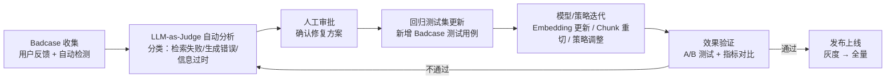

图 6-1 Badcase 闭环管理流程

### 6.6.2 质量运营指标

| 指标            | 目标       | 监控方式          |
| ------------- | -------- | ------------- |
| Top-5 命中率     | 日均 ≥ 85% | Grafana 仪表盘   |
| Badcase 月度下降率 | ≥ 30%    | 月度质量报告        |
| 检索 P95 延迟     | ≤ 300ms  | Prometheus 告警 |
| 首字延迟（SSE）     | ≤ 800ms  | Prometheus 告警 |
| 缓存命中率         | ≥ 60%    | DCS 监控        |
| DeepEval 评测得分 | ≥ 0.85   | 自动化评测流水线      |

## 6.7 关键技术选型汇总

| 组件           | 选型                           | 理由                             |
| ------------ | ---------------------------- | ------------------------------ |
| Embedding 模型 | Jina-Code-Embeddings-0.5B    | 代码+文本混合场景最优，Hit Rate 90%       |
| Reranker     | Jina-Reranker-v3             | 精排效果好，延迟为 CoREB-Reranker 的 1/7 |
| 向量数据库        | CSS（Elasticsearch kNN）       | 与华为云深度集成，免运维                   |
| 图数据库         | GES                          | 华为云托管图引擎，兼容 openCypher         |
| 关系数据库        | RDS for PostgreSQL           | 成熟稳定，支持 RLS 行级安全               |
| 消息队列         | Kafka / 华为消息队列               | 入库异步解耦，支持幂等与重试                 |
| LLM          | 通义千问（主）/ Claude（代码）/ GPT（推理） | 多 Provider 路由，避免单点锁定           |
| 代码检索引擎       | CBM + codegraph 联合部署         | 158 语言 AST 解析 + 芯片 KB 原生支持     |
| MCP 框架       | Anthropic MCP SDK            | 标准化 Agent 集成协议                 |

## 6.8 版本管理与双态发布

### 6.8.1 双态分离设计理念

双态分离是版本管理的核心设计理念：

- **SDT 开发态**：承载内部研发的所有"过程产物"——素材、初稿、调试中的版本、未脱敏的内部 API
- **Hisparks 发布态**：只承载"对外成熟能力"——经过审核、打标签、灰度验证的稳定版本

两态物理/逻辑隔离，确保内部研发数据绝不外泄。SDT 与 Hisparks 之间唯一的桥梁是审核员人工签字触发的"稳定后同步"动作。

**双态分离架构总览**：

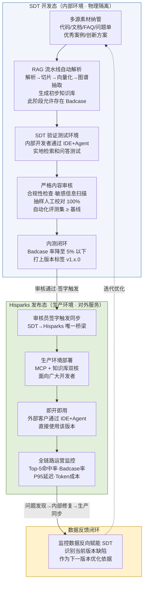

图 6-2 SDT/Hisparks 双态分离架构总览

### 6.8.2 四步标准化发布流水线

发布流程严格经历四个标准化阶段，每个阶段有明确的入口条件、关键动作与门禁规则：

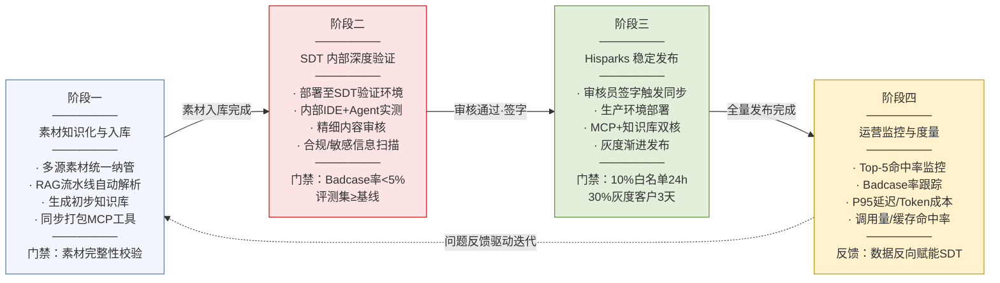

图 6-3 四步标准化发布流水线

### 6.8.3 灰度发布与紧急回滚机制

为降低新版本上线风险，采用灰度渐进发布策略；同时为应对极端异常，提供 5 分钟级紧急回滚能力。

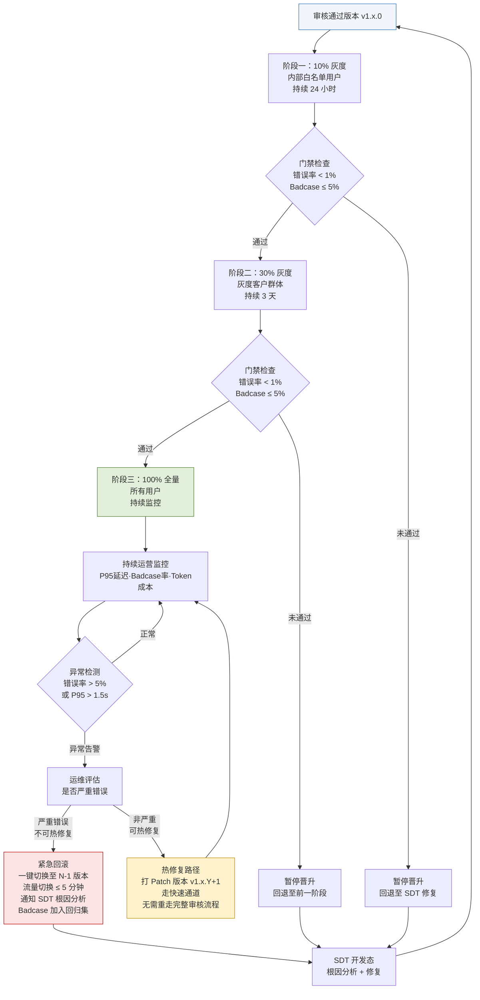

图 6-4 灰度发布与紧急回滚决策流程

### 6.8.4 核心运营监控指标

| 指标类别 | 指标名          | 采集来源                | 告警阈值        |
| ---- | ------------ | ------------------- | ----------- |
| 检索质量 | Top-5 命中率    | DeepEval 评测         | 日均值 < 85%   |
| 检索质量 | Badcase 率    | 用户反馈 + LLM-as-Judge | 日均值 > 5%    |
| 性能   | 检索 P95 延迟    | Prometheus          | > 500 ms    |
| 性能   | 首字延迟（SSE）    | Gateway 日志          | > 1500 ms   |
| 成本   | 日均 LLM Token | LLM 网关              | 环比上涨 > 30%  |
| 业务   | 版本调用量        | MCP Server          | 日环比下跌 > 50% |
| 业务   | 缓存命中率        | DCS                 | < 60%       |
| 安全   | 越权尝试次数       | 审计日志                | > 10 次/小时   |

---

# 7 架构原则与扩展性

## 7.1 四条核心原则

本文档遵循以下四条核心设计原则，并在每一章节的设计决策中体现：

| 原则   | 内涵                        | 在本架构中的体现                                                  |
| ---- | ------------------------- | --------------------------------------------------------- |
| 针对性  | 面向海思芯片开发场景，识别真正高价值的差异化能力  | 硬件专有信息抽取层、代码-文档双向映射、多 Agent 集成、多芯片共存                      |
| 扩展性  | 新需求/新格式/新模型/新 Agent 接入零侵入 | 解析器插件机制、模型 Provider 抽象层、Agent 适配器接口、元数据驱动扩展               |
| 高可用  | 检索服务零中断、索引重建不停机、灰度可回滚     | 读写分离、增量重建 + 蓝绿切换、Staging→Canary→Prod 灰度、5 分钟紧急回滚          |
| 安全合规 | 权限可粒度化、操作可审计、敏感数据可隔离      | RBAC + ABAC + ACL 三级权限、PostgreSQL RLS 行级安全、审计日志哈希链 ≥180 天 |

## 7.2 扩展性设计

| 扩展场景             | 方式                                         | 工作量    |
| ---------------- | ------------------------------------------ | ------ |
| 新增文档格式           | 实现 IParser 接口 + 注册 + 单测                    | ≤ 1 人周 |
| 新增 Coding Agent  | 实现 IAgentAdapter 接口                        | ≤ 1 人周 |
| 新增芯片型号           | chips/*.chip.yaml 新增配置，无需改代码               | 即时     |
| 切换 Embedding/LLM | Provider 抽象层配置切换                           | 即时     |
| 存储水平扩展           | CSS 索引分片、GES 按芯片型号分库、RDS 读写分离 + Citus 水平分库 | 运维操作   |

---

# 8 网络安全设计

## 8.1 五区安全模型

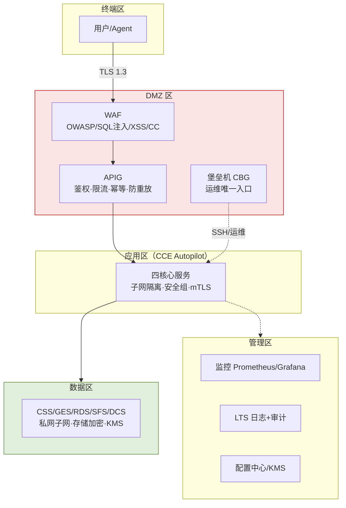

图 8-1 五区安全模型与网络拓扑

## 8.2 分区与边界防护

| 分区    | 组件                   | 边界防护                                                            |
| ----- | -------------------- | --------------------------------------------------------------- |
| 终端区   | 用户浏览器 / Coding Agent | TLS 1.3 接入；Agent 持 Token/APIKey                                 |
| DMZ 区 | WAF、APIG、堡垒机 CBG     | WAF 防 OWASP Top10/SQL 注入/XSS/CC；APIG 统一鉴权、限流、幂等防重放；堡垒机 SSH 录屏审计 |
| 应用区   | CCE Autopilot 四核心服务  | VPC 私有子网；安全组白名单（仅允许 APIG 入站、仅允许出站到数据区）；服务间 mTLS；命名空间隔离          |
| 数据区   | CSS/GES/RDS/SFS/DCS  | 无公网 EIP；仅应用区安全组可访问；存储加密 + KMS 托管密钥                              |
| 管理区   | 监控、LTS、配置中心、KMS      | 独立子网；仅堡垒机可达；审计日志哈希链不可篡改，保留 ≥180 天                               |

## 8.3 传输与存储安全

| 维度   | 措施                                              |
| ---- | ----------------------------------------------- |
| 传输加密 | 外部（终端↔DMZ）TLS 1.3；服务间（CCE 内）mTLS 双向认证           |
| 存储加密 | RDS TDE 透明加密；SFS 文件加密；DCS 缓存加密；全量密钥托管于 KMS，支持轮换 |
| 密钥管理 | 华为云 KMS 统一管理，应用通过 IAM 临时凭证访问，密钥不明文落地            |
| 数据脱敏 | 敏感字段入库前脱敏；查询返回时按用户 clearance 动态脱敏               |

## 8.4 身份与访问控制

- **RBAC**：角色→权限码（kb:doc:read / kb:doc:search / sys:audit 等），决定"能做什么操作"
- **ABAC**：属性条件策略（WHEN-THEN），如"机密文档仅正式员工可见""部门隔离""地域限制"
- **ACL**：资源级（文档/类别）显式授权或黑名单，可继承可阻断
- **判定优先级**：ACL 显式 DENY > ABAC DENY > ACL 显式 ALLOW > ABAC ALLOW > RBAC 默认
- **SSO**：OIDC Client 对接多 IdP（公司 SSO / 合作伙伴 IdP / 本地账号），首次接入需管理员授权
- **行级安全**：PostgreSQL RLS 实现多租户与芯片系列（chip_model 标签）隔离

## 8.5 审计与合规

- **全链路日志**：所有请求经 APIG → 后端 → 数据区全程埋点，写入 LTS
- **审计日志**：敏感操作记录操作者/时间/对象/前后值/来源 IP；追加写 + 哈希链，不可篡改，保留 ≥180 天
- **安全告警**：越权尝试 >10 次/小时、敏感词拒答、异常大批量导出触发告警
- **纯私有云**：无公网暴露，用户与 Agent 经专线/VPN 接入 DMZ
- **Air-gapped 可选**：敏感芯片资料可物理隔离部署（离线镜像）
- **敏感词拒答**：敏感词库按需录入，命中拒答并审计

## 8.6 公共组件安全配置

| 组件                 | 安全配置要点                         |
| ------------------ | ------------------------------ |
| PostgreSQL（RDS）    | TDE 加密、RLS 策略、最小权限账户、连接 SSL 强制 |
| Elasticsearch（CSS） | 索引级访问控制、HTTPS 强制、匿名访问禁止        |
| GES 图引擎            | VPC 内网访问、Cypher 注入防护、角色权限隔离    |
| Redis（DCS）         | 密码认证、TLS 传输加密、RENAME 危险命令      |
| API 网关（APIG）       | OAuth2/APIKey 双认证、请求签名校验、防重放   |
| 容器（CCE）            | 非 root 运行、只读根文件系统、安全上下文约束      |

---

# 9 部署与运维设计

## 9.1 设计目标与部署原则

基于华为云 CCE Autopilot，遵循"无状态服务可弹性、状态服务外置、在线服务与批处理分离、GPU/CPU 资源独立调度"四条原则。

## 9.2 CCE Autopilot 工作负载拆分

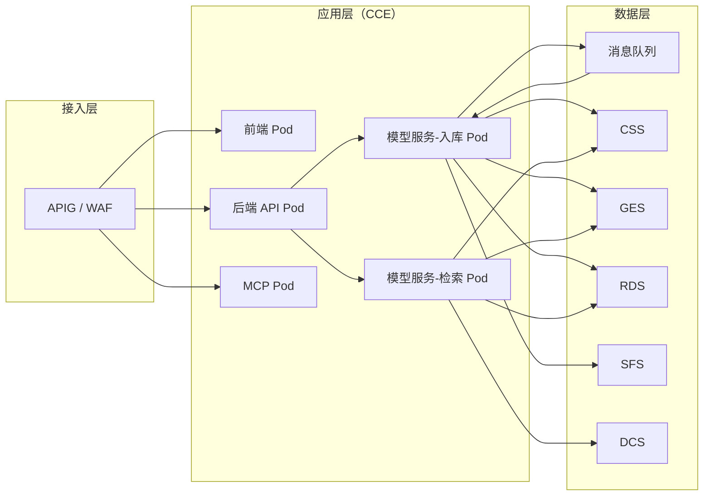

图 9-1 CCE Autopilot 工作负载拆分

| Pod/工作负载    | 部署内容                      | 典型资源特征         | 伸缩方式                       |
| ----------- | ------------------------- | -------------- | -------------------------- |
| 前端页面 Pod    | Web UI / 微前端静态资源          | CPU 低，内存中等     | HPA 按 CPU/RPS 扩缩           |
| 后端 API Pod  | REST API、检索编排、权限校验、版本管理   | CPU 中等，内存中等    | HPA 按 QPS、P95 延迟扩缩         |
| MCP Pod     | Agent 适配、MCP 工具暴露、长连接适配   | CPU 中等，网络高     | HPA 按活跃连接数扩缩               |
| 模型服务-入库 Pod | 解析器、切片、清洗、Embedding、图谱抽取  | CPU 密集，内存高     | KEDA/HPA 按队列长度扩缩           |
| 模型服务-检索 Pod | 向量/图谱召回、Reranker、LLM 生成网关 | GPU/CPU 混合，低延迟 | HPA 按 QPS、P95 延迟、GPU 利用率扩缩 |

## 9.3 默认副本策略

| 组件          | 默认最小副本 | 默认最大副本 | 触发指标                   |
| ----------- | ------ | ------ | ---------------------- |
| 前端页面 Pod    | 2      | 6      | CPU / RPS              |
| 后端 API Pod  | 2      | 8      | QPS / P95 延迟 / CPU     |
| MCP Pod     | 2      | 6      | 活跃连接数 / CPU            |
| 模型服务-入库 Pod | 2      | 12     | 队列长度 / 任务积压            |
| 模型服务-检索 Pod | 2      | 8      | QPS / P95 延迟 / GPU 利用率 |

## 9.4 弹性伸缩策略

### 在线问答高峰场景

- 检索 Pod 先按 HPA 扩容，优先扩容 GPU 推理副本与 Reranker 实例
- 后端 API Pod 同步扩容，防止网关排队
- DCS 热点缓存命中率不足时，增加缓存预热

### 大批量知识入库场景

- 入库 Pod 按消息队列长度、积压任务数和消费延迟扩容
- 超大文件拆分成多个子任务并发执行
- 低峰期按调度策略减少入库 Pod 数量

### Agent / MCP 高并发场景

- MCP Pod 按活跃连接数和 CPU 使用率扩缩
- 通用能力下沉到后端服务，MCP 保持轻量适配层

### 索引重建 / 模型升级场景

- 先创建新版本入库/检索 Pod，后台构建新索引；旧版本仍保持可用
- 通过别名切换、灰度流量和滚动发布实现零中断切换

## 9.5 索引重建（F-063）

- **增量重建**：单条增删改触发，秒级，在线检索无影响
- **全量重建**：嵌入模型切换/大版本升级时，采用蓝绿策略——新索引后台并行构建，原子切换别名，检索零中断

## 9.6 运行时部署细节

- **资源配置**：前端/后端/MCP 采用通用 CPU 节点池（2-4 vCPU / 4-8GiB）；入库 Pod 采用 CPU 节点池（8-16 vCPU / 16-32GiB）；检索 Pod 采用 GPU 节点池（1-2 卡/Pod）
- **健康检查**：Liveness / Readiness 分别配置；检索 Pod 需同时监控端口、模型服务健康、外部依赖（CSS/GES）连通性
- **滚动发布**：后端、MCP、前端滚动发布；检索/入库 Pod 灰度发布
- **故障降级**：CSS/GES 短时抖动，后端与模型服务自动进入降级模式，优先返回关键词检索或缓存结果；GPU 节点不可用，切换到降级推理/缓存命中模式

---

# 10 风险与对策

| 风险                                  | 影响          | 概率  | 对策                                                    |
| ----------------------------------- | ----------- | --- | ----------------------------------------------------- |
| 公开数据手册 PDF 表格解析准确率不足                | 寄存器/Pin 表错漏 | 中   | 多引擎融合（pdfplumber + CV 表格识别 + 规则模板），人工抽检 + Badcase 闭环  |
| 文档↔代码链接噪声（同义符号、重载）                  | 召回不准        | 中   | 链接以"确切函数签名/寄存器地址/限定名"为强信号，弱匹配降权；FTS 排序                |
| 云端 LLM 依赖导致延迟/不可用                   | 检索中断        | 低   | 多 Provider 路由；高频查询结果缓存；本地 vLLM 兜底；降级为关键词检索+摘要         |
| 知识库版本与 SDK 版本错位                     | 返回过期 API    | 中   | 双时态模型（valid_from / valid_to），按用户指定的 SDK 版本过滤          |
| 入库批量任务冲击在线检索                        | P95 延迟飙升    | 中   | 入库/检索子池物理隔离（CPU/GPU 分池）；消息队列背压控制；蓝绿索引切换               |
| 多语言 Sample 工程混合（C + Python + Shell） | 跨语言调用链断裂    | 低   | 优先打通 C 主链路；Python/Sh 调用 C 的边界用约定（subprocess/ctypes）建边 |
| 代码检索引擎性能衰减                          | 大规模仓库检索变慢   | 低   | CBM 极速索引（2800 万行/3 分钟）；增量索引；热点仓库预加载                   |

---

# 11 差异说明与改动清单

## 11.1 与原 V1.3 版差异

| #   | 变更                        | 原因                     |
| --- | ------------------------- | ---------------------- |
| 1   | 补入 WAF 于 DMZ              | 原图无 Web 边界防护（缺口②）      |
| 2   | 补入 CSS（向量+全文）、GES（图）      | 原图缺这两类核心存储             |
| 3   | 画出四核心模块间调用方向、同步/异步、数据流    | 原图模块关联缺失（缺口①）          |
| 4   | 补三条关键链路时序（检索/入库/Agent）    | 让关联关系可执行级可读            |
| 5   | 四模块各拆子功能 + 接口 + 对接        | 原图模块内功能不清晰（缺口③）        |
| 6   | 安全分区/传输存储加密/身份访问/审计/私有云合规 | 原图无网络安全设计（缺口②）         |
| 7   | 章节重组为"总→分→横切"结构           | 按完善版逻辑，先总后分再横切，更符合阅读认知 |

## 11.2 可执行改动清单

### 文档层面

- 将总体架构图、模块关联图、时序图统一为后端→模型服务→CSS/GES 的路径；避免任何文档中出现后端直接调用 CSS/GES 的表述
- 在架构说明中补充"模型服务内部包含入库子池与在线检索子池"的分层描述

### 配置层面

- 在 CCE Autopilot 部署模板中定义两个模型服务工作负载：`model-service-ingest` 和 `model-service-retrieval`
- 为入库子池配置异步队列消费者、独立 CPU 节点池；为在线检索子池配置低延迟 GPU 节点池
- 在 APIG/RBAC 策略中增加"后端仅调用模型服务入口"的访问控制规则
- 为消息队列配置"入库任务主题"和"索引切换主题"

### 部署层面

- 先上线模型服务内部拆分方案，保持现有外部调用接口不变
- 针对 Embedding 切换和 CSS 索引重建，部署蓝绿切换机制
- 为在线检索配置 DCS 缓存层，并部署热点缓存与缓存键策略
- 增加可观测项：入库队列长度、任务处理时长、GPU 利用率、检索 P95、缓存命中率、失败率

> 本文档不替换 V1.3，只补全其总体架构的三处缺口并重组章节结构。V1.3 第 4/5/6/8/9/10/12/16 章的细项设计仍以原版为准。

---

# 12 参考资料

1. 海思知识库需求说明 V0.3——需求基线文档
2. 海思知识库架构设计 V1.3（旧模版）——原始架构设计文档（16 章 + 附录 A/B/C）
3. 海思知识库架构设计-完善版——V1.3 三处缺口补全
4. 海思知识库关键技术选型设计——CBM + codegraph 代码检索引擎选型论证
5. 海思知识库数据库设计文档——五库 DDL 与跨库一致性设计
6. 海思知识库——文档解析、分块与向量化接入方案——六阶段入库流水线
7. 海思知识库架构设计 - 权限与安全设计——RBAC+ABAC+ACL 三层模型详细设计
8. 海思知识库架构设计 - 部署与运维设计——华为云部署详细方案
9. 文本与代码混合检索模型选型报告——Embedding/Reranker 42 种组合实证
10. Dify 的优劣势分析及法本方案对比——竞品分析参考
11. 法本架构核心优势总结——差异化优势提炼
12. Anthropic MCP 协议规范——MCP Specification
13. 华为云 CCE Autopilot / CSS / GES / RDS / DCS / SFS / LTS 产品文档
