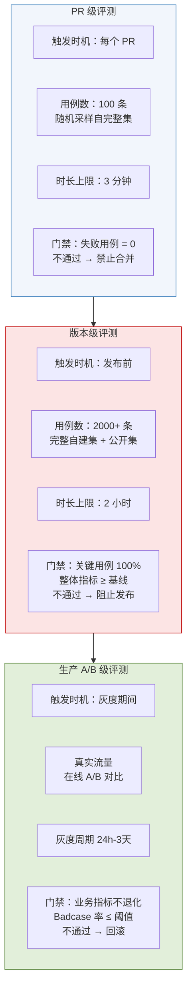
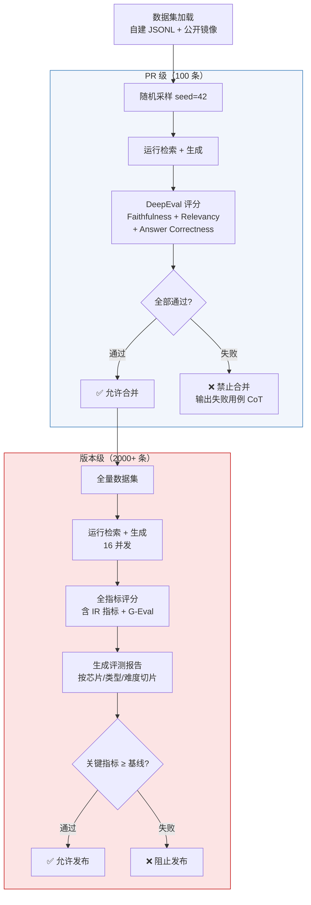

| 产品名称 | 密级 |
| --- | --- |
| 海思芯片知识库——测评设计 | 内部资料 |
| 产品版本 | 共 XX 页 |
| V1.0（8.9 版本） |   |

海思知识库 测评设计说明书

| Prepared by<br>拟制 | 架构组 | Date<br>日期 | 2026-08-09 |
| --- | --- | --- | --- |
| Reviewed by<br>审核 |   | Date<br>日期 |   |
| Approved by<br>批准 |   | Date<br>日期 |   |

Huawei Technologies Co., Ltd.

华为技术有限公司

All rights reserved

版权所有  侵权必究

Revision record 修订记录

| Date<br>日期 | Revision Version<br>修订版本 | Revision<br>Chapter<br>修订章节 | Change Description<br>修改描述 | Author<br>作者 |
| --- | --- | --- | --- | --- |
| 2026-07-23 | V0.1 | 全部 | 初稿，整合公开数据集选型、自建数据集、多维指标、DeepEval 集成方案 | 架构组 |
| 2026-07-27 | V0.2 | §7.7 | 新增自建数据集分类体系 A-L 十二类，合计 2200 题 | 架构组 |
| 2026-08-09 | V1.0 | 全部 | 按软件设计说明书模板重组，新增 Mermaid 架构图 | 架构组 |

Keywords 关键词：测评体系、DeepEval、LLM-as-judge、G-Eval、Hit Rate、Recall@K、MRR、Faithfulness、公开数据集、自建数据集、评测流水线、CI 集成

Abstract 摘要：本文档是海思芯片知识库的测评设计说明书，基于 DeepEval 框架定义了一套多层次、多维度、多源数据的自动化测评体系。覆盖三层评测架构（PR 级/版本级/生产 A/B 级）、五类指标体系（检索/生成/端到端/业务/安全）、公开数据集选型（BEIR/MTEB/CoIR 等 12 个）、自建数据集分类体系（A-L 十二类 2200 题）、Python 工程实现、CI 集成方案、行业水平评估方法论与成本优化策略。

List of abbreviations 缩略语清单：

| 缩略语 | 英文全名 | 中文解释 |
| --- | --- | --- |
| MRR | Mean Reciprocal Rank | 平均倒数排名 |
| NDCG | Normalized Discounted Cumulative Gain | 归一化折损累计增益 |
| MAP | Mean Average Precision | 平均精度均值 |
| CoT | Chain-of-Thoughts | 思维链 |
| DLQ | Dead Letter Queue | 死信队列 |
| CI | Continuous Integration | 持续集成 |
| MTEB | Massive Text Embedding Benchmark | 大规模文本嵌入基准 |
| BEIR | Benchmarking IR | 信息检索基准 |

# 1 概述

## 1.1 目的

本文档是《海思芯片知识库架构设计》§15.4 的配套落地文档，回答"如何客观、可重复、可量化地评估海思知识库的检索与生成质量，并定位其在行业中的水平"。具体目标：

1. **可执行**：提供完整的目录结构、Python 代码、pytest 用例，团队拿到即可运行
2. **可对比**：通过公开数据集建立行业基线，量化海思知识库的相对位置
3. **可演进**：评测体系本身版本化，每次发布前后触发，回归不通过自动驳回
4. **可解释**：评测结果附带 LLM-as-judge 的 CoT 推理过程，便于定位失败用例

## 1.2 范围

本文档覆盖测评体系的完整设计：

- 三层评测架构与触发门禁规则
- 五类指标体系（检索/生成/端到端/业务/安全）及 Python 实现
- DeepEval 框架集成与 G-Eval 自定义指标
- 公开数据集选型（12 个数据集）与行业对比方法
- 自建数据集分类体系（A-L 十二类，2200 题）与标注规范
- 评测流水线工程实现与 CI 集成
- 行业水平评估方法论与成本优化策略

## 1.3 适用读者

- 算法工程师：理解指标定义、运行评测、定位模型短板
- 后端开发：理解目录结构、CI 集成、自定义指标开发
- 架构师/技术负责人：评审评测体系完整性、行业对比方法论
- 产品与业务方：理解"行业水平"结论的依据与边界

## 1.4 设计原则

| 原则 | 内涵 | 落地体现 |
| --- | --- | --- |
| 多层次 | PR 级、版本级、生产 A/B 级三层评测 | §3 测评触发 |
| 多维度 | 检索 + 生成 + 业务 + 安全四类指标 | §4 指标体系 |
| 多源数据 | 公开数据集（行业对比）+ 自建数据集（场景验证） | §5/§6 |
| 可重复 | 评测代码、随机种子、模型版本全部固定 | §7 工程实现 |
| 可解释 | LLM-as-judge 附 CoT，失败用例可追溯 | §4.4 G-Eval |
| 自动化 | pytest + CI 集成，无需人工触发 | §7.6 CI 集成 |

## 1.5 与其他文档的关系

| 文档 | 关系 |
| --- | --- |
| 架构设计 §15.4 自动 RAG 评测系统 | 本文档的来源与理论基础 |
| 架构设计 §16 模型选型实证 | HDMI 60 条测试集是自建数据集的起点 |
| 《检索设计文档》 | 被测对象之一（检索路径） |
| 《数据库设计文档》 | 被测对象之一（跨库查询） |

## 1.6 术语定义

| 术语 | 说明 |
| --- | --- |
| DeepEval | Confident AI 开源的 LLM 评估框架，pytest 风格 API |
| G-Eval | DeepEval 的自定义指标框架，用自然语言定义评估标准 |
| Gold Answer | 人工标注的标准答案 |
| Gold Chunk | 人工标注的应当被检索到的 Chunk ID 列表 |
| Hit Rate | 检索结果中至少命中一个 Gold Chunk 的比例 |
| Faithfulness | 生成回答是否忠实于检索上下文（反幻觉） |

# 2 模块简介（架构设计）

## 2.1 模块概述

本模块为海思知识库的质量评测子系统，负责对"检索 + 生成"端到端流水线进行自动化、可重复、可量化的质量评估。基于 DeepEval 框架，采用 pytest 风格 API，集成到 CI 流水线中，实现每次 PR 和版本发布的自动评测门禁。

## 2.2 总体结构——三层测评架构



图 2-1 三层测评架构与门禁规则

## 2.3 设计约束

- 评测框架：DeepEval（Confident AI 开源，pytest 风格）
- LLM-as-judge 模型：通义千问 Qwen-Plus（主要）/ 本地 Qwen2.5-7B（公开数据集降本）
- 被测对象：海思知识库"检索 + 生成"端到端流水线
- 编程语言：Python 3.10+

# 3 模块需求分析

## 3.1 核心目标

| 目标类别 | 目标项 |
| --- | --- |
| 检索精度 | Top-5 Hit Rate ≥ 90%（自建开发者评测集） |
| 检索精度 | Recall@10 ≥ 85%（公开数据集对比基线） |
| 生成质量 | Faithfulness ≥ 0.85（无幻觉） |
| 生成质量 | Answer Relevancy ≥ 0.80 |
| 性能 | 评测 PR 级子集（100 条）≤ 3 分钟 |
| 性能 | 评测完整集（数千条）≤ 2 小时 |
| 成本 | 单次完整评测 LLM Token 成本 ≤ ¥100 |
| 行业定位 | MTEB/C-MTEB 子任务排名 ≥ 前 30% |

## 3.2 关键技术挑战

| 挑战 | 难点 | 本文应对 |
| --- | --- | --- |
| 代码-文本混合场景缺标准 | 公开数据集多为纯文本或纯代码 | §5 CoIR + §6 自建 HDMI 集 |
| 中文芯片领域无公开数据 | 海思场景过于专业 | §6 自建数据集 12 类 2200 题 |
| LLM-as-judge 不稳定 | 同一用例多次评分可能不同 | §4.5 评分稳定性策略 |
| 评测成本高 | 数千条用例调用 LLM 成本高 | §8 成本优化 |
| 多芯片共存评测 | 不同芯片知识需隔离评测 | §6.7 多芯片数据集 |

# 4 模块概要设计

## 4.1 DeepEval 框架选型

| 候选框架 | 选/不选 | 理由 |
| --- | --- | --- |
| DeepEval | ✅ 主选 | pytest 风格、50+ 内置指标、G-Eval 自定义、CI 友好、社区活跃 |
| RAGAS | 备选 | 专攻 RAG，但自定义指标能力弱于 G-Eval |
| TruLens | 不选 | 偏交互式 Notebook，CI 集成不便 |
| LangChain Evals | 不选 | 与 LangChain 耦合 |
| 自研 | 不选 | 重复造轮子，DeepEval 已覆盖 90% 需求 |

## 4.2 指标体系全景

| 类别 | 指标 | 来源 | 评测对象 |
| --- | --- | --- | --- |
| 检索 | Hit Rate / Recall@K / Precision@K / MRR / NDCG@K | 自实现 | 检索召回阶段 |
| 检索 | Contextual Precision / Recall / Relevancy | DeepEval 内置 | 检索召回阶段 |
| 生成 | Faithfulness / Answer Relevancy | DeepEval 内置 | 生成阶段 |
| 端到端 | Answer Correctness / Code Accuracy / Hardware Factuality | DeepEval G-Eval | 端到端 |
| 业务 | Latency P50/P95/P99 / Token Cost / Cache Hit Rate | Prometheus/日志 | 全链路 |
| 安全 | 越权通过率 / 敏感信息泄露 / Prompt 注入成功率 | 自实现 + G-Eval | 全链路 |

## 4.3 公开数据集选型

| 数据集 | 类别 | 规模 | 海思用法 |
| --- | --- | --- | --- |
| BEIR-SCIFACT | 通用 IR | 5K | 科技论文场景基线 |
| BEIR-NFCorpus | 通用 IR | 4K | 医学专业场景基线 |
| MTEB-CodeSearchNet | 嵌入评估 | 100K | 代码嵌入质量验证 |
| C-MTEB-DuRetrieval | 中文嵌入 | 90K | 中文嵌入验证 |
| MS MARCO | 开放域 QA | 1M | 通用检索基线（抽 1000 条） |
| HotpotQA | 多跳推理 | 113K | 多跳检索验证 |
| CoIR-CodeSearchNet | 代码检索 | 100K | 代码检索基线 |
| DuReader | 中文 QA | 200K | 中文检索验证（抽 500 条） |

## 4.4 自建数据集分类体系

评测数据集按认知复杂度从低到高划分为十二类，合计 2200 题（V2.0 基线）：

| 类别 | 名称 | 题目数 | 认知层级 | 核心考察能力 |
| --- | --- | --- | --- | --- |
| A | 事实定位题 | 200 | 记忆/定位 | 单 Chunk 事实检索 |
| B | 细粒度定位题 | 200 | 精确定位 | 表单元格/寄存器位域级检索 |
| C | 单文档多跳问题 | 200 | 简单推理 | 同一文档内多事实组合 |
| D | 跨 Chunk 融合 | 200 | 中等推理 | 同文档不同 Chunk 信息融合 |
| E | 跨文件融合问题 | 200 | 中等推理 | 不同文档间信息拼接 |
| F | 跨文件多跳推理 | 200 | 复杂推理 | 跨文档推理链 |
| G | 冲突消解问题 | 200 | 批判性思维 | 矛盾信息识别与裁决 |
| H | 隐式推理问题 | 200 | 深层推理 | 非显性知识的推断 |
| I | 排序/比较/统计 | 200 | 分析综合 | 多对象比较、排序、聚合 |
| J | 图片表格文字融合 | 200 | 多模态推理 | 图文表跨模态融合 |
| K | 代码-文档融合 | 100 | 跨模态推理 | 代码与自然语言文档关联 |
| L | 多芯片融合 | 100 | 跨域推理 | 多芯片型号对比与迁移 |

## 4.5 评测流水线总览



图 4-1 评测流水线总览——从 PR 级到版本级

# 5 模块详细设计

## 5.1 检索指标详细设计

### 5.1.1 Hit Rate@K

定义：前 K 个检索结果中至少命中一个 Gold Chunk 的查询占比。业务意义：实用性的第一门槛。

```python
def hit_rate_at_k(retrieved_ids: list[str], gold_ids: list[str], k: int) -> float:
    return 1.0 if set(retrieved_ids[:k]) & set(gold_ids) else 0.0
```

### 5.1.2 Recall@K

定义：前 K 个结果中召回的 Gold Chunk 占全部 Gold Chunk 的比例。

```python
def recall_at_k(retrieved_ids: list[str], gold_ids: list[str], k: int) -> float:
    if not gold_ids:
        return 0.0
    hits = set(retrieved_ids[:k]) & set(gold_ids)
    return len(hits) / len(gold_ids)
```

### 5.1.3 MRR

定义：第一个 Gold Chunk 排名倒数的均值。反映排序质量。

```python
def reciprocal_rank(retrieved_ids: list[str], gold_ids: list[str]) -> float:
    for i, rid in enumerate(retrieved_ids, start=1):
        if rid in gold_ids:
            return 1.0 / i
    return 0.0
```

### 5.1.4 NDCG@K

定义：考虑相关性等级与位置折扣的归一化指标。当相关性有等级（强相关/弱相关）时，NDCG 比 Recall 更精细。

```python
def dcg_at_k(rels: list[float], k: int) -> float:
    return sum((2 ** rel - 1) / math.log2(i + 2) for i, rel in enumerate(rels[:k]))

def ndcg_at_k(retrieved_rels: list[float], k: int) -> float:
    dcg = dcg_at_k(retrieved_rels, k)
    idcg = dcg_at_k(sorted(retrieved_rels, reverse=True), k)
    return dcg / idcg if idcg > 0 else 0.0
```

## 5.2 DeepEval 内置指标

### 5.2.1 Contextual Precision（上下文精确率）

评估检索结果中相关 Chunk 是否排在前面。LLM-as-judge 对每个 Chunk 二分类（相关/不相关），按排名加权。适用场景：无 Gold Chunk 标注时用 LLM 判断相关性。

### 5.2.2 Faithfulness（忠实度——最重要指标）

生成回答是否忠实于检索上下文，用于检测幻觉。海思场景对幻觉零容忍——错误的寄存器地址可能导致硬件损坏，阈值设为 0.85（高于通用场景）。

### 5.2.3 Answer Relevancy（回答相关性）

从 actual_output 反向生成候选问题，与原 input 计算相似度，阈值 0.7。

## 5.3 G-Eval 自定义指标

海思场景有特殊维度，DeepEval 内置指标无法覆盖，需用 G-Eval 自定义：

**Answer Correctness**：判断实际回答与标准答案在事实层面是否一致。重点关注寄存器地址、引脚号、参数值、命令语法、版本号等关键事实。

**Code Accuracy**：判断代码是否语法正确、API 名称与参数与官方 SDK 一致、能在目标芯片编译运行、与标准答案功能等价。任何编译错误或 API 拼写错误均为 0 分。阈值 0.7。

**Hardware Factuality**：针对硬件类问题，判断每个数值、地址、位域是否与标准答案完全一致。硬件事实错误直接判 0 分，strict_mode=True，阈值 0.9（最高）。

## 5.4 评分稳定性策略

| 策略 | 实现 | 适用场景 |
| --- | --- | --- |
| 多次采样取均值 | N=3 次取算术平均 | 关键指标（Faithfulness） |
| 多次采样取众数 | N=5 次取众数 | 二分类指标（安全） |
| 温度降低 | LLM-as-judge temperature=0 | 所有 LLM 指标 |
| 锚定 CoT | G-Eval 强制 include_reason=True | 所有自定义指标 |
| 双模型交叉验证 | 两个 LLM 各评一次，分歧 > 阈值则人工复核 | 版本级评测 |

## 5.5 自建数据集详细分类

### 5.5.1 A 类：事实定位题（200 题，easy:medium:hard=3:4:3）

答案明确存在于某一 Chunk 中，无需跨 Chunk 组合。考察检索命中率（Hit@5 ≥ 0.95）和排序质量（MRR）。典型用例："CV610 的 I2C0_SCL 引脚复用功能有哪些？"

### 5.5.2 B 类：细粒度定位题（200 题）

答案不是整个 Chunk 的摘要级信息，而是 Chunk 内部某个具体位置的值——表格单元格、寄存器位域、代码常量值。与 A 类区别：A 类只需找到"哪个 Chunk"，B 类还需在 Chunk 内部精确定位。Hit@5 ≥ 0.90。

### 5.5.3 C-F 类：多跳推理递增（C→F，800 题）

- **C 单文档多跳**（200 题，Hit@5 ≥ 0.85）：同文档不同位置信息组合，有逻辑先后顺序
- **D 跨 Chunk 融合**（200 题，Hit@5 ≥ 0.80）：同文档被 Chunk 分割后的并列拼接
- **E 跨文件融合**（200 题，Hit@5 ≥ 0.80）：不同文档信息互补，无复杂推理链
- **F 跨文件多跳**（200 题，Hit@5 ≥ 0.75）：最复杂——跨文档推理链，如"数据手册基地址→参考手册寄存器→驱动代码→写出 init 代码"（3-4 跳）

### 5.5.4 G 类：冲突消解（200 题）

不同文档/版本对同一事实描述矛盾，系统需识别并裁决。冲突类型：版本冲突（以最新版为准）、类型冲突（数据手册>应用笔记>驱动注释）、代码-文档冲突（以实际硬件行为为准）、跨芯片冲突（以目标芯片为准）。

### 5.5.5 H 类：隐式推理（200 题）

答案未在任何 Chunk 中直接陈述，需推断。如"数据手册中为什么没有列出 H.266 支持？"（缺失推断）、"NC 引脚可以不连接吗？"（惯例推断）。不要求 Hit@5，重点评估推理合理性和反幻觉。

### 5.5.6 I 类：排序/比较/统计（200 题）

筛选/排序/比较/统计/组合操作。如"列出 CV610 所有支持 I2C 的引脚，按编号排序"。Recall@10 尤为关键（≥ 0.85）。

### 5.5.7 J 类：图片表格文字融合（200 题）

跨模态信息融合——从框图/时序图（图）+ 寄存器表（表）+ 正文（文）中提取。如"根据时钟树框图和分频寄存器表，描述从 PLL 到 VPU 的完整时钟路径"。

### 5.5.8 K 类：代码-文档融合（100 题专项）

代码与自然语言文档两种模态的信息对齐和一致性验证。直接评测 V1.1 三角关联（code↔register↔document）。专属 G-Eval 指标"Code-Document Consistency"：判断代码与文档的对应关系，文档>代码原则，阈值 0.7。

### 5.5.9 L 类：多芯片融合（100 题专项）

跨芯片型号的差异比较/迁移评估/兼容性判断/趋势分析。直接评测多芯片硬隔离和 Neo4j 芯片间关系边。chip_model 字段设为 "multi"。

## 5.6 数据集演进路线

| 版本 | 规模 | 内容 |
| --- | --- | --- |
| V1.0 | 60 条 | HDMI 基线集（已有） |
| V2.0 | ~2550 条 | A-J 各 200 + K/L 各 100 + 芯片扩展 350 + HDMI 60 |
| V3.0 | ~4000 条 | Badcase 反哺 + 新芯片型号扩展 |
| V4.0 | ~6500 条 | 生产流量自动标注 + 半监督扩充 |

## 5.7 分类间最低通过标准

| 类别 | 最低 Hit@5 | 最低 Recall@10 | 最低 Faithfulness |
| --- | --- | --- | --- |
| A 事实定位 | 0.95 | — | 0.90 |
| B 细粒度定位 | 0.90 | — | 0.90 |
| C 单文档多跳 | 0.85 | 0.80 | 0.85 |
| D 跨 Chunk 融合 | 0.80 | 0.80 | 0.85 |
| E 跨文件融合 | 0.80 | 0.75 | 0.80 |
| F 跨文件多跳 | 0.75 | 0.70 | 0.80 |
| G 冲突消解 | 0.85 | 0.80 | 0.85 |
| H 隐式推理 | — | 0.75 | 0.80 |
| I 排序/比较/统计 | 0.80 | 0.85 | 0.85 |
| J 图文表融合 | 0.75 | 0.75 | 0.80 |
| K 代码-文档融合 | 0.80 | 0.80 | 0.85 |
| L 多芯片融合 | 0.80 | 0.80 | 0.85 |

## 5.8 评测工程实现

### 5.8.1 目录结构

```
datasets/                     ← 数据集仓库（版本化）
  ├── public/                 ← 公开数据集镜像
  └── hisi/                   ← 自建数据集（v1.0_hdmi_60.jsonl 等）

tests/                        ← pytest 测试文件
  ├── conftest.py             ← 全局 fixture（kb_client, 指标实例）
  ├── fixtures/loaders.py     ← 数据集加载器
  ├── metrics/
  │   ├── ir_metrics.py       ← Hit Rate / MRR / NDCG 自实现
  │   └── hisi_geval.py       ← 海思专属 G-Eval 指标
  ├── test_pr_smoke.py        ← PR 级 100 条
  ├── test_release_full.py    ← 版本级全量
  ├── test_public_beir.py     ← 公开 BEIR
  └── test_security.py        ← 安全测试
```

### 5.8.2 全局 Fixture（conftest.py）

```python
@pytest.fixture(scope="session")
def kb_client():
    return HisiKnowledgeBaseClient(
        base_url=os.getenv("HISI_KB_URL", "http://localhost:8080"),
        api_key=os.getenv("HISI_KB_API_KEY"),
    )

@pytest.fixture(scope="session")
def faithfulness_metric():
    return FaithfulnessMetric(threshold=0.7)

@pytest.fixture(scope="session")
def relevancy_metric():
    return AnswerRelevancyMetric(threshold=0.7)
```

### 5.8.3 参数化测试模板

```python
@pytest.mark.parametrize("case", load_hisi_dataset("v2.0"))
def test_hisi_rag(case, kb_client, faithfulness_metric, relevancy_metric):
    result = kb_client.search(query=case["query"], chip_model=case["chip_model"])
    test_case = LLMTestCase(
        input=case["query"],
        actual_output=result.generated_answer,
        expected_output=case["gold_answer"],
        retrieval_context=[c["content"] for c in result.chunks],
    )
    assert_test(test_case, [faithfulness_metric, relevancy_metric])
```

### 5.8.4 CI 集成

PR 触发：`deepeval test run tests/test_pr_smoke.py`（100 条，≤3 分钟，失败用例=0）。版本发布触发：`deepeval test run tests/test_release_full.py`（全量，≤2 小时，关键指标≥基线）。

### 5.8.5 测试用例 Schema

```json
{
  "case_id": "fact-001",
  "query": "CV610 芯片的 NPU 算力是多少 TOPS？",
  "query_type": "text",
  "chip_model": "CV610",
  "gold_answer": "CV610 内置 NPU 的 INT8 算力为 2.0 TOPS。",
  "gold_chunk_ids": ["0192a8e1-..."],
  "strong_chunk_ids": ["0192a8e1-..."],
  "weak_chunk_ids": [],
  "difficulty": "easy",
  "category": "A",
  "tags": ["npu", "spec", "cv610"]
}
```

# 6 非功能设计

## 6.1 行业水平评估

"行业水平"是多维定位而非单一数字。四步方法论：选取对比维度 → 每个维度选 1-2 个公开数据集作为"测距尺" → 海思知识库在公开数据集上跑评测 → 对比公开 Leaderboard 定位百分位。

| 维度 | 公开数据集 | 海思目标 |
| --- | --- | --- |
| 通用文本检索 | BEIR-SCIFACT | 前 40% |
| 代码检索 | CoIR-CodeSearchNet | 前 30%（必须） |
| 中文检索 | C-MTEB-DuRetrieval | 前 50% |
| 开放域 QA | MS MARCO 子集 | 前 50% |
| 多跳推理 | HotpotQA 子集 | 前 60% |
| 端到端 RAG | 自建 HDMI 集 | Recall@10 ≥ 84.86% |

**评估边界**：公开数据集得分≠真实业务表现；自建数据集得分保密不外发；不允许用评测集训练模型；LLM-as-judge 模型不允许是被测 LLM 本身。

## 6.2 性能与成本

| 评测级别 | 用例数 | LLM 调用次数 | Token 总量 | 成本（Qwen-Plus） | 16 并发耗时 |
| --- | --- | --- | --- | --- | --- |
| PR 级 | 100 | 400 | 200K | ¥0.4 | 1 min |
| 版本级 | 2000 | 12000 | 6M | ¥12 | 30 min |
| 全量（含公开） | 5000 | 30000 | 15M | ¥30 | 1.5 h |

**成本优化策略**：缓存 LLM-as-judge 结果（节省 30%）、小模型粗筛+大模型精评（节省 40%）、公开数据集用本地 LLM 评分（节省 50%）、增量评测只对受影响的用例子集（节省 80%）。

## 6.3 可靠性设计

- **结果稳定性**：LLM-as-judge 多次采样（N=3 均值/N=5 众数）、temperature=0
- **评测隔离**：评测用例与训练数据严格隔离、LLM-as-judge 与被测 LLM 分离
- **失败用例定位**：每条失败用例附带 CoT 推理过程，按芯片/类型/难度/类别多维切片分析
- **趋势监控**：每次评测结果入 PG eval_history 表，Grafana 趋势图监控指标是否随版本上升

# 7 List of reference 参考文献清单

1. 海思芯片知识库架构设计——§15.4 自动 RAG 评测系统、§16 模型选型实证
2. 海思知识库检索设计文档——被测对象
3. 海思知识库数据库设计文档——被测对象
4. DeepEval 官方文档——https://deepeval.com/docs
5. BEIR 论文——arXiv:2104.08663
6. MTEB 论文——arXiv:2210.07316
7. CoIR 论文——ACL 2025
8. MS MARCO——https://microsoft.github.io/msmarco/
9. HotpotQA——https://hotpotqa.github.io/
10. DuReader——https://github.com/baidu/DuReader
